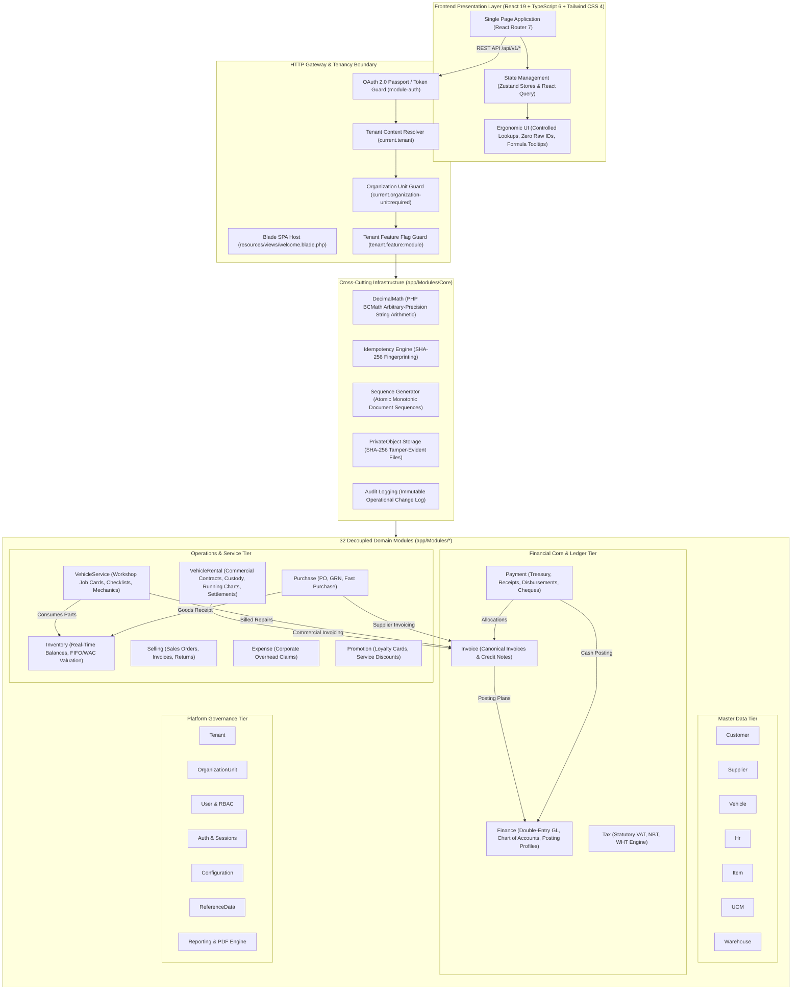
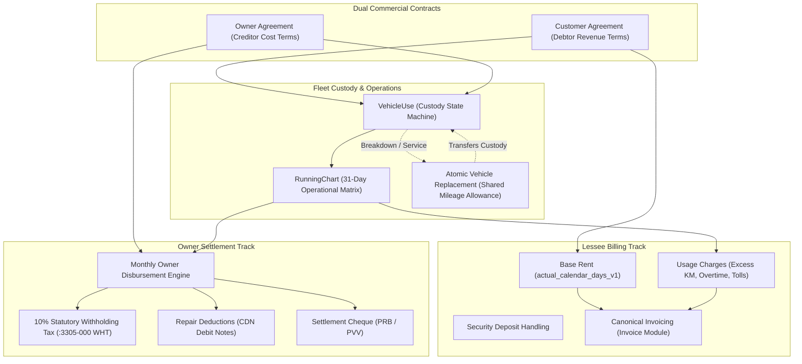
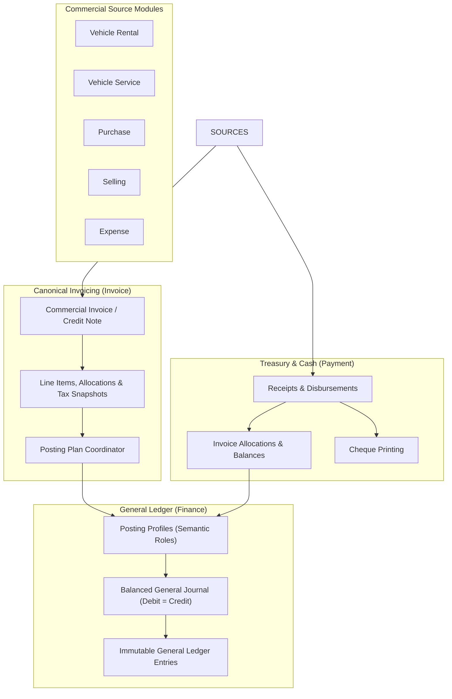

# AutoERP — Enterprise Modular Monolith ERP

- **Author:** Kasun Vimarshana
- **Email:** <kasunvmail@gmail.com>
- **Phone:** +94713525253

[](https://www.php.net/)
[](https://laravel.com/)
[](https://react.dev/)
[](https://www.typescriptlang.org/)
[](https://vitejs.dev/)
[](https://tailwindcss.com/)
[](file:///d:/project-new/AutoERP/tests)
[](file:///d:/project-new/AutoERP/database/migrations)

> AutoERP is a mission-critical, multi-tenant enterprise resource planning platform engineered as a clean **Modular Monolith**. It unifies dual-plane multi-tenancy, commercial vehicle fleet leasing and operations, automotive workshop repair jobs, supply chain procurement, inventory warehousing with FIFO/WAC valuation, canonical commercial invoicing, cash treasury management, double-entry general ledger accounting, statutory taxation, and executive business reporting.

---

## Table of Contents

- [1. Executive System Overview](#1-executive-system-overview)
- [2. The 12 Core Engineering Axioms](#2-the-12-core-engineering-axioms)
- [3. System Architecture & High-Level Design](#3-system-architecture--high-level-design)
- [4. Technology Stack & System Requirements](#4-technology-stack--system-requirements)
- [5. Repository Layout & Module Directory Map](#5-repository-layout--module-directory-map)
- [6. Installation & Developer Quick Start](#6-installation--developer-quick-start)
  - [6.1 Prerequisites](#61-prerequisites)
  - [6.2 Automated Quick Start](#62-automated-quick-start)
  - [6.3 Step-by-Step Manual Setup](#63-step-by-step-manual-setup)
  - [6.4 Local Development Workflow (`composer dev`)](#64-local-development-workflow-composer-dev)
  - [6.5 Environment Configuration (`.env`)](#65-environment-configuration-env)
- [7. Complete Domain Module Catalog (32 Modules)](#7-complete-domain-module-catalog-32-modules)
- [8. Database Architecture & Schema Governance](#8-database-architecture--schema-governance)
  - [8.1 The Single-Table Baseline Migration Principle](#81-the-single-table-baseline-migration-principle)
  - [8.2 Key Naming & Integrity Standards](#82-key-naming--integrity-standards)
  - [8.3 Immutable Status Histories & Evidence Retention](#83-immutable-status-histories--evidence-retention)
  - [8.4 Database Seeder Hierarchy](#84-database-seeder-hierarchy)
- [9. Multi-Tenancy, Security & Cross-Cutting Foundations](#9-multi-tenancy-security--cross-cutting-foundations)
  - [9.1 Dual-Plane Multi-Tenancy Architecture](#91-dual-plane-multi-tenancy-architecture)
  - [9.2 Authentication, OAuth 2.0 & Role-Based Access Control](#92-authentication-oauth-20--role-based-access-control)
  - [9.3 Request Idempotency Engine](#93-request-idempotency-engine)
  - [9.4 Atomic Sequence Generation](#94-atomic-sequence-generation)
  - [9.5 Tamper-Evident Private Storage](#95-tamper-evident-private-storage)
- [10. Core Business Workflows & Architectural Deep Dives](#10-core-business-workflows--architectural-deep-dives)
  - [10.1 Commercial Vehicle Rental Operating Engine](#101-commercial-vehicle-rental-operating-engine)
  - [10.2 Automotive Workshop Service Management](#102-automotive-workshop-service-management)
  - [10.3 Procurement & Fast Purchase Supply Chain](#103-procurement--fast-purchase-supply-chain)
  - [10.4 Real-Time Inventory & Stock Valuation](#104-real-time-inventory--stock-valuation)
  - [10.5 Financial Core, Canonical Invoicing & General Ledger](#105-financial-core-canonical-invoicing--general-ledger)
  - [10.6 Enterprise Reporting Suite](#106-enterprise-reporting-suite)
- [11. Engineering Practices & Coding Conventions](#11-engineering-practices--coding-conventions)
  - [11.1 Backend Standards (PHP 8.2+ / Laravel 12)](#111-backend-standards-php-82--laravel-12)
  - [11.2 Frontend Standards (React 19 / TypeScript 6 / Tailwind 4)](#112-frontend-standards-react-19--typescript-6--tailwind-4)
  - [11.3 Database Migration Standards](#113-database-migration-standards)
- [12. Testing, Linting & Verification Suite](#12-testing-linting--verification-suite)
- [13. Custom Artisan CLI Commands](#13-custom-artisan-cli-commands)
- [14. Operational Maintenance & Troubleshooting](#14-operational-maintenance--troubleshooting)
- [15. Developer & AI-Agent Governance Protocol](#15-developer--ai-agent-governance-protocol)

---

## 1. Executive System Overview

AutoERP is designed to solve the operational and financial complexities of equipment and vehicle rental operators, automotive repair facilities, and distribution businesses.

Unlike conventional generic ERPs that treat rental or workshop activities as standard stock items, AutoERP models physical assets as first-class operational entities subject to:

- **Custody Lifecycles & State Tracking:** Strict chain of custody across planned reservations, active handovers, maintenance blocks, and return inspections.
- **Dual-Sided Commercial Contracts:** Independent management of client revenues (corporate lessee contracts) and vehicle owner costs (lessor supplier contracts).
- **Exact Arbitrary-Precision Math:** Zero binary floating-point calculations in financial pathways; all financial calculations use PHP BCMath string arithmetic (`DecimalMath`).
- **Strict Concurrency & Immutability:** Optimistic concurrency control across all write mutations, pessimistic locks on physical custody cutovers, and append-only financial and operational ledgers.
- **Dual-Timestamp Architecture:** Architectural separation between server-owned physical ingestion facts (`created_at`) and civil operational business dates (`invoice_date`, `movement_date`, etc.).
- **Ergonomic, ID-Free User Interface:** Complete elimination of raw internal database IDs from the UI, with contextual selection dropdowns and transparent calculation breakdowns.

---

## 2. The 12 Core Engineering Axioms

Every engineer, contributor, and AI agent working on AutoERP must strictly adhere to the **12 Core Axioms** defined in [`AGENTS.md`](file:///d:/project-new/AutoERP/AGENTS.md) and [`DURABLE_RULES.md`](file:///d:/project-new/AutoERP/DURABLE_RULES.md):

1. **Understand First, Verify Second, Change Third (Prime Directive):** Never act on assumptions or guess. Fully understand requirements, module ownership, and data consequences before modifying code. Fix only the requested issue using the smallest safe change.
2. **Root Cause Design over Compatibility Workarounds:** Prioritize correctness, readability, and long-term maintainability over backward compatibility. Do not carry forward legacy flaws or patch bad designs. Fix underlying root causes.
3. **Simplicity, Pragmatism & No Overengineering:** Prefer the simplest clean design that correctly solves the problem. Avoid premature optimization, speculative features, or generic frameworks. Dead code is prohibited.
4. **Module Ownership & Clear Boundaries:** Each of the 32 domain modules strictly owns its models, business logic, and tables. Never compensate for a bug in one module by creating shadow tables or workarounds in another.
5. **Backend Authority & Single Source of Truth:** The backend is the single authoritative source of truth for business logic, validations, state transitions, calculations, and permissions. The frontend provides immediate presentation feedback only; it never substitutes for backend enforcement.
6. **Concurrency, Atomicity & Transaction Immutability:** Concurrency is assumed across all write operations. Every write mutation must be atomic, conflict-aware, and version-checked (`expected_version` / `row_version`). Historical operational and financial ledger records are immutable; adjustments and reversals must be recorded as separate, linked audit records. Dual-timestamp architecture strictly separates physical recording moments (`created_at`) from civil business dates (`invoice_date`, `movement_date`).
7. **Database Architecture & Explicit Migrations:** One table per migration file. Migrations represent immutable database schema history: write every column, foreign key, constraint, and index explicitly line-by-line (**KISS + Explicit over DRY**). Dynamic loops, runtime conditionals, or programmatic column names in migrations are prohibited.
8. **Code Modularity & File Size Management:** Organize code into cohesive, modular units. Split large files when they violate single responsibility, reduce readability, or increase cognitive complexity.
9. **Zero Magic Values:** Never use hardcoded magic values, literals, or strings in application logic. Use PHP Backed Enums (`string`) and TypeScript enums for predefined option sets. Use named constants for shared fixed values.
10. **UI/UX Clarity & Cognitive Efficiency:** Design for speed and task completion. **Never expose raw database IDs or primary keys to users**; relational inputs must use controlled selection components (`LookupSelect`, `GenericLookupSelect`). All autogenerated, autofilled, or calculated values must display clear calculation breakdowns and formula hints.
11. **Security & Predictable Error Handling:** Security first. Never introduce security vulnerabilities, expose secrets, bypass authorization/authentication, or weaken input validation. Handle errors explicitly and predictably; never silently swallow failures.
12. **Shared Project Memory via `/docs/changes`:** The `/docs/changes` directory is the project's shared append-only memory. Always read recent records before starting work, modify only necessary files, and create a new record detailing changes and verification results upon completion. Existing change records are never edited or deleted.

---

## 3. System Architecture & High-Level Design

AutoERP implements a **Modular Monolith** architecture where business capabilities are segregated into 32 autonomous backend modules within `app/Modules/*` (paired with 33 frontend modules in `resources/js/modules/*`), communicating via explicit contracts, service boundaries, and database relationships.



---

## 4. Technology Stack & System Requirements

### Backend Stack

- **Language:** PHP 8.2+ (`^8.2`, strictly typed via `declare(strict_types=1);`).
- **Framework:** Laravel Framework 12.x (`^12.0`).
- **Authentication:** Laravel Passport 13.x (`^13.7`, OAuth 2.0 with secure HttpOnly refresh cookie rotation).
- **Precision Arithmetic:** PHP BCMath via [`DecimalMath`](file:///d:/project-new/AutoERP/app/Modules/Core/Services/DecimalMath.php).
- **Document & PDF Generation:** Spatie Laravel PDF 2.x (`^2.12`) and DomPDF 3.x (`^3.1`).
- **API Documentation:** L5-Swagger 11.x (`^11.0`, OpenAPI 3.0 / Swagger UI).
- **Queue & Real-time:** Database queues / Redis with Laravel Reverb 1.x (`^1.10`).

### Frontend Stack

- **Library:** React 19.x (`^19.2.7`).
- **Language:** TypeScript 6.x (`^6.0.3`, strict mode enabled with zero emissions).
- **Styling:** Tailwind CSS 4.x (`^4.0.0`) with `@tailwindcss/vite`.
- **Routing:** React Router DOM 7.x (`^7.17.0`, client-side SPA routing).
- **State Management:** Zustand 5.x (`^5.0.14`) and custom React hooks.
- **HTTP Client:** Axios 1.x (`^1.17.0`).
- **Build Tool & Test Runner:** Vite 8.x (`^8.3.8`) with Hot Module Replacement (HMR) and Vitest 5.x (`^5.1.2`).
- **Notifications:** React-Toastify 11.x (`^11.1.0`).

### Database & Storage

- **Primary Database:** MySQL 8.0+ (standard local development and production runtime).
- **Test Database:** SQLite 3.x in-memory (`:memory:`) or file-backed (automated CI/CD and unit test runs).
- **Schema Management:** 307 canonical single-table baseline migrations (5 root + 302 modular migrations).
- **Attachment Storage:** Private tenant disks managed by `PrivateObject` with SHA-256 tamper-evident verification.

---

## 5. Repository Layout & Module Directory Map

AutoERP follows a clean domain-driven modular monolith directory layout:

```text
AutoERP/
├── app/
│   ├── Console/Commands/         # Core application console commands
│   ├── Models/                   # Base User model (delegates to Modules/User)
│   ├── Providers/                # Base Laravel application service providers
│   └── Modules/                  # 32 Autonomous Domain Modules
│       ├── Audit/                # Immutable change logs and activity streams
│       ├── Auth/                 # OAuth Passport authentication, refresh cookies
│       ├── Configuration/        # Version-controlled key-value configurations
│       ├── Core/                 # DecimalMath, TenantOwnedModel, API exceptions
│       ├── Customer/             # Corporate debtors, credit profiles, contacts
│       ├── Expense/              # Corporate overhead expenses and approvals
│       ├── Finance/              # Double-entry General Ledger, Chart of Accounts
│       ├── Hr/                   # Employee directory, attendance, biometrics, shifts
│       ├── Idempotency/          # Mutation request SHA-256 fingerprinting
│       ├── Inventory/            # Real-time stock balances, FIFO/WAC valuation
│       ├── Invoice/              # Canonical commercial invoice engine
│       ├── Item/                 # Product catalog, spare parts, labor lines
│       ├── OrganizationUnit/     # Physical branches, depots, workshop bays
│       ├── Payment/              # Cash receipts, disbursements, cheque printing
│       ├── Payroll/              # Salary structures, pay runs, loans, statutory deductions
│       ├── PrivateObject/        # Secure tamper-evident private file storage
│       ├── Promotion/            # Loyalty programs, service promo cards
│       ├── Purchase/             # Procurement, GRN, Fast Purchase
│       ├── ReferenceData/        # ISO currencies, countries, operational timezones
│       ├── Reporting/            # Printable layouts, Spatie PDF export engine
│       ├── Selling/              # Sales orders, counter delivery, sales returns
│       ├── Sequence/             # Atomic monotonic document sequence numbering
│       ├── Supplier/             # Creditors, parts vendors, vehicle lessors
│       ├── Tax/                  # Statutory tax profiles (VAT, NBT, 10% WHT)
│       ├── Tenant/               # Multi-tenant workspace governance and plans
│       ├── UOM/                  # Units of measure and conversion factors
│       ├── User/                 # Users, roles, and granular tenant permissions
│       ├── Vehicle/              # Fleet registry, odometer logs, specifications
│       ├── VehicleRental/        # Dual contracts, custody, replacements, running charts
│       ├── VehicleService/       # Workshop job cards, inspections, labor lines
│       ├── Voucher/              # Composite read-only payment/receipt vouchers
│       └── Warehouse/            # Storage warehouses, aisles, racks, and bins
├── database/
│   ├── factories/                # Model testing factories
│   ├── migrations/               # 5 Infrastructure migrations (cache, jobs)
│   └── seeders/                  # Canonical DatabaseSeeder and module seeders
├── docs/
│   ├── changes/                  # Shared append-only project memory records
│   ├── project_knowledgebase.md  # Central technical knowledge base & developer guide
│   └── knowledgebase.md          # Comprehensive canonical system specification
├── resources/
│   ├── css/                      # Global styles and Tailwind CSS 4 directives
│   ├── js/                       # React 19 / TypeScript 6 SPA application
│   │   ├── app/                  # Application root, error boundaries, providers
│   │   ├── modules/              # 33 Module-specific UI views, dialogs, and hooks
│   │   └── shared/               # Reusable components (LookupSelect, businessDate)
│   └── views/                    # welcome.blade.php (SPA host) and printable layouts
├── routes/
│   ├── console.php               # Console schedule and artisan commands
│   └── web.php                   # SPA catch-all route and signed print/PDF routes
├── tests/
│   ├── Feature/                  # HTTP integration and API endpoint tests
│   ├── Unit/                     # Domain service, math, and baseline tests
│   └── TestCase.php              # Base testing harness with tenant fixtures
├── AGENTS.md                     # Binding agent core axioms and engineering rules
├── DURABLE_RULES.md              # Permanent project development rules and migration standards
├── composer.json                 # PHP dependencies, scripts, and dev tools
├── package.json                  # Frontend dependencies, Vite 8.x, Vitest 5.x, TypeScript
└── vite.config.ts                # Vite 8 build configuration
```

---

## 6. Installation & Developer Quick Start

### 6.1 Prerequisites

Before setting up AutoERP locally, verify that your environment meets the minimum version requirements:

- **PHP:** Version 8.2 or higher (PHP 8.3+ recommended).
  - *Required PHP Extensions:* `bcmath`, `pdo`, `pdo_mysql`, `pdo_sqlite`, `openssl`, `mbstring`, `tokenizer`, `xml`, `ctype`, `json`, `curl`, `fileinfo`.
- **Composer:** Version 2.2 or higher.
- **Node.js:** Version 20.x or higher (LTS recommended; tested up to v24.x).
- **NPM:** Version 10.x or higher.
- **Database:** MySQL 8.0+ for standard local/production runtime; SQLite for automated tests.

---

### 6.2 Automated Quick Start

AutoERP includes an automated bootstrapping command that provisions the entire application from zero to ready-to-run:

```bash
composer setup
```

This single command automatically executes the following 8 operations defined in `composer.json`:

1. `composer install` (backend dependencies)
2. `.env` file generation from `.env.example` (if missing)
3. Configuration cache clear (`php artisan config:clear`)
4. Application key validation & safe generation (`php artisan app:key:ensure`)
5. Full database schema construction (`php artisan migrate --force`)
6. Platform permissions catalogue synchronization (`php artisan platform:permissions:sync`)
7. Authentication & OAuth readiness verification (`php artisan auth:readiness`)
8. Frontend dependencies installation and production asset build (`npm install && npm run build`)

---

### 6.3 Step-by-Step Manual Setup

If you prefer to configure each step manually:

```bash
# 1. Clone repository
git clone <repository-url> AutoERP
cd AutoERP

# 2. Setup environment configuration
cp .env.example .env

# 3. Configure your database credentials in .env:
# DB_CONNECTION=mysql
# DB_HOST=127.0.0.1
# DB_PORT=3306
# DB_DATABASE=autoerp
# DB_USERNAME=root
# DB_PASSWORD=your_secure_password

# 4. Install PHP dependencies
composer install

# 5. Generate application encryption key safely
php artisan app:key:ensure

# 6. Run all 307 canonical database migrations
php artisan migrate

# 7. Synchronize platform security catalogue
php artisan platform:permissions:sync

# 8. Verify OAuth Passport encryption keys & authentication tables
php artisan auth:readiness

# 9. Seed the canonical master data baseline
php artisan db:seed

# 10. Install frontend dependencies
npm install

# 11. Compile frontend assets
npm run build
```

---

### 6.4 Local Development Workflow (`composer dev`)

To launch the entire local development environment with synchronized hot module replacement, background queue workers, and real-time log streaming:

```bash
composer dev
```

This command uses `concurrently` to spawn four coordinated background processes:

1. **`server`:** Laravel development server on `http://127.0.0.1:8000`.
2. **`queue`:** Queue worker listening for background jobs (`php artisan queue:listen`).
3. **`logs`:** Real-time application log stream (`php artisan pail`).
4. **`vite`:** Frontend Vite development server with Hot Module Replacement (HMR).

Open your browser and navigate to:

```text
http://127.0.0.1:8000
```

---

### 6.5 Environment Configuration (`.env`)

Key configuration variables defined in `.env.example`:

| Environment Variable | Default Value | Description |
| --- | --- | --- |
| `APP_ENV` | `local` | Application runtime environment (`local`, `production`, `testing`). |
| `APP_KEY` | *(Generated)* | 32-character AES encryption key generated via `app:key:ensure`. |
| `APP_TIMEZONE` | `Asia/Colombo` | Default fallback civil business timezone when tenant localization setting is not specified. |
| `DB_CONNECTION` | `sqlite` | Default `.env.example` driver (`sqlite` out-of-the-box/tests; `mysql` for standard local/prod). |
| `AUTOERP_CURRENCY_CODE` | `LKR` | Default operational currency code for financial transactions. |
| `TENANT_LOCAL_FALLBACK_ENABLED` | `true` | Allows local development without multi-tenant subdomain DNS configuration. |
| `TENANT_LOCAL_FALLBACK_TENANT_CODE` | `AUTOERP` | The default fallback tenant code resolved during local single-domain dev. |
| `PDF_DRIVER` | `dompdf` | PDF rendering driver (`dompdf` or `spatie`). |
| `FILESYSTEM_DISK` | `local` | Default disk storage driver. |
| `PRIVATE_OBJECT_DEFAULT_DISK` | `"${FILESYSTEM_DISK}"` | Storage disk for tamper-evident private files with SHA-256 verification. |

---

## 7. Complete Domain Module Catalog (32 Modules)

AutoERP organizes its business capabilities into **32 decoupled backend modules** in `app/Modules/*` (paired with **33 frontend modules** in `resources/js/modules/*`):

| # | Module | Category | Primary Eloquent Models | Core Public Responsibilities |
| --- | --- | --- | --- | --- |
| 1 | **`Core`** | Foundation | *None (Technical primitives)* | Base models (`TenantOwnedModel`, `CoreModel`), `DecimalMath` BCMath arithmetic, API responses, exception handling. |
| 2 | **`Tenant`** | Platform | `Tenant`, `TenantPlan`, `TenantDomain` | Tenant lifecycle (`draft`, `active`, `suspended`), custom domain verification, plan limits. |
| 3 | **`OrganizationUnit`** | Platform | `OrganizationUnit`, `OrganizationUnitType` | Physical branch hierarchy, head office vs. depots, user unit assignments. |
| 4 | **`User`** | Platform | `User`, `Role`, `Permission` | Tenant user accounts, role definitions, permission catalogue synchronization. |
| 5 | **`Auth`** | Platform | `AuthIdentity`, `AuthSession`, `AuthClient` | Laravel Passport OAuth 2.0 tokens, HttpOnly refresh cookie rotation, session security. |
| 6 | **`Configuration`** | Platform | `TenantConfigurationValue`, `GlobalConfigurationValue` | Version-controlled configuration settings with audit trails and rollback capabilities. |
| 7 | **`ReferenceData`** | Platform | `Country`, `Currency`, `Language`, `Timezone` | ISO standardized reference catalogs, currency directories, civil timezones. |
| 8 | **`Idempotency`** | Infrastructure | `IdempotencyRecord` | Request payload SHA-256 fingerprinting, execution locks, duplicate submission prevention. |
| 9 | **`Sequence`** | Infrastructure | `Sequence` | Atomic monotonic sequential document number generation (`INV-`, `RC-`, `PRB-`). |
| 10 | **`Audit`** | Infrastructure | `AuditLog` | Append-only audit log capturing user, timestamp, route, and full attribute diffs. |
| 11 | **`PrivateObject`** | Infrastructure | *None (Disk-backed service)* | SHA-256 tamper-evident private file storage with signed streaming downloads. |
| 12 | **`Customer`** | Master Data | `Customer`, `CustomerContact`, `CustomerCreditProfile` | Corporate debtors, billing addresses, credit limit enforcement, contact directory. |
| 13 | **`Supplier`** | Master Data | `Supplier`, `SupplierContact`, `SupplierBankAccount` | Creditors, spare parts vendors, vehicle lessors, bank settlement profiles. |
| 14 | **`Vehicle`** | Master Data | `Vehicle`, `VehicleMake`, `VehicleModel`, `VehicleOwnership` | Physical fleet assets, odometers, VIN, revenue licence tracking, fleet availability. |
| 15 | **`Hr`** | Master Data | `HrEmployee`, `HrDepartment`, `HrDesignation`, `HrEmployeeRate` | Driver and technician master directory, licence tracking, commission rate rules. |
| 16 | **`Item`** | Master Data | `Item`, `ItemCategory`, `ItemBrand`, `ItemPrice` | Products, stock parts, repair labor lines, services, UOM assignments, base prices. |
| 17 | **`UOM`** | Master Data | `Uom`, `UomConversion` | Units of measure (km, hours, days, pieces), conversion factors, validation. |
| 18 | **`Warehouse`** | Master Data | `Warehouse`, `WarehouseLocation` | Physical parts warehouses, workshop bays, aisle/rack/bin storage hierarchies. |
| 19 | **`Inventory`** | Supply Chain | `InventoryBalance`, `InventoryMovement`, `InventoryBatch` | Real-time balances (on-hand, reserved, allocated), FIFO/WAC stock valuation layers. |
| 20 | **`Purchase`** | Supply Chain | `PurchaseOrder`, `GoodsReceiptNote`, `PurchaseInvoice` | Purchase orders, GRN receipts, supplier invoices, returns, debit notes, Fast Purchase. |
| 21 | **`Selling`** | Supply Chain | `Sale`, `SaleLine`, `SaleReturn`, `SaleReturnLine` | Commercial sales orders, quotations, customer deliveries, returns, line discounts. |
| 22 | **`Expense`** | Operations | `Expense`, `ExpenseType`, `ExpenseHistory` | Corporate overhead expense claims, approvals, sequential numbering, GL posting. |
| 23 | **`Promotion`** | Operations | `PromotionOffer`, `PromotionCard`, `PromotionBenefit` | Loyalty cards, promo templates, fixed/percentage discounts, redemption audit streams. |
| 24 | **`VehicleService`** | Operations | `VehicleServiceJob`, `VehicleServiceJobLine`, `JobType` | Mechanical repair job cards, inspection checklists, technician commissions, parts issues. |
| 25 | **`VehicleRental`** | Operations | `CustomerAgreement`, `OwnerAgreement`, `RunningChart` | Dual-sided commercial contracts, custody tracking, running charts, billing & settlements. |
| 26 | **`Invoice`** | Financial Core | `Invoice`, `InvoiceLine`, `InvoicePostingPlan` | Canonical single source of truth for all commercial invoices, debit/credit notes. |
| 27 | **`Payment`** | Financial Core | `Payment`, `PaymentAllocation`, `ChequeTemplate` | Customer receipts, supplier payouts, invoice allocations, cheque generation. |
| 28 | **`Finance`** | Financial Core | `FinanceAccount`, `FinanceJournalEntry`, `FinancePostingProfile` | Double-entry GL, Chart of Accounts, fiscal accounting periods, semantic posting rules. |
| 29 | **`Tax`** | Financial Core | `TaxProfile`, `TaxCategory`, `TaxRate` | VAT/NBT/WHT tax calculation profiles and line-level tax snapshots. |
| 30 | **`Voucher`** | Financial Core | *None (Presentation composite)* | Read-only unified views over transactions, receipts, and disbursement vouchers. |
| 31 | **`Payroll`** | Financial Core | `PayrollPayRun`, `PayrollPayslip`, `PayrollSalaryStructure`, `PayrollEmployeeLoan` | Multi-cycle pay runs, statutory deductions, employee loans, retroactive adjustments, GL posting. |
| 32 | **`Reporting`** | Business Intel | *None (Document engine)* | Printable HTML layouts, Spatie Laravel PDF exports, CSV/Excel data streams. |

---

## 8. Database Architecture & Schema Governance

### 8.1 The Single-Table Baseline Migration Principle

In AutoERP, database migrations are treated as **immutable database schema specifications**, not dynamic application code:

- **307 Canonical Tables:** 5 Laravel infrastructure tables in `database/migrations/` and 302 modular migrations in `app/Modules/*/database/migrations/`.
- **One Table Per Migration File:** Every database table is created by exactly one migration file named `YYYY_MM_DD_HHMMSS_create_<table_name>_table.php`.
- **Zero Patch Migrations:** Historical `Schema::table()` alteration migrations and `UpgradeMigrations` are strictly eliminated. All column additions, index alterations, and constraint updates are consolidated directly into the canonical creation migration.
- **KISS + Explicit over DRY:** Write every column, default value, foreign key constraint, and index explicitly line-by-line. Never use dynamic loops (`foreach ($columns as $col)`), runtime conditionals, or programmatic identifier naming.
- **Portable Data Types:** Native database `enum` types (`$table->enum(...)`) are prohibited. Use bounded string columns (`$table->string('status', 32)`) validated at the application layer via PHP Backed Enums. Financial amounts and rates use `$table->decimal('amount', 20, 6);`.

---

### 8.2 Key Naming & Integrity Standards

Foreign keys, unique keys, and lookup indexes adhere to deterministic abbreviations (`<table_abbrev>_<column>_<suffix>`):

- **Foreign Keys:** `<table_abbrev>_<column>_fk` (e.g. `vrca_customer_id_fk`).
- **Unique Indexes:** `<table_abbrev>_<columns>_uk` (e.g. `vrca_agreement_number_uk`).
- **Lookup Indexes:** `<table_abbrev>_<columns>_ix` (e.g. `vrca_tenant_status_ix`).
- **Primary Keys:** `<table_abbrev>_<column>_pk` (e.g. `reference_values_tenant_code_pk`).
- **Check Constraints:** `<table_abbrev>_<column>_ck`.
- **Identifier Length:** Strictly bounded under 60 characters to ensure cross-database safety.

---

### 8.3 Immutable Status Histories & Evidence Retention

State transitions on business documents (Customer Agreements, Invoices, Service Jobs, Running Charts) are recorded in dedicated `*_status_histories` tables:

- Historical records must enforce:

  ```php
  $table->foreignId('customer_agreement_id')
      ->constrained('customer_agreements')
      ->restrictOnDelete();
  ```

- **Cascading deletes (`cascadeOnDelete()`) on financial, audit, or operational records are strictly prohibited.** Parent records with historical evidence cannot be deleted in place; governed cancellations or reversals must be used.

---

### 8.4 Database Seeder Hierarchy

[`DatabaseSeeder`](file:///d:/project-new/AutoERP/database/seeders/DatabaseSeeder.php) coordinates deterministic baseline seeding inside a platform control-plane context in this strict topological order:

1. `TenantSeeder`: Platform root tenant and enterprise subscription tiers.
2. `OrganizationUnitSeeder`: Head office, branch depots, and workshop units.
3. `PlatformOperatorSeeder`: Platform super-administrators and system roles.
4. `AuthSeeder`: OAuth clients, auth providers, and token credentials.
5. `ReferenceDataSeeder`: ISO countries, currencies (LKR, USD, EUR), languages, and timezones.
6. `TenantReferenceAssignmentSeeder`: Default currency and operational timezone assignment.
7. `SequenceSeeder`: Atomic document sequence generators for invoices, vouchers, and jobs.
8. `UomSeeder`: Units of measure (km, hours, days, units, liters, sets).
9. `WarehouseSeeder`: Main warehouse, parts racks, and spare parts bins.
10. `FinanceSeeder`: Chart of accounts, posting profile rules, and fiscal accounting periods.
11. `PaymentSeeder`: Payment methods (Cash, Cheque, Bank Transfer, Card) and bank accounts.
12. `ItemSeeder`: Master item catalog (services, mechanical labor lines, lubricants, spare parts).
13. `SupplierSeeder`: Vendors, parts suppliers, and vehicle lessor profiles.
14. `CustomerSeeder`: Corporate clients, debtor profiles, and credit policies.
15. `VehicleSeeder`: Physical fleet vehicles, makes, models, engine/chassis specs, and initial odometers.
16. `VehicleServiceSeeder`: Job types, service checklists, and standard labor rates.
17. `HrSeeder`: Departments, designations, employee directory, fleet drivers, and workshop mechanics.
18. `TenantPermissionSeeder`: Tenant-level roles and granular permission matrix.

---

## 9. Multi-Tenancy, Security & Cross-Cutting Foundations

### 9.1 Dual-Plane Multi-Tenancy Architecture

AutoERP strictly separates administrative platform governance from commercial tenant operations:

1. **Platform Control Plane:** Platform operators manage tenant onboarding, subscription plans, domain mapping, global system configurations, and infrastructure health.
2. **Tenant Business Plane:** Authenticated tenant employees operate within an explicitly resolved tenant workspace (`current.tenant`) and active organization unit (`current.organization-unit:required`).
3. **Automatic Data Isolation:** All tenant models extend [`TenantOwnedModel`](file:///d:/project-new/AutoERP/app/Modules/Core/Models/TenantOwnedModel.php). The ORM automatically injects tenant constraints into queries (`scopeForTenant`), guaranteeing that cross-tenant data leakage is structurally impossible at the query layer.

---

### 9.2 Authentication, OAuth 2.0 & Role-Based Access Control

- **OAuth 2.0 Protocol:** Powered by Laravel Passport with signed tokens.
- **Secure Refresh Token Rotation:** Refresh tokens are dispatched in secure, HttpOnly, SameSite cookies to protect against cross-site scripting (XSS) credential theft. A 30-second concurrency grace window prevents simultaneous API requests from triggering false token revocation.
- **Granular RBAC:** Users are assigned roles composed of discrete permissions (e.g. `rental.agreement.create`, `invoice.post`, `vehicle.odometer.override`). Routes and UI actions are protected using middleware (`tenant.permission:{permission}`) and client hooks (`useAuth().hasPermission(...)`).

---

### 9.3 Request Idempotency Engine

Mutating API operations—such as posting an invoice, issuing a payment receipt, cutting over an agreement, or finalizing a running chart—mandate an `Idempotency-Key` HTTP header:

- The engine calculates a SHA-256 fingerprint of the request payload, authenticated user, and URI.
- If a network retry occurs with the same key, the engine safely returns the cached original response without re-executing business logic or creating duplicate transactions.

---

### 9.4 Atomic Sequence Generation

AutoERP avoids exposing raw database auto-increment IDs for commercial documents. The `Sequence` module provides monotonic, zero-collision, sequential document codes formatted with date tokens and prefixes:

- `INV-2026-0001` (Invoices)
- `RC-2026-09-0012` (Running Charts)
- `PRB-2026-0045` (Payment Receipts / Vouchers)
- `CDN-2026-0018` (Debit Notes / Repair Deductions)
- `EXP-2026-0033` (Operating Expenses)

Generators use atomic table locking to guarantee gap-free numbering even under heavy concurrent load.

---

### 9.5 Tamper-Evident Private Storage

Sensitive attachments—such as police accident reports, vehicle damage photographs, signed contract PDFs, and driver licences—are managed by `PrivateObject`:

- Files are saved to secure, private tenant storage disks outside the public web root.
- Each file is hashed (SHA-256) upon upload. The hash is verified on read to guarantee tamper-evidence.
- Downloads are served exclusively through authenticated, signed, streaming endpoints. Once an incident or agreement is formally reviewed, attachments are permanently locked against replacement or deletion.

---

## 10. Core Business Workflows & Architectural Deep Dives

### 10.1 Commercial Vehicle Rental Operating Engine

The `VehicleRental` module coordinates physical vehicle custody, daily operational evidence, customer revenue billing, and vehicle owner settlements.



#### 1. Dual-Sided Commercial Contracts

AutoERP enforces complete independence between customer pricing and owner costs:

- **Customer Agreement (`CustomerAgreement`):** Governs revenue owed by the corporate lessee. Specifies rental basis (`daily` vs. `monthly`), billing cycle, free kilometer allowance, excess distance rate, overtime hourly rates (Normal, Double, Triple), night out rates, AC mode premiums, and security deposit requirements.
- **Owner Agreement (`OwnerAgreement`):** Governs liabilities owed to third-party fleet suppliers (vehicle owners/lessors). Specifies the agreed base monthly hire, excess KM reimbursement rate, and overtime pass-through rates. Company-owned vehicles do not have Owner Agreements, preventing artificial owner liabilities.

#### 2. Agreement Lifecycle & Successor Architecture

To maintain legal auditability, an `Active` agreement is **immutable**. Commercial revisions use successor lineage (`supersedes_agreement_id`):

- An operator creates a draft successor agreement while the current agreement remains active.
- All operational terms copy forward to the draft **except security deposits** (security deposits belong to the original source payment and are preserved).
- Activating the successor atomically closes the predecessor at the cutover timestamp, updates lineage links, and applies new commercial terms without interrupting vehicle custody.

#### 3. Custody Tracking & Atomic Replacement

- **Custody State Machine (`VehicleUse`):** `planned` &rarr; `in_custody` &rarr; `returned` (or `cancelled`).
- **Half-Open Availability Intervals:** `VehicleUseAvailabilityBlocker` prevents overlapping assignments (`starts_at <= existing_end AND ends_at >= existing_start`). Exact boundary handovers (e.g. 10:00:00 return, 10:00:00 handover) are fully supported.
- **Odometer Continuity:** Starting odometer must match or exceed the vehicle's last recorded reading; return odometer cannot be lower than handover reading.
- **Atomic Vehicle Replacement (`VehicleUseService::replace()`):**
  - When an assigned vehicle breaks down, the operator records the return odometer and timestamp of the existing vehicle and selects the replacement vehicle, handover reading, and supply source.
  - The return of the disabled vehicle and the handover of the replacement vehicle execute atomically in a single database transaction.
  - **Shared Allowance:** Both vehicles share the single contract's monthly mileage allowance.
  - **Visual Audit Badge:** The replacement vehicle's trips on the 31-day running chart matrix are highlighted in amber and annotated `For Repl. <vehicle_no>`.

#### 4. Daily Running Chart Operational Matrix

The Running Chart is the **single physical operational log** of vehicle usage:

- Records daily operational facts:
  - Duty ON time (e.g. `06:30 AM`) and Duty OFF time (e.g. `08:00 PM`) in civil business timezone.
  - Start and finish odometers, comparative daily distance, and cumulative monthly mileage.
  - Overtime minutes categorized as Normal (`N`), Sunday/Double (`D`), or Holiday/Triple (`T`).
  - Out-of-pocket expressway tolls, driver night-out allowances, and AC mode usage.
- **Finalization Rules:** A trip can only be finalized after duty OFF has passed. Future or ongoing trips cannot be finalized. Once finalized, operational facts are frozen against casual editing. Reversals require an auditable reason.

#### 5. Commercial Billing & Owner Settlement Calculations

- **Lessee Base Rent Invoicing (`actual_calendar_days_v1`):** Monthly agreements bill on the agreement anniversary date. Proration for partial months calculates using actual civil calendar days:
  $$\text{Base Charge} = \frac{\text{Actual Days in Period}}{\text{Days in Month}} \times \text{Monthly Rate}$$
- **Owner Settlement Track & Closed-Loop Reconciliation:**
  $$\begin{aligned}
  \text{Gross Earnings} &= \text{Balance B/F} + \text{Base Monthly Hire} + \text{Driver Overtime Normal} + \text{Pass Outlays} \\
  \text{Net Settlement} &= \text{Gross Earnings} - \text{Repair Deductions (CDN)} - \text{10\% Withholding Tax} - \text{Settlement Cheques}
  \end{aligned}$$
- **Statutory Withholding Tax Ledger (`:3305-000 WHT`):** Automatically computes and audits 10% WHT deductions from gross lessor earnings, tracking credit note entries with credit amounts and running balances.

#### 6. Fleet Expenses & 4-Way Destination Matrix

Fleet expenses (fuel, tolls, repairs, fines, maintenance) are recorded in `RentalExpense` and allocated across four destinations:

1. `Company Cost`: Absorbed directly as fleet operational overhead.
2. `Customer Recovery`: Billed to customer on next rental invoice.
3. `Owner Deduction`: Deducted from lessor's disbursement statement (`CDN` note).
4. `Employee Reimbursement`: Reimbursed to driver through HR/Payroll.

---

### 10.2 Automotive Workshop Service Management

- Governs automotive maintenance and mechanical repairs through `VehicleServiceJob`.
- Tracks mechanical inspection checklists, labor operation lines, technician assignments, and spare parts issue requests.
- **Stock Consumption:** Approving a parts issue automatically triggers inventory issue allocations, consuming stock at current valuation layers and posting Cost of Goods Sold (COGS) to `Finance`.
- **Mechanical Custody Blocker:** Admitting a vehicle into the workshop for repairs sets its mechanical status to off-road, immediately blocking commercial rental dispatch until the job card is formally signed off and closed.

---

### 10.3 Procurement & Fast Purchase Supply Chain

- **Standard Procurement Track:** `Purchase Order` &rarr; `Goods Receipt Note (GRN)` &rarr; `Supplier Invoice` &rarr; `Payment`.
- **Fast Purchase Orchestration:** For counter purchases, Fast Purchase coordinates PO generation, goods receipt, and invoice matching in an atomic single-screen workflow.
- **Supplier Invoice Gating:** Invoices cannot be posted against a purchase order until physical goods have been formally received via a Goods Receipt Note (`GRN`).

---

### 10.4 Real-Time Inventory & Stock Valuation

- **Four Real-Time Balance Dimensions:**
  $$\text{Available Stock} = \text{On-Hand} - \text{Reserved} - \text{Allocated}$$
- **Valuation Layers:** Supports FIFO (First-In, First-Out) and Weighted Average Costing (WAC). Every stock issue consumes explicit valuation layers, debiting Cost of Goods Sold (COGS) and crediting Inventory Asset via `Finance` posting profiles.

---

### 10.5 Financial Core, Canonical Invoicing & General Ledger



- **Canonical Invoicing (`Invoice`):** Single authoritative source of truth for commercial billing across sales, service, rental, and purchases. Document lifecycles: `draft` &rarr; `approved` &rarr; `posted` &rarr; `paid` (or `cancelled`, `voided`, `reversed`).
- **Treasury & Money Movement (`Payment`):** Owns all cash movements: customer receipts, supplier disbursements, deposit receipts, advances, and refunds. Allocates payments against open invoice balances and tracks unapplied credits.
- **General Ledger (`Finance`):** Owns the Chart of Accounts, fiscal calendars, journal entries, and financial ledgers. Source modules never hardcode account numbers; they provide semantic transaction roles (e.g. `rental_revenue`, `accounts_receivable`, `wht_payable`, `cogs_parts`), which `Finance` resolves dynamically against the tenant's active posting profile.
- **Statutory Taxation (`Tax`):** Manages tax categories, legal tax profiles, and calculation rules (VAT, NBT, WHT). Tax calculations are snapshot on invoice lines at posting time.

---

### 10.6 Enterprise Reporting Suite

AutoERP includes a dedicated reporting engine supporting interactive HTML grids, printable views, and PDF exports:

| Module | Report Name | Page Orientation | Core Business Purpose |
| --- | --- | --- | --- |
| **Rental** | **Running Chart 31-Day Matrix Sheet** | **A4 Landscape** | Official monthly trip matrix (`pmdeblogsheet2.frx` / `pmcre1logsheet2.frx`). Daily odometers, comparative/cumulative KM, OT tiers, night outs, toll pass outlays, and replacement vehicle badges in Lessee & Owner modes. |
| **Rental** | **Statement of Accounts (Detail I)** | **A4 Portrait** | Single-vehicle vertical statement (`pmcre1vehstat_b.frx`). Balance B/F, Base Hire, Driver OT, Tolls, Cheque Settlements (`PRB`), Repair Deductions (`CDN`), and Closing Balance. |
| **Rental** | **Statement of Accounts (Detail II)** | **A4 Landscape** | Single-vehicle 18-column operational matrix (`pmcre1vehstat_c.frx`). Agreed KM, Non-A/C KM rate, Base Hire, Agreed OT Hours, OT Amount, Other Charges, Cheque Settlements, and Closing Balance. |
| **Rental** | **WHT Ledger Account** | **A4 Landscape** | Statutory Withholding Tax audit ledger (`pmglled.frx`) under Account `:3305-000 WHT`, tracking 10% deductions across credit notes (`CDN7000248`–`CDN7000273`). |
| **Rental** | **Lessee Outstanding Age Analysis** | **A4 Portrait** | Debtor receivable aging (`pmdebinv5.frx`) grouped by client, agreement, and vehicle across Current, 30, 60, 90, 120+ day buckets. |
| **Rental** | **Lessee All Invoice Listing** | **A4 Portrait** | Chronological billing registry (`pmdebinv3.frx`) with invoice numbers, dates, customer names, periods, base hire, excess KM, and totals. |
| **Rental** | **Vehicle Revenue Licence Expire Report** | **A4 Portrait** | Fleet regulatory compliance (`pmcrelicence.frx`) tracking registration numbers, owners, expiry dates, and alert countdowns. |
| **Rental** | **Fleet Utilization & Status Report** | **A4 Landscape** | Asset availability, custody states (In Custody, Available, Planned), ownership type, period distance, and utilization rates %. |
| **Rental** | **Fleet Vehicle Profitability & Unit Economics** | **A4 Landscape** | Vehicle P&L: revenue minus direct costs (lessor payout, fuel, repairs, tolls), gross margins, and per-KM economics. |
| **Finance** | **Trial Balance, P&L, Balance Sheet, Cash Flow** | **A4 Portrait / Landscape** | Authoritative double-entry financial statements generated from posted general ledger transactions. |
| **Inventory** | **Stock Availability & Reorder Health** | **A4 Landscape** | Multi-warehouse stock health: on-hand, reserved, available quantities, reorder thresholds, and bin locations. |
| **Service** | **Vehicle Service History & Costing** | **A4 Portrait** | Complete workshop repair history, labor costs, parts issues, and technician performance. |

---

## 11. Engineering Practices & Coding Conventions

### 11.1 Backend Standards (PHP 8.2+ / Laravel 12)

1. **Strict Typing:**
   Every PHP file must declare strict types at the very top:

   ```php
   <?php

   declare(strict_types=1);
   ```

2. **Thin Controllers & Rich Services:**
   - Controllers must never contain SQL queries, mathematical calculations, or complex branching logic.
   - Controllers handle HTTP validation (via FormRequests), pass validated DTOs/arrays to domain Services, and return API Resources or HTTP responses.

3. **Zero Magic Values (PHP Backed Enums):**
   - String literals and integer codes for statuses, document types, billing modes, and roles are forbidden.
   - Use PHP Backed Enums (`string`) placed in `app/Modules/<ModuleName>/Enums/` or `Constants/`:

     ```php
     namespace Modules\VehicleRental\Enums;

     enum AgreementStatus: string
     {
         case Draft = 'draft';
         case Active = 'active';
         case Closed = 'closed';
         case Cancelled = 'cancelled';
     }
     ```

4. **Optimistic Concurrency Control (OCC):**
   - Every mutable business entity carries an unsigned integer `row_version` (default 1).
   - Update endpoints mandate `expected_version` in the request payload.
   - Service mutations execute atomic, version-checked database updates:

     ```php
     $updated = $model->newQuery()
         ->where('id', $model->id)
         ->where('row_version', $expectedVersion)
         ->update(array_merge($attributes, [
             'row_version' => $expectedVersion + 1,
         ]));

     if ($updated === 0) {
         throw new ConflictHttpException('The record was modified by another user.');
     }
     ```

5. **Exact Decimal Arithmetic (`DecimalMath`):**
   - Standard binary floating-point arithmetic (`float`, `double`, `(float) $val`) is strictly prohibited for monetary values, taxes, mileage calculations, or quantities.
   - Always use [`DecimalMath`](file:///d:/project-new/AutoERP/app/Modules/Core/Services/DecimalMath.php), which executes exact string-based arithmetic via PHP's BCMath extension:

     ```php
     $math = app(DecimalMath::class);

     // Exact addition, subtraction, multiplication, division (standard scale: 6)
     $subtotal = $math->mul($quantity, $unitPrice, 6);
     $tax = $math->mul($subtotal, $taxRate, 6);
     $grandTotal = $math->add($subtotal, $tax, 2); // Quantized to 2 decimal places
     ```

6. **Deny-by-Default Mass Assignment:**
   - `CoreModel` explicitly sets `protected $guarded = ['*'];`.
   - Models must explicitly define `protected $fillable = [...]` containing only legitimate mass-assignable attributes.

7. **Pessimistic Locking for Custody & Financial Cutovers:**
   - High-concurrency operations (vehicle dispatch, agreement replacement, cash disbursement, invoice posting) must run inside `DB::transaction()` using `lockForUpdate()`.

---

### 11.2 Frontend Standards (React 19 / TypeScript 6 / Tailwind 4)

1. **TypeScript Strict Mode:**
   - All frontend files are TypeScript (`.ts` or `.tsx`). Never use `any` when a type can be modeled.
   - Define domain interfaces in `resources/js/modules/<module>/types.ts` or `resources/js/shared/types/`.

2. **Zero Raw Database IDs in the User Interface:**
   - The user interface must never show raw integer database IDs (e.g. `vehicle_id: 42`, `customer_id: 108`).
   - Display human-readable identifiers: registration numbers (`WP CAB-1234`), customer codes (`CUST-0042`), invoice numbers (`INV-2026-0001`), or names.
   - Relationship selection must use controlled search components:
     - [`LookupSelect`](file:///d:/project-new/AutoERP/resources/js/shared/components/LookupSelect.tsx)
     - [`GenericLookupSelect`](file:///d:/project-new/AutoERP/resources/js/shared/components/GenericLookupSelect.tsx)

3. **Transparent Autofill & Automatic Calculation UX:**
   - Never leave users confused about where a value came from or how a total was derived.
   - When a field is autofilled from master data (e.g. standard daily rate, driver OT rate, item price, tax percentage), display an informative hint:
     > *"Autofilled from Customer Agreement terms (Rs. 4,500.00/day)"*
   - When fields are computed dynamically (e.g. comparative mileage, total rent, overtime hours, discounts, net amount), display a formula breakdown:
     > *"Calculated: (180 km - 100 free km) × Rs. 65.00/km = Rs. 5,200.00"*

4. **Dynamic Civil Timezone Standard:**
   - The user's browser may be in any timezone. To prevent date-sliding bugs (e.g., selecting Nov 22 but submitting Nov 21 UTC), **never** use `new Date().toISOString()`.
   - Use [`businessDate.ts`](file:///d:/project-new/AutoERP/resources/js/shared/utils/businessDate.ts) for civil date formatting, parsing, and day calculations against the dynamically configured workspace civil timezone (`localization.timezone` / application configuration).

5. **Progressive Disclosure:**
   - Keep primary workflow dialogs and creation forms focused on essential fields required to complete the task.
   - Place secondary configuration, technical details, raw logs, and audit histories inside expandable sections (`<details>`, tabs, or collapsible panels).

---

### 11.3 Database Migration Standards

- Exactly **one table per migration file** named `YYYY_MM_DD_HHMMSS_create_<table_name>_table.php`.
- Zero `Schema::table()` patches. Update the canonical create migration directly.
- Explicit line-by-line columns, foreign keys, constraints, and indexes. Zero dynamic loops or conditional builders.
- Enforce `restrictOnDelete()` on all status history tables and financial relationships.

---

## 12. Testing, Linting & Verification Suite

AutoERP maintains a strict zero-regression quality gate. All checks must pass with 0 errors before code is merged:

| Gate | Command | Description |
| --- | --- | --- |
| **Backend Unit & Feature Tests** | `php artisan test` | Runs 1,433 PHPUnit tests (15,106 assertions) across all 32 modules using SQLite in-memory. |
| **MySQL Integration Tests** | `composer test:mysql` | Runs integration tests against a live MySQL instance (`phpunit.mysql.xml`). |
| **Frontend Unit Tests** | `npm test` | Runs 177 Vitest test files (745 tests) in JSDOM mode. |
| **TypeScript Compilation** | `npm run typecheck` | Validates TypeScript types across `resources/js` with zero emissions (`tsc --noEmit`). |
| **ESLint Quality Check** | `npm run lint` | Lints React 19 / TypeScript code (`eslint resources/js`). |
| **PHP Code Style (Pint)** | `php vendor/bin/pint --test` | Validates Laravel Pint code formatting standards. |
| **Migration Baseline Integrity** | `php artisan test --filter ModuleMigrationBaselineTest` | Verifies one-table-per-migration, timestamp ordering, and zero `Schema::table`. |
| **Historical Retention Integrity** | `php artisan test --filter HistoricalRetentionMigrationTest` | Asserts status history tables enforce `restrictOnDelete` without cascading deletes. |
| **Markdown Standard Linting** | `npx markdownlint-cli2 --no-globs README.md docs/README.md` | Validates CommonMark/GFM compliance and document formatting standards. |

---

## 13. Custom Artisan CLI Commands

AutoERP provides specialized CLI commands for administrative, platform, and operational tasks:

| Artisan Command | Purpose |
| --- | --- |
| `php artisan app:key:ensure` | Checks for `APP_KEY` and generates one non-interactively if missing. |
| `php artisan auth:readiness` | Verifies Auth configuration, schema, cache, and critical container bindings. |
| `php artisan auth:client-create` | Creates a tenant-owned OAuth client with exact redirects and security policy. |
| `php artisan auth:clear-resets` | Flushes expired password reset tokens. |
| `php artisan auth:incident` | Finds an Auth incident in local Laravel logs by correlation ID. |
| `php artisan auth:retention:purge` | Purges expired Auth operational records according to configured retention periods. |
| `php artisan hr:detect-missing-punches` | Scans attendance records to detect missing in/out punches, unpaired breaks, and duration anomalies. |
| `php artisan platform:permissions:sync` | Scans all modules and synchronizes permissions into the platform catalog. |
| `php artisan platform:health` | Verifies platform operational health checks across database, cache, queues, and storage. |
| `php artisan tenant:create` | Creates a draft tenant with initial domain and plan configuration. |
| `php artisan tenant:activate` | Activates an onboarded tenant workspace through the validated lifecycle. |
| `php artisan tenant:suspend` | Suspends an active tenant through the validated lifecycle. |
| `php artisan tenant:deactivate` | Deactivates a tenant through the validated lifecycle. |
| `php artisan tenant:expire` | Deactivates active tenants whose subscription or trial has expired. |
| `php artisan tenant:domains:revalidate` | Validates and verifies tenant custom domains and DNS mapping. |
| `php artisan tenant:events:publish` | Publishes pending tenant lifecycle events from the durable outbox. |
| `php artisan tenant:events:retry-dead` | Moves selected dead tenant outbox events back to the pending queue. |
| `php artisan tenant:permissions:sync` | Synchronizes tenant permission catalogues and Super Admin roles from registered modules. |
| `php artisan tenant:storage:cleanup` | Deletes queued tenant private-object files after a storage cleanup failure. |
| `php artisan customers:audit-phone-numbers` | Read-only audit of missing, duplicate, and invalid customer phone/WhatsApp numbers. |
| `php artisan vehicle-service:import-legacy-history` | Safely parses and imports legacy FoxPro workshop service histories. |

---

## 14. Operational Maintenance & Troubleshooting

### Fresh Database Baseline Reset

To reset the database cleanly from scratch and verify full baseline integrity:

```bash
# Drops all tables, re-runs all 307 canonical migrations, and seeds master baseline
php artisan migrate:fresh --seed
```

### Cache & Optimization Management

```bash
# Clear caches during development
php artisan config:clear
php artisan route:clear
php artisan view:clear
php artisan cache:clear

# In production, compile optimized caches:
php artisan config:cache
php artisan route:cache
php artisan view:cache
```

### Common Troubleshooting Scenarios

1. **409 Conflict (Optimistic Locking Error):**
   - *Cause:* The `expected_version` submitted in the payload does not match the database `row_version`.
   - *Solution:* Reload the record before applying edits. Never retry blindly by force-incrementing the version.
2. **Idempotency Key Collisions:**
   - *Cause:* A request was resent with an existing `Idempotency-Key` but an altered JSON payload.
   - *Solution:* If the request is a new operation, generate a fresh UUID v4 key. If it is a retry, submit the identical payload.
3. **Date Shift on Daily Running Charts:**
   - *Cause:* Client-side code used `new Date().toISOString()` which shifted timestamps across midnight UTC.
   - *Solution:* Always parse and format dates using `businessDate.ts` against the dynamically configured workspace civil timezone.
4. **Tenant Scope Access Denied:**
   - *Cause:* Query executed outside an authenticated tenant session or attempted to access records across tenant boundaries.
   - *Solution:* Verify the user has an active membership in the target tenant and organization unit.

---

## 15. Developer & AI-Agent Governance Protocol

### AI-Agent Decision Sequence

When modifying code or implementing new features:

1. **Identify Module Responsibility:** Determine which of the 32 modules owns the capability. If logic belongs elsewhere, implement it in the owning module.
2. **Check Single Source of Truth:** Ensure no business rule or calculation is duplicated.
3. **Verify Evidence & Policies:** Consult `docs/project_knowledgebase.md` (and `docs/knowledgebase.md`). If no commercial policy exists, physical facts may be recorded, but **no monetary transaction may be invented**.
4. **Enforce Optimistic Concurrency:** Require `expected_version` and increment `row_version` on every write.
5. **Preserve Immutable History:** Record complete transition snapshots in append-only history tables.
6. **Maintain UI Ergonomics:** Use `LookupSelect`, human-readable labels, progressive disclosure, and business date utilities.
7. **Append to Change Memory:** Document the completed task in `docs/changes/YYYY-MM-DD-*.md`. Never edit previous change records.

### Definition of Done Quality Checklist

A task is complete only when:

- [x] Concurrency is atomic, version-checked, and conflict-aware (`expected_version`).
- [x] Tenant and organization unit boundaries are strictly enforced.
- [x] Relational inputs use controlled selection components; zero raw IDs are exposed in the UI.
- [x] Calculation transparency is maintained with clear formula hints and breakdowns.
- [x] All dates and times evaluate against the workspace's dynamically configured civil business timezone (zero hardcoded timezones).
- [x] All relevant backend PHPUnit test suites pass completely (`php artisan test`).
- [x] All relevant frontend Vitest test suites pass completely (`npm test`).
- [x] TypeScript compile checks (`npm run typecheck`) report zero errors.
- [x] ESLint (`npm run lint`) reports zero errors.
- [x] An append-only change record is added to `docs/changes/`.

---

## Author & Maintainer

- **Lead Architect & Developer:** Kasun Vimarshana
- **Email:** [kasunvmail@gmail.com](mailto:kasunvmail@gmail.com)
- **Phone:** [+94713525253](tel:+94713525253)
- **Repository:** [kasunvimarshana/AutoERP](https://github.com/kasunvimarshana/AutoERP)

---

## License

The AutoERP platform is proprietary enterprise software. All rights reserved.
