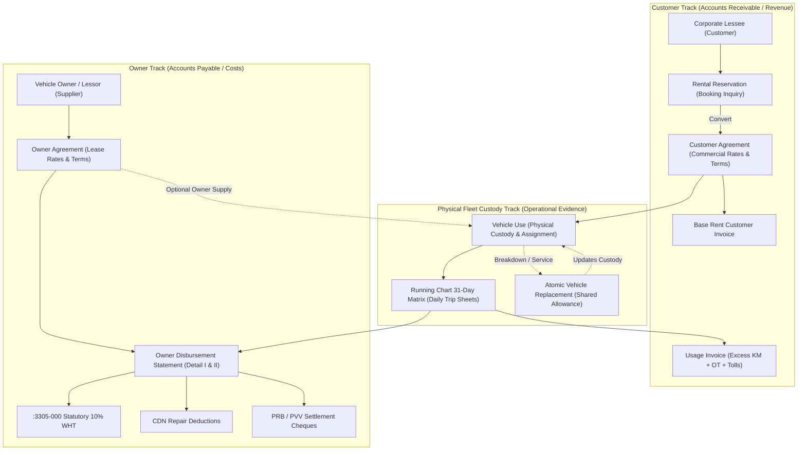
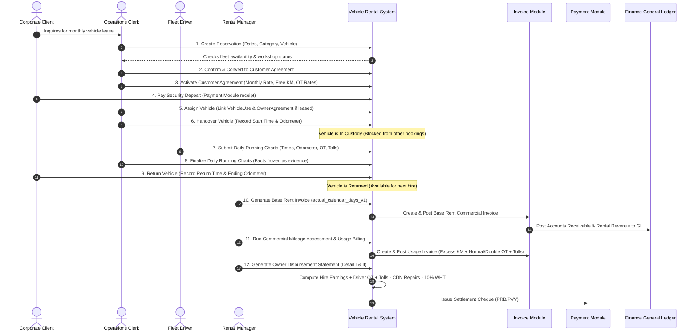
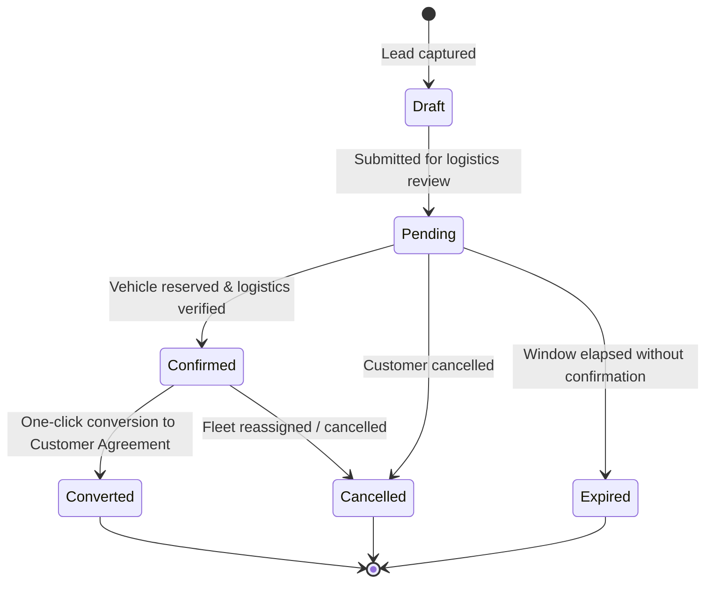
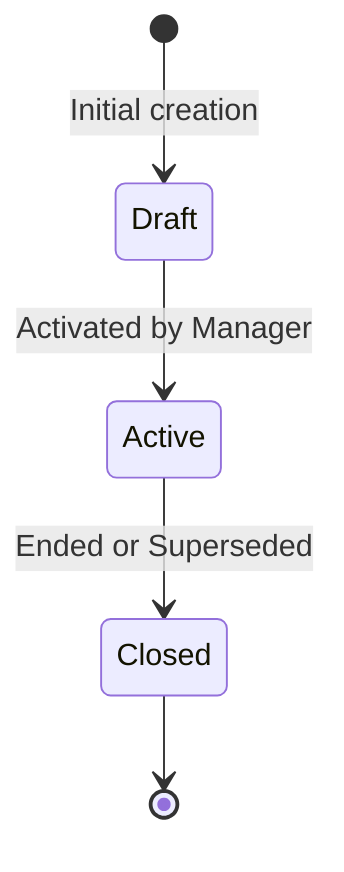
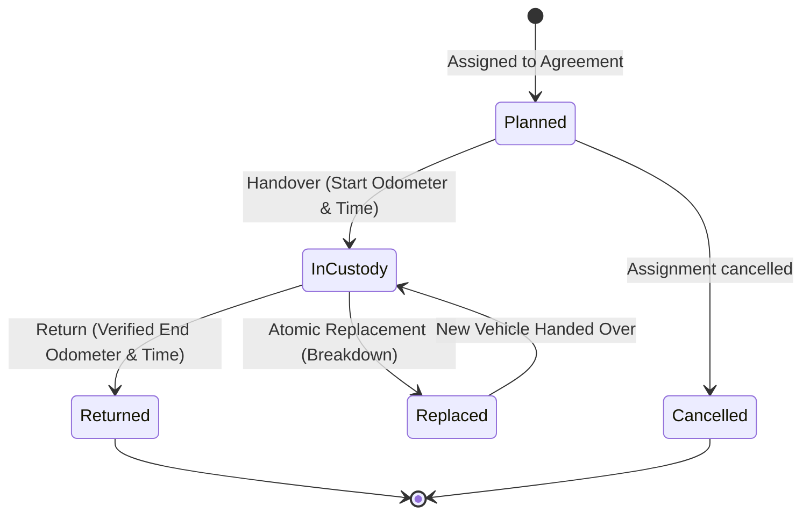
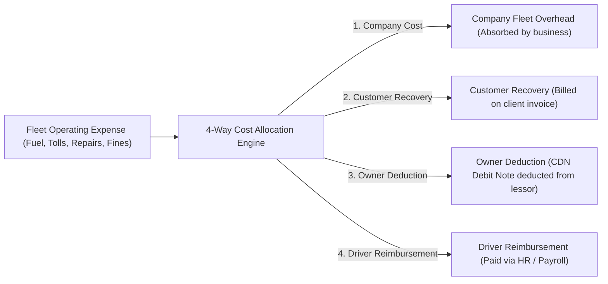
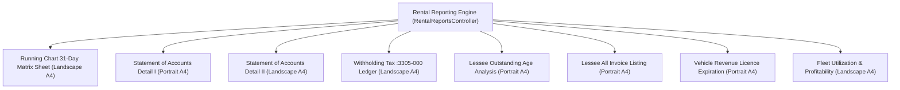
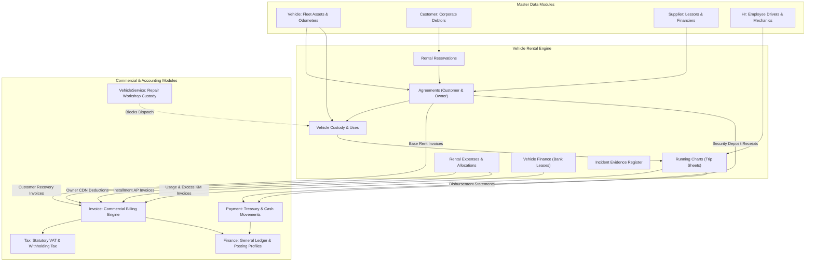

# AutoERP Vehicle Rental Module: Complete Technical & Operational Guide

**Status:** Authoritative Enterprise Technical Specification & Developer Onboarding Guide  
**Module Directory:** [`app/Modules/VehicleRental`](file:///d:/project-new/AutoERP/app/Modules/VehicleRental)  
**Frontend Directory:** [`resources/js/modules/vehicle-rental`](file:///d:/project-new/AutoERP/resources/js/modules/vehicle-rental)  
**Timezone Standard:** `Asia/Colombo` (Operational Civil Business Calendar)  
**Arithmetic Standard:** Arbitrary-Precision String Math via [`DecimalMath`](file:///d:/project-new/AutoERP/app/Modules/Core/Services/DecimalMath.php) (BCMath)  
**Test Suite:** 234 Backend PHPUnit Tests (2,007 Assertions) · 29 Frontend Vitest Suites (138 Tests)  

---

## Table of Contents

1. [Executive Overview & Business Purpose](#1-executive-overview--business-purpose)
2. [Dual-Sided Commercial Architecture](#2-dual-sided-commercial-architecture)
3. [End-to-End Operational Journey (Life of a Rental)](#3-end-to-end-operational-journey-life-of-a-rental)
4. [Component & Subsystem Architecture](#4-component--subsystem-architecture)
5. [Step-by-Step Workflows & State Machines](#5-step-by-step-workflows--state-machines)
   - 5.1 [Rental Reservations & Booking Inquiries](#51-rental-reservations--booking-inquiries)
   - 5.2 [Commercial Agreements & Successor Lineage](#52-commercial-agreements--successor-lineage)
   - 5.3 [Vehicle Custody, Handover, Return & Atomic Replacement](#53-vehicle-custody-handover-return--atomic-replacement)
   - 5.4 [Daily Running Charts (Physical Operational Log)](#54-daily-running-charts-physical-operational-log)
   - 5.5 [Debtor Revenue Billing (Base Rent, Mileage, Usage)](#55-debtor-revenue-billing-base-rent-mileage-usage)
   - 5.6 [Creditor Owner Settlements & WHT (:3305-000)](#56-creditor-owner-settlements--wht-3305-000)
   - 5.7 [Fleet Operating Expenses & 4-Way Allocation Matrix](#57-fleet-operating-expenses--4-way-allocation-matrix)
   - 5.8 [Vehicle Finance & Bank Leasing Contracts](#58-vehicle-finance--bank-leasing-contracts)
   - 5.9 [Incident Evidence Register & Private Proofs](#59-incident-evidence-register--private-proofs)
   - 5.10 [Security Deposits & Payment Allocations](#510-security-deposits--payment-allocations)
6. [Comprehensive Enterprise Reporting Suite](#6-comprehensive-enterprise-reporting-suite)
7. [Data Flow & Cross-Module Integrations](#7-data-flow--cross-module-integrations)
8. [Database Schema Reference (22 Tables)](#8-database-schema-reference-22-tables)
9. [Complete REST API Reference](#9-complete-rest-api-reference)
10. [Frontend UI/UX Architecture & Components](#10-frontend-uiux-architecture--components)
11. [Data Integrity, Concurrency & Validation Invariants](#11-data-integrity-concurrency--validation-invariants)
12. [Developer Quickstart & Verification Checklist](#12-developer-quickstart--verification-checklist)

---

## 1. Executive Overview & Business Purpose

The **Vehicle Rental** module (`VehicleRental`) is the operational and commercial engine of AutoERP for fleet management, executive chauffeur transport, self-drive leasing, and commercial tour services.

### Core Business Problem
Running a commercial vehicle rental enterprise involves two distinct, interacting tracks:
1. **Fleet Logistics (Physical World):** Vehicles move in and out of depots, odometers roll forward, drivers clock shifts, trips incur highway expressway toll passes, cars suffer breakdowns, and substitute replacement vehicles are deployed mid-lease.
2. **Commercial Accounting (Financial World):** Corporate lessees are billed for monthly base hire, excess kilometer consumption, driver overtime, and toll outlays; vehicle owners (lessors) must receive monthly statements showing hire earnings, driver overtime reimbursements, maintenance chargeback deductions, statutory tax withholdings, and cheque disbursements.

### Architectural Core Principles
- **Do Not Invent Money:** Physical evidence (trip sheets, odometers, fuel receipts, accident damage) is logged as operational truth. **No financial document** (invoice, debit note, credit note, owner payable voucher, or GL entry) is ever generated automatically without an explicit, approved business rule and verified commercial entitlement.
- **Dual-Track Commercial Independence:** A customer's agreement terms (revenue) never derive the owner's payable rates (costs); an owner's lease rates never dictate customer billing.
- **No Fictitious Owner Costs for Company Fleet:** When a vehicle is company-owned, zero artificial owner agreements or supplier vouchers are manufactured.
- **Optimistic Concurrency Control (OCC):** Every write is atomic, version-checked (`expected_version` against `row_version`), and multi-actor conflict-aware.
- **Exact Decimal Precision:** Floating-point math is strictly forbidden. All monetary figures, distances, tax levies, and fuel liters use arbitrary-precision string math via [`DecimalMath`](file:///d:/project-new/AutoERP/app/Modules/Core/Services/DecimalMath.php).
- **Civil Timezone Standard:** All operational calendar dates, duty timestamps, and proration schedules evaluate strictly against the tenant's civil business timezone (`Asia/Colombo`).

---

## 2. Dual-Sided Commercial Architecture

AutoERP decouples customer-facing commercial revenue from supplier-facing fleet lease liabilities, uniting them only at the point of physical vehicle custody:



---

## 3. End-to-End Operational Journey (Life of a Rental)

The complete lifecycle of a rental follows an orderly, audit-logged progression:



---

## 4. Component & Subsystem Architecture

The module is structured into 10 decoupled subsystems:

| Subsystem | Core Model | Service | Primary Role |
|---|---|---|---|
| **Reservations** | [`RentalReservation`](file:///d:/project-new/AutoERP/app/Modules/VehicleRental/Models/RentalReservation.php) | [`RentalReservationService`](file:///d:/project-new/AutoERP/app/Modules/VehicleRental/Services/RentalReservationService.php) | Inquiry lead capture, quote estimation, booking confirmation, and one-click conversion. |
| **Agreements** | [`CustomerAgreement`](file:///d:/project-new/AutoERP/app/Modules/VehicleRental/Models/CustomerAgreement.php) / [`OwnerAgreement`](file:///d:/project-new/AutoERP/app/Modules/VehicleRental/Models/OwnerAgreement.php) | [`CustomerAgreementService`](file:///d:/project-new/AutoERP/app/Modules/VehicleRental/Services/CustomerAgreementService.php) | Commercial terms, rate cards, successor contracts, closure cutovers. |
| **Vehicle Custody** | [`VehicleUse`](file:///d:/project-new/AutoERP/app/Modules/VehicleRental/Models/VehicleUse.php) | [`VehicleUseService`](file:///d:/project-new/AutoERP/app/Modules/VehicleRental/Services/VehicleUseService.php) | Physical possession, odometers, handover/return, atomic vehicle replacement. |
| **Availability** | *In-memory checker* | [`VehicleUseAvailabilityBlocker`](file:///d:/project-new/AutoERP/app/Modules/VehicleRental/Services/VehicleUseAvailabilityBlocker.php) | Half-open interval conflict detection, workshop service blocking. |
| **Running Charts** | [`RunningChart`](file:///d:/project-new/AutoERP/app/Modules/VehicleRental/Models/RunningChart.php) | [`RunningChartService`](file:///d:/project-new/AutoERP/app/Modules/VehicleRental/Services/RunningChartService.php) | Daily trip logging, duty ON/OFF times, comparative/cumulative KM, overtime tiers, toll passes. |
| **Base Billing** | [`CustomerBaseCharge`](file:///d:/project-new/AutoERP/app/Modules/VehicleRental/Models/CustomerBaseCharge.php) | [`CustomerBaseRentBillingService`](file:///d:/project-new/AutoERP/app/Modules/VehicleRental/Services/CustomerBaseRentBillingService.php) | Civil calendar base rent proration (`actual_calendar_days_v1`) and invoice creation. |
| **Usage Billing** | [`CustomerUsageCharge`](file:///d:/project-new/AutoERP/app/Modules/VehicleRental/Models/CustomerUsageCharge.php) | [`UsageChargeService`](file:///d:/project-new/AutoERP/app/Modules/VehicleRental/Services/UsageChargeService.php) & [`MileageAssessmentService`](file:///d:/project-new/AutoERP/app/Modules/VehicleRental/Services/MileageAssessmentService.php) | Excess distance calculations, overtime hours billing, night-out and pass billing. |
| **Owner Settlements** | [`OwnerBaseCharge`](file:///d:/project-new/AutoERP/app/Modules/VehicleRental/Models/OwnerBaseCharge.php) / [`OwnerUsageCharge`](file:///d:/project-new/AutoERP/app/Modules/VehicleRental/Models/OwnerUsageCharge.php) | [`OwnerDisbursementReportService`](file:///d:/project-new/AutoERP/app/Modules/VehicleRental/Services/OwnerDisbursementReportService.php) | Vertical Statement Detail I, Horizontal Matrix Detail II, Statutory 10% WHT ledger `:3305-000`. |
| **Fleet Expenses** | [`RentalExpense`](file:///d:/project-new/AutoERP/app/Modules/VehicleRental/Models/RentalExpense.php) | [`RentalExpenseService`](file:///d:/project-new/AutoERP/app/Modules/VehicleRental/Services/RentalExpenseService.php) | Direct operating costs and 4-way allocation matrix (`Company`, `Customer`, `Owner`, `HR`). |
| **Bank Leasing** | [`VehicleFinanceAgreement`](file:///d:/project-new/AutoERP/app/Modules/VehicleRental/Models/VehicleFinanceAgreement.php) | [`VehicleFinanceService`](file:///d:/project-new/AutoERP/app/Modules/VehicleRental/Services/VehicleFinanceService.php) | Amortization schedules, status sync (`scheduled`/`due`/`overdue`), AP payable generation. |
| **Incident Register** | [`RentalIncident`](file:///d:/project-new/AutoERP/app/Modules/VehicleRental/Models/RentalIncident.php) | [`RentalIncidentService`](file:///d:/project-new/AutoERP/app/Modules/VehicleRental/Services/RentalIncidentService.php) | Evidence logging, SHA-256 tamper-evident attachments, private streaming downloads. |

---

## 5. Step-by-Step Workflows & State Machines

### 5.1 Rental Reservations & Booking Inquiries

The reservation subsystem captures booking leads before binding contracts are signed:



- **Validation Rules:**
  - Planned pickup timestamp must precede planned return timestamp.
  - Estimated rent and security deposit amounts must be non-negative decimals.
  - Availability check verifies that the selected vehicle (or category) is not already in custody or admitted to a workshop.
- **Conversion Flow:**
  - Converting a `Confirmed` reservation creates a draft `CustomerAgreement` copying customer, vehicle, requested dates, and estimated rates, advancing the reservation status to `Converted`.

### 5.2 Commercial Agreements & Successor Lineage

Agreements represent the binding legal contract between the rental company and the counterparty:



#### Dual Agreement Structure:
1. **Customer Agreement (`CustomerAgreement`):**
   - Rental Basis: `daily` or `monthly`.
   - Driver Mode: `self_drive` or `with_driver`.
   - Agreed Terms: Base cycle rate, free mileage allowance (e.g. 2,500 KM/month), excess distance rate (e.g. 100.00/KM), driver overtime rates (Normal, Double/Sunday, Triple/Holiday), night-out rate, and agreed security deposit.
2. **Owner Agreement (`OwnerAgreement`):**
   - Must reference the specific supplied physical vehicle (`vehicle_id`).
   - Sets lessor base lease entitlement, excess mileage reimbursement rate, driver overtime reimbursement rate.

#### Successor Agreement Cutover Architecture:
When rates change on an active contract, **mutating the active agreement in place is strictly prohibited**. Instead, operators create a **Successor Agreement**:
1. Operator creates a `Draft` successor referencing `supersedes_agreement_id = predecessor.id` and sets an `effective_date`.
2. All commercial terms copy from predecessor to successor **except the security deposit** (deposits belong to the original cash payment and are never duplicated).
3. The predecessor remains `Active` and billable up to the cutover boundary.
4. Upon activation on or after the effective date:
   - System validates that no unfinalized vehicle custody overlaps the cutover boundary.
   - Atomically closes predecessor (`status = 'closed'`, `closed_at = cutover_timestamp`).
   - Activates successor (`status = 'active'`, `activated_at = cutover_timestamp`).
   - Lineage is permanently locked in `CustomerAgreementHistory`.

### 5.3 Vehicle Custody, Handover, Return & Atomic Replacement

Physical custody of a vehicle is governed by [`VehicleUse`](file:///d:/project-new/AutoERP/app/Modules/VehicleRental/Models/VehicleUse.php):



#### 1. Availability Blocker Algorithm (`VehicleUseAvailabilityBlocker`):
Before dispatching a vehicle, the system evaluates half-open intervals:
$$\text{Conflict} \iff (StartsAt < ExistingEndsAt) \land (EndsAt > ExistingStartsAt)$$
- If `existing_ends_at == new_starts_at` (e.g., returned at 10:00:00, next handover at 10:00:00), there is **zero conflict**.
- The blocker simultaneously queries [`VehicleService`](file:///d:/project-new/AutoERP/app/Modules/VehicleService) to verify the vehicle is not admitted for mechanical workshop repair.

#### 2. Handover & Return Invariants:
- **Handover:** Requires non-null starting odometer. Starting reading must equal or exceed the vehicle asset's current odometer in [`Vehicle`](file:///d:/project-new/AutoERP/app/Modules/Vehicle).
- **Return:** Requires ending odometer $\ge$ starting odometer. Updates the master odometer in `Vehicle`.

#### 3. Atomic Vehicle Replacement (`VehicleUseService::replace()`):
When a vehicle suffers a mechanical breakdown mid-rental:
1. Operator provides the disabled vehicle's return timestamp and final odometer reading.
2. Operator selects the replacement vehicle, handover timestamp, starting odometer, and supply source (`company` vs. `owner`).
3. In a single atomic database transaction:
   - Existing vehicle is returned (`status = 'returned'`).
   - Replacement assignment is created and handed over (`status = 'in_custody'`, `replaced_use_id = existing.id`).
   - **Shared Monthly Allowance:** The client agreement's free kilometer allowance remains pooled across both vehicles.
   - **Amber Badge Audit Trail:** Trips performed by the replacement vehicle on the 31-day running chart matrix display with an amber badge and remark `For Repl. <original_reg_no>` (as evidenced in production scan `LAG7000012`).

### 5.4 Daily Running Charts (Physical Operational Log)

The [`RunningChart`](file:///d:/project-new/AutoERP/app/Modules/VehicleRental/Models/RunningChart.php) is the daily physical log sheet (`pmdeblogsheet2.frx` / `pmcre1logsheet2.frx`):

```text
+--------------------------------------------------------------------------------------------------------------------------+
| Date       | Start KM | Finish KM | Comp KM | Cumu KM | ON       | OFF      | OT Hrs | Type | Night Out | Pass   | Remark  |
+--------------------------------------------------------------------------------------------------------------------------+
| 01/07/2026 | 190491   | 190698    | 207     | 207     | 05:00 AM | 10:00 PM | 5.00   | N    | -         | 850.00 | Repl.   |
| 02/07/2026 | 190698   | 190904    | 206     | 413     | 06:30 AM | 08:00 PM | 1.50   | N    | -         | -      | Repl.   |
+--------------------------------------------------------------------------------------------------------------------------+
```

- **Daily Data Captured:**
  - `start_at` and `end_at`: Timestamps in `Asia/Colombo`.
  - `start_odometer` and `end_odometer`: Distance tracked.
  - `comparative_mileage`: Distance driven during the day ($\text{End} - \text{Start}$).
  - `cumulative_mileage`: Running sum of distance for the billing month.
  - `duty_on` and `duty_off`: Shift start and end times (e.g. `06:30 AM` to `08:00 PM`).
  - `overtime_minutes`: Categorized by tier: Normal (`N`), Double/Sunday (`D`), Triple/Holiday (`T`).
  - `night_out_count`: Overnight depot stays outside home base.
  - `pass_amount`: Expressway highway toll receipts paid out of pocket.
  - `ac_mode`: `non_ac`, `front_ac`, or `dual_ac`.
  - `driver_employee_id`: Active employee from `Hr` module (or contractor snapshot).
- **Finalization Rules:** A chart can only be finalized once the trip has physically completed. Once finalized, operational facts are permanently frozen. Reversals create an auditable cancellation record and require a narrative reason.

### 5.5 Debtor Revenue Billing (Base Rent, Mileage, Usage)

Billing operates across three independent revenue tracks:

#### Track 1: Base Rent Invoicing (`actual_calendar_days_v1`)
- Billed on monthly start-date anniversary cycles (e.g., 1st to 30th).
- **Proration Formula:**
  $$\text{Base Amount} = \frac{\text{Actual Civil Days}}{\text{Days in Month}} \times \text{Agreed Monthly Rate}$$
- Creates an approved commercial invoice in [`Invoice`](file:///d:/project-new/AutoERP/app/Modules/Invoice) with posting role `rental_base_rent`.

#### Track 2: Commercial Mileage Assessment
- Aggregates finalized commercial kilometers across all running charts in the cycle (including replacement vehicles).
- **Excess KM Formula:**
  $$\text{Excess KM} = \max(0, \text{Total Commercial KM} - \text{Agreed Free Allowance})$$
  $$\text{Excess Mileage Charge} = \text{Excess KM} \times \text{Agreed Excess Rate}$$
- If distance $\le$ allowance, a zero-charge assessment record is created to prove the allowance was consumed without manufacturing an invoice.

#### Track 3: Usage Charges Invoicing
- Overtime charges: $\text{Normal OT Hours} \times \text{Normal Rate} + \text{Double OT Hours} \times \text{Double Rate} + \text{Triple OT Hours} \times \text{Triple Rate}$.
- Night-out allowances: $\text{Count} \times \text{Night Out Rate}$.
- Expressway pass reimbursements: Exact out-of-pocket toll amounts added to invoice line items.

### 5.6 Creditor Owner Settlements & WHT (:3305-000)

The vehicle owner settlement engine handles monthly disbursements to third-party fleet lessors (`OwnerDisbursementReportService`):

```text
========================================================================
            OWNER DISBURSEMENT RECONCILIATION FORMULA
========================================================================
  Balance Brought Forward (Balance B/F from prior month)
+ Agreed Base Vehicle Lease Entitlement (Period rate)
+ Driver's Overtime Normal (Running Chart hours × Agreed OT rate)
+ Other Charges / Expressway Pass Outlays (Reimbursed toll receipts)
------------------------------------------------------------------------
= Gross Earnings Payable
- Maintenance & Repair Deductions (CDN Debit Notes from Expense Allocation)
- Statutory 10% Withholding Tax (Posted to Account :3305-000 WHT)
- Outbound Cheque Settlements (PRB / PVV Settlement Vouchers)
------------------------------------------------------------------------
= Closing Balance: Balance Over Paid (Credit) or Balance Payable (Debit)
========================================================================
```

#### Dual Settlement Views:
1. **Statement of Accounts (Detail I) [A4 Portrait, `pmcre1vehstat_b.frx`]:** Vertical single-vehicle account statement showing Balance B/F, Base Hire period, Driver Overtime Normal, Other Charges, settlement cheques/vouchers (`PRB`/`PVV`), repair deduction debit notes (`CDN`), and net closing balance (`Balance Over Paid` or `Balance Payable`).
2. **Statement of Accounts (Detail II) [A4 Landscape, `pmcre1vehstat_c.frx`]:** 18-column operational matrix detailing hire start/finish dates, unit, agreed total KM, non-A/C KM rate, hire amount, normal/double/triple overtime hours, driver salary/bata, other charges, VAT, net settlements, and closing balance.
3. **Statutory Withholding Tax Ledger (`:3305-000 WHT`, `pmglled.frx`):** Tracks 10% statutory tax deductions on gross earnings across credit notes (`CDN7000248`–`CDN7000273`).

### 5.7 Fleet Operating Expenses & 4-Way Allocation Matrix

Fleet expenses ([`RentalExpense`](file:///d:/project-new/AutoERP/app/Modules/VehicleRental/Models/RentalExpense.php)) track operational vehicle outlays (petrol, tolls, emergency maintenance, traffic fines, cleaning):



### 5.8 Vehicle Finance & Bank Leasing Contracts

For vehicles purchased through commercial bank hire-purchase or leasing ([`VehicleFinanceAgreement`](file:///d:/project-new/AutoERP/app/Modules/VehicleRental/Models/VehicleFinanceAgreement.php)):
- **Financing Terms:** Principal financed amount, down payment, residual/balloon value, annual interest rate (%), repayment period (months), and interest calculation method (`flat` vs. `reducing_balance`).
- **Amortization Schedule:** Automatically calculates monthly installments ([`VehicleFinanceInstallment`](file:///d:/project-new/AutoERP/app/Modules/VehicleRental/Models/VehicleFinanceInstallment.php)) with principal and interest splits.
- **Automated Due Status Sync:** `refreshDueStatuses()` scans installment due dates against current business dates to advance statuses from `scheduled` &rarr; `due` &rarr; `overdue`.
- **Payable Creation:** Maturing installments convert directly into accounts payable supplier invoices in [`Invoice`](file:///d:/project-new/AutoERP/app/Modules/Invoice) with one click.

### 5.9 Incident Evidence Register & Private Proofs

Captures accidents, mechanical damage, traffic fines, and toll violations ([`RentalIncident`](file:///d:/project-new/AutoERP/app/Modules/VehicleRental/Models/RentalIncident.php)):
- **Non-Monetary Evidence:** Recording an incident verifies physical facts; it **never automatically creates financial charges** without an explicit authorized decision.
- **SHA-256 Tamper-Evident Attachments:** Operators upload PDF, JPEG, or PNG photos/police reports up to 10 MB. Files are stored on private tenant disk storage with SHA-256 integrity checksums and downloaded via streaming responses with security headers (`no-store`, `no-sniff`).
- **Review Lock:** Once confirmed or rejected by management, incident records and attachments are permanently locked against editing or deletion.

### 5.10 Security Deposits & Payment Allocations

- Security deposit requirements are established in `CustomerAgreement`.
- Deposit receipts are processed through [`Payment`](file:///d:/project-new/AutoERP/app/Modules/Payment).
- The rental UI tracks remaining collection capacity:
  $$\text{Remaining to Receive} = \text{Agreed Deposit Requirement} - \text{Net Receipts}$$
- Unapplied deposit balances are allocated against final commercial invoices upon contract termination. Refunds require the governed `Payment` refund workflow linking back to the original receipt.

---

## 6. Comprehensive Enterprise Reporting Suite

The module provides 8 official enterprise reports, available in interactive HTML grids, printable views, and PDF exports:



| Report Name | Layout | Legacy FoxPro FRX | Key Data Fields & Purpose |
|---|---|---|---|
| **Running Chart 31-Day Matrix** | **Landscape A4** | `pmdeblogsheet2.frx`<br>`pmcre1logsheet2.frx` | Daily start/end odometers, comparative/cumulative KM, duty ON/OFF, Normal/Double/Triple OT, night outs, toll pass outlays, and amber replacement vehicle badges in Lessee & Owner modes. |
| **Statement of Accounts (Detail I)** | **Portrait A4** | `pmcre1vehstat_b.frx` | Single-vehicle vertical statement: Balance B/F, Base Hire period, Driver OT Normal, Tolls, Cheque Settlements (`PRB`), Repair Deductions (`CDN`), and Closing Balance. |
| **Statement of Accounts (Detail II)** | **Landscape A4** | `pmcre1vehstat_c.frx` | Single-vehicle 18-column operational matrix: Included KM, Non-A/C KM rate, Base Hire, OT Hours split, OT Amount, Driver Salary/Bata, Other Charges, Settlements, and Closing Balance. |
| **Statutory WHT Ledger** | **Landscape A4** | `pmglled.frx` | Audit ledger for General Ledger Account `:3305-000 WHT`, tracking 10% tax deductions across credit notes (`CDN7000248`–`CDN7000273`). |
| **Lessee Outstanding Age Analysis** | **Portrait A4** | `pmdebinv5.frx` | Debtor receivable aging grouped by customer, agreement, and vehicle across Current, 30, 60, 90, and 120+ day buckets. |
| **Lessee All Invoice Listing** | **Portrait A4** | `pmdebinv3.frx`<br>`prndebinv3_s.pdf` | Chronological billing register: invoice number, invoice date, lessee details, vehicle number, base hire, excess KM, VAT, and grand totals. |
| **Vehicle Revenue Licence Expiry** | **Portrait A4** | `pmcrelicence.frx` | Fleet regulatory compliance: registration number, owner, expiry date, remaining days, and alert status (Expired, Expiring Soon, Valid). |
| **Fleet Utilization & Economics** | **Landscape A4** | — | Asset availability, custody states, distance driven, utilization %, vehicle P&L, gross margins, and per-KM unit economics. |

---

## 7. Data Flow & Cross-Module Integrations



---

## 8. Database Schema Reference (22 Tables)

The module defines 22 explicit database tables (strictly one table per migration file, following KISS + Explicit):

| Table Name | Entity Represented | Primary Keys & Foreign Keys | Key Columns |
|---|---|---|---|
| `vehicle_rental_customer_agreements` | Customer Agreement | `id` (PK), `tenant_id`, `organization_unit_id`, `customer_id` | `reference`, `basis`, `driver_mode`, `starts_at`, `ends_at`, `status`, `row_version` |
| `vehicle_rental_customer_agreements_history` | Customer Agreement Audit | `id` (PK), `agreement_id` (FK) | `action`, `actor_id`, `narrative_reason`, `snapshot_diff`, `created_at` |
| `vehicle_rental_owner_agreements` | Owner Agreement | `id` (PK), `tenant_id`, `supplier_id`, `vehicle_id` | `reference`, `basis`, `starts_at`, `ends_at`, `owner_base_rate`, `status`, `row_version` |
| `vehicle_rental_owner_agreements_history` | Owner Agreement Audit | `id` (PK), `agreement_id` (FK) | `action`, `actor_id`, `narrative_reason`, `snapshot_diff`, `created_at` |
| `vehicle_rental_uses` | Physical Vehicle Custody | `id` (PK), `customer_agreement_id`, `owner_agreement_id`, `vehicle_id` | `status`, `planned_starts_at`, `planned_ends_at`, `handover_at`, `start_odometer`, `return_at`, `end_odometer`, `replaced_use_id`, `row_version` |
| `vehicle_rental_use_history` | Vehicle Use Audit | `id` (PK), `use_id` (FK) | `action`, `actor_id`, `snapshot_diff`, `created_at` |
| `vehicle_rental_running_charts` | Daily Trip Log Sheet | `id` (PK), `vehicle_use_id`, `driver_employee_id` | `trip_date`, `duty_on`, `duty_off`, `start_odometer`, `end_odometer`, `comparative_mileage`, `cumulative_mileage`, `normal_ot_minutes`, `double_ot_minutes`, `triple_ot_minutes`, `night_out_count`, `pass_amount`, `status`, `row_version` |
| `vehicle_rental_running_chart_history` | Running Chart Audit | `id` (PK), `running_chart_id` (FK) | `action`, `actor_id`, `narrative_reason`, `snapshot_diff`, `created_at` |
| `vehicle_rental_customer_base_charges` | Base Rent Charges | `id` (PK), `customer_agreement_id`, `invoice_id` | `cycle_start`, `cycle_end`, `billed_days`, `charge_amount`, `status`, `row_version` |
| `vehicle_rental_owner_base_charges` | Owner Lease Charges | `id` (PK), `owner_agreement_id`, `invoice_id` | `cycle_start`, `cycle_end`, `billed_days`, `charge_amount`, `status`, `row_version` |
| `vehicle_rental_customer_usage_charges` | Usage Charges (KM/OT) | `id` (PK), `customer_agreement_id`, `running_chart_id`, `invoice_id` | `charge_type`, `quantity`, `unit_rate`, `total_amount`, `status`, `row_version` |
| `vehicle_rental_owner_usage_charges` | Owner Usage Settlements | `id` (PK), `owner_agreement_id`, `running_chart_id`, `invoice_id` | `charge_type`, `quantity`, `unit_rate`, `total_amount`, `status`, `row_version` |
| `vehicle_rental_incidents` | Fleet Incident Register | `id` (PK), `vehicle_id`, `vehicle_use_id`, `running_chart_id` | `incident_type`, `incident_date`, `description`, `police_report_number`, `status`, `row_version` |
| `vehicle_rental_incident_events` | Incident Review Audit | `id` (PK), `incident_id` (FK) | `action`, `actor_id`, `narrative_reason`, `created_at` |
| `vehicle_rental_incident_attachments` | Proof File Attachments | `id` (PK), `incident_id` (FK) | `file_path`, `file_name`, `mime_type`, `file_size`, `sha256_checksum`, `created_at` |
| `vehicle_rental_reservations` | Booking Inquiries | `id` (PK), `customer_id`, `vehicle_id`, `category_id` | `reservation_number`, `planned_starts_at`, `planned_ends_at`, `estimated_rent`, `status`, `row_version` |
| `vehicle_rental_reservation_histories` | Reservation Audit | `id` (PK), `reservation_id` (FK) | `action`, `actor_id`, `snapshot_diff`, `created_at` |
| `vehicle_rental_finance_agreements` | Bank Leases | `id` (PK), `supplier_id`, `vehicle_id` | `contract_number`, `principal_amount`, `interest_rate`, `calculation_method`, `tenor_months`, `status`, `row_version` |
| `vehicle_rental_finance_installments` | Amortization Schedule | `id` (PK), `finance_agreement_id`, `invoice_id` | `installment_number`, `due_date`, `principal_due`, `interest_due`, `total_due`, `status`, `row_version` |
| `vehicle_rental_finance_status_histories`| Finance Agreement Audit | `id` (PK), `finance_agreement_id` (FK) | `action`, `actor_id`, `snapshot_diff`, `created_at` |
| `vehicle_rental_expenses` | Fleet Operating Expenses | `id` (PK), `vehicle_id`, `vehicle_use_id` | `expense_category`, `expense_date`, `total_amount`, `odometer_reading`, `status`, `row_version` |
| `vehicle_rental_expense_allocations` | 4-Way Cost Allocations | `id` (PK), `expense_id`, `target_id` | `destination`, `allocated_amount`, `invoice_id`, `status`, `row_version` |

---

## 9. Complete REST API Reference

All routes are authenticated, require tenant context (`current.tenant` and `current.organization-unit:required`), and are prefixed with `/api/v1/vehicle-rental`.

### 1. Reservations (`/reservations`)
- `GET /reservations`: Paginated list of reservations with search and status filtering.
- `POST /reservations`: Create a new reservation.
- `GET /reservations/{id}`: Detailed reservation record including full history.
- `PUT /reservations/{id}`: Update reservation terms (requires `expected_version`).
- `PATCH /reservations/{id}/transition`: Transition status (`pending`, `confirmed`, `cancelled`).
- `POST /reservations/{id}/convert`: Convert confirmed reservation to Customer Agreement.

### 2. Agreements (`/{kind}/agreements` where `kind` is `customer` or `owner`)
- `GET /{kind}/agreements`: Paginated agreement list.
- `POST /{kind}/agreements`: Create a new draft agreement.
- `GET /{kind}/agreements/{id}`: Full agreement details, rates, and active terms.
- `PUT /{kind}/agreements/{id}`: Update draft terms (requires `expected_version`).
- `POST /{kind}/agreements/{id}/successor`: Draft a successor agreement.
- `GET /{kind}/agreements/{id}/history`: Paginated audit history log.
- `POST /{kind}/agreements/{id}/{action}`: Transition status (`activate`, `close`).
- `POST /{kind}/agreements/{id}/base-rent-preview`: Calculate preview base rent.

### 3. Vehicle Custody & Uses (`/vehicle-uses`)
- `GET /customer/agreements/{agreement}/vehicles`: List vehicle custody assignments.
- `POST /customer/agreements/{agreement}/vehicles`: Assign vehicle to agreement.
- `GET /vehicles/{vehicle}/sources`: Available owner supply contracts for vehicle/period.
- `POST /vehicle-uses/{use}/replace`: Atomically replace disabled vehicle with replacement.
- `GET /vehicle-uses/{use}/history`: Custody audit history.
- `POST /vehicle-uses/{use}/{action}`: Transition custody (`handover`, `return`, `cancel`).
- `GET /vehicle-uses`: Global vehicle use register.
- `GET /vehicles/available`: Real-time fleet availability query.

### 4. Daily Running Charts (`/running-charts`)
- `GET /vehicle-uses/{use}/running-charts`: Charts logged under vehicle assignment.
- `POST /vehicle-uses/{use}/running-charts`: Log a new daily running chart.
- `GET /running-charts`: Global running chart register with date and vehicle filters.
- `PUT /running-charts/{chart}`: Update draft chart (requires `expected_version`).
- `GET /running-charts/{chart}/history`: Running chart audit history.
- `POST /running-charts/{chart}/{action}`: Transition chart (`finalize`, `reverse`).

### 5. Billing & Charges
- `GET /{kind}/agreements/{agreement}/base-charges`: Billed base rent records.
- `POST /{kind}/agreements/{agreement}/base-charges`: Invoice base rent charge.
- `POST /{kind}/agreements/{agreement}/base-charges/{charge}/void`: Void base charge.
- `POST /{kind}/agreements/{agreement}/base-charges/{charge}/reissue`: Reissue base charge.
- `GET /running-charts/{chart}/{kind}/charges/mileage`: Preview commercial excess mileage.
- `POST /running-charts/{chart}/{kind}/charges/mileage`: Assess and invoice mileage.
- `GET/POST /running-charts/{chart}/{kind}/charges`: List or create usage charges.

### 6. Security Deposits
- `GET /customer/agreements/{agreement}/deposits`: Deposit requirement, net receipts, remaining capacity.
- `POST /customer/agreements/{agreement}/deposits`: Record deposit receipt via `Payment` module.

### 7. Vehicle Finance & Bank Leases (`/finance-agreements`)
- `GET /finance-agreements`: Paginated financing contracts.
- `POST /finance-agreements`: Create bank leasing contract.
- `GET /finance-agreements/{id}`: Contract details and amortization schedule.
- `PATCH /finance-agreements/{id}/activate`: Activate contract.
- `PATCH /finance-agreements/{id}/cancel`: Cancel contract.
- `POST /finance-agreements/installments/{installment}/payable`: Create AP invoice for installment.
- `PATCH /finance-agreements/installments/refresh-due-statuses`: Sync installment due statuses.

### 8. Fleet Operating Expenses (`/expenses`)
- `GET /expenses`: Paginated fleet expenses.
- `POST /expenses`: Record operating expense (fuel, toll, repair, fine).
- `GET /expenses/{id}`: Expense details and allocation breakdown.
- `PATCH /expenses/{id}/transition`: Approve expense and apply multi-destination allocations.

### 9. Incident Evidence & File Proofs (`/incidents`)
- `GET /incidents`: Paginated incident register.
- `POST /incidents`: Record new incident.
- `GET /incidents/{id}`: Incident details and timeline.
- `GET /incidents/{id}/history`: Incident event audit history.
- `POST /incidents/{id}/{action}`: Review incident (`confirm`, `reject`).
- `POST /incidents/{id}/attachments`: Upload PDF/image proof file.
- `GET /incidents/{id}/attachments/{attachment}`: Stream download private proof file.

### 10. Operational & Financial Reports (`/reports/*`)
- `GET /reports/running-chart-sheet`: Generate Landscape A4 31-day running chart matrix.
- `GET /reports/fleet-utilization`: Fleet utilization & custody report.
- `GET /reports/revenue-licenses`: Vehicle revenue licence expiration compliance report.
- `GET /reports/rental-revenue`: Customer commercial revenue summary and All Invoice Listing.
- `GET /reports/lessee-outstanding`: Lessee accounts receivable age analysis report.
- `GET /reports/owner-disbursements`: Owner settlement statements (Detail I & II) and WHT ledger.
- `GET /reports/vehicle-profitability`: Vehicle-level P&L and unit economics report.
- `GET /reports/incidents-summary`: Fleet risk & incident summary report.
*(All reports support `/export/pdf`, `/export/print`, and `/export/html`)*

---

## 10. Frontend UI/UX Architecture & Components

The frontend SPA in [`resources/js/modules/vehicle-rental`](file:///d:/project-new/AutoERP/resources/js/modules/vehicle-rental) is built with React 19, TypeScript 6, Tailwind CSS 4, and TanStack React Query:

### Core UI/UX Invariants
1. **Zero Raw Database IDs:** Users never see or type foreign keys. All entities display human-readable labels (e.g. `WP-PX-2020 (Toyota KDH)`, `AGR-2026-001 · John Doe`).
2. **Controlled Search Lookups:** All relational inputs use [`LookupSelect`](file:///d:/project-new/AutoERP/resources/js/shared/components/LookupSelect.tsx) with debounced asynchronous search and pagination.
3. **Progressive Disclosure:** Complex forms separate primary action fields from secondary details using `<details>`, tabs, and expandable side panels.
4. **Tenant Business Calendar:** Forms default to `businessDateInputValue()`; civil dates format via `formatBusinessDate()`. Operational timestamps respect `Asia/Colombo`.

### Key Component Directory
- [`AgreementsPage.tsx`](file:///d:/project-new/AutoERP/resources/js/modules/vehicle-rental/AgreementsPage.tsx): Master agreement management workspace.
- [`AgreementEditor.tsx`](file:///d:/project-new/AutoERP/resources/js/modules/vehicle-rental/AgreementEditor.tsx): Form editor for customer and owner agreement terms.
- [`VehicleUsePanel.tsx`](file:///d:/project-new/AutoERP/resources/js/modules/vehicle-rental/VehicleUsePanel.tsx): Vehicle dispatch, handover, return, and replacement dialogs.
- [`RunningChartEditor.tsx`](file:///d:/project-new/AutoERP/resources/js/modules/vehicle-rental/RunningChartEditor.tsx): Trip sheet data entry modal.
- [`OwnerDisbursementReportPage.tsx`](file:///d:/project-new/AutoERP/resources/js/modules/vehicle-rental/OwnerDisbursementReportPage.tsx): Multi-tab settlement viewer (Summary, Detail I, Detail II, WHT Ledger).
- [`RentalRevenueReportPage.tsx`](file:///d:/project-new/AutoERP/resources/js/modules/vehicle-rental/RentalRevenueReportPage.tsx): Commercial revenue summaries and All Invoice Listing.
- [`RentalRunningChartReportPage.tsx`](file:///d:/project-new/AutoERP/resources/js/modules/vehicle-rental/RentalRunningChartReportPage.tsx): Landscape 31-day running chart matrix sheet viewer.

---

## 11. Data Integrity, Concurrency & Validation Invariants

1. **Optimistic Locking Guard:**
   - Every state transition or update request must supply `expected_version`.
   - Update query enforces `WHERE id = ? AND row_version = ?`.
   - Stale updates throw `409 Conflict`.
2. **No Inventing Money:**
   - Operational logs can be saved immediately.
   - Financial invoices, deductions, or vouchers are created only through approved billing services.
3. **Proration Invariant:**
   - Calendar days use civil dates in `Asia/Colombo`.
   - Partial month billing divides actual civil days by total days in the calendar month.
4. **Half-Open Custody Boundary:**
   - Vehicle turnover at exact boundaries (10:00:00 return, 10:00:00 next handover) is permitted without false collision.
5. **Replacement Allowance Pooling:**
   - Replaced vehicles share the contract's single free mileage allowance pool.
6. **Immutable Transaction History:**
   - Posted invoices, payments, and finalized running charts are never modified in place. Corrections require governed reversals with lineage tracking.

---

## 12. Developer Quickstart & Verification Checklist

When developing or extending the Vehicle Rental module, run these commands to verify that code standards and test suites pass completely:

### 1. Run Backend Test Suite
```bash
php artisan test app/Modules/VehicleRental/Tests
```
*Expected: 234 tests passed, 2,007 assertions.*

### 2. Run Frontend Test Suite
```bash
npx vitest run resources/js/modules/vehicle-rental --fileParallelism=false
```
*Expected: 29 test files passed, 138 tests passed.*

### 3. Verify TypeScript Types
```bash
npm run typecheck
```
*Expected: 0 errors.*

### 4. Run Code Linter (ESLint)
```bash
npm run lint
```
*Expected: 0 errors, 0 warnings.*

### 5. Build Production Assets (Vite)
```bash
npm run build
```
*Expected: Clean asset build without errors.*

### 6. Verify Git Cleanliness
```bash
git status
```
*Expected: Working tree clean.*
