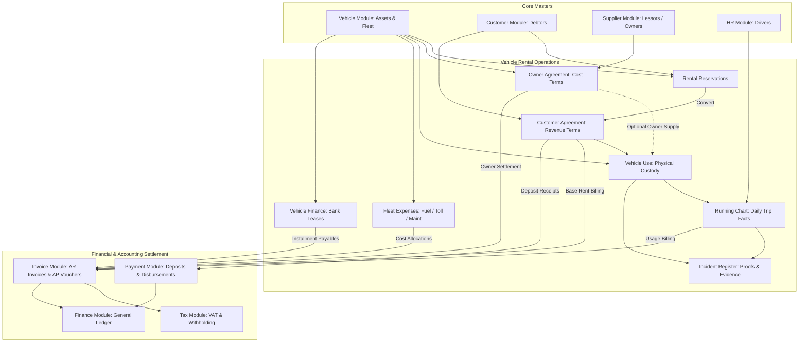
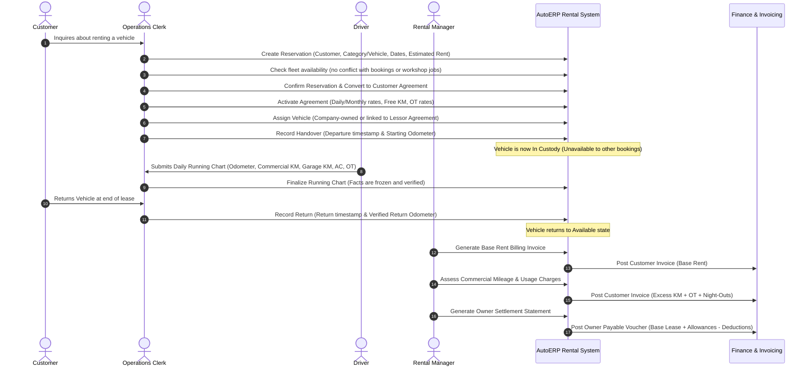
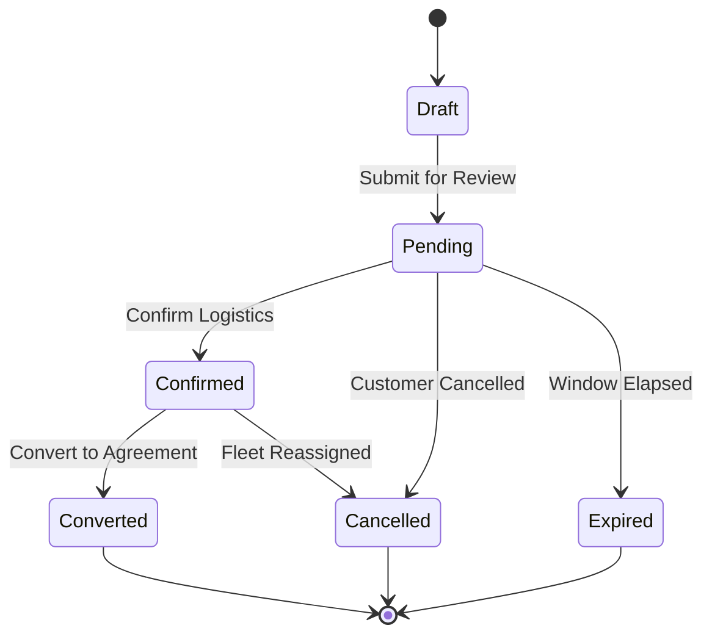
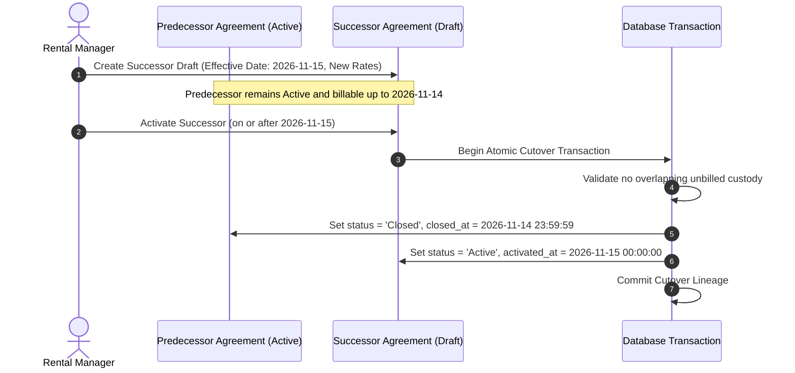
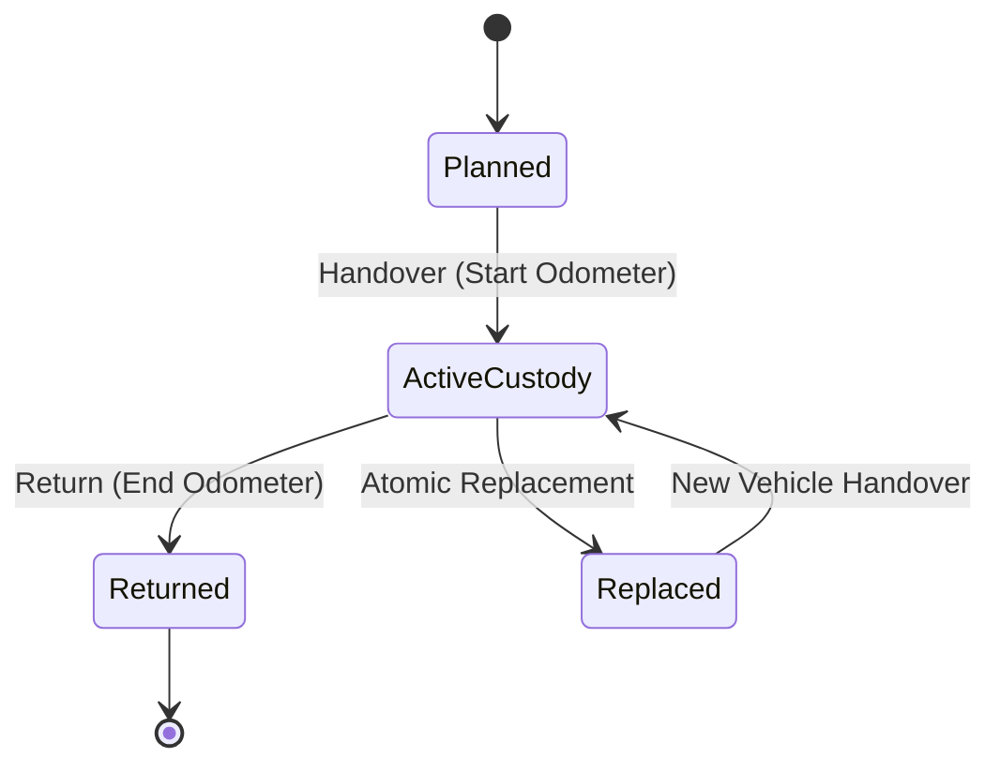
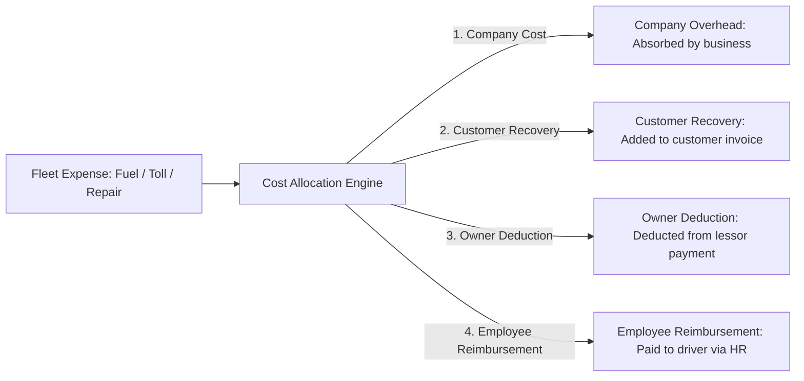

# AutoERP Vehicle Rental Module: Complete Technical & Operational Guide

Welcome to the comprehensive, beginner-friendly technical guide for the **Vehicle Rental** module in **AutoERP**. Whether you are a newly joined software engineer, a business analyst, a QA engineer, or a technical operator, this document will guide you through the entire module from high-level business architecture down to database tables, API payloads, React components, and background calculations.

> [!NOTE]
> For day-to-day depot staff, dispatchers, billing clerks, and rental managers looking for a step-by-step UI operations manual with click paths and screen guides, see the [Vehicle Rental End-User Operations Guide](VEHICLE_RENTAL_USER_GUIDE.md).

---

## Table of Contents

1. [Module Overview & Architecture Philosophy](#1-module-overview--architecture-philosophy)
2. [High-Level Domain Architecture](#2-high-level-domain-architecture)
3. [The End-to-End Operational Journey (Life of a Rental)](#3-the-end-to-end-operational-journey-life-of-a-rental)
4. [Rental Reservations & Booking Inquiries](#4-rental-reservations--booking-inquiries)
5. [Commercial Agreements & Successor Contracts](#5-commercial-agreements--successor-contracts)
6. [Vehicle Sourcing, Custody & Fleet Availability](#6-vehicle-sourcing-custody--fleet-availability)
7. [Daily Running Charts (Physical Operational Log)](#7-daily-running-charts-physical-operational-log)
8. [Commercial Billing Engine & Calculations](#8-commercial-billing-engine--calculations)
9. [Vehicle Finance & Bank Leasing Agreements](#9-vehicle-finance--bank-leasing-agreements)
10. [Rental Fleet Expenses & Direct Cost Recovery](#10-rental-fleet-expenses--direct-cost-recovery)
11. [Incident Evidence, Damage Risk & Private Proofs](#11-incident-evidence-damage-risk--private-proofs)
12. [Security Deposits, Payments & Cash Flow Operations](#12-security-deposits-payments--cash-flow-operations)
13. [Comprehensive Business Intelligence & Reporting Suite](#13-comprehensive-business-intelligence--reporting-suite)
14. [Concurrency, Multi-Tenancy & Audit Integrity](#14-concurrency-multi-tenancy--audit-integrity)
15. [User Interface (UI/UX) Standards & Design Patterns](#15-user-interface-uiux-standards--design-patterns)
16. [Complete Database Schema Reference](#16-complete-database-schema-reference)
17. [Complete REST API Reference](#17-complete-rest-api-reference)
18. [Developer Quickstart & Verification Checklist](#18-developer-quickstart--verification-checklist)

---

## 1. Module Overview & Architecture Philosophy

### What is the Vehicle Rental Module?

In commercial vehicle rental businesses (such as tour operators, executive transport companies, and commercial fleet managers), operations are fundamentally **dual-sided**:
1. **The Customer / Lessee Side:** The client who rents the vehicle. Money flows **inward** (receivables / revenue) through base rental charges, excess kilometer fees, driver overtime fees, and night-out outlays.
2. **The Owner / Lessor / Supplier Side:** The third-party vehicle owner who leases their asset to the business. Money flows **outward** (payables / costs) through monthly lease entitlements, driver/OT reimbursements, and expense settlements.

AutoERP's Vehicle Rental module bridges physical fleet logistics (tracking custody, odometers, breakdowns, drivers, and daily trips) with commercial accounting (invoicing, accounts payable, expense recovery, and financial reconciliation).

### Core Architectural Principles

- **Dual-Track Commercial Independence:**  
  Customer Agreements and Owner Agreements are completely independent contracts. Customer prices never derive Owner payables; Owner lease costs never dictate Customer billing.
- **Unified Physical Evidence:**  
  A single physical vehicle assignment and its daily trip sheets ([`RunningChart`](file:///d:/project-new/AutoERP/app/Modules/VehicleRental/Models/RunningChart.php)) act as the single source of truth for both commercial tracks.
- **Never Invent Money:**  
  Physical facts (a trip taken, fuel pumped, or an accident report) can be logged immediately as evidence. However, **no financial document** (invoice, debit note, or payable voucher) is created without verified agreement terms and an authorized commercial decision.
- **No Fictitious Owner Costs for Company Fleets:**  
  When the vehicle is company-owned, no artificial Owner Agreement or external payable voucher is manufactured.
- **Clean Module Boundaries:**  
  Vehicle Rental strictly focuses on rental contracts and trip evidence. It relies on dedicated platform modules for shared responsibilities:
  - [`Vehicle`](file:///d:/project-new/AutoERP/app/Modules/Vehicle): Fleet master and vehicle specifications.
  - [`Customer`](file:///d:/project-new/AutoERP/app/Modules/Customer): Debtor master.
  - [`Supplier`](file:///d:/project-new/AutoERP/app/Modules/Supplier): Creditor / vehicle lessor master.
  - [`HR`](file:///d:/project-new/AutoERP/app/Modules/HR): Employee driver directory.
  - [`Invoice`](file:///d:/project-new/AutoERP/app/Modules/Invoice): Customer invoices and supplier payable vouchers.
  - [`Payment`](file:///d:/project-new/AutoERP/app/Modules/Payment): Cash receipts, deposit receipts, allocations, and refunds.
  - [`Tax`](file:///d:/project-new/AutoERP/app/Modules/Tax): Statutory VAT, NBT, and Withholding Tax (WHT).
  - [`Finance`](file:///d:/project-new/AutoERP/app/Modules/Finance): General ledger journals, accounts, and posting profiles.
  - [`VehicleService`](file:///d:/project-new/AutoERP/app/Modules/VehicleService): Maintenance workshops; workshop admissions block rental dispatches.

---

## 2. High-Level Domain Architecture

The following diagram illustrates how the Vehicle Rental module connects to foundational modules and coordinates the dual commercial sides:



---

## 3. The End-to-End Operational Journey (Life of a Rental)

Here is a step-by-step breakdown of how a complete rental transaction unfolds from start to finish:



---

## 4. Rental Reservations & Booking Inquiries

The **Reservation** sub-system handles lead capture and preliminary booking before signing a binding contract.

### What It Does
- Captures customer booking inquiries (walk-in, phone, email, website).
- Reserves a vehicle or requested vehicle category for a planned window.
- Calculates preliminary estimated rental amounts and required security deposits.
- Prevents double-booking by checking vehicle availability.
- Converts confirmed reservations into active Customer Agreements with one click.

### Data Model & Status Lifecycle
- **Status Enum:** [`RentalReservationStatus`](file:///d:/project-new/AutoERP/app/Modules/VehicleRental/Enums/RentalReservationStatus.php)
  - `Draft`: Initial lead capture.
  - `Pending`: Awaiting customer deposit or fleet logistics confirmation.
  - `Confirmed`: Logistics verified; vehicle reserved for customer.
  - `Converted`: Agreement executed; reservation converts to active agreement.
  - `Cancelled`: Customer or business cancelled booking (requires reason).
  - `Expired`: Booking window passed without conversion.



### Key Source Files
- Controller: [`RentalReservationController.php`](file:///d:/project-new/AutoERP/app/Modules/VehicleRental/Http/Controllers/RentalReservationController.php)
- Service: [`RentalReservationService.php`](file:///d:/project-new/AutoERP/app/Modules/VehicleRental/Services/RentalReservationService.php)
- Model: [`RentalReservation.php`](file:///d:/project-new/AutoERP/app/Modules/VehicleRental/Models/RentalReservation.php)
- Frontend UI: [`ReservationsPage.tsx`](file:///d:/project-new/AutoERP/resources/js/modules/vehicle-rental/ReservationsPage.tsx) & [`ReservationEditor.tsx`](file:///d:/project-new/AutoERP/resources/js/modules/vehicle-rental/ReservationEditor.tsx)

---

## 5. Commercial Agreements & Successor Contracts

### Dual Agreement Types
1. **Customer Agreement ([`CustomerAgreement.php`](file:///d:/project-new/AutoERP/app/Modules/VehicleRental/Models/CustomerAgreement.php))**:
   - Governs customer invoicing.
   - Basis: `daily` or `monthly`.
   - Driver arrangement: `self_drive` or `with_driver`.
   - Agreed terms: Base rate, included distance, excess KM rate, driver salary rate, Normal/Double/Triple overtime rates, night-out rate, AC rates (Non-AC, Front AC, Dual AC), and security deposit requirement.
2. **Owner Agreement ([`OwnerAgreement.php`](file:///d:/project-new/AutoERP/app/Modules/VehicleRental/Models/OwnerAgreement.php))**:
   - Governs payouts to external vehicle lessors.
   - Mandatory assigned vehicle reference.
   - Agreed terms: Owner base lease payable, owner included KM, owner excess KM rate, driver reimbursement rate, and overtime reimbursements.

### Lifecycle & Concurrency
Agreements progress through `Draft` -> `Active` -> `Closed`.
- In `Draft`, terms can be edited freely under optimistic concurrency (`expected_version`).
- Once `Active`, terms are strictly **immutable**.

### Successor Contracts (Amending Active Agreements)
When rental rates change mid-lease, AutoERP prohibits mutating the active agreement in-place. Instead, it uses **successor lineage**:
- Operators create a `Draft` successor specifying new rates and an effective start date.
- The predecessor remains `Active` while the successor is in `Draft`.
- **Deposit Non-Duplication Rule:** Security deposits belong to their original payment source; they are never copied into the successor automatically.
- Upon reaching the effective start date, activating the successor atomically validates active vehicle custody, closes the predecessor at the cutover boundary, and activates the successor.



---

## 6. Vehicle Sourcing, Custody & Fleet Availability

The **Vehicle Use** aggregate ([`VehicleUse.php`](file:///d:/project-new/AutoERP/app/Modules/VehicleRental/Models/VehicleUse.php)) tracks physical vehicle possession independently from commercial contracts.

### Sourcing: Company Fleet vs. Owner Leased
- **Company Fleet:** Dispatches company-owned vehicles. Operator checks "Company-owned vehicle"; zero owner payables are created.
- **Owner Leased:** Dispatches third-party vehicles. Operator links an active `OwnerAgreement` covering the period.

### Conflict Prevention & Availability Blocker
[`VehicleUseAvailabilityBlocker.php`](file:///d:/project-new/AutoERP/app/Modules/VehicleRental/Services/VehicleUseAvailabilityBlocker.php) checks:
1. Other active customer vehicle custody periods.
2. Planned vehicle dispatches.
3. Workshop admissions in [`VehicleService`](file:///d:/project-new/AutoERP/app/Modules/VehicleService).
Using half-open interval checking (`starts_at <= existing_end AND ends_at >= existing_start`), vehicles returning at 10:00 can be handed over at 10:00 without false collisions.

### Physical Custody Lifecycle & Atomic Replacement
- **Handover:** State becomes `active_custody`. Start timestamp and odometer verified.
- **Return:** State becomes `returned`. Return timestamp and non-decreasing odometer verified.
- **Atomic Replacement:** If a car breaks down, the return of the disabled vehicle and the handover of the fresh vehicle are recorded in a single atomic transaction. Both vehicles share the same customer agreement allowance pool.



---

## 7. Daily Running Charts (Physical Operational Log)

The [`RunningChart`](file:///d:/project-new/AutoERP/app/Modules/VehicleRental/Models/RunningChart.php) is the **central operational trip log**. It represents physical operational truth, not an invoice or voucher.

### What a Running Chart Logs
- **Timestamps:** Exact start and end date-times in the tenant business calendar.
- **Odometer Readings:** Start odometer, end odometer, total distance.
- **Distance Breakdown:**
  - `commercial_km`: Billable client travel distance.
  - `garage_km`: Depot-to-site deadhead distance.
- **Air Conditioning:** `NonAc`, `Front`, or `Dual`.
- **Driver Identity:**
  - Employee driver: Controlled lookup to [`HR`](file:///d:/project-new/AutoERP/app/Modules/HR) employee master.
  - External driver: Name and reference snapshots.
- **Operational Allowances:**
  - Normal, Double, and Triple overtime minutes.
  - Count of night-outs (overnight depot stays).
  - Highway expressway toll passes and observations.

### Lifecycle
- `Draft`: Logged by depot clerk; editable.
- `Finalized`: Frozen; ready for commercial billing and owner disbursement.
- `Reversed / Corrected`: Discovered errors trigger reversal with reason; corrected charts reference the reversed predecessor.

---

## 8. Commercial Billing Engine & Calculations

The billing engine consumes finalized Running Charts and agreement terms to generate invoices via the [`Invoice`](file:///d:/project-new/AutoERP/app/Modules/Invoice) module.

### 8.1 Base Rent Billing (`actual_calendar_days_v1`)
- **Daily Agreements:** Rate multiplied by covered civil days.
- **Monthly Agreements:** Billed on start-date anniversary cycles (e.g., 10th of May to 9th of June).
- **Proration:** Partial months use actual calendar days (`actual_days / days_in_month * monthly_rate`).
- **Idempotency:** Billed periods are locked; overlapping base charges are rejected.

### 8.2 Commercial Mileage Assessment
```text
Total Commercial KM from Finalized Charts in Cycle
- Agreed Cycle Free Allowance (Prorated if partial month)
= Excess Commercial KM
× Agreed Excess KM Rate
= Net Excess Mileage Charge
```
- **Zero-Cost Assessments:** If distance falls within the free allowance, a zero assessment records allowance consumption without creating an invoice.
- **Independent Owner Mileage:** Owner excess distance is evaluated separately using the Owner Agreement's allowance terms.

### 8.3 Usage Charges (OT, Night-Out, AC)
- **Overtime:** Converted to decimal hours (`minutes / 60`) and multiplied by agreed Normal, Double, or Triple rates.
- **Night-Out:** Count of night-outs multiplied by agreed daily night-out rate.
- **Frozen Snapshots:** The invoice creation freezes the source chart revision, exchange rates, and business timezones.

---

## 9. Vehicle Finance & Bank Leasing Agreements

Vehicle Finance ([`VehicleFinanceAgreement.php`](file:///d:/project-new/AutoERP/app/Modules/VehicleRental/Models/VehicleFinanceAgreement.php)) manages commercial bank leases and financial hire-purchase agreements on fleet vehicles:

- **Financing Structure:** Bank/lessor supplier, financed vehicle, principal financed amount, initial deposit, residual/balloon value, annual interest rate (%), and payment terms.
- **Interest Methods:** `flat` interest or `reducing_balance`.
- **Automated Amortization Schedule:** Generating the agreement produces scheduled installment rows ([`VehicleFinanceInstallment.php`](file:///d:/project-new/AutoERP/app/Modules/VehicleRental/Models/VehicleFinanceInstallment.php)).
- **Due Status Synchronization:** An automated refresh routine scans installment due dates against current business dates to mark maturing installments as `due` or `overdue`.
- **Payable Creation:** Maturing installments convert into accounts payable supplier invoices with one click, establishing liabilities in [`Invoice`](file:///d:/project-new/AutoERP/app/Modules/Invoice) without manual re-entry.

---

## 10. Rental Fleet Expenses & Direct Cost Recovery

Fleet expenses ([`RentalExpense.php`](file:///d:/project-new/AutoERP/app/Modules/VehicleRental/Models/RentalExpense.php)) tracks direct vehicle operating costs (petrol, tolls, emergency repairs, traffic fines, cleaning):

### 4-Destination Cost Allocation Matrix
Once an expense is approved, the manager allocates the cost across four destinations:



Allocations are governed by the typed enum [`RentalExpenseAllocationStatus`](file:///d:/project-new/AutoERP/app/Modules/VehicleRental/Enums/RentalExpenseAllocationStatus.php) (`Draft`, `Confirmed`, `Invoiced`, `Reversed`).

---

## 11. Incident Evidence, Damage Risk & Private Proofs

### Non-Monetary Factual Register
Rental incidents ([`RentalIncident.php`](file:///d:/project-new/AutoERP/app/Modules/VehicleRental/Models/RentalIncident.php)) track vehicle damage, accidents, police fines, and toll violations.
- **Semantic Boundary:** Recording an incident is a **factual verification of physical evidence**, not a financial liability decision. An incident never automatically creates an invoice, debit note, or owner deduction without an explicit, authorized commercial decision.
- **Categories:** Typed classifications via [`IncidentType`](file:///d:/project-new/AutoERP/app/Modules/VehicleRental/Enums/IncidentType.php): `fuel`, `toll`, `parking`, `repair`, `maintenance`, `accident_damage`, `penalty`, `cleaning`, `other`.
- **Review Actions:** `recorded` -> `reviewed`/`confirmed` vs. `rejected` (requires mandatory reason).

### Private Tamper-Evident Attachments
- Operators can upload PDF, JPEG, or PNG file proofs up to 10 MB ([`RentalIncidentAttachment.php`](file:///d:/project-new/AutoERP/app/Modules/VehicleRental/Models/RentalIncidentAttachment.php)).
- Uploads compute SHA-256 integrity checksums and store files on private tenant disk storage.
- Downloaded via streaming endpoints with `no-store`, `no-sniff`, and private headers.
- Once reviewed, attachments are permanently locked against deletion or replacement.

---

## 12. Security Deposits, Payments & Cash Flow Operations

AutoERP enforces strict separation: **[`Payment`](file:///d:/project-new/AutoERP/app/Modules/Payment) owns all cash and bank operations**.

- **Deposit Requirements:** Agreed deposit requirements are recorded on the `CustomerAgreement`.
- **Deposit Receipts:** Recorded via `DepositReceipts` calling `Payment` APIs.
- **Remaining Capacity:** The UI tracks `remaining_to_receive = agreed_deposit - net_receipts`.
- **Invoice Allocation:** Unapplied deposit balances are allocated against final customer invoices.
- **Refunds:** Customer refunds require the dedicated `Payment` refund workflow, linking to the original posted receipt.
- **No Automatic Forfeiture:** Security deposits are never forfeited automatically without verified legal liability and explicit authorized journal entries.

---

## 13. Comprehensive Business Intelligence & Reporting Suite

Vehicle Rental provides eight official operational and financial reports:

| Report Name | Layout | File Reference | Primary Business Purpose |
|---|---|---|---|
| **Running Chart 31-Day Matrix Sheet** | Landscape A4 | [`RunningChartReportService.php`](file:///d:/project-new/AutoERP/app/Modules/VehicleRental/Services/RunningChartReportService.php) | Official monthly trip sheet (`pmdeblogsheet2.frx` / `pmcre1logsheet2.frx`). Dual-mode (Customer vs. Owner). Daily breakdown of odometers, commercial/garage KM, overtime tiers, night outs, expressway toll passes, and driver/owner signatures. |
| **Fleet Utilization & Status Report** | Landscape A4 | [`FleetUtilizationReportService.php`](file:///d:/project-new/AutoERP/app/Modules/VehicleRental/Services/FleetUtilizationReportService.php) | Physical fleet asset availability, custody status (In Custody, Available/Idle, Planned), ownership type (Company vs. Leased), period distance driven, and utilization rate %. |
| **Vehicle Revenue Licence Expire Report** | Portrait A4 | [`VehicleRevenueLicenseReportService.php`](file:///d:/project-new/AutoERP/app/Modules/VehicleRental/Services/VehicleRevenueLicenseReportService.php) | Regulatory compliance tracking for fleet revenue licences. Expiry dates, countdown days, owner references, and renewal alerts (Expired, Expiring in 30 Days, Valid). |
| **Rental Revenue & Commercial Billing Summary** | Landscape A4 | [`RentalRevenueReportService.php`](file:///d:/project-new/AutoERP/app/Modules/VehicleRental/Services/RentalRevenueReportService.php) | Customer commercial billing totals: base rent, excess distance revenue, overtime charges, night-out allowances, and fuel/toll reimbursements. |
| **Lessee's Outstanding Age Analysis** | Portrait A4 | [`LesseeOutstandingReportService.php`](file:///d:/project-new/AutoERP/app/Modules/VehicleRental/Services/LesseeOutstandingReportService.php) | Accounts receivable aging analysis grouped by customer, rental agreement reference, and vehicle across Current, 30, 60, 90, and 120+ day buckets. |
| **Vehicle Owner Disbursement & Payables Ledger** | Landscape A4 | [`OwnerDisbursementReportService.php`](file:///d:/project-new/AutoERP/app/Modules/VehicleRental/Services/OwnerDisbursementReportService.php) | Lessor settlements: monthly base lease entitlements, usage revenue sharing, fuel/toll deductions, and Withholding Tax (WHT) ledger statements. |
| **Fleet Vehicle Profitability & Unit Economics** | Landscape A4 | [`VehicleProfitabilityReportService.php`](file:///d:/project-new/AutoERP/app/Modules/VehicleRental/Services/VehicleProfitabilityReportService.php) | Vehicle-level profit and loss: total revenue minus direct operating costs (lessor payout, fuel, repairs, maintenance, tolls), gross margins, and per-kilometer unit economics. |
| **Rental Incident & Damage Risk Report** | Landscape A4 | [`RentalIncidentReportService.php`](file:///d:/project-new/AutoERP/app/Modules/VehicleRental/Services/RentalIncidentReportService.php) | Fleet risk register: incident event classifications, vehicle history, review status, and photographic proof verification audits. |

*Reports support white-label multi-tenant headers, PDF download (via Spatie Laravel PDF), Print Preview, and interactive HTML data tables.*

---

## 14. Concurrency, Multi-Tenancy & Audit Integrity

### Optimistic Concurrency Control
In a multi-user environment, two clerks may attempt to edit the same record simultaneously. AutoERP protects data integrity using **optimistic locking**:
1. Every mutable database table has an integer `row_version`.
2. When the frontend loads a record, it receives `row_version`.
3. Every write endpoint (`PUT`, `PATCH`, action endpoints) requires `expected_version`.
4. The backend updates the record atomically:
   ```sql
   UPDATE vehicle_rental_customer_agreements
   SET status = 'active', row_version = row_version + 1
   WHERE id = 42 AND row_version = 3;
   ```
5. If another user modified the record in the meantime, zero rows are affected. The backend throws an HTTP `409 Conflict` error, prompting the user to reload the fresh state without overwriting changes.

### Multi-Tenant & Organization Scoping
- Every table carries `tenant_id` and `organization_unit_id`.
- Routes enforce middleware: `current.tenant`, `current.organization-unit:required`, and `tenant.feature:vehicle_rental`.
- Controller queries apply context scopes (`forContext($tenantId, $orgUnitId)`). Cross-tenant or foreign organization queries are rejected.

### Append-Only Immutable History
Every primary entity has an accompanying history table:
- [`CustomerAgreementHistory`](file:///d:/project-new/AutoERP/app/Modules/VehicleRental/Models/CustomerAgreementHistory.php) & [`OwnerAgreementHistory`](file:///d:/project-new/AutoERP/app/Modules/VehicleRental/Models/OwnerAgreementHistory.php)
- [`VehicleUseHistory`](file:///d:/project-new/AutoERP/app/Modules/VehicleRental/Models/VehicleUseHistory.php)
- [`RunningChartHistory`](file:///d:/project-new/AutoERP/app/Modules/VehicleRental/Models/RunningChartHistory.php)
- [`RentalReservationHistory`](file:///d:/project-new/AutoERP/app/Modules/VehicleRental/Models/RentalReservationHistory.php)
- [`RentalIncidentEvent`](file:///d:/project-new/AutoERP/app/Modules/VehicleRental/Models/RentalIncidentEvent.php)
- [`VehicleFinanceStatusHistory`](file:///d:/project-new/AutoERP/app/Modules/VehicleRental/Models/VehicleFinanceStatusHistory.php)

History tables record the actor, action, timestamp, narrative reason, and snapshot diffs. History records are permanent and cannot be modified or deleted.

---

## 15. User Interface (UI/UX) Standards & Design Patterns

The frontend in [`resources/js/modules/vehicle-rental`](file:///d:/project-new/AutoERP/resources/js/modules/vehicle-rental) adheres strictly to the project's UX principles:

1. **Zero Raw Database IDs:** Users never see or type foreign keys. Entities are represented with human-readable labels (e.g., `WP-PX-2020 (Toyota KDH)`, `AGR-2026-001 · John Doe`).
2. **Controlled Lookups:** All relational inputs use controlled components ([`LookupSelect`](file:///d:/project-new/AutoERP/resources/js/shared/components/LookupSelect.tsx)) with asynchronous search and pagination.
3. **Tenant Business Calendar:** Forms default to `businessDateInputValue()`; civil dates format via `formatBusinessDate()`. Operational timestamps respect the tenant's configured timezone (`Asia/Colombo`).
4. **Sensible Defaults:** Forms default standard values (e.g. today's date, base exchange rate `'1.00'`) to eliminate redundant keystrokes.
5. **Clear Error Presentation:** Validation errors attach directly to the responsible form input with inline error messages.

---

## 16. Complete Database Schema Reference

The module uses 22 dedicated database tables (one table per migration file, following KISS + Explicit):

| Table Name | Owning Entity | Migration File |
|---|---|---|
| `vehicle_rental_customer_agreements` | Customer Agreement | `2026_09_07_000001_create_vehicle_rental_customer_agreements_table.php` |
| `vehicle_rental_customer_agreements_history` | Agreement Audit | `2026_09_07_000002_create_vehicle_rental_customer_agreements_history_table.php` |
| `vehicle_rental_owner_agreements` | Owner Agreement | `2026_09_07_000003_create_vehicle_rental_owner_agreements_table.php` |
| `vehicle_rental_owner_agreements_history` | Owner Agreement Audit | `2026_09_07_000004_create_vehicle_rental_owner_agreements_history_table.php` |
| `vehicle_rental_uses` | Vehicle Custody Use | `2026_09_08_000001_create_vehicle_rental_uses_table.php` |
| `vehicle_rental_use_history` | Vehicle Use Audit | `2026_09_08_000002_create_vehicle_rental_use_history_table.php` |
| `vehicle_rental_running_charts` | Daily Trip Log | `2026_09_08_000003_create_vehicle_rental_running_charts_table.php` |
| `vehicle_rental_running_chart_history` | Trip Log Audit | `2026_09_08_000004_create_vehicle_rental_running_chart_history_table.php` |
| `vehicle_rental_customer_base_charges` | Base Rent Invoicing | `2026_09_11_220001_create_vehicle_rental_customer_base_charges_table.php` |
| `vehicle_rental_owner_base_charges` | Owner Lease Invoicing | `2026_09_11_220002_create_vehicle_rental_owner_base_charges_table.php` |
| `vehicle_rental_customer_usage_charges` | Usage Billing (KM/OT) | `2026_09_12_120001_create_vehicle_rental_customer_usage_charges_table.php` |
| `vehicle_rental_owner_usage_charges` | Owner Usage Settlement | `2026_09_12_120002_create_vehicle_rental_owner_usage_charges_table.php` |
| `vehicle_rental_incidents` | Incident Register | `2026_10_10_000001_create_vehicle_rental_incidents_table.php` |
| `vehicle_rental_incident_events` | Incident Review Audit | `2026_10_10_000002_create_vehicle_rental_incident_events_table.php` |
| `vehicle_rental_incident_attachments` | Incident Proof Files | `2026_10_31_140001_create_vehicle_rental_incident_attachments_table.php` |
| `vehicle_rental_reservations` | Booking Inquiries | `2026_11_02_100001_create_vehicle_rental_reservations_table.php` |
| `vehicle_rental_reservation_histories` | Reservation Audit | `2026_11_02_100002_create_vehicle_rental_reservation_histories_table.php` |
| `vehicle_rental_finance_agreements` | Bank Leases | `2026_11_02_100003_create_vehicle_rental_finance_agreements_table.php` |
| `vehicle_rental_finance_installments` | Amortization Schedule | `2026_11_02_100004_create_vehicle_rental_finance_installments_table.php` |
| `vehicle_rental_finance_status_histories` | Finance Agreement Audit | `2026_11_02_100005_create_vehicle_rental_finance_status_histories_table.php` |
| `vehicle_rental_expenses` | Fleet Operating Expenses | `2026_11_02_100006_create_vehicle_rental_expenses_table.php` |
| `vehicle_rental_expense_allocations` | Expense Cost Allocations| `2026_11_02_100007_create_vehicle_rental_expense_allocations_table.php` |

---

## 17. Complete REST API Reference

All routes are prefixed with `/api/v1/vehicle-rental` and require authentication and tenant context.

### Reservations
- `GET /reservations`: Paginated list of reservations with search/filter.
- `POST /reservations`: Create a new reservation.
- `GET /reservations/{id}`: Detailed reservation record with history.
- `PUT /reservations/{id}`: Update reservation terms (requires `expected_version`).
- `PATCH /reservations/{id}/transition`: Transition status (`pending`, `confirmed`, `cancelled`).
- `POST /reservations/{id}/convert`: Convert confirmed reservation to Customer Agreement.

### Agreements (`customer` or `owner`)
- `GET /{kind}/agreements`: Paginated agreement list.
- `POST /{kind}/agreements`: Create a new draft agreement.
- `GET /{kind}/agreements/{id}`: Agreement details and terms.
- `PUT /{kind}/agreements/{id}`: Update draft terms (requires `expected_version`).
- `POST /{kind}/agreements/{id}/successor`: Create a draft successor agreement.
- `GET /{kind}/agreements/{id}/history`: Paginated audit history.
- `POST /{kind}/agreements/{id}/{action}`: Transition status (`activate`, `close`).
- `POST /{kind}/agreements/{id}/base-rent-preview`: Calculate preview base rent.

### Vehicle Custody & Uses
- `GET /customer/agreements/{agreement}/vehicles`: List vehicle uses for agreement.
- `POST /customer/agreements/{agreement}/vehicles`: Assign vehicle to agreement.
- `GET /vehicles/{vehicle}/sources`: Available owner supply agreements for vehicle/period.
- `POST /vehicle-uses/{use}/replace`: Atomically replace vehicle (old return + new handover).
- `GET /vehicle-uses/{use}/history`: Custody audit history.
- `POST /vehicle-uses/{use}/{action}`: Transition custody (`handover`, `return`, `cancel`).
- `GET /vehicle-uses`: Global vehicle use register.
- `GET /vehicles/available`: Real-time fleet availability query.

### Running Charts
- `GET /vehicle-uses/{use}/running-charts`: Charts logged under vehicle assignment.
- `POST /vehicle-uses/{use}/running-charts`: Log a new running chart.
- `GET /running-charts`: Global running chart register.
- `PUT /running-charts/{chart}`: Update draft chart.
- `GET /running-charts/{chart}/history`: Running chart audit history.
- `POST /running-charts/{chart}/{action}`: Transition chart (`finalize`, `reverse`).

### Billing & Charges
- `GET /{kind}/agreements/{agreement}/base-charges`: Base rent charges.
- `POST /{kind}/agreements/{agreement}/base-charges`: Invoice base rent charge.
- `POST /{kind}/agreements/{agreement}/base-charges/{charge}/void`: Void base charge.
- `POST /{kind}/agreements/{agreement}/base-charges/{charge}/reissue`: Reissue base charge.
- `GET /running-charts/{chart}/{kind}/charges/mileage`: Preview commercial mileage quote.
- `POST /running-charts/{chart}/{kind}/charges/mileage`: Assess and invoice mileage.
- `GET/POST /running-charts/{chart}/{kind}/charges`: List / create usage charges.

### Security Deposits
- `GET /customer/agreements/{agreement}/deposits`: Deposit summary & receipts.
- `POST /customer/agreements/{agreement}/deposits`: Create deposit receipt via Payment module.

### Vehicle Finance & Bank Leases
- `GET /finance-agreements`: Paginated financing contracts.
- `POST /finance-agreements`: Create bank leasing contract.
- `GET /finance-agreements/{id}`: Contract details and amortization schedule.
- `PATCH /finance-agreements/{id}/activate`: Activate contract.
- `PATCH /finance-agreements/{id}/cancel`: Cancel contract.
- `POST /finance-agreements/installments/{installment}/payable`: Create AP payable invoice for installment.
- `PATCH /finance-agreements/installments/refresh-due-statuses`: Scan and sync due statuses.

### Fleet Operating Expenses
- `GET /expenses`: Paginated fleet expenses.
- `POST /expenses`: Record operating expense (fuel, toll, repair, fine).
- `GET /expenses/{id}`: Expense details and allocation breakdown.
- `PATCH /expenses/{id}/transition`: Approve expense and apply multi-destination allocations.

### Incident Evidence & File Proofs
- `GET /incidents`: Paginated incident register.
- `POST /incidents`: Record new incident.
- `GET /incidents/{id}`: Incident details and timeline.
- `GET /incidents/{id}/history`: Incident event audit history.
- `POST /incidents/{id}/{action}`: Review incident (`confirm`, `reject`).
- `POST /incidents/{id}/attachments`: Upload PDF/image proof file.
- `GET /incidents/{id}/attachments/{attachment}`: Stream download private proof file.

### Operational & Financial Reports
- `GET /reports/running-chart-sheet`: Generate Landscape A4 31-day running chart matrix.
- `GET /reports/fleet-utilization`: Fleet utilization & custody report.
- `GET /reports/revenue-licenses`: Vehicle revenue licence expiration compliance report.
- `GET /reports/rental-revenue`: Customer commercial revenue summary report.
- `GET /reports/lessee-outstanding`: Lessee accounts receivable age analysis report.
- `GET /reports/owner-disbursements`: Owner settlement & WHT statement report.
- `GET /reports/vehicle-profitability`: Vehicle-level P&L and unit economics report.
- `GET /reports/incidents-summary`: Fleet risk & incident summary report.
*(All reports support `/export/pdf`, `/export/print`, and `/export/html`)*

---

## 18. Developer Quickstart & Verification Checklist

When maintaining or extending the Vehicle Rental module, use these terminal commands to verify that your changes adhere to code standards and do not introduce regressions:

### 1. Run Backend Test Suite
```bash
php artisan test --filter=VehicleRental
```
*Expected: 173 tests passed, 1,587+ assertions.*

### 2. Run Frontend Vitest Suite
```bash
npx vitest run resources/js/modules/vehicle-rental
```
*Expected: 28 test suites passed, 103 tests passed.*

### 3. Verify TypeScript Types
```bash
npm run typecheck
```
*Expected: 0 errors.*

### 4. Run Code Linter (ESLint)
```bash
npm run lint
```
*Expected: 0 errors, 0 warnings.*

### 5. Compile Production Assets (Vite)
```bash
npm run build
```
*Expected: Clean asset build without compilation errors.*

### 6. Verify Whitespace and Git Cleanliness
```bash
git diff --check
```
*Expected: Clean output with no trailing whitespace or formatting hazards.*

---

## Conclusion

The AutoERP Vehicle Rental module is engineered for **accuracy, maintainability, high performance, and user task completion efficiency**. By adhering to clean module boundaries, atomic optimistic concurrency, dual-track commercial independence, and strict data integrity, the system provides a robust, enterprise-grade fleet management foundation built to last.
