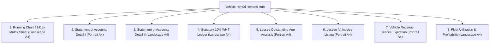

# AutoERP Vehicle Rental: End-User Operations Manual & Complete User Guide

**Status:** Official Comprehensive User Manual & Operational Reference  
**Audience:** Front-Desk Agents, Depot Clerks, Fleet Dispatchers, Rental Managers, Invoicing Specialists, Accountants, and New Team Members  
**System Standard:** Operational Civil Business Calendar (`Asia/Colombo`) · Exact Currency Precision (`DecimalMath`)  

---

## Welcome to the Vehicle Rental Operations Manual

Welcome to the **AutoERP Vehicle Rental Operations Manual**. This comprehensive, beginner-friendly guide walks you through every screen, feature, workflow, and business rule of the Vehicle Rental module.

Whether you are booking your first customer reservation, dispatching a vehicle from the depot, logging a driver's daily trip sheet, generating monthly commercial invoices, calculating vehicle owner payout statements, or printing official A4 legal running charts, this manual provides clear, step-by-step instructions with real-world examples.

---

## Table of Contents

1. [Understanding the System: The Dual-Sided Business Model](#1-understanding-the-system-the-dual-sided-business-model)
2. [Navigating the Workspace & User Interface Standards](#2-navigating-the-workspace--user-interface-standards)
3. [The Complete Rental Journey at a Glance](#3-the-complete-rental-journey-at-a-glance)
4. [Managing Reservations & Customer Inquiries](#4-managing-reservations--customer-inquiries)
5. [Customer Agreements (Client Contracts & Pricing Terms)](#5-customer-agreements-client-contracts--pricing-terms)
6. [Vehicle Owner Agreements (Leased Fleet Management)](#6-vehicle-owner-agreements-leased-fleet-management)
7. [Fleet Availability & Checking Vehicle Status](#7-fleet-availability--checking-vehicle-status)
8. [Vehicle Dispatches: Handover & Return Procedures](#8-vehicle-dispatches-handover--return-procedures)
9. [Vehicle Breakdowns & Emergency Swaps (Atomic Replacement)](#9-vehicle-breakdowns--emergency-swaps-atomic-replacement)
10. [Daily Running Charts (Official Trip Sheets)](#10-daily-running-charts-official-trip-sheets)
11. [Customer Billing: Base Rent, Mileage & Usage Invoicing](#11-customer-billing-base-rent-mileage--usage-invoicing)
12. [Vehicle Owner Settlements & Withholding Tax (WHT :3305-000)](#12-vehicle-owner-settlements--withholding-tax-wht-3305-000)
13. [Customer Security Deposits & Payment Management](#13-customer-security-deposits--payment-management)
14. [Fleet Operating Expenses & Cost Allocation Matrix](#14-fleet-operating-expenses--cost-allocation-matrix)
15. [Incident Evidence Register & Private Proof Uploads](#15-incident-evidence-register--private-proof-uploads)
16. [Vehicle Finance & Commercial Bank Leasing](#16-vehicle-finance--commercial-bank-leasing)
17. [Official Reports Hub & Exporting A4 Printouts](#17-official-reports-hub--exporting-a4-printouts)
18. [Troubleshooting & Frequently Asked Questions (FAQ)](#18-troubleshooting--frequently-asked-questions-faq)
19. [Daily Operational Best Practices Checklist](#19-daily-operational-best-practices-checklist)

---

## 1. Understanding the System: The Dual-Sided Business Model

Commercial fleet management involves two independent commercial tracks connected by physical vehicles:

```text
+----------------------------------------------------------------------------------------------------+
|                                    PHYSICAL FLEET OPERATIONS                                       |
|               Vehicle Dispatches · Daily Speedometers · Odometer Continuity · Trip Sheets          |
+----------------------------------------------------------------------------------------------------+
                                                  |
                 +--------------------------------+--------------------------------+
                 |                                                                 |
                 v                                                                 v
+----------------------------------+                             +-----------------------------------+
|      CUSTOMER TRACK (REVENUE)    |                             |        OWNER TRACK (COSTS)        |
|  Corporate Client (Customer)     |                             |  Vehicle Owner / Lessor (Supplier)|
|  Customer Agreement (Contract)   |                             |  Owner Agreement (Lease Terms)    |
|  Monthly Base Rent Invoices      |                             |  Monthly Base Lease Entitlements  |
|  Excess KM & Overtime Billing    |                             |  Driver OT Pass-Through Payouts   |
|  Security Deposit Receipts       |                             |  Repair Deductions (CDN Notes)    |
|  Receivables (Money Coming In)   |                             |  10% Statutory Withholding Tax    |
|                                  |                             |  Payables (Money Going Out)       |
+----------------------------------+                             +-----------------------------------+
```

### Three Fundamental Rules to Know:

1. **We Never Invent Money:** Physical evidence (speedometer readings, trip sheets, petrol bills, accident photos) can be recorded freely as operational truth. However, **no financial invoice, debit note, or cheque voucher** is ever generated automatically without an explicit, approved contract term and an authorized user action.
2. **Customer Pricing Never Derives Owner Costs:** What you bill the customer is completely independent of what you pay the vehicle owner. Each side has its own formal agreement.
3. **Company Vehicles Incur Zero Fictitious Owner Costs:** When your company owns the vehicle directly, the system flags it as company-owned; zero artificial owner agreements or supplier vouchers are created.

---

## 2. Navigating the Workspace & User Interface Standards

AutoERP is designed for speed, clarity, and ease of use. You never need to memorize database codes or complex technical IDs.

### 2.1 Workspace Navigation Menu

Access the Vehicle Rental module from the left sidebar navigation under **Vehicle Rental**:

| Menu Item | Screen URL | Primary Purpose |
|---|---|---|
| **Dashboard** | `/vehicle-rental/dashboard` | Live overview of active rentals, dispatches, pending inquiries, and today's trips. |
| **Reservations** | `/vehicle-rental/reservations` | Capture customer inquiries, quotes, and convert bookings into contracts. |
| **Customer Agreements** | `/vehicle-rental/customer/agreements` | Manage customer leasing contracts, rate cards, base billing, and deposits. |
| **Owner Agreements** | `/vehicle-rental/owner/agreements` | Manage contracts with external vehicle owners and fleet suppliers. |
| **Vehicle Dispatches** | `/vehicle-rental/uses` | Global register of all planned, in-custody, and returned vehicle assignments. |
| **Fleet Availability** | `/vehicle-rental/vehicles/available` | Real-time vehicle availability search across any selected date range. |
| **Running Charts** | `/vehicle-rental/running-charts` | Daily operational trip sheets, speedometer readings, overtime, and toll passes. |
| **Fleet Expenses** | `/vehicle-rental/expenses` | Log petrol, toll receipts, maintenance bills, and assign who pays for them. |
| **Incident Register** | `/vehicle-rental/incidents` | Record accidents, damage, police fines, and attach photographic proofs. |
| **Vehicle Finance** | `/vehicle-rental/finance-agreements` | Manage commercial bank leasing contracts, installments, and payment schedules. |
| **Reports Hub** | `/vehicle-rental/reports` | Access all 8 official printable reports, including 31-day running chart sheets. |

### 2.2 User Interface Principles Built for You

- **Zero Raw Database IDs:** You will never see cryptic database numbers. All vehicles display their registration plate number and model (e.g. `CBC-9180 · Toyota HiAce Super GL`), and customers/suppliers display their official business names.
- **Smart Search Dropdowns (`LookupSelect`):** When selecting a vehicle, customer, owner, or driver, simply start typing any part of their name or registration number. The system instantly filters and presents matching results.
- **Progressive Disclosure:** Forms keep primary fields front and center. Secondary details (rate adjustments, history logs, audit notes) are organized inside neat tabs and expandable `<details>` sections so your screen stays uncluttered.
- **Civil Business Calendar:** All dates automatically format to the civil business timezone (`Asia/Colombo`). Forms default to today's date so you don't waste time typing dates manually.

---

## 3. The Complete Rental Journey at a Glance

Here is how a typical monthly rental progresses through the system:

```text
[ 1. INQUIRY & RESERVATION ]
Customer calls for a vehicle -> Agent records dates & quote -> System checks fleet availability -> Confirmed!
                     |
                     v
[ 2. CONTRACT ACTIVATION ]
One-click Convert to Customer Agreement -> Set monthly rates, free KM & overtime terms -> Click "Activate"
                     |
                     v
[ 3. SECURITY DEPOSIT ]
Customer pays deposit -> Clerk records receipt via Payment module -> System tracks remaining deposit capacity
                     |
                     v
[ 4. FLEET DISPATCH (HANDOVER) ]
Customer arrives -> Clerk enters starting speedometer (e.g. 190,491 KM) & handover time -> Vehicle is "In Custody"
                     |
                     v
[ 5. DAILY OPERATION (RUNNING CHARTS) ]
Driver submits daily trip sheet -> Clerk records Start/End KM, duty times, overtime hours, and expressway toll passes
                     |
                     v
[ 6. FLEET RETURN (CHECK-IN) ]
Rental period concludes -> Clerk enters final speedometer (e.g. 192,316 KM) & return time -> Vehicle is "Available"
                     |
                     v
[ 7. COMMERCIAL INVOICING ]
Manager generates Base Rent Invoice (calendar proration) -> Runs Mileage Assessment (excess KM) -> Invoices Overtime
                     |
                     v
[ 8. LESSOR SETTLEMENT (IF LEASED) ]
System calculates owner hire earnings + overtime - repair deductions - 10% statutory WHT -> Issues settlement cheque
```

---

## 4. Managing Reservations & Customer Inquiries

The **Reservations** screen (`/vehicle-rental/reservations`) handles early booking inquiries from walk-ins, phone calls, emails, or company websites before signing a binding contract.

```text
+----------------------------------------------------------------------------------------------------+
|                                    RESERVATIONS MANAGEMENT                                         |
|  [ + New Reservation ]                                          Search: [ Unilever               ] |
+----------------------------------------------------------------------------------------------------+
| Ref Number      | Customer Name            | Vehicle / Category     | Rental Dates         | Status|
+----------------------------------------------------------------------------------------------------+
| RES-2026-0012   | Unilever Sri Lanka Ltd   | CBC-9180 (Toyota KDH)  | 01/07/26 to 30/07/26 | Conf. |
| RES-2026-0013   | John Keells Holdings     | Luxury Sedan Category  | 15/08/26 to 20/08/26 | Pend. |
+----------------------------------------------------------------------------------------------------+
```

### How to Create a New Reservation:

1. Click **New Reservation** in the top right corner.
2. Complete the form:
   - **Customer:** Type to select the corporate client or private individual.
   - **Requested Vehicle (Optional):** If the customer requested a specific car, select it. If they only requested a type (e.g. "Van" or "Sedan"), leave the vehicle blank and select the category.
   - **Rental Mode:** Choose **Self Drive** (client drives) or **With Driver** (company provides chauffeur).
   - **Billing Basis:** Choose **Daily** or **Monthly**.
   - **Dates & Times:** Select the planned departure and return dates.
   - **Estimated Rent & Deposit:** Enter the quoted price and required security deposit.
   - **Inquiry Source:** Select Walk-in, Phone Inquiry, Email, or Website.
   - **Remarks:** Add customer requests (e.g. "English-speaking driver requested", "Airport pickup").
3. Click **Create Reservation**.

### Reservation Lifecycle:
- **Pending:** The inquiry is logged while waiting for the client to confirm their schedule.
- **Confirmed:** The client confirmed their booking and fleet logistics are locked in.
- **Convert to Agreement:** When the client arrives to sign the contract, click **Convert to Agreement**. AutoERP instantly generates an active customer agreement pre-filled with the customer, dates, and pricing, saving you from re-typing data.
- **Cancelled:** If the client cancels, click **Cancel** and enter a brief reason (e.g. "Flight rescheduled").

---

## 5. Customer Agreements (Client Contracts & Pricing Terms)

A **Customer Agreement** (`/vehicle-rental/customer/agreements`) is the legal commercial contract defining what you charge the client.

### Step-by-Step: Setting Up a Customer Agreement

1. Go to **Vehicle Rental > Customer Agreements** and click **New agreement**.
2. **Contract Essentials:**
   - **Agreement Reference:** Enter your contract reference (e.g. `LAG7000012`). If omitted, the system generates one automatically.
   - **Customer:** Search and select the client.
   - **Rental Basis:** Choose **Monthly** (standard corporate lease) or **Daily** (short-term hire).
   - **Driver Arrangement:** Choose **With driver** or **Self-drive**.
   - **Start Date & End Date:** Enter the contract dates. (Leave End Date blank if open-ended).
3. **Agreed Rates & Allowances (Expandable Section):**
   - **Base Rental Rate:** The fixed charge per cycle (e.g. `327,500.00` per month).
   - **Included Distance (KM):** Free kilometers allowed per month (e.g. `2,500 KM`).
   - **Excess Distance Rate per KM:** Charge for every extra kilometer (e.g. `100.00` per KM).
   - **Driver Overtime Rates:** Hourly rates for Normal OT (e.g. `1,500.00/hr`), Double OT (Sunday/Off-day), and Triple OT (Public Holiday).
   - **Night-Out Rate:** Daily allowance if the chauffeur sleeps away from home depot.
   - **Agreed Security Deposit:** Required refundable deposit amount.
4. Click **Save draft**.

### Reviewing and Activating:
- In `Draft` status, you can freely edit terms and review rate calculations.
- Once verified, click **Review** &rarr; **Activate**.
- **Important:** Once **Active**, contract terms are permanently locked to ensure past invoices remain 100% auditable and tamper-proof.

### How to Change Rates on an Active Contract (Successor Agreement):
If a client renegotiates their monthly rate after a few months, **never attempt to edit the active contract**. Instead:
1. Open the active agreement and click **Create successor**.
2. Enter the new reference, effective cutover date, and update the new rates in the draft.
3. On the effective date, click **Activate**. The system seamlessly closes the old agreement and activates the new rates without disrupting active vehicle custody or duplicating security deposits.

---

## 6. Vehicle Owner Agreements (Leased Fleet Management)

When your company leases vehicles from private owners or fleet investors to supply your clients, manage them in **Owner Agreements** (`/vehicle-rental/owner/agreements`).

```text
+----------------------------------------------------------------------------------------------------+
|                                    OWNER AGREEMENT (SUPPLIER)                                      |
| Lessor / Owner: GUNATHILAKE H M S K GUNATHILAKE                     Vehicle: CBC-9180              |
| Monthly Base Lease Entitlement: LKR 327,500.00                      Free Allowance: 2,500 KM       |
| Driver Overtime Payout Rate: LKR 1,500.00/hr                        Excess KM Payout: LKR 100.00   |
+----------------------------------------------------------------------------------------------------+
```

### Key Differences from Customer Agreements:
- **Mandatory Vehicle Assignment:** An owner agreement always references the specific vehicle supplied by that owner.
- **Supplier Directory:** The owner is selected from your verified Supplier master list, complete with bank account details for monthly cheque disbursements.
- **Independent Payout Rates:** You define what you owe the owner (base monthly lease, overtime reimbursement, and excess mileage payout), completely separate from what you charge your client.

---

## 7. Fleet Availability & Checking Vehicle Status

Before promising a car to a client, always check its real-time availability in **Fleet Availability** (`/vehicle-rental/vehicles/available`):

1. Select your planned **Start Date & Time** and **End Date & Time**.
2. Filter by vehicle category (e.g. Van, SUV, Premium Sedan) if desired.
3. Click **Check Availability**.
4. The system scans all fleet records and displays color-coded badges:
   - <span style="color:#16a34a;font-weight:bold;">Available:</span> The car is idle in the depot, mechanically fit, and ready for dispatch.
   - <span style="color:#2563eb;font-weight:bold;">In Custody:</span> Currently out on the road with another customer.
   - <span style="color:#d97706;font-weight:bold;">Workshop / Maintenance:</span> Admitted to the repair workshop in `VehicleService`. The system **automatically blocks dispatches** until the workshop job card is formally signed off!
   - <span style="color:#9333ea;font-weight:bold;">Reserved:</span> Held under a confirmed booking inquiry.

---

## 8. Vehicle Dispatches: Handover & Return Procedures

Vehicle dispatches are managed inside the active Customer Agreement under the **Assigned Vehicles & Handover** tab.

```text
[ Step 1: Assign Vehicle ]         [ Step 2: Depot Handover ]         [ Step 3: Depot Return ]
Select vehicle & planned dates  ->  Inspect car & enter start ODO  ->  Inspect car & enter end ODO
(Status: Planned)                  (Status: In Custody)               (Status: Returned / Available)
```

### Step 1: Assigning a Vehicle to the Contract
1. Open the active Customer Agreement and click the **Assigned Vehicles & Handover** tab.
2. Click **Assign vehicle**.
3. Select the vehicle and enter the planned handover and return dates.
4. **Supply Source:**
   - If company-owned: Check **Company-owned vehicle**.
   - If leased from an owner: Select the covering **Owner Agreement**.
5. Click **Save assignment**. The vehicle is now `Planned`.

### Step 2: Handover (Vehicle Leaves Depot)
When the driver/client arrives to collect the vehicle:
1. Inspect the vehicle exterior and fuel level with the client.
2. Read the current speedometer (odometer).
3. Click **Handover** on the vehicle row.
4. Enter the **Handover Date & Time** and the **Starting Odometer** (e.g. `190,491 KM`).
5. Click **Confirm Handover**. The vehicle is now officially **In Custody**.

### Step 3: Return (Vehicle Comes Back to Depot)
When the rental concludes and the vehicle returns to the depot:
1. Inspect the car for any new damage or fuel discrepancies.
2. Click **Return vehicle**.
3. Enter the **Return Date & Time** and the verified **Return Odometer** (e.g. `192,316 KM`).
4. Click **Confirm Return**.
5. The vehicle status becomes **Returned**, the asset's master odometer updates automatically, and the car is immediately freed up for future bookings.

> [!NOTE]
> The system enforces strict **Odometer Continuity**. You can never enter a return odometer lower than the handover odometer.

---

## 9. Vehicle Breakdowns & Emergency Swaps (Atomic Replacement)

If an assigned vehicle experiences engine trouble, AC failure, or an accident mid-rental, you must deploy a replacement car immediately.

**Never manually return the car and create a new contract!** Doing so would split the client's monthly mileage allowance across two contracts and result in incorrect excess mileage charges. Instead, use the **Replace Vehicle** feature.

```text
+----------------------------------------------------------------------------------------------------+
|                                    ATOMIC VEHICLE REPLACEMENT                                      |
+----------------------------------------------------------------------------------------------------+
| Disabled Vehicle: CAP-1302        Return Odometer: 139,166 KM       Swap Time: 26/07/2026 08:00 AM |
| Replacement Car:  CBC-9180        Handover Odo:    192,020 KM       Supply:    Owner Agreement     |
| Reason: Engine overheating on CAP-1302; swapped for CBC-9180                                      |
+----------------------------------------------------------------------------------------------------+
                                                  |
                                                  v
                      [ Both Vehicles Share the Single 2,500 KM Allowance ]
                      [ Trips on CBC-9180 Show Amber Badge: "For Repl. CAP-1302" ]
```

### How to Execute a Vehicle Replacement:
1. Open the agreement's **Assigned Vehicles & Handover** tab.
2. On the disabled vehicle, click **Replace vehicle**.
3. Enter the disabled vehicle's final **Return Odometer**.
4. Select the **Replacement Vehicle** from the available fleet.
5. Enter the replacement vehicle's starting **Handover Odometer**.
6. Set the **Replacement Date & Time** and enter a mandatory reason.
7. Click **Confirm replacement**.

**What the system does behind the scenes:**
- Returns the old car and hands over the new car in a single atomic transaction.
- Combines commercial mileage across both vehicles under the client's single monthly allowance.
- Automatically places a visual amber badge and note (`For Repl. <old_car>`) on all subsequent trip sheets and official printouts.

---

## 10. Daily Running Charts (Official Trip Sheets)

The **Running Chart** (`/vehicle-rental/running-charts`) is the official daily log sheet replicating Sri Lankan transport industry standards (`pmdeblogsheet2.frx` and `pmcre1logsheet2.frx`).

```text
+----------------------------------------------------------------------------------------------------+
| RUNNING CHART: RC-2026-07-01-01               Date: 01/07/2026               Client: Unilever      |
| Vehicle: CBC-9180                             Duty: 05:00 AM to 10:00 PM     Driver: M. Perera     |
+----------------------------------------------------------------------------------------------------+
| Start Odo: 190,491 KM   Finish Odo: 190,698 KM   Comparative: 207 KM         Cumulative: 207 KM    |
| Normal OT: 5.00 Hrs     Double OT:  0.00 Hrs     Triple OT:   0.00 Hrs       Pass / Toll: 850.00   |
| Remarks: For Repl. CAP-1302 [Amber Replacement Badge]                                              |
+----------------------------------------------------------------------------------------------------+
```

### How to Record a Daily Running Chart:
1. Open the agreement's **Running Charts** tab (or go to **Vehicle Rental > Running Charts**).
2. Click **Record Running Chart**.
3. Fill in the daily operational facts:
   - **Trip Date:** The civil calendar date of travel.
   - **Duty ON & Duty OFF:** Chauffeur shift start and finish times (e.g. `06:30 AM` to `08:00 PM`).
   - **Start & End Odometer:** Speedometer readings. The system automatically computes the **Comparative Mileage** (distance driven today) and the running **Cumulative Mileage** for the month.
   - **Commercial vs. Garage KM:** Billable client distance vs. deadhead depot travel.
   - **Driver Assignment:** Select an employee driver from the HR directory or record external contractor details.
   - **Overtime Hours & Tier:** Enter overtime hours and specify tier: **Normal OT** (`N`), **Double/Sunday OT** (`D`), or **Triple/Holiday OT** (`T`).
   - **Night Out:** Check if the driver stayed overnight outside depot base.
   - **Pass (Highway Tolls):** Enter expressway toll charges paid out of pocket (e.g. `850.00`).
4. Click **Save Running Chart**.

### Finalizing the Trip Sheet:
Once verified against the driver's signed paper sheet, click **Finalize**. Finalizing freezes the facts as permanent evidence, enabling automated commercial billing.

---

## 11. Customer Billing: Base Rent, Mileage & Usage Invoicing

AutoERP eliminates manual invoice preparation by automatically calculating charges directly from your contracts and finalized running charts.

### 11.1 Base Rent Invoicing (Monthly Calendar Proration)
1. In the Customer Agreement, switch to the **Billing & Invoices** tab.
2. Click **Preview base rent** to inspect the calculation.
   - The system checks the cycle (e.g. 1st to 30th) and calculates exact proration using actual calendar days (`actual_calendar_days_v1`):
     $$\text{Charge} = \frac{\text{Actual Days in Period}}{\text{Total Days in Month}} \times \text{Monthly Base Rate}$$
3. Click **Create base rent invoice**.
4. The system posts a formal commercial invoice in [`Invoice`](file:///d:/project-new/AutoERP/app/Modules/Invoice) with revenue credited to General Ledger accounts.

### 11.2 Commercial Mileage Assessment (Excess KM)
At month end, assess whether the client exceeded their free mileage allowance:
1. In the Running Charts panel, click **Mileage Assessment**.
2. The system automatically aggregates all finalized trip kilometers across the month (including replacement cars):
   - *Total Commercial KM:* e.g. `2,850 KM`.
   - *Monthly Free Allowance:* e.g. `2,500 KM`.
   - *Billable Excess KM:* `350 KM`.
   - *Excess Rate:* `LKR 100.00 / KM`.
   - *Total Excess Charge:* `LKR 35,000.00`.
3. Click **Record mileage assessment**. If excess kilometers exist, the system generates an official customer invoice for the difference.

### 11.3 Invoicing Driver Overtime & Toll Passes
1. On any finalized running chart, open the **Usage Charges** panel.
2. Select **Overtime** or **Toll Pass Outlays**.
3. Overtime hours automatically multiply by agreed hourly rates. Toll receipts transfer at exact cost.
4. Click **Create usage charge invoice** to post the bill.

---

## 12. Vehicle Owner Settlements & Withholding Tax (WHT :3305-000)

If you lease vehicles from third-party owners, AutoERP provides a closed-loop settlement engine that calculates monthly payouts with zero guesswork.

```text
======================================================================================================
               STATEMENT OF ACCOUNTS - VEHICLE WISE (DETAIL I) [A4 PORTRAIT]
Lessor: GUNATHILAKE H M S K GUNATHILAKE                               Vehicle: CBC-9180
Period: 01/08/2026 To 31/08/2026
======================================================================================================
Balance Brought Forward (Balance B/F as at 01/08/2026)............................. LKR (82,445.00)

Rental & Other Payable:
  One Month Base Hire (01/08/2026 To 31/08/2026).................. LKR 327,500.00
  Driver's Overtime Normal (11.75 Hrs @ 1,500.00)................. LKR  17,625.00
  Other Charges / Expressway Toll Passes Reimbursed............... LKR   2,070.00
  ---------------------------------------------------------------------------------
  Total Rental & Other Payable.................................... LKR 347,195.00    LKR 347,195.00

Settlements (Bank Vouchers & Cheques Issued):
  31/08/2026 PRB7001084 (Cheque No: 552350)....................................... LKR (334,095.00)

Deductions for Repair (Chargebacks):
  31/08/2026 CDN7000294 DAY 01 CBC-9180 Maintenance Deduction.................... LKR  (13,100.00)
------------------------------------------------------------------------------------------------------
Closing Balance: Balance Over Paid as at 31/08/2026................................ LKR (82,445.00)
======================================================================================================
```

### Accessing Owner Settlement Statements:
Navigate to **Vehicle Rental > Reports > Owner Disbursements**:
1. **Statement of Accounts (Detail I) [A4 Portrait]:** A clean vertical summary showing opening balance, earnings, cheque disbursements, repair deductions, and closing balance.
2. **Statement of Accounts (Detail II) [A4 Landscape]:** An 18-column operational matrix showing hire dates, agreed KM, rate, hire amount, normal/double/triple overtime hours split, driver salary/bata, other charges, VAT, net settlements, and closing balance.
3. **Statutory Withholding Tax Ledger (`:3305-000 WHT`):** Automatically audits 10% statutory tax withheld from gross lessor earnings, tracking credit note references (`CDN7000248` to `CDN7000273`).

---

## 13. Customer Security Deposits & Payment Management

Security deposits protect against vehicle damage or unpaid bills. AutoERP manages deposits through the dedicated [`Payment`](file:///d:/project-new/AutoERP/app/Modules/Payment) module.

### How to Collect a Deposit:
1. Open the Customer Agreement and switch to the **Security Deposit** tab.
2. The summary displays:
   - *Agreed Deposit Requirement:* e.g. `LKR 50,000.00`.
   - *Net Collected Receipts:* Cash already in hand.
   - *Remaining Capacity:* Balance left to collect.
3. Enter receipt details (Payment Method: Cash, Bank Transfer, or Cheque; Reference Number; Amount).
4. Click **Create deposit receipt**. The system records the payment and links it to the contract.

### Applying or Refunding Deposits:
- **Settling Final Invoices:** When the lease terminates, open the customer's final invoice and click **Apply Payment / Deposit** to settle open balances with the deposit.
- **Refunding Clean Returns:** If the car is returned undamaged with all bills paid, open the deposit receipt in the Payment module and click **Refund Deposit**.

---

## 14. Fleet Operating Expenses & Cost Allocation Matrix

When drivers buy fuel, pay highway tolls, or perform emergency repairs on the road, log them in **Fleet Expenses** (`/vehicle-rental/expenses`).

```text
[ Record Expense ]  -->  [ Manager Review ]  -->  [ Choose 1 of 4 Allocation Destinations ]
Petrol, Tolls, Maint.     Inspect Receipt         1. Company Cost (Absorbed by business)
                                                  2. Customer Recovery (Billed to client)
                                                  3. Owner Deduction (Deducted from lessor payout)
                                                  4. Driver Reimbursement (Paid via HR/Payroll)
```

### How to Record and Allocate an Expense:
1. Go to **Vehicle Rental > Fleet Expenses** and click **Record Rental Fleet Expense**.
2. Select the vehicle, expense date, category (Fuel, Toll, Repair, Fine), and amount.
3. Once saved, click **Approve & Allocate**.
4. Select who absorbs the cost:
   - **Company Cost:** Absorbed as fleet operating overhead.
   - **Customer Recovery:** Automatically added as a billable item on the customer's next invoice.
   - **Owner Deduction:** Deducted as a `CDN` debit note on the vehicle owner's monthly payout.
   - **Driver Reimbursement:** Sent to HR/Payroll to reimburse the employee driver.

---

## 15. Incident Evidence Register & Private Proof Uploads

When an accident, body scratch, or police traffic citation occurs, record it in the **Incident Register** (`/vehicle-rental/incidents`).

### Key Invariant: Factual Evidence vs. Financial Charges
Logging an incident records verified physical evidence. It **never automatically creates financial charges** against a client or driver without an authorized commercial decision.

### How to Log an Incident:
1. Go to **Vehicle Rental > Incident Evidence** and click **Record new incident**.
2. Select the vehicle assignment, date, incident category (Accident/Damage, Traffic Fine, Toll Violation), and description.
3. **Upload Proof Files:** Click **Attach file** to upload photos or scanned police vouchers (up to 10 MB PDF/JPEG/PNG). Files are stored in secure private tenant storage with SHA-256 digital integrity fingerprints.
4. **Manager Review:** The rental manager reviews the evidence and clicks **Confirm Evidence** or **Reject Evidence**. Once confirmed, records are locked permanently for audit compliance.

---

## 16. Vehicle Finance & Commercial Bank Leasing

If your company finances fleet vehicles through commercial banks or leasing institutions, track their amortization schedules in **Vehicle Finance** (`/vehicle-rental/finance-agreements`).

- **Setup Financing Terms:** Enter the financing bank, financed vehicle, loan amount, down payment, balloon value, interest rate (%), and payment tenor (months).
- **Automated Amortization:** The system instantly generates a 36- or 48-month installment schedule with principal and interest breakdowns.
- **Due Status Sync:** Click **Refresh Due Statuses** to automatically flag installments maturing in the current business month.
- **One-Click Invoicing:** Click **Create Payable Invoice** on any due installment to post an inbound supplier invoice in [`Invoice`](file:///d:/project-new/AutoERP/app/Modules/Invoice) so accounts can disburse payment.

---

## 17. Official Reports Hub & Exporting A4 Printouts

Access the complete reporting suite at **Vehicle Rental > Reports** (`/vehicle-rental/reports`):



### How to Print the Official 31-Day Running Chart Matrix Sheet:
1. Open **Reports > Running Chart 31-Day Matrix Sheet**.
2. Select the vehicle assignment, month, and view mode (**Lessee Mode** for clients or **Owner Mode** for lessors).
3. Click **Generate Report**.
4. The full calendar matrix displays on your screen showing daily odometers, duty times, overtime tiers, toll passes, and replacement vehicle amber badges.
5. Click **Download PDF** for an official legal A4 Landscape printout complete with driver and client signature blocks.

---

## 18. Troubleshooting & Frequently Asked Questions (FAQ)

### Q1: The system gave an error: "Conflict: The record has been modified by another user." What does this mean?
**Answer:** AutoERP uses optimistic concurrency protection. If another team member updated the agreement, vehicle use, or running chart while you had it open on your screen, the system prevents you from accidentally overwriting their changes. Simply refresh your browser page to load the latest data, then reapply your edit.

### Q2: Why is a vehicle missing from the dispatch dropdown?
**Answer:** Check three things:
1. Is the vehicle currently dispatched to another client? (Check **Fleet Availability**).
2. Is the vehicle admitted to the workshop in **Vehicle Service**? (Workshop admissions block rental dispatches).
3. If it is an owner-leased car, does the owner agreement cover the dates you selected?

### Q3: Can I delete an invoice or running chart if I made a mistake?
**Answer:** No. Deleting records destroys financial audit trails. Instead:
- To correct a trip sheet: Open the chart and click **Correct**. The system reverses the old chart and creates an editable revision.
- To cancel an unposted billing item: Click **Void**.

### Q4: Why did the system reject my return odometer?
**Answer:** The system strictly enforces odometer continuity. Your return odometer must be equal to or greater than the handover odometer. Double-check the vehicle's speedometer reading.

### Q5: Can I give a customer a discount on their monthly base rent?
**Answer:** Yes. In a `Draft` customer agreement, you can enter any agreed rate. If the contract is already active, click **Create successor** to negotiate and activate the discounted rate starting from the next billing cycle.

---

## 19. Daily Operational Best Practices Checklist

- [x] **Check Availability First:** Always verify vehicle availability in the system before promising dates to a customer.
- [x] **Verify Speedometers at the Curb:** Check the actual odometer at handover and return; record readings immediately.
- [x] **Prompt Daily Finalization:** Ensure chauffeurs submit trip sheets daily and finalize them promptly so monthly billing is never delayed.
- [x] **Always Use "Replace Vehicle" for Swaps:** Never manually check-in and re-assign a breakdown car; use atomic replacement so the client's monthly mileage allowance remains shared.
- [x] **Attach Photos for Damage:** Always upload clear photographs and police vouchers when logging incidents to protect company liability.
- [x] **Reconcile Owner Statements Monthly:** Cross-check owner settlement statements against repair deductions and 10% statutory WHT before releasing settlement cheques.
