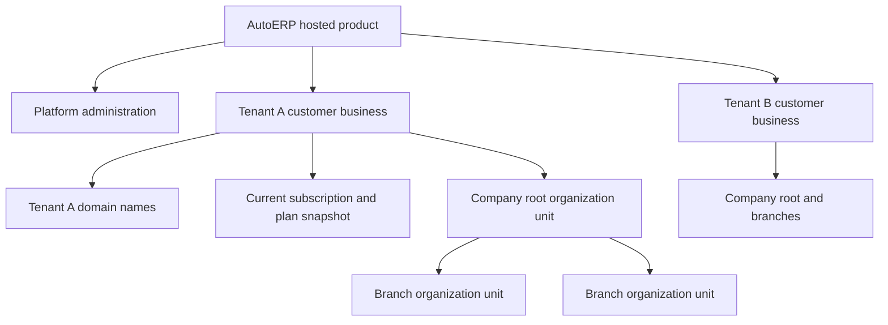

# AutoERP SaaS tenancy and pricing review

Date: 31 October 2026

## Conclusion

AutoERP has the foundation for one hosted product serving multiple customer businesses. Each subscribing business is a Tenant; its company root and branches are Organization Units within that tenant. A hostname maps to a tenant, and the tenant's current subscription controls available commercial modules and resource limits.

The implemented model is a modular Laravel application with a React frontend, a shared database schema and tenant-owned rows. Creating a customer tenant does not create a separate application installation or database. It also does not automatically provision DNS, a web-server virtual host or a TLS certificate.

Plan pricing and subscription entitlement administration exist. A complete SaaS charging system was not found in the reviewed application: recurring platform invoices, subscription payment collection, gateway checkout, payment webhooks, payment-driven renewals, proration and customer self-service billing are not implemented by the Tenant subscription flows reviewed here.

Two correctness problems affect commercial operations: reassignment after expiry/cancellation conflicts with revision validation, and schema-version handling can remove Vehicle Rental from a price-only plan revision. These should be corrected before relying on the affected workflows.

This is a source review with focused validation, not a production deployment or a complete security audit. No application behavior or database data was changed.

## Product and customer structure

| Term | Meaning in this codebase | Commercial interpretation |
|---|---|---|
| AutoERP platform | Shared application and platform administration | The product/service you operate |
| Tenant | A customer business with its own identity, lifecycle and subscription | The business buying AutoERP |
| Organization Unit | Protected company root or descendant branch/unit | Locations or departments inside that business |
| Customer module record | A party served by the tenant business | For example, a vehicle owner visiting the garage; not an AutoERP subscriber |
| Tenant Plan | Platform-managed package identity | The package sold to businesses |
| Plan Revision | Immutable price, currency, interval, modules and limits | A dated version of that package |
| Subscription | Tenant assignment with commercial snapshots and access dates | The customer's current contractual access |

Different subscribing companies should receive different tenants. Branches of one company should normally remain inside its tenant as organization units. Do not place unrelated subscribing companies under one tenant merely because both are called organizations in business conversation.

Evidence: [tenant creation](../../app/Modules/Tenant/Services/CreateTenantService.php), [root provisioning](../../app/Modules/OrganizationUnit/Services/Provisioning/TenantOrganizationProvisioner.php), [organization schema](../../app/Modules/OrganizationUnit/Database/Migrations/2026_06_12_020002_create_organization_units_table.php).

## Current onboarding workflow

The platform UI exposes Identity, Foundation, Domain, Subscription and Readiness steps.

1. A platform operator creates the tenant with code, name, slug and base accounting currency. It starts in Draft state with an onboarding progress record.
2. Foundation provisioning creates/reconciles the protected company root, permission catalogue, Super Admin role, authentication provider and initial administrator account. The owning modules provision their own resources through contracts.
3. The operator adds an exact public hostname and completes ownership and operational verification.
4. The operator selects a plan revision, assigns trial or active access, and supplies the relevant dates.
5. Readiness checks verify the actual foundation resources, operational administrator, base currency, active plan, usable subscription and primary domain.
6. Activation checks readiness again while the tenant is locked, rather than trusting an earlier screen response.

Provisioning is designed to reconcile and resume foundation steps. It is an operator-led flow; it is not an implemented public purchase-and-auto-provision checkout flow.

Evidence: [setup navigation](../../resources/js/modules/tenant/components/TenantSetupNavigation.tsx), [onboarding coordinator](../../app/Modules/Tenant/Services/Onboarding/TenantOnboardingService.php), [readiness](../../app/Modules/Tenant/Services/Onboarding/TenantReadinessService.php), [activation](../../app/Modules/Tenant/Services/TenantLifecycleService.php).

## Domains and subdomains

A customer subdomain such as `business-a.<your-product-domain>` fits the current tenant-domain design. A customer-owned hostname also fits. These are examples, not configured or verified production domains.

The application stores the complete hostname in `tenant_domains`. It does not derive the tenant from the first subdomain label or automatically turn a tenant slug into a domain. Exact domain lookup selects the tenant. Multiple domains may belong to a tenant, with a separate primary-domain assignment. The domain table belongs to Tenant, not OrganizationUnit; branch-specific subdomain selection is not provided by this mapping.

Current verification requires:

1. Add the hostname through domain management.
2. Request a DNS challenge.
3. Publish a TXT record at `_autoerp-verification.<complete-hostname>` with the returned verification value.
4. Configure public DNS and the hosting/reverse-proxy route to reach the AutoERP deployment.
5. Arrange valid HTTPS for that hostname outside the application.
6. Run verification jobs. They verify DNS ownership, inspect TLS validity and call the application's HTTPS domain probe, which must confirm the expected tenant and hostname.
7. Mark the operationally ready domain as primary and satisfy tenant activation readiness.

No DNS-provider or certificate-issuance automation was found in this workflow. A wildcard DNS/certificate deployment could be arranged at the hosting layer, but the current application still requires each exact tenant hostname record and ownership challenge. A wildcard hostname itself is rejected as a tenant-domain value.

At runtime the request host must resolve to a ready domain belonging to an active tenant with usable trial/active subscription access. The authenticated token's tenant and the user's tenant membership must match. Production tenant selection cannot be overridden to a different tenant by a request header. A configured central/platform host is a different context; local fallback is explicitly restricted to local/testing.

Evidence: [domain service](../../app/Modules/Tenant/Services/Domains/TenantDomainService.php), [DNS verifier](../../app/Modules/Tenant/Services/Domains/DnsTenantDomainOwnershipVerifier.php), [operational verifier](../../app/Modules/Tenant/Services/Domains/TenantDomainOperationalVerificationService.php), [domain readiness](../../app/Modules/Tenant/Services/Domains/TenantDomainReadinessPolicy.php), [host resolver](../../app/Modules/Tenant/Services/CurrentTenantContextResolver.php), [hostname validation](../../app/Modules/Tenant/Services/Rules/TenantValueNormalizer.php).

## Data architecture and separation

The explicit supported database strategy is `shared_schema`. Tenant-owned Eloquent models use a mandatory tenant scope. Reads without a trusted tenant context return no rows, except in an explicit control-plane context. Model ownership guards reject tenant mismatches and changes to a record's tenant ownership. Organization-unit hierarchy foreign keys include tenant ownership, preventing parents/types from another tenant.

This is logical isolation in shared infrastructure. It is not a separate database, server, application copy or file provider for each customer. Direct SQL and custom queries still require correct tenant constraints; these foundation mechanisms do not by themselves prove isolation of every feature, export, background job and storage path.

Private storage is shared with tenant-specific object-key prefixes. Infrastructure capabilities report a platform mailer and no supported tenant-specific database/storage/mail provider profiles. Business configuration follows organization-unit override, tenant override, global override and definition default precedence.

The main module responsibilities are clear: Tenant coordinates SaaS lifecycle and entitlements, OrganizationUnit owns hierarchy, User owns access assignments, Auth owns credentials/tokens, and business modules own their operational records. Tenant should remain the access/subscription source of truth. Future platform charging needs its own coherent ownership boundary.

Evidence: [database strategy](../../app/Modules/Tenant/Constants/TenantDatabaseStrategy.php), [scope](../../app/Modules/Core/Database/Scopes/TenantScope.php), [ownership guards](../../app/Modules/Core/Models/Concerns/HasImmutableTenantOwnership.php), [infrastructure capabilities](../../app/Modules/Tenant/Services/Platform/TenantInfrastructureCapabilityService.php).

## Pricing and subscription capabilities already present

| Capability | Current behavior |
|---|---|
| Package catalogue | Create, update, activate and deactivate plans |
| Revision history | Commercial changes create immutable plan revisions with a change note and effective date |
| Price | One non-negative decimal price per revision, with currency |
| Interval | Month, quarter or year |
| Commercial modules | Customers, suppliers, HR, items, warehouses, inventory, purchasing, selling, vehicles, service, rental, invoicing, payments, finance and reporting |
| Foundation modules | Auth, Tenant, User, OrganizationUnit, Configuration, ReferenceData and Audit are outside the commercial module selection catalogue |
| Limits | Users, organization units, warehouses and tenant-document storage |
| Assignment | Assign a plan revision with trial/active status and access dates |
| Changes | Renew, extend, correct and cancel commands, with the correctness limitations below |
| History | Immutable subscription revisions, commercial snapshots, current pointer and event/audit history |
| Downgrade checks | Reject limits below existing usage; active tenants cannot remove modules without suspension/closeout |
| Runtime enforcement | Backend feature middleware and resource-creation limit checks; not just navigation hiding |

A subscription snapshots the plan name, features, limits, price, currency and interval. Changing the catalogue price does not automatically reprice existing subscriptions. A deliberate later subscription revision must select the intended plan revision.

The interval does not calculate an automatic next invoice or contract end date in the reviewed command flow. Dates are supplied independently. Active subscriptions can have no end date. Future subscription start dates are explicitly rejected. Trial expiry does not perform an automatic paid conversion.

Expiry is checked at runtime. Scheduled expiry also changes the current subscription state and makes active tenants inactive, with audit/outbox records. Merely recording a monthly price is insufficient to produce monthly renewal or payment behavior.

Evidence: [plan schema](../../app/Modules/Tenant/Services/Plans/TenantPlanSchema.php), [plan update](../../app/Modules/Tenant/Services/Plans/UpdateTenantPlanService.php), [subscription lifecycle](../../app/Modules/Tenant/Services/Subscriptions/TenantSubscriptionLifecycleService.php), [input/date rules](../../app/Modules/Tenant/Services/Subscriptions/TenantSubscriptionCommandInput.php), [entitlements](../../app/Modules/Tenant/Services/TenantEntitlementService.php), [downgrade readiness](../../app/Modules/Tenant/Services/Subscriptions/TenantSubscriptionReadinessService.php), [expiry](../../app/Modules/Tenant/Services/ExpireTenantsService.php).

## SaaS charging capabilities not found

The reviewed platform/Tenant flow does not implement subscription invoices, a platform payment ledger, checkout, gateway payment webhooks, automatic collection, payment-driven renewals, failed-payment retries, dunning, proration, setup-fee charging, coupon calculation, per-seat charging, usage-based overage charging, a future scheduled plan switch or a customer self-service billing portal.

The application's Invoice/Payment modules currently handle the tenant business's operational transactions, such as garage invoices and supplier/customer payments. Their existence does not mean AutoERP subscription revenue is being charged to the tenant. No Tenant subscription integration with those modules was found in the reviewed code paths.

This absence was checked using module routes, migrations, services, frontend subscription controls and searches for payment provider, checkout, recurring collection and webhook integrations. It does not claim to inspect separate infrastructure or an external billing system outside this repository.

## Correctness findings affecting pricing

### P1 Reassignment after expiry or cancellation is internally inconsistent

`TenantSubscriptionMutationPolicy` allows `assign` when an existing pointer is expired/cancelled and the version matches. The frontend offers Assign in those states. `TenantSubscriptionLifecycleService` then includes the existing subscription ID as `supersedes_subscription_id`. However, `TenantSubscriptionRevisionState` forbids any superseded subscription for an Assign operation, and the model executes that validation on creation.

Consequently, the intended reassignment path rejects the revision. Once the scheduler has made the pointer expired, Renew is also rejected by the mutation policy because non-Assign commands require an assigned pointer. This blocks the normal terminal-state recovery path.

Validation: a direct policy/validator probe confirmed both terminal states permit Assign, followed by the exception `An initial assignment cannot supersede another subscription.` A full HTTP/database reproduction was not performed.

Responsible layer: Tenant subscription lifecycle and revision invariants. Define reassignment semantics consistently, preserve history and verify assign-after-expiry, assign-after-cancellation and reactivation end to end. Do not patch this by deleting old pointers or bypassing validation in the frontend.

Sources: [mutation policy](../../app/Modules/Tenant/Services/Subscriptions/TenantSubscriptionMutationPolicy.php#L29), [revision construction](../../app/Modules/Tenant/Services/Subscriptions/TenantSubscriptionLifecycleService.php#L212), [revision validation](../../app/Modules/Tenant/Services/Subscriptions/TenantSubscriptionRevisionState.php#L52), [model creation guard](../../app/Modules/Tenant/Models/TenantSubscriptionModel.php), [UI actions](../../resources/js/modules/tenant/components/tenantSubscriptionRules.ts).

### P1 A price-only plan revision can lose Vehicle Rental

Vehicle Rental is retained by schema version 2 normalization, but intentionally stripped when normalizing schema version 1. `UpdateTenantPlanService` normalizes existing features without passing their saved schema version when the update omits features. The actual plan editor sends only changed fields, so a price-only edit omits the unchanged feature list.

The new revision can therefore retain the new price but lose Vehicle Rental. Existing subscription snapshots remain unchanged immediately, but assigning/renewing against that revision changes the available modules.

The subscription-readiness service also omits schema versions when comparing old/new modules, so its active-tenant module-removal check can miss Vehicle Rental removal.

Validation: direct normalizer calls on the same feature payload retained Vehicle Rental with schema 2 and removed it with the omitted/default schema. The editor and service call path was inspected; an HTTP/database reproduction was not performed.

Responsible layer: pass the persisted source schema version when reading saved feature payloads in plan updates and readiness comparison. Verify price-only edits preserve every module and that active-tenant rental removal is blocked.

Sources: [normalizer](../../app/Modules/Tenant/Services/Plans/TenantPlanSchema.php#L82), [plan update](../../app/Modules/Tenant/Services/Plans/UpdateTenantPlanService.php#L145), [partial update payload](../../resources/js/modules/tenant/components/TenantPlanEditor.tsx#L300), [readiness comparisons](../../app/Modules/Tenant/Services/Subscriptions/TenantSubscriptionReadinessService.php#L59).

### Commercial limit meanings require precise wording

- Organization-unit limits count the protected company root and all non-retired descendants. A limit of one means only the root remains available; it does not mean one additional branch. Inactive non-retired units still count.
- User usage counts non-deleted user records rather than simultaneous sessions. The current model is a maximum user-count entitlement, not metered per-seat billing.
- `max_storage_mb` currently measures and enforces Tenant document storage, using `tenant_documents.size_bytes`. It does not represent an established whole-product storage quota across employee/customer/service-job files, logos, database records and backups. Do not sell it as total account storage without defining and implementing that scope.
- No usage/overage charge is calculated when a cap is reached; relevant creation operations reject the request.

Sources: [organization count](../../app/Modules/OrganizationUnit/Repositories/EloquentOrganizationUnitRepository.php#L21), [user usage](../../app/Modules/User/Services/TenantLimits/UserLimitUsageContributor.php), [storage usage](../../app/Modules/Tenant/Services/Subscriptions/TenantStorageLimitUsageContributor.php#L18), [storage enforcement](../../app/Modules/Tenant/Services/Documents/TenantDocumentService.php#L336).

## Pricing design that fits this foundation

The smallest initial commercial model is a fixed package price per customer tenant for a chosen interval, with included modules and clearly defined user, organization-unit and warehouse caps. This fits the implemented single-price revision model. Actual selling prices should be decided from operating costs, support commitments, onboarding effort and customer value; no market price is inferred from source code.

Before implementation, define these commercial rules:

1. Whether the protected company root counts in advertised location allowances, and how that maps to internal limits.
2. What constitutes a billed user, and whether inactive accounts consume the allowance.
3. Included modules and the module combinations required for complete workflows.
4. Monthly/quarterly/annual prices and whether each is its own commercial revision or a distinct package variant.
5. Setup, training and data-import charges, if any.
6. Trial length and the explicit conversion process.
7. Access period, payment due date, grace policy and expiry/reactivation rules.
8. Upgrade timing, downgrade closeout, refunds and whether proration is supported initially.
9. Storage scope before publishing a storage allowance.

For an operator-led launch, use external/manual billing with an auditable payment record and deliberate entitlement activation after the confirmed commercial decision. Existing code does not provide the platform collection record; that process must be explicitly designed. Fix subscription recovery before depending on manual renewal operations.

For automated sales, add a platform-owned billing capability for invoices, charges/payments and adjustments, then integrate verified payment outcomes with Tenant subscription commands. Keep tenant business operational invoices separate in ownership and reporting from AutoERP's own subscription charges. Reuse existing infrastructure through explicit contracts only where its tenancy and accounting semantics actually fit.

Do not implement charging by adding payment flags to organization units or by using tenant-domain names as billing identity. The subscriber is the Tenant. Domains are access routing, and branches are organization structure.

## Production hosting work remains separate

Prepare central host configuration, exact customer-domain records, DNS routing, HTTPS, queue workers and Laravel scheduling. The repository schedules domain maintenance every fifteen minutes, expiry hourly, storage cleanup every ten minutes and event publishing every minute. Declaring these jobs does not establish that workers or a scheduler run in production.

The reviewed sample configuration supports local fallback. This review did not read production secrets, change DNS, create a tenant, issue certificates, charge money or verify a deployed hostname. Before launch, test two real tenants across login, branch permissions, reports, exports, background work and private files.

Evidence: [Tenant configuration](../../app/Modules/Tenant/Config/tenant.php), [example environment](../../.env.example), [scheduler](../../routes/console.php), [platform routes](../../app/Modules/Tenant/Routes/api.php).

## Verification record

- Reviewed recent change records before examining the relevant modules.
- Inspected migrations, ownership boundaries, domain and authentication routing, onboarding, plan/subscription services, limits, expiry and frontend administration flows.
- Ran direct, read-only contract probes for terminal-state reassignment and schema-version feature normalization; both reproduced the inconsistencies described above.
- Focused Tenant tests passed: 23 tests, 43 assertions, covering domain rules, the supported database strategy, subscription command dates and subscription mutation policy.
- A broader Tenant test run was stopped after prolonged lack of progress; it did not produce a completed result. No full-suite success is claimed. The focused passing tests do not cover the cross-service inconsistencies identified above.
- No application-code fixes, migrations, DNS changes or production acceptance testing were performed.
