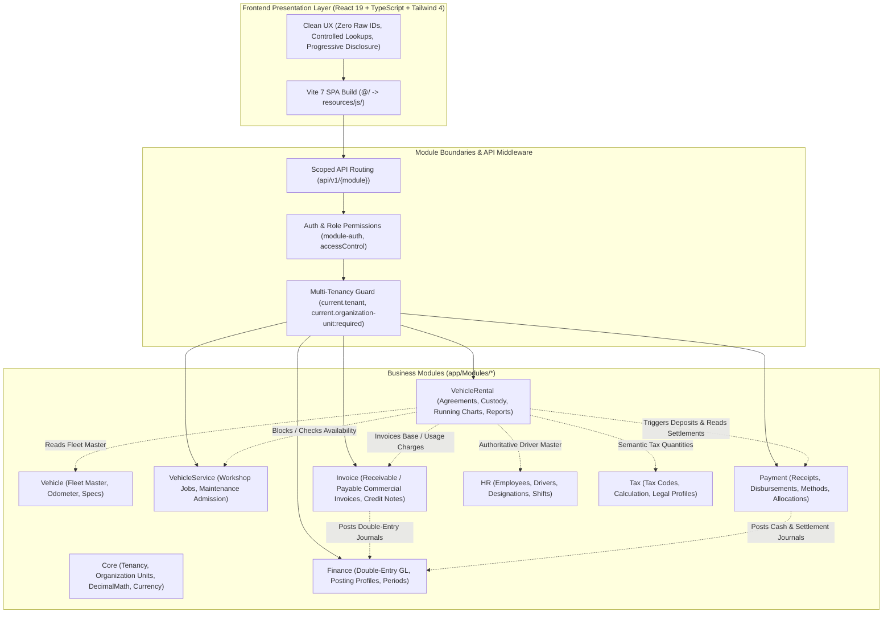
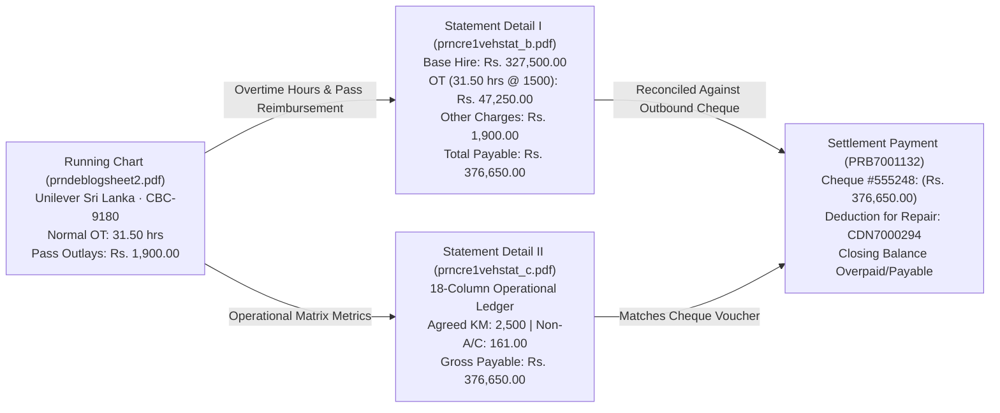
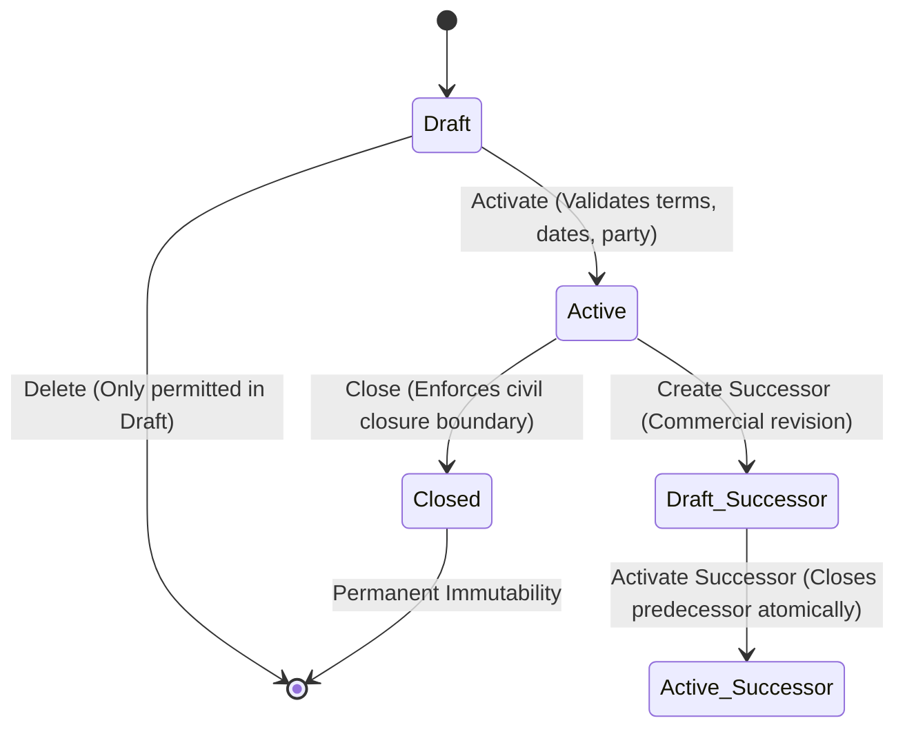
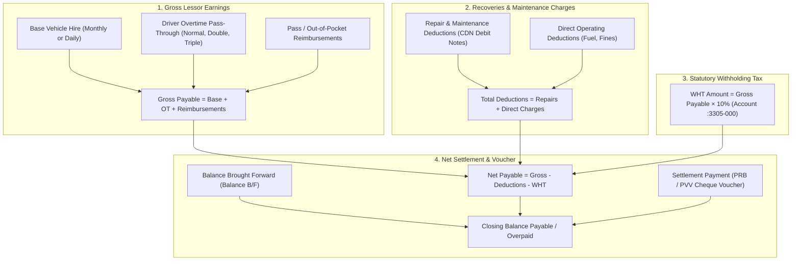

# AutoERP Enterprise Knowledge Base & Vehicle Rental Canonical Specification

**Status:** Canonical Enterprise Architecture, Vehicle Rental Business Domain Policy, and Operational Reference for AutoERP.  
**Owning Modules:** `app/Modules/VehicleRental`, `app/Modules/Core`, `app/Modules/Invoice`, `app/Modules/Payment`, `app/Modules/Finance`, `app/Modules/Vehicle`, `app/Modules/VehicleService`, `app/Modules/HR`, `app/Modules/Tax`  
**Binding Architecture Policies:** Root `AGENTS.md` and `RULES.md`  
**Technical Implementation Guide:** [`VEHICLE_RENTAL_GUIDE.md`](VEHICLE_RENTAL_GUIDE.md)  
**End-User Operations Guide:** [`VEHICLE_RENTAL_USER_GUIDE.md`](VEHICLE_RENTAL_USER_GUIDE.md)  
**Shared Memory & Change History:** `docs/changes/`  

---

## 1. Purpose, Authority & Guiding Principles

This document serves as the authoritative, self-contained domain knowledge base and architectural reference for AutoERP, with complete canonical depth on the Vehicle Rental enterprise module. It synthesizes proven commercial fleet workflows derived from historical production operations (the TACGL Visual FoxPro ERP corpus, authoritative screen recordings, and real-world scanned commercial documents) with AutoERP's clean modular architecture, multi-tenant security, optimistic concurrency, and immutable auditability.

It is **not** a dated commit log or a transient audit diary; it is the living specification of how the system is structured, how data integrity is enforced, how financial boundaries are preserved, and how operators interact with the platform.

### Core Guiding Principles

1. **Understand first, verify second, change third.**  
   Never guess, assume, or apply changes blindly. Fully understand business context, module ownership, and data consequences before modifying the codebase.
2. **Do not invent money.**  
   Physical events (vehicle dispatches, odometer readings, fuel purchases, driver duty hours, incidents) are operational evidence. However, **no financial transaction**—invoice, debit note, credit note, owner payable voucher, tax withholding, or expense deduction—may ever be created without an explicit, approved business rule and verified commercial entitlement.
3. **Speed and clarity over information overload.**  
   Users need task completion efficiency without cognitive fatigue. Keep user flows minimal, focused, and easy to complete. Never expose raw database IDs to users; all relationships must use guided controls (`LookupSelect`, dropdowns, search) with human-readable labels. Move secondary information into separate views, tabs, or expandable accordions (`<details>`).
4. **Fix issues at their root source.**  
   Never compensate for a bug, missing functionality, or incomplete implementation in one module by adding workarounds or shadow tables in another. Keep module boundaries clean and maintainable.
5. **KISS + Explicit over DRY.**  
   Clarity, predictability, and safety always outweigh clever or dynamic abstractions. Database schemas, migrations, calculation snapshots, and business rules must be brutally explicit.
6. **Assume multiple actors interact simultaneously.**  
   Concurrency is assumed. Every write must be atomic, version-checked (`expected_version`), and conflict-aware.
7. **Preserve historical truth permanently.**  
   Store every transaction with its original values and never modify or delete historical records. Corrections and adjustments create distinct, auditable reversal records.

### Source Precedence Hierarchy

When evaluating domain behavior or resolving conflicting requirements, prioritize in this strict order:
1. **Proven business evidence** from the TACGL corpus, real-world scanned commercial documents, and authoritative operational workflow videos.
2. **Root architectural rules** (`AGENTS.md` / `RULES.md`): single source of truth, atomic concurrency, clean module boundaries, immutable history, portable schema.
3. **Narrowest integrity rule** necessary to preserve physical and commercial truth safely.
4. **Explicit AutoERP production policies** formally documented in this specification.
5. **Absence of automatic financial effect:** If an edge case has no confirmed business policy, physical evidence is preserved but no automatic financial document is generated until explicitly authorized.

---

## 2. AutoERP Modular Platform Architecture

AutoERP is architected as a clean modular monolith: a single robust Laravel 12 backend and a reactive TypeScript/React 19 single-page application (SPA).



### 2.1 Multi-Tenancy & Bounded Data Scoping
- **Shared-Schema Multi-Tenancy:** All business tables carry `tenant_id` and `organization_unit_id`.
- **Strict Execution Context:** Requests pass through tenancy middleware (`current.tenant`, `current.organization-unit:required`).
- **Scoped Queries:** Eloquent models inherit from `TenantOwnedModel` and enforce scopes (`scopeForContext($tenantId, $organizationUnitId)`). Cross-tenant data leakage is structurally impossible.

### 2.2 Concurrency & State Mutation
- **Optimistic Concurrency Control (OCC):** Mutable entities feature an integer `row_version`. Every update or state transition requires `expected_version`. Stale writes abort immediately with `409 Conflict`.
- **Pessimistic Row-Level Locking:** High-stakes transactional boundaries (e.g. issuing invoices, cutting over agreements, replacing vehicles) utilize `DB::transaction()` with `lockForUpdate()`.

### 2.3 UI/UX Standards & Operator Ergonomics
- **Zero Raw IDs Exposed:** Database primary keys are internal foreign keys. The interface displays human-readable registration numbers, agreement references, counterparty names, and formatted document codes.
- **Controlled Lookups:** All relational inputs use controlled components (`LookupSelect`, `Select`) with search and pagination, preventing invalid foreign key entry.
- **Progressive Disclosure:** Primary workflows show only essential fields. Secondary fields (auto-generated references, remarks, supplier references, observation notes) are grouped inside collapsible `<details>` accordions.
- **Tenant Business Calendar:** All operational dates and times operate in the tenant's civil business timezone (`Asia/Colombo`). Frontend forms default via `businessDateInputValue()` and `businessDateTimeInputValueWithSeconds()`.

### 2.4 Database Migration Policy
- **One Table Per Migration File:** Never bundle multiple table definitions in a single migration.
- **Portable Laravel Schema APIs:** Only use portable APIs compatible across SQLite, MySQL, MariaDB, and PostgreSQL.
- **Explicit over DRY:** Never use dynamic loops or dynamic foreign key generation in migrations. Every column, foreign key, and index is defined explicitly line-by-line.

---

## 3. Authoritative Source Evidence Register

### 3.1 TACGL Visual FoxPro Legacy Corpus
The historical TACGL system (`TACGL.zip`, 452 normalized DBF tables and FRX report forms) proves real-world commercial fleet rental practices in Sri Lanka:
- `scfveh.DBF`: Vehicle master, registration numbers, engine/chassis specs, service thresholds.
- `scfdeb.DBF` & `scfcre.DBF`: Commercial counterparties (debtor lessees and creditor lessors).
- `scfinv.DBF` & `scftxn.DBF`: Historical billing registers, itemized rates, taxes (VAT/NBT), and discounts.
- `scftdb.DBF` & `scftcr.DBF`: Debtor and creditor subledgers.
- `scfglt.DBF`: General ledger transaction entries, settlement vouchers, and cheque numbers.
- `pmdeblogsheet2.frx` & `pmcre1logsheet2.frx`: Authoritative 31-day running chart matrix reports.
- `pmcre1vehstat_b.frx` & `pmcre1vehstat_c.frx`: Statement of Accounts Vehicle Wise (Detail I Portrait and Detail II Landscape).
- `pmglled.frx`: Withholding Tax liability ledger (`:3305-000 WHT`).
- `pmdebinv3.frx` & `pmdebinv5.frx`: All invoice listings and accounts receivable aging analyses.
- `pmcrelicence.frx`: Vehicle revenue licence compliance reports.

### 3.2 Real-World Scanned Document Proofs (Closed-Loop Proof)

Physical scans from production operations demonstrate the exact closed-loop accounting math:



1. **Running Chart for Lessee (`prndeblogsheet2.pdf`):**
   - Client: `UNILEVER SRI LANKA LTD`, Agreement: `LAG7000012`, Vehicle: `CBC-9180`.
   - Records daily usage, odometer start/finish, comparative and cumulative distance.
   - Total Normal Overtime: **31.50 hrs**. Total Pass Outlays: **Rs. 1,900.00**.
   - Temporary vehicle substitutions logged with remark: `For Repl. CAP-1302`.
2. **Statement of Accounts Detail I (`prncre1vehstat_b.pdf`):**
   - Vehicle: `CBC-9180`, Lessor: `MANOHARA P M N KUDAHETTY`.
   - Base monthly hire: **Rs. 327,500.00**.
   - Driver's Overtime Normal: **31.50 hrs @ 1,500.00 = Rs. 47,250.00** *(derived directly from running chart!)*.
   - Other Charges / Expressway passes: **Rs. 1,900.00** *(matching running chart pass outlay!)*.
   - Total Payable: **Rs. 376,650.00**.
   - Settlement: Cheque #555248 (Voucher `PRB7001132`) settled exactly `(376,650.00)`.
3. **Statement of Accounts Detail II (`prncre1vehstat_c.pdf`):**
   - Wide 18-column operational ledger in Landscape orientation.
   - Agreed KM: **2,500 km**, Non-A/C Rate: **161.00/km**, Base Hire: **Rs. 327,500.00**, N/O Hrs: **31.50**, OT Amount: **Rs. 47,250.00**, Pass Outlay: **Rs. 1,900.00**, Gross: **Rs. 376,650.00**.
4. **WHT Ledger Account (`pmglled.frx`):**
   - Tracks 10% Withholding Tax deducted on owner disbursements under Account `:3305-000 WHT`.
5. **Running Chart UI Render (`media_1794379855450_9d7d2914.jpg`):**
   - AutoERP 31-day running chart matrix sheet, displaying substitution trips highlighted in amber with the visual badge `For Repl. KI 1685`.

---

## 4. The Dual-Sided Commercial Model

Vehicle Rental balances two distinct commercial parties:

```text
       Owner / Supplier / Lessor                          Customer / Lessee
                   │                                               │
            Owner Agreement                                Customer Agreement
                   │                                               │
                   └───────────────┬───────────────────────────────┘
                                   │
                          Vehicle Use / Custody
                                   │
                          Daily Running Chart
                              /         \
                             /           \
                  Customer Side         Owner Side
                (Receivable/Rev)       (Payable/Cost)
                         │                   │
                  Customer Invoice      Owner Payable Voucher
                         │                   │
                  Customer Receipt       Owner Payment
                          \                 /
              Finance / Tax / Banking / Reconciliation / BI Reports
```

### Non-Negotiable Domain Invariants

1. **Independent Commercial Aggregates:** Customer Agreements and Owner Agreements are completely independent commercial contracts. Customer rates never derive Owner payables; Owner costs never dictate Customer billing.
2. **Unified Physical Evidence:** A single physical vehicle assignment and its daily Running Charts serve as the single source of truth for both commercial sides.
3. **No Double Consumption:** An operational component (such as a calendar day of base rent or a kilometer of commercial distance) can never be billed twice on the same side without formal reversal/reissue lineage.
4. **Asynchronous Parallel Processing:** Invoicing the customer does not block settling with the owner, and owner disbursement does not wait for customer payment.
5. **No Fictitious Owner Costs:** When a vehicle is company-owned, no artificial Owner Agreement or external payable voucher is manufactured.
6. **Immutable Operational Truth:** Finalized Running Charts, custody transitions, and recorded incidents are permanent historical records. Adjustments create auditable reversal lineage rather than mutating historical facts.
7. **Strict Financial Separation:** Vehicle Rental delegates accounting, invoicing, tax, and cash movements to their respective owning modules (`Invoice`, `Payment`, `Finance`, `Tax`). Rental never maintains a duplicate GL or shadow cash ledger.
8. **Tenant & Organization Isolation:** Every entity, lookup query, and write operation is strictly scoped to the active tenant and organization unit.

---

## 5. Agreements & Successor Lineage Architecture

### 5.1 Customer Agreement vs. Owner Agreement

| Feature / Dimension | Customer Agreement (`CustomerAgreement`) | Owner Agreement (`OwnerAgreement`) |
|---|---|---|
| **Commercial Role** | Accounts Receivable (Debtor / Lessee) | Accounts Payable (Creditor / Lessor) |
| **Counterparty** | Customer / Corporate Lessee (`Customer`) | Vehicle Owner / Supplier (`Supplier` / `Party`) |
| **Rental Basis** | `daily` or `monthly` | `daily` or `monthly` |
| **Driver Arrangement** | `self_drive` or `with_driver` | `self_drive` or `with_driver` |
| **Vehicle Binding** | Dynamically assigned via `VehicleUse` | Statically bound (`vehicle_id` required) |
| **Security Deposit** | Supported (Customer-only commercial term) | Prohibited (Zero deposit payable) |
| **Base Charge Invoicing** | Generates Accounts Receivable Invoice | Generates Accounts Payable Voucher / Invoice |

### 5.2 Agreement Lifecycle State Machine



- **Draft:** Mutable. Terms, rates, allowances, and dates can be revised under optimistic concurrency (`row_version`).
- **Active:** Immutable. Commercial terms are locked. Any mid-lease price or term change requires creating a successor agreement.
- **Closed:** Terminal. Coverage ceases at the recorded closure boundary. Historical calculations remain intact.

### 5.3 Successor Agreement Mechanics
When commercial terms or rates change mid-contract, AutoERP strictly forbids in-place mutation:
1. **Non-Disruptive Drafting:** An operator creates a `Draft` successor referencing the active predecessor.
2. **Deposit Non-Duplication:** Existing terms are copied into the draft, **except the security deposit requirement**. Security deposits belong to their original payment source and are never duplicated automatically.
3. **Atomic Cutover:** On or after its effective start date, activating the successor executes within a single database transaction:
   - Validates that active vehicle uses and billing periods do not conflict with the boundary cutover.
   - Closes the predecessor agreement exactly at the cutover boundary.
   - Activates the successor agreement.
   - Links bidirectional lineage (`supersedes_agreement_id` / `successor_agreement`).

### 5.4 Agreement Financial Summary & Adjustments
The `AgreementFinancialSummaryPanel` aggregates:
- **Total Invoiced:** Base rent charges + assessed usage charges + direct billable expenses.
- **Total Payments:** Settled customer receipts / owner payments linked via `Payment`.
- **Credit / Debit Notes:** Incurred allowances, billing adjustments, or maintenance deductions.
- **Financial Adjustments:** Operators can issue formal Credit Notes or Debit Notes directly against the agreement, validating `expected_version`, acquiring row locks (`lockForUpdate`), and generating canonical `Invoice` documents.

---

## 6. Rental Reservations & Inquiries

Reservations manage customer booking inquiries before an agreement is executed:
- **Data Model:** Customer (controlled lookup), requested vehicle / category preference, rental mode (`self_drive` vs. `with_driver`), billing cycle (`daily` vs. `monthly`), requested start/end timestamps, estimated rent and deposit amounts, origin source (`phone`, `walk_in`, `email`, `website`), and remarks.
- **Status Progression:** `draft` &rarr; `pending` &rarr; `confirmed` &rarr; `converted` (or `cancelled`, `expired`).
- **Conversion Workflow:** Once confirmed, operators convert the reservation directly into an active `CustomerAgreement`. Optimistic concurrency prevents race conditions, and predecessor reservation history is permanently preserved.

---

## 7. Fleet Custody, Dispatch, Availability & Replacement

### 7.1 Supply Sources: Company-Owned vs. Owner-Leased
- **Company-Owned Supply:** Vehicle belongs to the internal fleet. Operator flags "Company-owned vehicle". System verifies no customer booking conflict exists and generates **zero owner payables**.
- **Owner-Leased Supply:** Vehicle is leased from a third-party owner. Operator links an active `OwnerAgreement` covering the vehicle for the planned period. System validates that owner contract dates cover the customer dispatch.

### 7.2 Vehicle Availability Blocker
The `VehicleUseAvailabilityBlocker` service enforces availability:
- Implements `VehicleAvailabilityBlockerInterface`.
- Cross-references planned dispatches, active in-custody periods, and workshop admissions (`VehicleService`).
- **Half-Open Intervals:** Matching uses `starts_at <= existing_end AND ends_at >= existing_start`, permitting exact-boundary turnovers (e.g. return at 10:00:00, next handover at 10:00:00) without false collision.

### 7.3 Handover, Return & Atomic Replacement
- **Handover (`VehicleUseAction::Handover`):** Records departure timestamp and verified starting odometer. Odometer cannot be lower than the vehicle's last recorded odometer reading.
- **Return (`VehicleUseAction::ReturnVehicle`):** Records actual return timestamp and return odometer. Return odometer cannot be less than handover odometer.
- **Atomic Vehicle Replacement (`VehicleUseService::replace()`):**
  - Records the return of the existing vehicle (return odometer, timestamp, replacement reason).
  - Selects the replacement vehicle, handover odometer, and supply source.
  - In a single database transaction, the existing custody is closed, the replacement custody is activated, and lineage is linked (`replaces_use_id` / `replaced_by_use_id`).
  - **Shared Monthly Allowance:** The replacement vehicle under the same customer agreement shares the agreement's monthly mileage allowance. No duplicate base rent or bonus free KM is granted.
  - **Running Chart Annotation:** Replaced trips are visually flagged with `For Repl. <vehicle_no>` on the running chart matrix sheet.

---

## 8. Daily Running Chart Physical Evidence Register

### 8.1 Purpose & Role
The Running Chart is the **single physical operational log** of vehicle usage. It is not an invoice or payable voucher; it is the factual foundation from which billing and settlements are derived.

### 8.2 Operational Evidence Facts

```text
Running Chart Log Fields:
├── Starts At & Ends At (Business civil timezone)
├── Start Odometer & End Odometer (Non-decreasing check)
├── Distance Segmentation:
│   ├── Commercial KM (Billable client travel)
│   └── Garage KM (Deadhead depot-to-client distance)
├── Air Conditioning Mode (Non-AC, Front AC, Dual AC)
├── Driver Identity:
│   ├── Employee Driver (Linked to HR employee master)
│   └── External Driver (Captured name and stable identification reference)
├── Overtime Hours:
│   ├── Normal OT Minutes (Standard overtime)
│   ├── Double OT Minutes (Double / Sunday overtime)
│   └── Triple OT Minutes (Holiday / special overtime)
├── Night Outs (Count of overnight stays outside base depot)
└── Operational Notes & Expressway Toll Outlays
```

### 8.3 Lifecycle & Immutability
- **Draft:** Usage facts can be revised or corrected by fleet clerks while trips are underway.
- **Finalized:** Facts are frozen. Finalization requires the trip to have concluded (cannot finalize future or ongoing trips).
- **Reversed / Corrected:** If errors are discovered after finalization, the chart is reversed with an auditable reason. A corrected chart references the reversed predecessor.

---

## 9. Commercial Calculations & Billing Engine

### 9.1 Base Rent Billing (`actual_calendar_days_v1`)
- **Daily Basis:** Multiplies agreed daily rate by civil calendar days covered.
- **Monthly Basis:** Evaluates start-date anniversary cycles (e.g. 15th of the month to 14th of the next month).
- **Proration Policy:** Partial monthly cycles use actual calendar days:
  $$\text{Base Charge} = \frac{\text{Actual Days}}{\text{Days in Month}} \times \text{Monthly Rate}$$
- **Idempotency:** Once a billing period is invoiced, that date range is locked. Overlapping base charges for the same agreement are rejected.

### 9.2 Commercial Mileage Assessment & Allowance Pooling
- **Customer Allowance Pooling:** Commercial distance from all finalized running charts within an anniversary cycle is pooled against the agreed cycle allowance.
- **Prorated Free Allowance:** For partial final months, free kilometers are prorated based on active days.
- **Excess Mileage Billing:** Total commercial distance minus pooled allowance yields excess kilometers, billed at `excess_km_rate`.
- **Zero-Cost Assessments:** If usage falls within the free allowance, a zero assessment is recorded to consume the allowance without creating an invoice.
- **Independent Owner Mileage:** Owner excess distance is evaluated separately using the Owner Agreement's terms.

### 9.3 Overtime, Night-Out & Auxiliary Charges
- **Overtime Calculations:** Minutes logged on finalized charts are converted to hours ($\text{minutes} / 60$) and multiplied by the agreed hourly rate for each tier (Normal, Double, Triple).
- **Night-Out Charges:** Count of night-outs multiplied by agreed daily night-out rate.
- **Reissue & Voiding:** Usage charges freeze the source chart revision. Reissuing or voiding unwinds invoice linkages safely through the `Invoice` module.

### 9.4 Security Deposits & Payment Authority
- **Module Authority:** `Payment` owns all money movements.
- **Deposit Requirement:** Customer Agreement records the requirement.
- **Receipt Workflow:** Operator creates a deposit receipt, which calls the `Payment` API.
- **Collection Capacity:** Remaining capacity is tracked:
  $$\text{Remaining Capacity} = \text{Agreed Deposit} - \text{Net Receipts (including drafts)}$$
- **Disposition:** Deposits can be applied against final rental invoices or refunded through the Payment module. Deposits are never forfeited without authorized legal documentation.

---

## 10. Supplier / Lessor Settlement Engine

Owner settlement calculates disbursements to vehicle lessors:



1. **Balance Brought Forward (`Balance B/F`):** Cumulative prior earnings minus prior settlements, deductions, and prior WHT.
2. **Gross Rental Earnings:** Base hire + driver overtime pass-through + toll/pass reimbursements.
3. **Maintenance & Operating Deductions:** Sourced from `RentalExpenseAllocation` of type `OwnerDeduction` (`CDN` notes).
4. **Statutory Withholding Tax:** Standard 10% WHT deducted from gross earnings, posted to liability account `:3305-000 WHT`.
5. **Settlement Vouchers:** Outbound payment vouchers (`PRB` / `PVV`) with cheque numbers settle net liabilities.

---

## 11. Rental Fleet Expenses & Multi-Sided Allocation

Fleet operating costs (fuel, highway tolls, repairs, traffic fines, cleaning) are recorded with:
- Vehicle reference (controlled lookup).
- Typed category: `fuel`, `toll`, `maintenance`, `fine`, `other` (`RentalExpenseType`).
- Net amount, tax amount, gross amount, currency, supplier/petrol station, and receipt proof reference.

### Multi-Sided Allocation Matrix

```text
Fleet Expense (Approved)
├── Company Cost: Operational fleet expense absorbed directly by the business.
├── Customer Recovery: Billable to customer; invoiced on next billing cycle.
├── Owner Deduction: Deducted from owner's monthly disbursement (CDN note).
└── Employee Reimbursement: Reimbursable to driver employee via HR/Payroll.
```

- **Status Governance:** Governed by `RentalExpenseAllocationStatus` (`Draft`, `Confirmed`, `Invoiced`, `Reversed`).
- **Unlinking Integrity:** If a generated customer invoice is cancelled, `unlinkCancelledInvoice()` unlocks the allocation so it can be re-billed or re-allocated without data corruption.

---

## 12. Vehicle Finance & Bank Leasing

Manages commercial bank financing and hire-purchase contracts:
- **Agreement Terms:** Bank / financing supplier (`Supplier`), financed vehicle (`Vehicle`), principal amount, initial deposit, residual value, annual interest rate, calculation method (`flat` vs. `reducing_balance`), installment frequency (`monthly`, `quarterly`, `annual`), installment count, payment term days.
- **Amortization Schedule:** Automatically generates installment schedule upon agreement activation.
- **Due Status Synchronization:** `refreshDueStatuses()` scans installment due dates against business dates to transition maturing installments from `scheduled` &rarr; `due` &rarr; `overdue`.
- **Accounts Payable Integration:** Maturing installments convert into inbound supplier invoices (`Invoice` module), establishing payable liabilities without manual re-entry.

---

## 13. Incident Evidence, Damage Risk & Private Proofs

- **Semantic Boundary:** Recording or reviewing an incident is a **factual verification of evidence**, not a financial liability adjudication. An incident never automatically creates an invoice, debit note, or owner deduction without a separate authorized commercial decision.
- **Classification:** Categorized via `IncidentType`: `fuel`, `toll`, `parking`, `repair`, `maintenance`, `accident_damage`, `penalty`, `cleaning`, `other`.
- **Private Tamper-Evident Proofs:**
  - Proof documents (PDF, JPEG, PNG up to 10 MB) are stored in private tenant storage with SHA-256 integrity checksums.
  - Served via streaming downloads with `no-store`, `no-sniff`, and private cache headers.
  - Attachments cannot be modified or replaced; reviewing the incident permanently freezes attachments.

---

## 14. Comprehensive Reporting & Business Intelligence Suite

The Vehicle Rental module provides eight production-ready operational and financial reports:

| Report Name | Layout | Primary Purpose & Key Metrics | Legacy Template |
|---|---|---|---|
| **Running Chart 31-Day Matrix Sheet** | **Landscape A4** | Full 31-day operational matrix: Start/Finish KM, Comparative/Cumulative distance, ON/OFF hours, OT tiers (Normal, Double/Sunday, Triple), Night Outs, Pass Outlays, replacement badges (`For Repl. <vehicle_no>`), and signature blocks in Lessee & Owner modes. | `pmdeblogsheet2.frx`<br>`pmcre1logsheet2.frx` |
| **Statement of Accounts (Detail I)** | **Portrait A4** | Single-vehicle vertical ledger: Balance B/F, Base Hire (One Month), Driver Overtime (Hrs @ Rate), Pass Outlays, Settlement Vouchers (`PRB`), Repair Deductions (`CDN`), and Closing Balance Payable / Overpaid. | `pmcre1vehstat_b.frx` |
| **Statement of Accounts (Detail II)** | **Landscape A4** | Single-vehicle 18-column operational ledger matrix: Agreed KM, Non-A/C KM rate, A/C KM rate, Base Hire, Agreed OT Hours, Night Out Hours, OT Amount, Other Charges, Gross Total, Cheque Settlements, and Closing Balance. | `pmcre1vehstat_c.frx` |
| **WHT Ledger Account** | **Landscape A4** | Statutory Withholding Tax audit trail under `:3305-000 WHT`, tracking 10% deductions across credit notes (`CDN7000248`–`CDN7000273`), payee names, debits, credits, and running balance. | `pmglled.frx` |
| **Lessee's Outstanding Age Analysis** | **Portrait A4** | Corporate receivable aging report grouped by client, agreement reference, and individual vehicle across Current, 30, 60, 90, and 120+ day buckets. | `pmdebinv5.frx` |
| **Lessee's All Invoice Listing** | **Portrait A4** | Chronological billing registry: Invoice No, Invoice Date, Lessee Name, Period, Base Rental Charge, Excess Mileage, Vehicle Reg No, Total Amount. | `pmdebinv3.frx` |
| **Vehicle Revenue Licence Expire Report** | **Portrait A4** | Fleet regulatory compliance: Vehicle Reg No, Owner Name, Expiration Date, and renewal alert badges. | `pmcrelicence.frx` |
| **Fleet Utilization & Status Report** | **Landscape A4** | Physical asset availability, custody status (In Custody, Available, Planned), ownership type, period distance, and utilization rate %. | Modern Standard |
| **Fleet Vehicle Profitability & Unit Economics** | **Landscape A4** | Vehicle-level P&L: Total commercial revenue minus direct costs (lessor payout, fuel, repairs, tolls), gross margins, and per-KM economics. | Modern Standard |

---

## 15. Legacy Anti-Patterns & Prohibited Traps

The following legacy mechanisms are strictly prohibited:

1. **No Direct Vehicle-to-Agreement Foreign Keys:** Vehicles must not be directly hardcoded to customer agreements. All vehicle assignments must pass through the `VehicleUse` custody aggregate to preserve replacement history and prevent silent double-booking.
2. **No Destructive Financial Edits:** Posted invoices, payments, vouchers, or running charts must never be edited in-place or deleted. Corrections must follow governed reversal/credit/reissue workflows.
3. **No Inter-Module Workarounds:** Rental must never compensate for missing features in Invoice, Payment, or Finance by building shadow tables. Fix issues at their root source.
4. **No Artificial Owner Payables:** Never create fake lessor agreements or payable vouchers for company-owned vehicles.
5. **No Hardcoded Magic Values:** Use enums for predefined option sets, constants for shared immutable values, and configuration sources for environment-specific settings.
6. **No Compatibility Patches for Legacy Flaws:** Do not compromise clean architecture to preserve historical design flaws. Build the correct foundation now.

---

## 16. Developer & AI-Agent Governance Protocol

### AI-Agent Decision Sequence

Any developer or autonomous agent modifying Vehicle Rental must adhere to this sequence:
1. **Identify Module Responsibility:** Determine whether the change belongs in Rental or an owning module (`Invoice`, `Payment`, `Vehicle`, `Tax`, `Finance`, `HR`).
2. **Check Single Source of Truth:** Verify that the rule or calculation is not duplicated elsewhere.
3. **Verify Evidence & Policies:** Consult this knowledge base. If no commercial policy exists, physical facts may be recorded, but **no monetary transaction may be invented**.
4. **Enforce Optimistic Concurrency:** Ensure all mutations pass `expected_version` and update `row_version`.
5. **Preserve Immutable History:** Record full transition snapshots in the respective append-only history table.
6. **Maintain UI Ergonomics:** Use `LookupSelect`, human-readable labels, and tenant business date utilities. Never expose raw database IDs.
7. **Append to Change Memory:** Document the completed work in `docs/changes/YYYY-MM-DD-*.md`. Never edit previous change records.

### Definition of Done Checklist

A Vehicle Rental feature or refactoring task is complete only when:
- [x] Concurrency is atomic, version-checked, and conflict-aware (`expected_version`).
- [x] Tenant and organization unit boundaries are strictly enforced.
- [x] Relational selections use controlled lookup components; zero raw IDs are exposed in the UI.
- [x] All dates and times use tenant operational business calendar utilities.
- [x] Backend tests (`php artisan test app/Modules/VehicleRental/Tests`) pass completely.
- [x] Frontend tests (`npx vitest run resources/js/modules/vehicle-rental --fileParallelism=false`) pass completely.
- [x] TypeScript compile checks (`npm run typecheck`) report zero errors.
- [x] ESLint (`npm run lint`) reports zero errors and zero warnings.
- [x] Production asset compilation (`npm run build`) succeeds cleanly.
- [x] A new change record is appended to `docs/changes/`.
