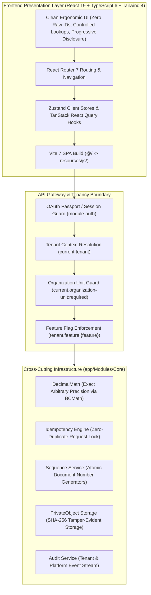
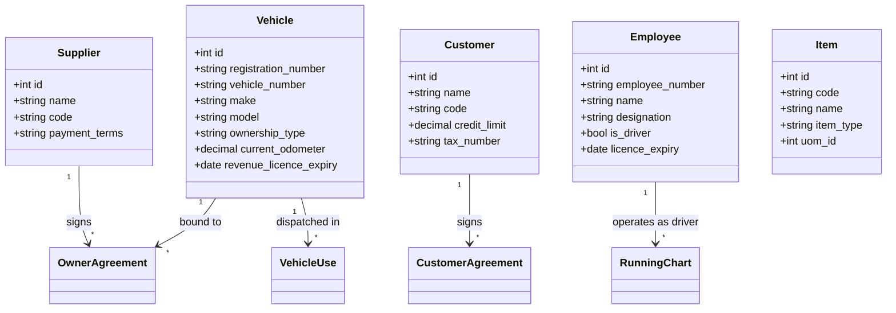
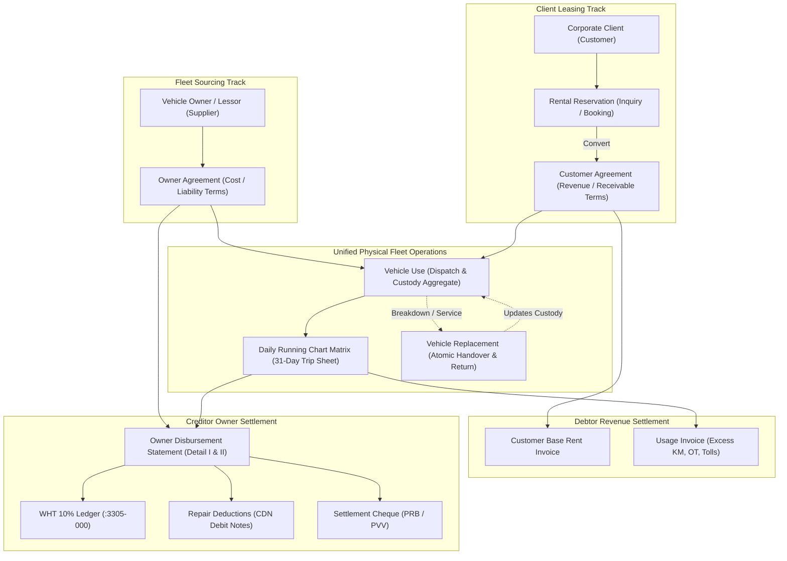
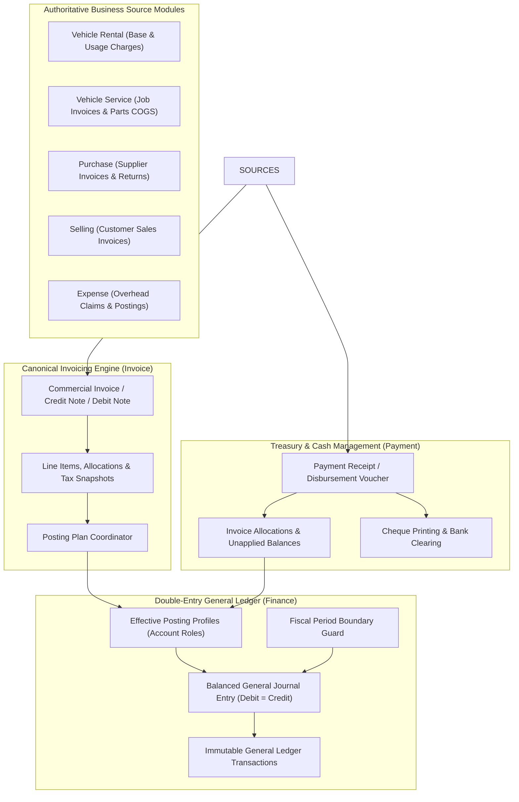

# AutoERP Enterprise Knowledge Base & Canonical System Specification

**Status:** Authoritative Enterprise Architecture, Business Domain Specification, and Operational Governance Reference for AutoERP.  
**System Architecture:** Modular Monolith (Laravel 12 + React 19 / TypeScript 6 / Vite 7)  
**Timezone Standard:** `Asia/Colombo` (Operational Civil Business Calendar)  
**Arithmetic Precision:** Exact Arbitrary-Precision Math (`DecimalMath` / BCMath)  
**Owning Modules:** `app/Modules/*` (31 Specialized Business Domains)  
**Binding Architecture Policies:** Root `AGENTS.md` and `RULES.md`  
**Shared Memory & Change History:** `docs/changes/`  

---

## 1. Executive System Overview & Canonical Authority

AutoERP is a multi-tenant, vehicle-oriented enterprise resource planning platform engineered as a modular monolith. It unifies platform administration, security, master data governance, supply chain procurement, inventory warehousing and valuation, canonical commercial invoicing, payments and cash management, double-entry general ledger accounting, statutory taxation, automotive workshop operations, customer loyalty promotions, and a specialized commercial vehicle rental operating engine.

This document is the **single authoritative reference** for the entire AutoERP system. It defines the implemented software architecture, domain boundaries, data-integrity models, transactional lifecycles, and operational workflows.

### 1.1 Core Architectural Axioms

The following non-negotiable rules govern every module, service, and data model in AutoERP:

1. **Understand first, verify second, change third.**  
   Never guess, assume, or apply changes blindly. Fully understand requirements, module boundaries, and downstream data consequences before modifying code.
2. **Do not invent money.**  
   Physical events (odometer readings, trip logs, fuel receipts, vehicle dispatches, workshop labor hours, damaged parts) are operational evidence. **No financial document**—invoice, debit note, credit note, owner payable voucher, payment receipt, tax withholding, or GL journal—may ever be created without an explicit, approved business rule and verified commercial entitlement.
3. **Speed and clarity over information overload.**  
   Design systems for task completion efficiency and minimal cognitive load. Keep primary workflows focused on essential fields. Never expose raw database IDs to users; all relationships must use guided controls (`LookupSelect`, dropdowns, search) with human-readable labels and codes. Progressive disclosure (`<details>`, tabs, expandable sections) must be used for secondary or audit details.
4. **Fix issues at their root source.**  
   Never compensate for a bug, missing feature, or incomplete implementation in one module by adding workarounds or shadow tables in another. Keep module boundaries clean and maintainable.
5. **No compatibility patches for legacy design flaws.**  
   Prioritize correctness, readability, and long-term maintainability over backward compatibility. Fix root causes rather than carrying historical mistakes forward.
6. **Assume multiple actors interact simultaneously.**  
   Concurrency is assumed across all writes. Every mutation must be atomic, conflict-aware, and version-checked (`expected_version` / `row_version`).
7. **Store transactions with original values; preserve history permanently.**  
   Historical business records are immutable. Never modify or overwrite historical transactions in place. Any later adjustments, reversals, or corrections must be recorded as separate, auditable transactions linked through lineage.
8. **KISS + Explicit over DRY in migrations.**  
   Database migrations are immutable schema history, not dynamic application code. Every column, constraint, index, and foreign key must be defined explicitly line by line without dynamic loops or abstractions. Use one table per migration file.

### 1.2 System Source Precedence Hierarchy

When evaluating domain behavior or resolving conflicting requirements, prioritize in this strict order:
1. **Proven production business evidence** from the historical enterprise corpus (TACGL Visual FoxPro ERP database, operational screen recordings, and real-world scanned commercial documents).
2. **Root architectural rules** (`AGENTS.md` / `RULES.md`): single source of truth, atomic concurrency, clean module boundaries, immutable history, portable schema.
3. **Narrowest integrity rule** necessary to preserve physical, commercial, and financial truth safely.
4. **Explicit AutoERP production policies** formally documented in this specification.
5. **Absence of automatic financial effect:** If an edge case lacks an approved commercial policy, physical facts are preserved but no automatic financial document is generated until explicitly authorized.

---

## 2. Platform Architecture & Cross-Cutting Foundations

AutoERP's technical stack combines a high-performance PHP 8.2+ / Laravel 12 backend with a reactive TypeScript 6 / React 19 SPA built via Vite 7.



### 2.1 Multi-Tenancy & Bounded Data Scoping
- **Dual Operating Planes:**
  - **Platform Control Plane:** Platform super-administrators manage tenant provisioning, subscription plans, platform-wide configuration, infrastructure targeting, and system health.
  - **Tenant Business Plane:** Authenticated tenant users operate within an explicitly resolved tenant (`current.tenant`) and an active organization unit (`current.organization-unit:required`).
- **Shared-Schema Tenancy Isolation:** All tenant-owned database tables include `tenant_id` and `organization_unit_id`. Models extend `TenantOwnedModel` and enforce scoped query builders (`scopeForContext($tenantId, $organizationUnitId)`), guaranteeing that cross-tenant access is structurally prevented at the ORM layer.
- **Organization Unit Hierarchies:** Organization units represent branches, divisions, physical depots, or repair workshops. Access is granted explicitly via user-organization mappings.

### 2.2 Concurrency & State Mutation
- **Optimistic Concurrency Control (OCC):** Every mutable business record carries an integer `row_version`. API mutation endpoints (`PUT`, `PATCH`, state transitions) mandate `expected_version`. Updates execute atomic version-checked queries:
  ```sql
  UPDATE {table} SET ..., row_version = row_version + 1 WHERE id = ? AND row_version = ?
  ```
  Stale updates abort immediately with `409 Conflict`, leaving existing state intact.
- **Pessimistic Row-Level Locking:** High-stakes financial and custody boundaries (e.g. issuing invoices, cutting over agreements, dispatching/replacing vehicles) utilize `DB::transaction()` with `lockForUpdate()`.

### 2.3 Exact Decimal Arithmetic Standard
- Standard floating-point math (`float`, `double`) is strictly forbidden for financial calculations.
- All monetary amounts, tax levies, interest accruals, fuel liters, and commercial kilometer totals use arbitrary-precision string arithmetic via [`DecimalMath`](file:///d:/project-new/AutoERP/app/Modules/Core/Services/DecimalMath.php) (wrapping PHP's BCMath extension).
- Standard scale configuration: 2 decimal places for currency, 4–6 decimal places for tax rates, exchange rates, and unit costs.

### 2.4 Immutable Auditing & Append-Only History
- Major domain entities maintain dedicated append-only history tables (e.g. `CustomerAgreementHistory`, `VehicleUseHistory`, `RunningChartHistory`, `RentalIncidentEvent`, `ExpenseHistory`).
- Histories record the transition action, exact timestamp, actor ID, old/new revision snapshots, and human-readable narrative reasons.
- History records can never be updated or deleted.

---

## 3. Module Ownership & Domain Boundary Matrix

AutoERP comprises 31 business modules with strict boundaries and zero cross-module workarounds:

| Module | Core Responsibility | Public Contracts & Boundaries |
|---|---|---|
| **`Core`** | Tenancy models, organization context, `DecimalMath`, base abstractions. | Provides foundation for all modules. |
| **`Auth`** | Authentication, OAuth Passport tokens, session management, RBAC permissions. | Protects API routes; provides `useAuth` and `hasPermission`. |
| **`Tenant`** | Multi-tenant lifecycle, tenant workspaces, domain verification, feature flags. | Governs tenant provisioning and feature activation. |
| **`OrganizationUnit`** | Branch/depot hierarchy, legal profiles, user-organization scoping. | Enforces branch-level operational boundaries. |
| **`User`** | Tenant users, platform operators, roles, permissions. | Manages identity and access credentials. |
| **`Configuration`** | Global, tenant, and org-unit settings, immutable revisions, rollback. | Stores runtime configurations and posting rules. |
| **`Sequence`** | Document number generation (`INV-`, `RC-`, `PRB-`, `CDN-`, `EXP-`). | Atomically generates monotonic, zero-collision document numbers. |
| **`Audit`** | Tenant and platform audit logs, security event streams. | Read-only audit log inspection. |
| **`PrivateObject`** | Secure file storage, SHA-256 checksums, signed streaming downloads. | Manages tamper-evident file attachments. |
| **`Idempotency`** | Request locks, execution fingerprinting, duplicate protection. | Ensures mutating API requests execute exactly once safely. |
| **`ReferenceData`** | System catalogs (countries, currencies, languages, timezones). | Authoritative reference lookups and tenant currency directory. |
| **`Customer`** | Customer master profiles, debtor entities, credit limits, contacts. | Single source of truth for commercial clients. |
| **`Supplier`** | Supplier/vendor profiles, creditor entities, bank accounts. | Single source of truth for vendors and vehicle owners. |
| **`Hr`** | Employees, departments, designations, skills, driver directory, commissions. | Authoritative master for drivers and workshop mechanics. |
| **`Vehicle`** | Physical fleet asset registry, makes, models, engine/chassis, odometers, licences. | Single source of truth for physical vehicle assets. |
| **`Item`** | Item catalog, stock/service/labor types, categories, brands, variants, bundles. | Master catalog for products, labor, and services. |
| **`UOM`** | Units of Measure, dimensional conversions, usage validation. | Governs physical and operational units. |
| **`Warehouse`** | Warehouse facilities, locations, aisle/rack/bin coordinates. | Physical storage locations. |
| **`Inventory`** | On-hand/reserved/allocated balances, stock movements, valuation (FIFO/WAC). | Owns physical stock quantities and inventory valuation. |
| **`Purchase`** | Purchase orders, goods receipts (GRN), purchase invoices, returns, debit notes. | Governs procurement lifecycles and supplier billing. |
| **`Selling`** | Sales orders, quotations, customer deliveries. | Governs commercial customer sales orders. |
| **`Expense`** | Corporate operating expenses, expense categories, approvals, GL posting. | Owns general operational expense claims and postings. |
| **`Promotion`** | Loyalty cards, promo templates, job-line choices, discount redemption. | Manages service discounts and customer loyalty programs. |
| **`VehicleService`** | Workshop repair jobs, mechanical checklists, labor lines, spare parts issue. | Manages repair workshop custody and mechanical maintenance. |
| **`Invoice`** | Canonical commercial invoices, credit/debit notes, posting plans, balances. | Single source of truth for all commercial billing. |
| **`Payment`** | Receipts, disbursements, deposits, payment methods, bank allocations. | Single source of truth for all money movement. |
| **`Finance`** | Double-entry GL, Chart of Accounts, fiscal periods, posting profiles, journals. | Single source of truth for General Ledger and financial accounting. |
| **`Tax`** | Tax rules, VAT/NBT rates, legal tax calculation profiles. | Computes legal taxes from semantic invoice line items. |
| **`VehicleRental`** | Dual agreements, dispatch custody, running charts, billing, lessor settlements. | Complete commercial fleet rental operating engine. |
| **`Voucher`** | Presentation views over transaction sources without duplicating ownership. | Unified voucher viewing. |
| **`Reporting`** | PDF generation (Spatie Laravel PDF / DOMPDF), print previews, streaming exports. | Document generation and business intelligence exports. |

---

## 4. Master Data Architecture



### 4.1 Vehicle Fleet Asset Governance
- Physical vehicles are registered in the `Vehicle` module.
- Tracks registration number, internal vehicle code, VIN/chassis, engine number, make, model, category, current odometer reading, fuel type, ownership classification (`company_owned` vs. `leased`), and regulatory revenue licence expiration dates.
- Rental dispatches query active fleet vehicles via `GET /api/v1/vehicles/lookup/active` and inspect mechanical availability through `VehicleAvailabilityBlockerInterface`.

### 4.2 Customer & Supplier Master Data
- Debtor lessees are registered in `Customer`; creditor vehicle lessors and parts vendors are registered in `Supplier`.
- Masters capture legal corporate names, tax registration numbers (VAT/TIN), operational contacts, billing addresses, credit profiles, and bank account settlement details.
- Rental agreements and transactions link directly to these master records, preventing duplicate counterparty creation.

### 4.3 Human Resources & Driver Directory
- Fleet drivers and mechanics are mastered in `Hr`.
- Captures employee codes, driver licence numbers, licence expiry dates, duty shifts, and hourly wage/commission profiles.
- Rental Running Charts reference active employee drivers via `driver_employee_id` or record verified external contractor details (`driver_name_snapshot`, `driver_reference_snapshot`).

---

## 5. Supply Chain, Inventory, Workshop & Auxiliary Operations

### 5.1 Procurement & Fast Purchase Workflows
- The `Purchase` module orchestrates vendor orders: `Purchase Order` &rarr; `Goods Receipt Note (GRN)` &rarr; `Supplier Invoice` &rarr; `Payment`.
- **Fast Purchase Orchestration:** For counter parts purchases, Fast Purchase coordinates PO generation, receipt, and invoice matching in an atomic flow.
- **Supplier Invoice Gating:** Invoices cannot be created against a purchase order until physical goods have been received (`GRN`).

### 5.2 Inventory Balances & Real-Time Valuation
- Inventory maintains four distinct balance dimensions:
  $$\text{Available} = \text{On-Hand} - \text{Reserved} - \text{Allocated}$$
- **Valuation Layers:** Supports FIFO and Weighted Average Costing (WAC). Every stock issue consumes explicit valuation layers, debiting Cost of Goods Sold (COGS) and crediting Inventory Asset via `Finance` posting profiles.

### 5.3 Automotive Workshop Service Management
- `VehicleService` governs automotive repair operations through `VehicleServiceJob`.
- Tracks mechanical inspection checklists, labor operation lines, technician assignments, and spare parts issue requests.
- **Stock Consumption:** Approving a parts issue automatically triggers inventory issue allocations, consuming stock at current valuation layers and posting COGS to `Finance`.
- **Mechanical Custody Blocker:** Admitting a vehicle into the workshop for repairs sets its mechanical status to off-road, immediately blocking commercial rental dispatch until the job card is formally signed off and closed.

### 5.4 Corporate Expenses & GL Integration (`Expense`)
- Governs overhead operational expenses (administrative expenses, office utilities, travel claims) distinct from fleet rental operational expenses.
- Supports configurable `ExpenseType` catalogs, status lifecycles (`draft` &rarr; `submitted` &rarr; `approved` &rarr; `posted` &rarr; `reversed`), sequential numbering (`EXP-`), and double-entry general ledger posting via `Finance`.

### 5.5 Customer Loyalty & Service Promotions (`Promotion`)
- Manages marketing discounts and loyalty programs across workshop service jobs and sales orders.
- Features `PromotionCardTemplate` definitions, `PromotionCard` issuance to customers, benefit rules (percentage vs. fixed monetary discount), job-line choices, and immutable redemption event audit streams.

---

## 6. Commercial Vehicle Rental Enterprise Domain

The Vehicle Rental module is an integrated commercial operating engine structured around a **dual-sided commercial model**:



### 6.1 Dual-Sided Commercial Contracts
1. **Customer Agreement (`CustomerAgreement`):**
   - Governs commercial receivables from corporate lessees.
   - Sets rental basis (`daily` vs. `monthly`), driver mode (`self_drive` vs. `with_driver`), cycle base rates, free kilometer allowances, excess distance rates, overtime hourly rates (Normal, Double, Triple), night out rates, AC mode premiums, and agreed security deposit requirements.
2. **Owner Agreement (`OwnerAgreement`):**
   - Governs liabilities owed to third-party vehicle owners who supply vehicles to the fleet.
   - Sets lessor base lease entitlements, excess distance reimbursement rates, driver overtime pass-through rates, and bounds the supplied physical vehicle (`vehicle_id`).
   - Completely independent from customer pricing.

### 6.2 Agreement Lifecycle & Successor Architecture
- **Draft &rarr; Active &rarr; Closed:** Mutating rates or terms on an active agreement is strictly prohibited.
- **Successor Agreement Mechanics:** Commercial revisions use successor lineage (`supersedes_agreement_id`):
  1. Operator drafts a successor agreement while the predecessor remains `Active`.
  2. All terms copy to the draft **except security deposits** (security deposits belong to the original source payment and are not duplicated).
  3. Activating the successor atomically closes the predecessor at the cutover boundary, links lineage, and activates the new terms without disrupting active vehicle custody.

### 6.3 Custody Tracking, Handover, Return & Atomic Replacement
- **Custody State Machine:** `planned` &rarr; `in_custody` &rarr; `returned` (or `cancelled`).
- **Half-Open Interval Blocker:** `VehicleUseAvailabilityBlocker` prevents overlapping assignments (`starts_at <= existing_end AND ends_at >= existing_start`). Exact-boundary turnovers (e.g. 10:00:00 return, 10:00:00 handover) are permitted.
- **Odometer Continuity:** Starting odometer must match or exceed the vehicle's last recorded reading; return odometer cannot be lower than handover odometer.
- **Atomic Vehicle Replacement (`VehicleUseService::replace()`):**
  - When an assigned vehicle breaks down, the operator records the return odometer and timestamp of the existing vehicle and selects the replacement vehicle, handover reading, and supply source.
  - The return of the old vehicle and the handover of the substitute vehicle execute atomically in a single database transaction.
  - **Shared Allowance:** Both vehicles share the single contract's monthly mileage allowance.
  - **Visual Audit Badge:** The replacement vehicle's trips on the 31-day running chart matrix are highlighted in amber and annotated `For Repl. <vehicle_no>`.

### 6.4 Daily Running Chart Operational Evidence Register
- The Running Chart is the **single physical operational log** of vehicle usage (`pmdeblogsheet2.frx` / `pmcre1logsheet2.frx`).
- Records daily trips:
  - **Dates & Times:** Start and finish timestamps formatted in operational civil business timezone (`Asia/Colombo`). Duty ON (e.g. `06:30 AM`) and duty OFF (e.g. `08:00 PM`).
  - **Odometers & Distance:** Start and finish readings, comparative mileage (daily distance), and cumulative monthly mileage.
  - **Overtime Tiers:** Overtime minutes categorized as Normal (`N`), Sunday/Double (`D`), or Holiday/Triple (`T`).
  - **Operational Outlays:** Driver night-out allowances, AC mode premiums, and expressway pass outlays (toll receipts).
  - **Driver Identity:** Employee driver from `Hr` or external contractor snapshots.
- **Finalization Rules:** A trip can only be finalized as physical evidence after it has concluded. Future or ongoing trips cannot be finalized. Once finalized, facts are frozen. Reversals require an auditable reason.

### 6.5 Commercial Billing & Owner Settlement Calculations

#### A. Customer Billing Track
- **Base Rent Invoicing (`actual_calendar_days_v1`):** Billed on daily or start-date anniversary monthly cycles. Proration uses actual calendar days:
  $$\text{Base Charge} = \frac{\text{Actual Days}}{\text{Days in Month}} \times \text{Monthly Rate}$$
- **Commercial Mileage Assessment:** Finalized commercial kilometers are pooled against the monthly allowance. Kilometers exceeding the allowance are billed at `excess_km_rate`.
- **Usage Invoicing:** Overtime hours ($\text{minutes} / 60$), night-out allowances, and expressway pass outlays convert into canonical invoices via `Invoice`.
- **Security Deposits:** Processed via `Payment`. Rental tracks remaining collection capacity ($\text{Agreed Deposit} - \text{Net Receipts}$) and applies unallocated balances to final invoices.

#### B. Owner Settlement Track & Closed-Loop Reconciliation
The owner settlement engine calculates monthly disbursements to vehicle lessors, proven by production scans (`prndeblogsheet2.pdf`, `prncre1vehstat_b.pdf`, `prncre1vehstat_c.pdf`, `pmglled.frx`):

```text
Owner Disbursement Statement (Detail I & Detail II):
  Balance Brought Forward (Balance B/F)
+ Base Monthly Vehicle Hire (Agreed cycle rate)
+ Driver's Overtime Normal (Hours from Running Chart × Agreed Rate)
+ Other Charges / Pass Outlays (Out-of-pocket tolls from Running Chart)
------------------------------------------------------------------------
= Gross Earnings Payable
- Maintenance & Repair Deductions (CDN Debit Notes from Expense Allocation)
- Statutory 10% Withholding Tax (Posted to Account :3305-000 WHT)
- Outbound Cheque Settlements (PRB / PVV Settlement Vouchers)
------------------------------------------------------------------------
= Closing Balance Payable / (Balance Overpaid)
```

1. **Statement of Accounts (Detail I) [A4 Portrait]:** Vertical statement showing Balance B/F, Base Hire period, Driver Overtime Normal, Other Charges, settlement cheques/vouchers (`PRB`/`PVV`), repair deduction debit notes (`CDN`), and final closing balance (`Balance Over Paid` or `Balance Payable`).
2. **Statement of Accounts (Detail II) [A4 Landscape]:** 18-column operational matrix detailing hire start/finish dates, unit, agreed total KM, non-A/C KM rate, hire amount, normal/double/triple overtime hours, driver salary/bata, other charges, VAT, net settlements, and closing balance.
3. **Statutory Withholding Tax Ledger (`:3305-000 WHT`):** Automatically computes and audits 10% WHT deductions from gross lessor earnings, tracking credit note entries (`CDN7000248`–`CDN7000273`) with credit amounts and running balances.

### 6.6 Fleet Expenses & 4-Way Allocation Matrix
Fleet expenses (fuel, tolls, repairs, fines, maintenance) are recorded in `RentalExpense` and allocated across four destinations:
1. `Company Cost`: Absorbed directly as fleet operational overhead.
2. `Customer Recovery`: Billed to customer on next rental invoice.
3. `Owner Deduction`: Deducted from lessor's disbursement statement (`CDN` note).
4. `Employee Reimbursement`: Reimbursed to driver through HR/Payroll.

### 6.7 Vehicle Finance & Bank Leasing
- Manages hire-purchase and bank leasing contracts (`VehicleFinanceAgreement`).
- Automatically computes amortization schedules (flat or reducing balance interest).
- `refreshDueStatuses()` scans installment due dates against current business dates, advancing statuses from `scheduled` &rarr; `due` &rarr; `overdue`.
- Maturing installments convert directly into inbound supplier invoices (`Invoice`), establishing accounts payable liabilities.

### 6.8 Incident Evidence & Private Proof Attachments
- Captures accidents, damage, police fines, and toll violations.
- **Semantic Boundary:** Recording an incident verifies physical evidence; it never automatically generates a financial charge without an authorized commercial decision.
- **Private Tamper-Evident Proofs:** Photographs and police reports (PDF, JPEG, PNG up to 10 MB) are stored in private tenant storage with SHA-256 checksums and served via streaming downloads. Reviewing an incident permanently locks attachments.

---

## 7. Financial Core, Invoicing, Tax & Treasury

AutoERP enforces strict separation between commercial source modules and financial ledgers:



### 7.1 Canonical Commercial Invoicing (`Invoice`)
- `Invoice` is the single source of truth for commercial billing across sales, service, rental, and purchases.
- **Document Lifecycles:** `draft` &rarr; `approved` &rarr; `posted` &rarr; `paid` (or `cancelled`, `voided`, `reversed`).
- **Focused Document Printing:** Service and supplier invoices render in a compact A5/A4 portrait format with focused tables (Item, Quantity, Unit Price, Amount) and payment-gated copy labels (Original vs. Duplicate).

### 7.2 Treasury & Money Movement (`Payment`)
- `Payment` owns all cash movements: customer receipts, supplier disbursements, deposit receipts, advances, and refunds.
- **Allocation Engine:** Allocates payments against open invoice balances, tracking remaining unapplied balances.
- **Cheque Printing:** Configurable cheque templates with automated amount-in-words spelling.

### 7.3 General Ledger & Posting Profiles (`Finance`)
- `Finance` owns the Chart of Accounts, fiscal calendars, journal entries, and financial ledgers.
- **Posting Profiles:** Source modules never hardcode GL account numbers. Instead, they provide semantic transaction roles (e.g. `rental_revenue`, `accounts_receivable`, `wht_payable`, `cogs_parts`), which `Finance` resolves dynamically against the tenant's active posting profile.
- **Fiscal Period Guard:** Prevents posting or reversing journals into closed accounting periods.

### 7.4 Statutory Taxation Engine (`Tax`)
- Manages tax categories, legal tax profiles, and calculation rules (VAT, NBT, WHT).
- Tax calculations are snapshot on invoice lines at posting time. Later statutory tax rate changes never alter historical posted documents.

### 7.5 Idempotent Financial Execution & State Safety (`Idempotency`)
- Guarantees zero-duplicate requests across high-stakes financial operations (invoice posting, payment recording, agreement cutovers, expense reversals).
- Tracks idempotency keys with payload SHA-256 fingerprints, optimistic lock states, and cached responses to prevent double-billing or duplicate payments.

### 7.6 Reference Catalogs, Currencies & Civil Timezones (`ReferenceData`)
- Supplies standardized ISO country codes, currency directories (with default tenant operating currency, e.g. LKR), and timezone directories.
- Enforces system-wide civil business timezone resolution (`Asia/Colombo`), ensuring consistent calendar dates across operational logs and financial reports.

---

## 8. Comprehensive Enterprise Reporting Suite

AutoERP includes a dedicated reporting engine supporting interactive HTML grids, printable views, and PDF exports:

| Module | Report Name | Page Orientation | Core Business Purpose |
|---|---|---|---|
| **Rental** | **Running Chart 31-Day Matrix Sheet** | **A4 Landscape** | Official monthly trip matrix (`pmdeblogsheet2.frx` / `pmcre1logsheet2.frx`). Daily odometers, comparative/cumulative KM, OT tiers, night outs, toll pass outlays, and replacement vehicle badges in Lessee & Owner modes. |
| **Rental** | **Statement of Accounts (Detail I)** | **A4 Portrait** | Single-vehicle vertical statement (`pmcre1vehstat_b.frx`). Balance B/F, Base Hire, Driver OT, Tolls, Cheque Settlements (`PRB`), Repair Deductions (`CDN`), and Closing Balance. |
| **Rental** | **Statement of Accounts (Detail II)** | **A4 Landscape** | Single-vehicle 18-column operational matrix (`pmcre1vehstat_c.frx`). Agreed KM, Non-A/C KM rate, Base Hire, Agreed OT Hours, OT Amount, Other Charges, Cheque Settlements, and Closing Balance. |
| **Rental** | **WHT Ledger Account** | **A4 Landscape** | Statutory Withholding Tax audit ledger (`pmglled.frx`) under Account `:3305-000 WHT`, tracking 10% deductions across credit notes (`CDN7000248`–`CDN7000273`). |
| **Rental** | **Lessee Outstanding Age Analysis** | **A4 Portrait** | Debtor receivable aging (`pmdebinv5.frx`) grouped by client, agreement, and vehicle across Current, 30, 60, 90, 120+ day buckets. |
| **Rental** | **Lessee All Invoice Listing** | **A4 Portrait** | Chronological billing registry (`pmdebinv3.frx`) with invoice numbers, dates, customer names, periods, base hire, excess KM, and totals. |
| **Rental** | **Vehicle Revenue Licence Expire Report** | **A4 Portrait** | Fleet regulatory compliance (`pmcrelicence.frx`) tracking registration numbers, owners, expiry dates, and alert countdowns. |
| **Rental** | **Fleet Utilization & Status Report** | **A4 Landscape** | Asset availability, custody states (In Custody, Available, Planned), ownership type, period distance, and utilization rates %. |
| **Rental** | **Fleet Vehicle Profitability & Unit Economics** | **A4 Landscape** | Vehicle P&L: revenue minus direct costs (lessor payout, fuel, repairs, tolls), gross margins, and per-KM economics. |
| **Finance** | **Trial Balance, P&L, Balance Sheet, Cash Flow** | **A4 Portrait / Landscape** | Authoritative double-entry financial statements generated from posted general ledger transactions. |
| **Inventory**| **Stock Availability & Reorder Health** | **A4 Landscape** | Multi-warehouse stock health: on-hand, reserved, available quantities, reorder thresholds, and bin locations. |
| **Service**  | **Vehicle Service History & Costing** | **A4 Portrait** | Complete workshop repair history, labor costs, parts issues, and technician performance. |

---

## 9. Prohibited Anti-Patterns & Architecture Violations

The following legacy anti-patterns are strictly forbidden:

1. **Direct Vehicle-to-Agreement Foreign Keys:** Vehicles must never be bound directly to customer agreements. All vehicle assignments must pass through `VehicleUse` to preserve replacement lineage and prevent silent double-booking.
2. **Destructive In-Place Edits on Posted Transactions:** Posted invoices, payments, vouchers, or running charts must never be edited in-place or deleted. Corrections must follow governed reversal/credit/reissue workflows.
3. **Inter-Module Workarounds:** Never compensate for missing features in `Invoice`, `Payment`, `Inventory`, or `Finance` by building shadow tables in a business module. Fix issues in the module where they belong.
4. **Fictitious Owner Costs:** Never manufacture artificial Owner Agreements or payable vouchers for company-owned vehicles.
5. **Hardcoded Magic Account Numbers:** Never hardcode legacy account codes in business logic. All GL postings must resolve through `Finance` posting profiles.
6. **Exposing Raw Database IDs in the UI:** The interface must never display raw integer IDs. Use human-readable labels, registration numbers, codes, and search-driven components (`LookupSelect`).
7. **Client Timezone Drift:** Never rely on browser UTC string slicing (`.toISOString()`). All business dates and timestamps must be formatted using the tenant's operational business timezone (`Asia/Colombo`).

---

## 10. Developer & AI-Agent Governance Protocol

### 10.1 AI-Agent Decision Sequence
When modifying code or implementing new features:
1. **Identify Module Responsibility:** Determine which module owns the capability. If logic belongs elsewhere, implement it in the owning module.
2. **Check Single Source of Truth:** Ensure no business rule or calculation is duplicated.
3. **Verify Evidence & Policies:** Consult this knowledge base. If no commercial policy exists, physical facts may be recorded, but **no monetary transaction may be invented**.
4. **Enforce Optimistic Concurrency:** Require `expected_version` and increment `row_version` on every write.
5. **Preserve Immutable History:** Record complete transition snapshots in append-only history tables.
6. **Maintain UI Ergonomics:** Use `LookupSelect`, human-readable labels, progressive disclosure, and business date utilities.
7. **Append to Change Memory:** Document the completed task in `docs/changes/YYYY-MM-DD-*.md`. Never edit previous change records.

### 10.2 Definition of Done Quality Checklist
A task is complete only when:
- [x] Concurrency is atomic, version-checked, and conflict-aware (`expected_version`).
- [x] Tenant and organization unit boundaries are strictly enforced.
- [x] Relational inputs use controlled selection components; zero raw IDs are exposed in the UI.
- [x] All dates and times evaluate against the tenant's civil business timezone (`Asia/Colombo`).
- [x] All relevant backend PHPUnit test suites pass completely.
- [x] All relevant frontend Vitest test suites pass completely.
- [x] TypeScript compile checks (`npm run typecheck`) report zero errors.
- [x] ESLint (`npm run lint`) reports zero errors and zero warnings.
- [x] Production asset compilation (`npm run build`) succeeds cleanly.
- [x] An append-only change record is added to `docs/changes/`.
