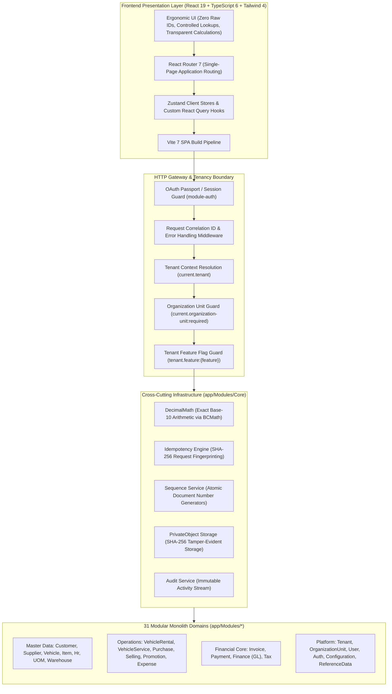
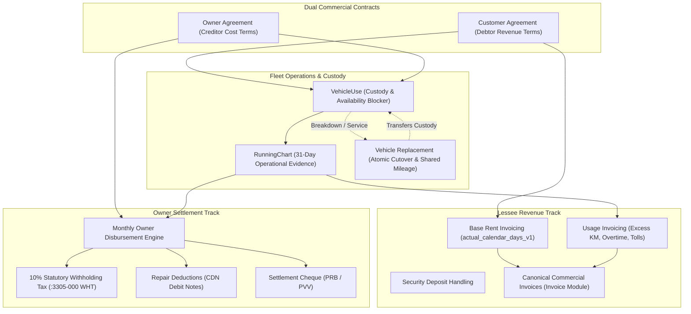
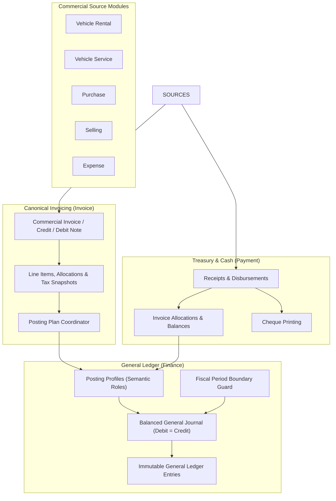

# AutoERP Enterprise Knowledge Base & Canonical Technical Guide

**Document Status:** Single Authoritative System Specification, Enterprise Architecture Reference, and Developer Onboarding Guide for AutoERP.  
**System Architecture:** Modular Monolith (Laravel 12 Backend + React 19 / TypeScript 6 SPA Frontend)  
**Standard Civil Timezone:** `Asia/Colombo` (Operational Business Calendar & Civil Timestamps)  
**Arithmetic Precision:** Exact Arbitrary-Precision String Arithmetic via `DecimalMath` (PHP BCMath)  
**Business Modules:** 31 Domain Modules located in `app/Modules/*`  
**Shared Project Memory:** Append-Only Change Records in `docs/changes/`  
**Binding Core Axioms:** `AGENTS.md` and `RULES.md`  

---

## 1. Executive System Overview & Core Architecture

AutoERP is an enterprise resource planning platform engineered as a clean **Modular Monolith**. It unifies multi-tenant platform administration, role-based security, master data governance, supply chain procurement, inventory warehousing and valuation, canonical commercial invoicing, cash treasury management, double-entry general ledger accounting, statutory taxation, automotive workshop repair operations, customer loyalty promotions, and a specialized commercial vehicle rental operating engine.

### 1.1 The 12 Non-Negotiable Core Engineering Axioms

Every module, class, database table, API route, and UI component in AutoERP must adhere strictly to these 12 core engineering axioms:

1. **Understand First, Verify Second, Change Third:** Never act on assumptions or guess. Fully understand requirements, system context, module ownership, and data consequences before modifying code. Fix only requested issues using the smallest safe change.
2. **Root Cause Design over Compatibility Workarounds:** Prioritize correctness, readability, and long-term maintainability over backward compatibility. Do not carry forward legacy design flaws or preserve historical mistakes with patches. Fix underlying designs at the root source.
3. **Simplicity, Pragmatism & No Overengineering:** Prefer the simplest clean design that correctly solves the problem. Avoid premature optimization, speculative features, or generic frameworks. Dead code is prohibited.
4. **Module Ownership & Clear Boundaries:** Each of the 31 modules strictly owns its models, business logic, and database tables. Never compensate for a deficiency in one module by adding workarounds or shadow tables in another.
5. **Backend Authority & Single Source of Truth:** The backend is the single authoritative source of truth for business rules, calculations, permissions, validations, and state transitions. The frontend provides immediate user feedback and presentation only; it never substitutes for backend enforcement.
6. **Concurrency, Atomicity & Transaction Immutability:** Concurrency is assumed across all writes. Every write mutation must be atomic, conflict-aware, and version-checked (`expected_version` / `row_version`). Historical operational and financial ledger records are immutable; adjustments and reversals must be recorded as separate, linked audit records.
7. **Database Architecture & Explicit Migrations:** One table per migration file. Migrations represent immutable database schema history: write every column, foreign key, constraint, and index explicitly line-by-line (KISS + Explicit over DRY). Dynamic loops, runtime conditionals, or programmatic column names in migrations are prohibited.
8. **Code Modularity & File Size Management:** Organize code into cohesive, modular units. Split files when they exceed clean separation of concerns or increase cognitive complexity, with clear architectural justification.
9. **Zero Magic Values:** Never use hardcoded magic values, literals, or strings in application logic. Use PHP Backed Enums (`string`) and TypeScript enums for predefined option sets. Use named constants for fixed values.
10. **UI/UX Clarity & Cognitive Efficiency:** Design for speed and task completion efficiency. Keep primary workflows focused on essential fields and use progressive disclosure for secondary details. **Never expose raw database IDs or primary keys to users**; relational inputs must use controlled selection components (`LookupSelect`, `GenericLookupSelect`). All autogenerated, autofilled, or calculated values must display clear calculation breakdowns and formula hints.
11. **Security & Predictable Error Handling:** Handle errors explicitly, consistently, and predictably. Never silently swallow failures, bypass authentication/authorization, or weaken validation.
12. **Shared Project Memory via `/docs/changes`:** The `/docs/changes` directory is the project's shared append-only memory. Always read recent records before starting work, modify only necessary files, and create a new record detailing changes and verification results upon completion. Existing change records are never edited or deleted.

### 1.2 System Source Precedence Hierarchy

When evaluating business requirements or resolving edge cases:
1. **Proven production business evidence** from operational commercial documents and historical enterprise records.
2. **Root architectural axioms** (`AGENTS.md` / `RULES.md`).
3. **Narrowest integrity rule** necessary to preserve physical, commercial, and financial truth safely.
4. **Explicit AutoERP production policies** formally documented in this specification.
5. **Absence of automatic financial effect:** Physical events (trips, damaged parts, workshop labor) are operational facts. **No financial document may ever be created without an explicit business rule and commercial entitlement.**

### 1.3 High-Level System Architecture



---

## 2. Developer Environment Setup, Installation & Tooling

AutoERP is designed to be straightforward to set up, run, and verify locally on macOS, Linux, or Windows.

### 2.1 System Prerequisites

Before setting up the project, ensure the following runtimes and extensions are installed:
- **PHP:** Version 8.2 or higher (8.3+ supported).
- **Required PHP Extensions:** `bcmath` (mandatory for `DecimalMath`), `pdo`, `pdo_mysql`, `pdo_sqlite`, `openssl`, `mbstring`, `tokenizer`, `xml`, `ctype`, `json`, `curl`, `fileinfo`.
- **Composer:** Version 2.2 or higher.
- **Node.js:** Version 20.x or higher (LTS recommended).
- **NPM:** Version 10.x or higher.
- **Database:** MySQL 8.0+ for standard local/production execution; SQLite (in-memory or file) for automated test suites.

### 2.2 Step-by-Step Installation & Bootstrapping

Follow these steps from the repository root:

```bash
# 1. Clone the repository
git clone <repository-url> AutoERP
cd AutoERP

# 2. Configure environment file
cp .env.example .env
# Edit .env to set your database credentials:
# DB_CONNECTION=mysql
# DB_HOST=127.0.0.1
# DB_PORT=3306
# DB_DATABASE=autoerp
# DB_USERNAME=root
# DB_PASSWORD=your_password

# 3. Install backend PHP dependencies
composer install

# 4. Generate application key safely
php artisan app:key:ensure

# 5. Run database migrations to construct the clean schema
php artisan migrate

# 6. Synchronize platform security catalogs and permissions
php artisan platform:permissions:sync

# 7. Verify authentication readiness (OAuth clients and tokens)
php artisan auth:readiness

# 8. Seed the canonical system baseline (Master data, CoA, settings)
php artisan db:seed

# 9. Install frontend Node dependencies
npm install

# 10. Build frontend production assets
npm run build
```

Alternatively, the automated setup script runs the core provisioning sequence:
```bash
composer setup
```

### 2.3 Local Development Workflow

To run the complete development environment with live hot-reloading, queue workers, and log streaming, run:
```bash
composer dev
```
This command uses `concurrently` to spawn four synchronized processes:
1. `server`: Laravel HTTP development server (`php artisan serve`).
2. `queue`: Queue worker daemon (`php artisan queue:listen --tries=1 --timeout=0`).
3. `logs`: Real-time application log tailing (`php artisan pail --timeout=0`).
4. `vite`: Frontend development server with Hot Module Replacement (`npm run dev`).

Access the application in your browser at `http://127.0.0.1:8000`.

### 2.4 Testing, Linting & Verification Suite

Every change to the codebase must pass all verification gates with zero errors:

| Check | Command | Description |
|---|---|---|
| **Backend Unit & Feature Tests** | `php artisan test` | Runs 1,300+ PHPUnit tests across all 31 modules using SQLite in-memory. |
| **MySQL Integration Tests** | `composer test:mysql` | Runs integration tests against a live MySQL instance (`phpunit.mysql.xml`). |
| **Frontend Unit Tests** | `npm test` | Runs 174 Vitest test suites (726+ tests) in JSDOM mode. |
| **TypeScript Typecheck** | `npm run typecheck` | Validates TypeScript types across `resources/js` with zero emissions (`tsc --noEmit`). |
| **ESLint Quality Check** | `npm run lint` | Lints React 19 / TypeScript code (`eslint resources/js`). |
| **PHP Code Style (Pint)** | `vendor/bin/pint --test` | Validates Laravel Pint code formatting standards. |
| **Migration Baseline Integrity**| `php artisan test --filter ModuleMigrationBaselineTest` | Verifies one-table-per-migration, timestamp ordering, and zero `Schema::table`. |
| **Historical Retention Integrity**| `php artisan test --filter HistoricalRetentionMigrationTest`| Asserts status history tables enforce `restrictOnDelete` without cascading deletes. |

### 2.5 Useful Custom Artisan CLI Commands

The system provides dedicated console commands for maintenance and administration:

| Artisan Command | Purpose |
|---|---|
| `php artisan app:key:ensure` | Checks for `APP_KEY` and generates one non-interactively if missing. |
| `php artisan auth:readiness` | Verifies OAuth Passport encryption keys, token tables, and auth providers. |
| `php artisan auth:client:create` | Creates an OAuth client for API access. |
| `php artisan platform:permissions:sync` | Scans all modules and synchronizes permissions into the platform catalog. |
| `php artisan platform:health` | Performs system diagnostics across database, cache, queues, and storage. |
| `php artisan tenant:create` | Provisions a new tenant with initial domain and plan configuration. |
| `php artisan tenant:activate` | Activates an onboarded tenant workspace. |
| `php artisan tenant:domain:revalidate` | Validates and verifies tenant custom domains and DNS mapping. |
| `php artisan tenant:storage:cleanup` | Prunes orphaned private files and cleans up temporary attachments. |
| `php artisan vehicle:ownership:versioned` | Reconciles versioned vehicle asset ownership periods and roles. |
| `php artisan vehicle-service:legacy-import` | Safely parses and imports legacy FoxPro workshop service histories. |

---

## 3. Development Practices & Coding Conventions

### 3.1 Backend Engineering Standards (PHP 8.2+ / Laravel 12)

1. **Strict Typing:** Every PHP file must declare strict types at the very top:
   ```php
   <?php

   declare(strict_types=1);
   ```

2. **Thin Controllers & Rich Services:**
   - Controllers must never contain business calculations, SQL queries, or complex branching logic.
   - A controller's sole duties are: (1) Authorize the request via policies/middleware, (2) Validate inputs using Form Requests, (3) Delegate execution to a domain Service, and (4) Return an HTTP Response or API Resource.

3. **Form Requests for Input Validation:**
   - All write mutation endpoints (`POST`, `PUT`, `PATCH`) must use dedicated Form Request classes extending `Illuminate\Foundation\Http\FormRequest`.
   - Explicitly define rules for all expected parameters. Disallow unexpected fields where appropriate.

4. **Zero Magic Values (PHP Backed Enums):**
   - String literals and integer codes for statuses, document types, billing modes, and roles are forbidden in application logic.
   - Use PHP Backed Enums (`string`) placed in `app/Modules/<ModuleName>/Enums/` or `Constants/`:
     ```php
     namespace Modules\VehicleRental\Enums;

     enum AgreementStatus: string
     {
         case Draft = 'draft';
         case Active = 'active';
         case Closed = 'closed';
         case Cancelled = 'cancelled';
     }
     ```

5. **Deny-by-Default Mass Assignment:**
   - `CoreModel` explicitly sets `protected $guarded = ['*'];`.
   - Models must explicitly define `protected $fillable = [...]` containing only legitimate mass-assignable attributes.

6. **Optimistic Concurrency Control (OCC):**
   - Every mutable business entity carries an unsigned integer `row_version` (default 1).
   - Update endpoints mandate `expected_version` in the request payload.
   - Service mutations execute atomic, version-checked database updates:
     ```php
     $updated = $model->newQuery()
         ->where('id', $model->id)
         ->where('row_version', $expectedVersion)
         ->update(array_merge($attributes, [
             'row_version' => $expectedVersion + 1,
         ]));

     if ($updated === 0) {
         throw new ConflictHttpException('The record was modified by another user.');
     }
     ```

7. **Exact Decimal Arithmetic (`DecimalMath`):**
   - Standard binary floating-point arithmetic (`float`, `double`, `(float) $val`) is strictly prohibited for monetary values, taxes, mileage calculations, or quantities.
   - Always use [`DecimalMath`](file:///d:/project-new/AutoERP/app/Modules/Core/Services/DecimalMath.php), which executes exact string-based arithmetic via PHP's BCMath extension:
     ```php
     $math = app(DecimalMath::class);

     // Exact addition, subtraction, multiplication, division (standard scale: 6)
     $subtotal = $math->mul($quantity, $unitPrice, 6);
     $tax = $math->mul($subtotal, $taxRate, 6);
     $grandTotal = $math->add($subtotal, $tax, 2); // Quantized to 2 decimal places
     ```

8. **Pessimistic Locking for Custody & Financial cutovers:**
   - High-concurrency operations (vehicle dispatch, agreement replacement, cash disbursement, invoice posting) must run inside `DB::transaction()` using `lockForUpdate()`.

### 3.2 Frontend Engineering Standards (React 19 / TypeScript 6 / Tailwind CSS 4)

1. **TypeScript Strict Mode:**
   - All frontend files are TypeScript (`.ts` or `.tsx`). Never use `any` when a type can be modeled.
   - Define domain interfaces in `resources/js/modules/<module>/types.ts` or `resources/js/shared/types/`.

2. **Zero Raw Database IDs in the User Interface:**
   - The user interface must never show raw integer database IDs (e.g. `vehicle_id: 42`, `customer_id: 108`).
   - Display human-readable identifiers: registration numbers (`WP CAB-1234`), customer codes (`CUST-0042`), invoice numbers (`INV-2026-0001`), or names.
   - Relationship selection must use controlled search components:
     - [`LookupSelect`](file:///d:/project-new/AutoERP/resources/js/shared/components/LookupSelect.tsx)
     - [`GenericLookupSelect`](file:///d:/project-new/AutoERP/resources/js/shared/components/GenericLookupSelect.tsx)

3. **Transparent Autofill & Automatic Calculation UX:**
   - Never leave users confused about where a value came from or how a total was derived.
   - When a field is autofilled from master data (e.g. standard daily rate, driver OT rate, item price, tax percentage), display an informative hint:
     > *"Autofilled from Customer Agreement terms (Rs. 4,500.00/day)"*
   - When fields are computed dynamically (e.g. comparative mileage, total rent, overtime hours, discounts, net amount), display a formula breakdown:
     > *"Calculated: (180 km - 100 free km) × Rs. 65.00/km = Rs. 5,200.00"*

4. **Civil Timezone Standard (`Asia/Colombo`):**
   - The user's browser may be in any timezone. To prevent date-sliding bugs (e.g., selecting Nov 22 but submitting Nov 21 UTC), **never** use `new Date().toISOString()`.
   - Use [`businessDate.ts`](file:///d:/project-new/AutoERP/resources/js/shared/utils/businessDate.ts) for civil date formatting, parsing, and day calculations against the business operational timezone.

5. **Progressive Disclosure:**
   - Keep primary workflow dialogs and creation forms focused on essential fields required to complete the task.
   - Place secondary configuration, technical details, raw logs, and audit histories inside expandable sections (`<details>`, tabs, or collapsible panels).

---

## 4. Database Architecture & Migration Governance

### 4.1 The Single-Table Baseline Migration Principle

In AutoERP, database migrations are treated as **immutable database schema specifications**, not dynamic application code.

- **One Table Per Migration File:** Every database table is created by exactly one migration file named `YYYY_MM_DD_HHMMSS_create_<table_name>_table.php`.
- **Elimination of Patch Migrations:** Historical `Schema::table()` alteration migrations and `UpgradeMigrations` are strictly forbidden. All column additions, index alterations, and constraint updates must be consolidated directly into the canonical creation migration file.
- **Explicit Column and Index Definitions (KISS + Explicit over DRY):**
  - Define every column, default value, foreign key constraint, and index explicitly line-by-line.
  - Never use dynamic loops (`foreach ($columns as $col)`), runtime conditionals, or programmatic identifier naming.
- **Canonical Key Naming Standard:**
  - Foreign keys: `<table_abbrev>_<column>_fk` (e.g. `vrca_customer_id_fk`).
  - Unique keys: `<table_abbrev>_<columns>_uk` (e.g. `vrca_agreement_number_uk`).
  - Lookup indexes: `<table_abbrev>_<columns>_ix` (e.g. `vrca_tenant_status_ix`).
- **Portable Data Types:**
  - Native database `enum` types (`$table->enum(...)`) are prohibited. Use bounded string columns (`$table->string('status', 32)`) validated at the application layer.
  - Financial amounts and rates use `$table->decimal('amount', 20, 6);`.
- **Immutable Status Histories & Retention:**
  - Status history tables (`*_status_histories`) record state transitions and must enforce `$table->foreignId(...)->constrained()->restrictOnDelete();`.
  - Cascading deletes (`cascadeOnDelete()`) on historical financial or audit records are strictly prohibited.

### 4.2 Migration Inventory & Discovery

The system comprises **266 canonical database tables**:
- **5 Infrastructure Migrations** in `database/migrations/`:
  1. `0001_01_01_000001_create_cache_table.php`
  2. `0001_01_01_000002_create_cache_locks_table.php`
  3. `0001_01_01_000003_create_jobs_table.php`
  4. `0001_01_01_000004_create_job_batches_table.php`
  5. `0001_01_01_000005_create_failed_jobs_table.php`
- **261 Modular Migrations** distributed across 27 database-owning modules in `app/Modules/<ModuleName>/Database/Migrations/`.
- Every module service provider loads its migrations uniformly:
  ```php
  $this->loadMigrationsFrom(__DIR__.'/../Database/Migrations');
  ```
- Modules with no database tables: `Core` (technical primitives only), `PrivateObject` (tamper-evident storage service), `Reporting` (document export engine), and `Voucher` (composite presentation views).

### 4.3 Seeder Execution Hierarchy

The root [`DatabaseSeeder`](file:///d:/project-new/AutoERP/database/seeders/DatabaseSeeder.php) coordinates deterministic baseline seeding inside a platform control-plane context in this strict topological order:

1. `TenantSeeder`: Platform root tenant and enterprise subscription tiers.
2. `OrganizationUnitSeeder`: Head office, branch depots, and workshop units.
3. `PlatformOperatorSeeder`: Platform super-administrators and system roles.
4. `AuthSeeder`: OAuth clients, auth providers, and token credentials.
5. `ReferenceDataSeeder`: ISO countries, currencies (LKR, USD, EUR), languages, and timezones.
6. `TenantReferenceAssignmentSeeder`: Default currency and operational timezone assignment (`Asia/Colombo`).
7. `SequenceSeeder`: Atomic document sequence generators for invoices, vouchers, and jobs.
8. `UomSeeder`: Units of measure (km, hours, days, units, liters, sets).
9. `WarehouseSeeder`: Main warehouse, parts racks, and spare parts bins.
10. `FinanceSeeder`: Chart of accounts, posting profile rules, and fiscal accounting periods.
11. `PaymentSeeder`: Payment methods (Cash, Cheque, Bank Transfer, Card) and bank accounts.
12. `ItemSeeder`: Master item catalog (services, mechanical labor lines, lubricants, spare parts).
13. `SupplierSeeder`: Vendors, parts suppliers, and vehicle lessor profiles.
14. `CustomerSeeder`: Corporate clients, debtor profiles, and credit policies.
15. `VehicleSeeder`: Physical fleet vehicles, makes, models, engine/chassis specs, and initial odometers.
16. `VehicleServiceSeeder`: Job types, service checklists, and standard labor rates.
17. `HrSeeder`: Departments, designations, employee directory, fleet drivers, and workshop mechanics.
18. `TenantPermissionSeeder`: Tenant-level roles and granular permission matrix.

---

## 5. Multi-Tenancy, Security & Cross-Cutting Foundations

### 5.1 Dual-Plane Multi-Tenancy Architecture

AutoERP separates platform governance from tenant business operations:

1. **Platform Control Plane:** Platform super-administrators manage tenant onboarding, subscription plans, domain mapping, global system configurations, and infrastructure health.
2. **Tenant Business Plane:** Authenticated tenant employees operate within an explicitly resolved tenant workspace (`current.tenant`) and active organization unit (`current.organization-unit:required`).
3. **Data Isolation:** All tenant models extend `TenantOwnedModel`. The ORM automatically injects tenant constraints into queries (`scopeForTenant`), guaranteeing that cross-tenant data leakage is structurally impossible at the database query layer.

### 5.2 Authentication, OAuth Tokens & RBAC (`Auth` & `User`)

- **Authentication Protocol:** OAuth 2.0 via Laravel Passport. Tokens are signed and verified against tenant boundaries.
- **Secure Refresh Token Rotation:** Refresh tokens are dispatched in secure, HTTP-only, SameSite cookies to protect against cross-site scripting (XSS) credential theft.
- **Granular RBAC:** Users are assigned roles composed of discrete permissions (e.g. `rental.agreement.create`, `invoice.post`, `vehicle.odometer.override`). Routes and UI actions are protected using middleware (`tenant.permission:{permission}`) and client hooks (`useAuth().hasPermission(...)`).

### 5.3 Idempotency Engine (`Idempotency`)

Mutating API operations—such as posting an invoice, issuing a payment receipt, cutting over an agreement, or finalizing a running chart—mandate an `Idempotency-Key` HTTP header.
- The engine calculates a SHA-256 fingerprint of the request payload, authenticated user, and URI.
- If a network retry occurs with the same key, the engine safely returns the cached original response without re-executing business logic or creating duplicate transactions.

### 5.4 Atomic Sequence Generation (`Sequence`)

AutoERP avoids database auto-increment IDs for commercial documents. The `Sequence` module provides monotonic, zero-collision, sequential document codes formatted with date tokens and prefixes:
- `INV-2026-0001` (Invoices)
- `RC-2026-09-0012` (Running Charts)
- `PRB-2026-0045` (Payment Receipts / Vouchers)
- `CDN-2026-0018` (Debit Notes / Repair Deductions)
- `EXP-2026-0033` (Operating Expenses)

Generators use atomic table locking to guarantee gap-free numbering even under heavy concurrent load.

### 5.5 Tamper-Evident Storage (`PrivateObject`)

Sensitive attachments—such as police accident reports, vehicle damage photographs, signed contract PDFs, and driver licences—are managed by `PrivateObject`:
- Files are saved to secure, private tenant storage disks outside the public web root.
- Each file is hashed (SHA-256) upon upload. The hash is verified on read to guarantee tamper-evidence.
- Downloads are served exclusively through authenticated, signed, streaming endpoints. Once an incident or agreement is formally reviewed, attachments are permanently locked against replacement or deletion.

---

## 6. Complete Module Catalog & Domain Boundary Matrix

AutoERP organizes its business capabilities into **31 decoupled modules** in `app/Modules/*`:

| Module | Architectural Role | Key Eloquent Models | Core Public Responsibilities |
|---|---|---|---|
| **`Core`** | Foundation Infrastructure | *None (Technical primitives)* | `TenantOwnedModel`, `DecimalMath`, base responses, API error formatting. |
| **`Tenant`** | Multi-Tenancy Governance | `Tenant`, `TenantPlan`, `TenantDomain` | Tenant provisioning, lifecycle states (`active`, `suspended`), custom domain verification. |
| **`OrganizationUnit`** | Branch & Depot Scoping | `OrganizationUnit`, `OrganizationUnitType` | Physical branch hierarchy, legal business entities, user-depot assignments. |
| **`User`** | Identity & Access | `User`, `Role`, `Permission` | Tenant user accounts, role definitions, permission catalogue synchronization. |
| **`Auth`** | Authentication & OAuth | `AuthIdentity`, `AuthSession`, `AuthClient` | Passport OAuth tokens, session management, password hashing, credential rotation. |
| **`Configuration`** | Configuration Management | `TenantConfigurationValue`, `GlobalConfigurationValue` | Key-value settings with immutable version history and rollback capabilities. |
| **`ReferenceData`** | ISO System Catalogs | `Country`, `Currency`, `Language`, `Timezone` | Standard ISO catalogs, tenant currency directories, civil timezone lookups. |
| **`Idempotency`** | Mutation Request Safety | `IdempotencyRecord` | Request payload fingerprinting, execution locks, duplicate prevention. |
| **`Sequence`** | Document Numbering | `Sequence` | Atomic monotonic document sequence number generation. |
| **`Audit`** | Enterprise Activity Log | `AuditLog` | Append-only audit trail capturing user, timestamp, action, and change diffs. |
| **`PrivateObject`** | Secure File Storage | *None (Disk-backed service)* | SHA-256 tamper-evident private file storage and signed streaming downloads. |
| **`Customer`** | Customer Master Data | `Customer`, `CustomerContact`, `CustomerCreditProfile` | Corporate debtors, billing addresses, credit limit enforcement, contact directory. |
| **`Supplier`** | Supplier Master Data | `Supplier`, `SupplierContact`, `SupplierBankAccount` | Creditors, spare parts vendors, vehicle lessors, bank settlement profiles. |
| **`Vehicle`** | Fleet Asset Registry | `Vehicle`, `VehicleMake`, `VehicleModel`, `VehicleOwnership` | Physical fleet assets, odometers, VIN, revenue licence tracking, fleet availability. |
| **`Hr`** | Workforce Management | `Employee`, `Department`, `Designation`, `EmployeeRate` | Driver and technician master directory, licence tracking, commission rate rules. |
| **`Item`** | Master Product Catalog | `Item`, `ItemCategory`, `ItemBrand`, `ItemPrice` | Products, stock parts, repair labor lines, services, UOM assignments, base prices. |
| **`UOM`** | Units of Measure | `Uom`, `UomConversion` | Measurement units (km, hours, days, pieces), conversion factors, validation. |
| **`Warehouse`** | Storage Facilities | `Warehouse`, `WarehouseLocation` | Physical parts warehouses, workshop bays, aisle/rack/bin storage hierarchies. |
| **`Inventory`** | Stock & Valuation | `InventoryBalance`, `InventoryMovement`, `InventoryBatch` | Real-time balances (on-hand, reserved, allocated), FIFO/WAC stock valuation. |
| **`Purchase`** | Procurement Workflow | `PurchaseOrder`, `GoodsReceiptNote`, `PurchaseInvoice` | Purchase orders, GRN receipts, supplier invoices, returns, debit notes, Fast Purchase. |
| **`Selling`** | Customer Sales | `Sale`, `SaleLine`, `SaleReturn`, `SaleReturnLine` | Commercial sales orders, quotations, customer deliveries, returns, line discounts. |
| **`Expense`** | Corporate Overhead | `Expense`, `ExpenseType`, `ExpenseHistory` | Overhead expense claims, approvals, sequential numbering, GL posting. |
| **`Promotion`** | Loyalty & Promotions | `PromotionOffer`, `PromotionCard`, `PromotionBenefit` | Loyalty cards, promo templates, fixed/percentage discounts, redemption audit streams. |
| **`VehicleService`** | Workshop Operations | `VehicleServiceJob`, `VehicleServiceJobLine`, `JobType` | Mechanical repair job cards, inspection checklists, technician commissions, parts issues. |
| **`Invoice`** | Commercial Invoicing | `Invoice`, `InvoiceLine`, `InvoicePostingPlan` | Canonical single source of truth for all commercial invoices, debit/credit notes. |
| **`Payment`** | Cash & Treasury | `Payment`, `PaymentAllocation`, `ChequeTemplate` | Customer receipts, supplier payouts, invoice allocations, cheque generation. |
| **`Finance`** | General Ledger | `FinanceAccount`, `FinanceJournalEntry`, `FinancePostingProfile` | Double-entry GL, Chart of Accounts, fiscal accounting periods, semantic posting rules. |
| **`Tax`** | Statutory Taxation | `TaxProfile`, `TaxCategory`, `TaxRate` | VAT/NBT/WHT tax calculation profiles and line-level tax snapshots. |
| **`VehicleRental`** | Commercial Fleet Rental | `CustomerAgreement`, `OwnerAgreement`, `RunningChart` | Dual-sided commercial contracts, custody tracking, running charts, billing & settlements. |
| **`Voucher`** | Unified Voucher Views | *None (Presentation composite)* | Read-only unified views over transactions, receipts, and disbursement vouchers. |
| **`Reporting`** | Business Intelligence | *None (Document engine)* | Printable HTML layouts, Spatie Laravel PDF exports, CSV/Excel data streams. |

---

## 7. Deep Dive: Commercial Vehicle Rental Operating Engine

The `VehicleRental` module is AutoERP's most sophisticated domain engine. It coordinates physical vehicle custody, daily operational evidence, customer revenue billing, and vehicle owner settlements.



### 7.1 Dual-Sided Commercial Contracts

AutoERP enforces complete independence between customer pricing and owner costs:
1. **Customer Agreement (`CustomerAgreement`):** Governs revenue owed by the corporate lessee. Specifies rental basis (`daily` vs. `monthly`), billing cycle, free kilometer allowance, excess distance rate, overtime hourly rates (Normal, Double, Triple), night out rates, AC mode premiums, and security deposit requirements.
2. **Owner Agreement (`OwnerAgreement`):** Governs liabilities owed to third-party fleet suppliers (vehicle owners/lessors). Specifies the agreed base monthly hire, excess KM reimbursement rate, and overtime pass-through rates. Company-owned vehicles do not have Owner Agreements, preventing artificial owner liabilities.

### 7.2 Agreement Lifecycle & Successor Architecture

To maintain legal auditability, an `Active` agreement is **immutable**. Commercial revisions use successor lineage (`supersedes_agreement_id`):
1. An operator creates a draft successor agreement while the current agreement remains active.
2. All operational terms copy forward to the draft **except security deposits** (security deposits belong to the original source payment and are preserved).
3. Activating the successor atomically closes the predecessor at the cutover timestamp, updates lineage links, and applies new commercial terms without interrupting vehicle custody.

### 7.3 Custody Tracking, Handover, Return & Atomic Replacement

- **Custody State Machine (`VehicleUse`):** `planned` &rarr; `in_custody` &rarr; `returned` (or `cancelled`).
- **Half-Open Availability Intervals:** `VehicleUseAvailabilityBlocker` prevents overlapping assignments (`starts_at <= existing_end AND ends_at >= existing_start`). Exact boundary handovers (e.g. 10:00:00 return, 10:00:00 handover) are fully supported.
- **Odometer Continuity:** Starting odometer must match or exceed the vehicle's last recorded reading; return odometer cannot be lower than handover reading.
- **Atomic Vehicle Replacement (`VehicleUseService::replace()`):**
  - When an assigned vehicle breaks down, the operator records the return odometer and timestamp of the existing vehicle and selects the replacement vehicle, handover reading, and supply source.
  - The return of the disabled vehicle and the handover of the replacement vehicle execute atomically in a single database transaction.
  - **Shared Allowance:** Both vehicles share the single contract's monthly mileage allowance.
  - **Visual Audit Badge:** The replacement vehicle's trips on the 31-day running chart matrix are highlighted in amber and annotated `For Repl. <vehicle_no>`.

### 7.4 Daily Running Chart Operational Log

The Running Chart is the **single physical operational log** of vehicle usage:
- Records daily operational facts:
  - Duty ON time (e.g. `06:30 AM`) and Duty OFF time (e.g. `08:00 PM`) in civil business timezone (`Asia/Colombo`).
  - Start and finish odometers, comparative daily distance, and cumulative monthly mileage.
  - Overtime minutes categorized as Normal (`N`), Sunday/Double (`D`), or Holiday/Triple (`T`).
  - Out-of-pocket expressway tolls, driver night-out allowances, and AC mode usage.
  - Driver identity: Employee driver from `Hr` or external contractor snapshots.
- **Finalization Rules:** A trip can only be finalized after duty OFF has passed. Future or ongoing trips cannot be finalized. Once finalized, operational facts are frozen against casual editing. Reversals require an auditable reason.

### 7.5 Commercial Billing & Owner Settlement Calculations

#### A. Lessee Revenue Billing Track
- **Base Rent Invoicing (`actual_calendar_days_v1`):** Monthly agreements bill on the agreement anniversary date. Proration for partial months calculates using actual civil calendar days:
  $$\text{Base Charge} = \frac{\text{Actual Days in Period}}{\text{Days in Month}} \times \text{Monthly Rate}$$
- **Commercial Mileage Assessment:** Finalized commercial kilometers are pooled against the monthly allowance. Kilometers exceeding the allowance are billed at `excess_km_rate`.
- **Usage Invoicing:** Overtime hours ($\text{minutes} / 60$), night-out allowances, and expressway pass outlays convert into canonical invoices via `Invoice`.
- **Security Deposits:** Processed via `Payment`. Rental tracks remaining collection capacity ($\text{Agreed Deposit} - \text{Net Receipts}$) and applies unallocated balances to final invoices.

#### B. Owner Settlement Track & Closed-Loop Reconciliation
The owner settlement engine calculates monthly disbursements to vehicle lessors:

$$\begin{aligned}
\text{Gross Earnings} &= \text{Balance B/F} + \text{Base Monthly Hire} + \text{Driver Overtime Normal} + \text{Pass Outlays} \\
\text{Net Settlement} &= \text{Gross Earnings} - \text{Repair Deductions (CDN)} - \text{10\% Withholding Tax} - \text{Settlement Cheques}
\end{aligned}$$

1. **Statement of Accounts (Detail I) [A4 Portrait]:** Vertical statement showing Balance B/F, Base Hire period, Driver Overtime Normal, Other Charges, settlement cheques/vouchers (`PRB`/`PVV`), repair deduction debit notes (`CDN`), and final closing balance (`Balance Over Paid` or `Balance Payable`).
2. **Statement of Accounts (Detail II) [A4 Landscape]:** 18-column operational matrix detailing hire start/finish dates, unit, agreed total KM, non-A/C KM rate, hire amount, normal/double/triple overtime hours, driver salary/bata, other charges, VAT, net settlements, and closing balance.
3. **Statutory Withholding Tax Ledger (`:3305-000 WHT`):** Automatically computes and audits 10% WHT deductions from gross lessor earnings, tracking credit note entries with credit amounts and running balances.

### 7.6 Fleet Expenses & 4-Way Destination Allocation Matrix

Fleet expenses (fuel, tolls, repairs, fines, maintenance) are recorded in `RentalExpense` and allocated across four destinations:
1. `Company Cost`: Absorbed directly as fleet operational overhead.
2. `Customer Recovery`: Billed to customer on next rental invoice.
3. `Owner Deduction`: Deducted from lessor's disbursement statement (`CDN` note).
4. `Employee Reimbursement`: Reimbursed to driver through HR/Payroll.

### 7.7 Vehicle Finance & Bank Leasing

- Manages hire-purchase and bank leasing contracts (`VehicleFinanceAgreement`).
- Automatically computes amortization schedules (flat or reducing balance interest).
- `refreshDueStatuses()` scans installment due dates against current business dates, advancing statuses from `scheduled` &rarr; `due` &rarr; `overdue`.
- Maturing installments convert directly into inbound supplier invoices (`Invoice`), establishing accounts payable liabilities.

### 7.8 Incident Evidence & Private Proof Attachments

- Captures accidents, damage, police fines, and toll violations.
- **Semantic Boundary:** Recording an incident verifies physical evidence; it never automatically generates a financial charge without an authorized commercial decision.
- **Private Tamper-Evident Proofs:** Photographs and police reports (PDF, JPEG, PNG up to 10 MB) are stored in private tenant storage with SHA-256 checksums and served via streaming downloads. Reviewing an incident permanently locks attachments.

---

## 8. Deep Dive: Supply Chain, Workshop & Auxiliary Operations

### 8.1 Procurement & Fast Purchase Workflows (`Purchase`)

- **Standard Procurement Track:** `Purchase Order` &rarr; `Goods Receipt Note (GRN)` &rarr; `Supplier Invoice` &rarr; `Payment`.
- **Fast Purchase Orchestration:** For counter purchases, Fast Purchase coordinates PO generation, goods receipt, and invoice matching in an atomic single-screen workflow.
- **Supplier Invoice Gating:** Invoices cannot be posted against a purchase order until physical goods have been formally received (`GRN`).

### 8.2 Inventory Balances & Real-Time Valuation (`Inventory`)

- **Four Real-Time Balance Dimensions:**
  $$\text{Available Stock} = \text{On-Hand} - \text{Reserved} - \text{Allocated}$$
- **Valuation Layers:** Supports FIFO (First-In, First-Out) and Weighted Average Costing (WAC). Every stock issue consumes explicit valuation layers, debiting Cost of Goods Sold (COGS) and crediting Inventory Asset via `Finance` posting profiles.

### 8.3 Automotive Workshop Service Management (`VehicleService`)

- `VehicleService` governs automotive repair operations through `VehicleServiceJob`.
- Tracks mechanical inspection checklists, labor operation lines, technician assignments, and spare parts issue requests.
- **Stock Consumption:** Approving a parts issue automatically triggers inventory issue allocations, consuming stock at current valuation layers and posting COGS to `Finance`.
- **Mechanical Custody Blocker:** Admitting a vehicle into the workshop for repairs sets its mechanical status to off-road, immediately blocking commercial rental dispatch until the job card is formally signed off and closed.

### 8.4 Corporate Overhead Expenses (`Expense`)

- Governs overhead operational expenses (administrative expenses, office utilities, travel claims) distinct from fleet rental operational expenses.
- Supports configurable `ExpenseType` catalogs, status lifecycles (`draft` &rarr; `submitted` &rarr; `approved` &rarr; `posted` &rarr; `reversed`), sequential numbering (`EXP-`), and double-entry general ledger posting via `Finance`.

### 8.5 Customer Loyalty & Service Promotions (`Promotion`)

- Manages marketing discounts and loyalty programs across workshop service jobs and sales orders.
- Features `PromotionCardTemplate` definitions, `PromotionCard` issuance to customers, benefit rules (percentage vs. fixed monetary discount), job-line choices, and immutable redemption event audit streams.

---

## 9. Deep Dive: Financial Core, Invoicing, Treasury & Tax

AutoERP enforces strict separation between commercial source modules and financial ledgers:



### 9.1 Canonical Commercial Invoicing (`Invoice`)

- `Invoice` is the single authoritative source of truth for commercial billing across sales, service, rental, and purchases.
- **Document Lifecycles:** `draft` &rarr; `approved` &rarr; `posted` &rarr; `paid` (or `cancelled`, `voided`, `reversed`).
- **Focused Document Printing:** Service and supplier invoices render in compact A5/A4 portrait formats with focused tables (Item, Quantity, Unit Price, Amount) and payment-gated copy labels (Original vs. Duplicate).

### 9.2 Treasury & Money Movement (`Payment`)

- `Payment` owns all cash movements: customer receipts, supplier disbursements, deposit receipts, advances, and refunds.
- **Allocation Engine:** Allocates payments against open invoice balances, tracking remaining unapplied balances.
- **Cheque Printing:** Configurable cheque templates with automated amount-in-words spelling.

### 9.3 General Ledger & Posting Profiles (`Finance`)

- `Finance` owns the Chart of Accounts, fiscal calendars, journal entries, and financial ledgers.
- **Posting Profiles:** Source modules never hardcode GL account numbers. Instead, they provide semantic transaction roles (e.g. `rental_revenue`, `accounts_receivable`, `wht_payable`, `cogs_parts`), which `Finance` resolves dynamically against the tenant's active posting profile.
- **Fiscal Period Guard:** Prevents posting or reversing journals into closed accounting periods.

### 9.4 Statutory Taxation Engine (`Tax`)

- Manages tax categories, legal tax profiles, and calculation rules (VAT, NBT, WHT).
- Tax calculations are snapshot on invoice lines at posting time. Later statutory tax rate changes never alter historical posted documents.

---

## 10. Comprehensive Enterprise Reporting Suite

AutoERP includes a dedicated reporting engine supporting interactive HTML grids, printable views, and PDF exports:

| Module | Report Name | Page Orientation | Core Business Purpose |
|---|---|---|---|
| **Rental** | **Running Chart 31-Day Matrix Sheet** | **A4 Landscape** | Official monthly trip matrix (`pmdeblogsheet2.frx` / `pmcre1logsheet2.frx`). Daily odometers, comparative/cumulative KM, OT tiers, night outs, toll pass outlays, and replacement vehicle badges in Lessee & Owner modes. |
| **Rental** | **Statement of Accounts (Detail I)** | **A4 Portrait** | Single-vehicle vertical statement (`pmcre1vehstat_b.frx`). Balance B/F, Base Hire, Driver OT, Tolls, Cheque Settlements (`PRB`), Repair Deductions (`CDN`), and Closing Balance. |
| **Rental** | **Statement of Accounts (Detail II)** | **A4 Landscape** | Single-vehicle 18-column operational matrix (`pmcre1vehstat_c.frx`). Agreed KM, Non-A/C KM rate, Base Hire, Agreed OT Hours, OT Amount, Other Charges, Cheque Settlements, and Closing Balance. |
| **Rental** | **WHT Ledger Account** | **A4 Landscape** | Statutory Withholding Tax audit ledger (`pmglled.frx`) under Account `:3305-000 WHT`, tracking 10% deductions across credit notes (`CDN7000248`–`CDN7000273`). |
| **Rental** | **Lessee Outstanding Age Analysis** | **A4 Portrait** | Debtor receivable aging (`pmdebinv5.frx`) grouped by client, agreement, and vehicle across Current, 30, 60, 90, 120+ day buckets. |
| **Rental** | **Lessee All Invoice Listing** | **A4 Portrait** | Chronological billing registry (`pmdebinv3.frx`) with invoice numbers, dates, customer names, periods, base hire, excess KM, and totals. |
| **Rental** | **Vehicle Revenue Licence Expire Report** | **A4 Portrait** | Fleet regulatory compliance (`pmcrelicence.frx`) tracking registration numbers, owners, expiry dates, and alert countdowns. |
| **Rental** | **Fleet Utilization & Status Report** | **A4 Landscape** | Asset availability, custody states (In Custody, Available, Planned), ownership type, period distance, and utilization rates %. |
| **Rental** | **Fleet Vehicle Profitability & Unit Economics** | **A4 Landscape** | Vehicle P&L: revenue minus direct costs (lessor payout, fuel, repairs, tolls), gross margins, and per-KM economics. |
| **Finance** | **Trial Balance, P&L, Balance Sheet, Cash Flow** | **A4 Portrait / Landscape** | Authoritative double-entry financial statements generated from posted general ledger transactions. |
| **Inventory**| **Stock Availability & Reorder Health** | **A4 Landscape** | Multi-warehouse stock health: on-hand, reserved, available quantities, reorder thresholds, and bin locations. |
| **Service**  | **Vehicle Service History & Costing** | **A4 Portrait** | Complete workshop repair history, labor costs, parts issues, and technician performance. |

---

## 11. Operational Maintenance, Deployment & Troubleshooting

### 11.1 Fresh Database Baseline Reset

To reset the database cleanly from scratch and verify full baseline integrity:
```bash
# Drops all tables, re-runs all 266 canonical migrations, and seeds master baseline
php artisan migrate:fresh --seed
```

### 11.2 Cache & Optimization Management

When deploying updates or clearing configuration caches:
```bash
# Clear compiled application configurations
php artisan config:clear

# Clear cached routing table
php artisan route:clear

# Clear cached Blade view templates
php artisan view:clear

# Clear application cache store
php artisan cache:clear

# In production, compile optimized caches:
php artisan config:cache
php artisan route:cache
php artisan view:cache
```

### 11.3 Troubleshooting Common Scenarios

1. **409 Conflict (Optimistic Locking Error):**
   - *Cause:* The `expected_version` submitted in the payload does not match the database `row_version`.
   - *Solution:* Reload the record before applying edits. Never retry blindly by force-incrementing the version.
2. **Idempotency Key Collisions:**
   - *Cause:* A request was resent with an existing `Idempotency-Key` but an altered JSON payload.
   - *Solution:* If the request is a new operation, generate a fresh UUID v4 key. If it is a retry, submit the identical payload.
3. **Date Shift on Daily Running Charts:**
   - *Cause:* Client-side code used `new Date().toISOString()` which shifted timestamps across midnight UTC.
   - *Solution:* Always parse and format dates using `businessDate.ts` against the operational `Asia/Colombo` civil timezone.
4. **Tenant Scope Access Denied:**
   - *Cause:* Query executed outside an authenticated tenant session or attempted to access records across tenant boundaries.
   - *Solution:* Verify the user has an active membership in the target tenant and organization unit.

---

## 12. Prohibited Anti-Patterns & Architecture Invariants

The following practices are **strictly prohibited** across the entire AutoERP codebase:

1. **Direct Vehicle-to-Agreement Foreign Keys:** Vehicles must never be bound directly to customer agreements. All vehicle assignments must pass through `VehicleUse` to preserve replacement lineage and prevent silent double-booking.
2. **Destructive In-Place Edits on Posted Transactions:** Posted invoices, payments, vouchers, or running charts must never be edited in-place or deleted. Corrections must follow governed reversal/credit/reissue workflows.
3. **Inter-Module Workarounds:** Never compensate for missing features in `Invoice`, `Payment`, `Inventory`, or `Finance` by building shadow tables in a business module. Fix issues in the module where they belong.
4. **Fictitious Owner Costs:** Never manufacture artificial Owner Agreements or payable vouchers for company-owned vehicles.
5. **Hardcoded Magic Account Numbers:** Never hardcode legacy account codes in business logic. All GL postings must resolve through `Finance` posting profiles.
6. **Exposing Raw Database IDs in the UI:** The interface must never display raw integer IDs. Use human-readable labels, registration numbers, codes, and search-driven components (`LookupSelect`).
7. **Client Timezone Drift:** Never rely on browser UTC string slicing (`.toISOString()`). All business dates and timestamps must be formatted using the tenant's operational business timezone (`Asia/Colombo`).
8. **Dynamic Migration Code:** Never use dynamic loops, runtime conditionals, or raw SQL statements in migration files.

---

## 13. Developer & AI-Agent Governance Protocol

### 13.1 AI-Agent Decision Sequence

When modifying code or implementing new features:
1. **Identify Module Responsibility:** Determine which module owns the capability. If logic belongs elsewhere, implement it in the owning module.
2. **Check Single Source of Truth:** Ensure no business rule or calculation is duplicated.
3. **Verify Evidence & Policies:** Consult this knowledge base. If no commercial policy exists, physical facts may be recorded, but **no monetary transaction may be invented**.
4. **Enforce Optimistic Concurrency:** Require `expected_version` and increment `row_version` on every write.
5. **Preserve Immutable History:** Record complete transition snapshots in append-only history tables.
6. **Maintain UI Ergonomics:** Use `LookupSelect`, human-readable labels, progressive disclosure, and business date utilities.
7. **Append to Change Memory:** Document the completed task in `docs/changes/YYYY-MM-DD-*.md`. Never edit previous change records.

### 13.2 Definition of Done Quality Checklist

A task is complete only when:
- [x] Concurrency is atomic, version-checked, and conflict-aware (`expected_version`).
- [x] Tenant and organization unit boundaries are strictly enforced.
- [x] Relational inputs use controlled selection components; zero raw IDs are exposed in the UI.
- [x] Calculation transparency is maintained with clear formula hints and breakdowns.
- [x] All dates and times evaluate against the tenant's civil business timezone (`Asia/Colombo`).
- [x] All relevant backend PHPUnit test suites pass completely (`php artisan test`).
- [x] All relevant frontend Vitest test suites pass completely (`npm test`).
- [x] TypeScript compile checks (`npm run typecheck`) report zero errors.
- [x] ESLint (`npm run lint`) reports zero errors.
- [x] An append-only change record is added to `docs/changes/`.
