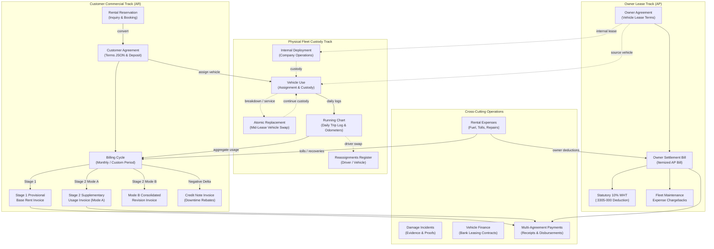
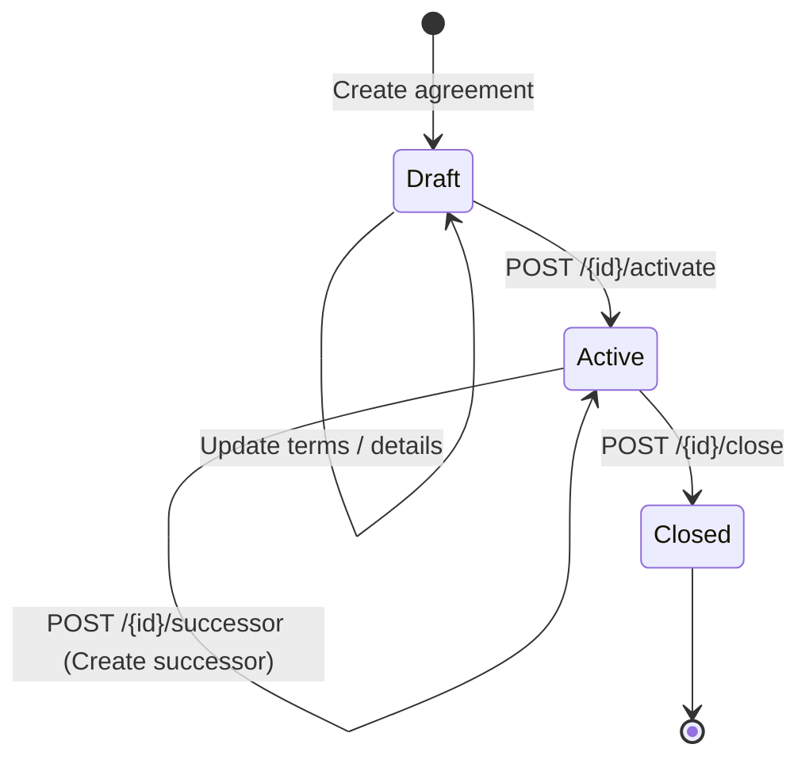
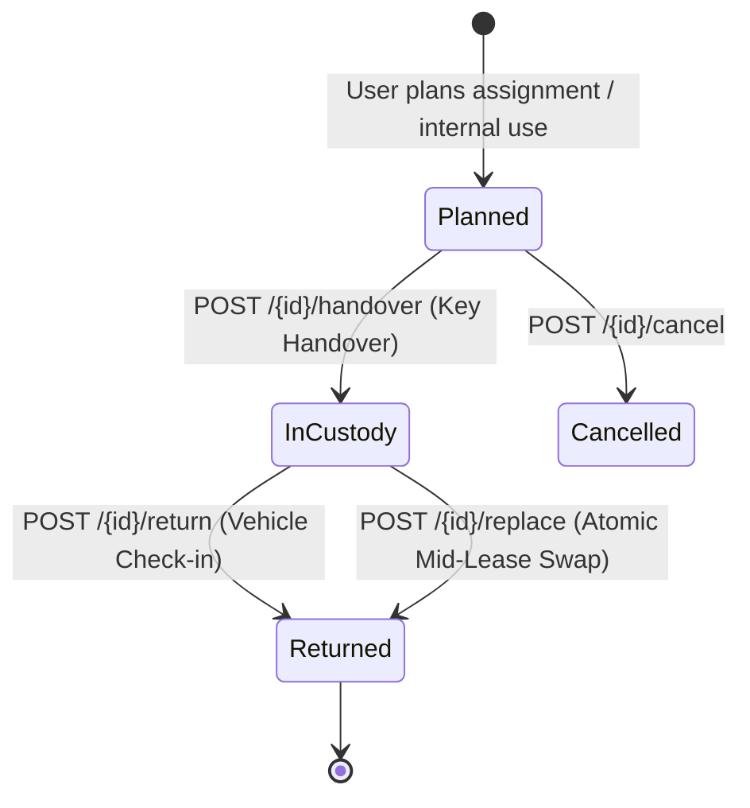

# AutoERP Vehicle Rental Module: Complete Technical & Operational Guide

**Status:** Canonical Master Technical Specification, Architecture Manual & Developer Guide
**Module Directory (Backend):** [`app/Modules/VehicleRental`](file:///d:/project-new/AutoERP/app/Modules/VehicleRental)  
**Frontend Directory:** [`resources/js/modules/vehicle-rental`](file:///d:/project-new/AutoERP/resources/js/modules/vehicle-rental)  
**Timezone Standard:** `Asia/Colombo` (Operational Civil Business Calendar)  
**Precision Arithmetic:** Arbitrary-Precision String Math via [`DecimalMath`](file:///d:/project-new/AutoERP/app/Modules/Core/Services/DecimalMath.php) (BCMath, scale 6)  
**Test Suite Coverage:** 344 Backend PHPUnit Tests (2,948 Assertions) · 38 Frontend Vitest Suites (181 Tests) · TypeScript Strict (0 Errors)

> [!TIP]
> **Operator Handbook:** For a beginner-friendly, step-by-step user manual with UI walkthroughs, screenshots, and daily business workflows designed for dispatchers, billing clerks, cashiers, and fleet officers, see the companion [Vehicle Rental User Guide](file:///d:/project-new/AutoERP/docs/user-guides/vehicle_rental_user_guide.md).

---

## Table of Contents

1. [Executive Overview & Business Mission](#1-executive-overview--business-mission)
   - 1.1 [Core Business Architecture: Multi-Track Operational Decoupling](#11-core-business-architecture-multi-track-operational-decoupling)
   - 1.2 [Fundamental Architectural Invariants](#12-fundamental-architectural-invariants)
   - 1.3 [High-Level Architecture Diagram](#13-high-level-architecture-diagram)
   - 1.4 [Directory & Codebase Layout](#14-directory--codebase-layout)
2. [Complete Database Schema Reference](#2-complete-database-schema-reference)
   - 2.1 [Master Entity-Relationship Diagram (ERD)](#21-master-entity-relationship-diagram-erd)
   - 2.2 [The Core Database Tables & Column Definitions](#22-the-core-database-tables--column-definitions)
   - 2.3 [Immutable History & Event Tables](#23-immutable-history--event-tables)
   - 2.4 [The Agreement Terms JSON Schema](#24-the-agreement-terms-json-schema)
   - 2.5 [Complete Domain Enums Catalog (38 Enums)](#25-complete-domain-enums-catalog-38-enums)
3. [Subsystems, State Machines & Operational Lifecycles](#3-subsystems-state-machines--operational-lifecycles)
   - 3.1 [Rental Reservations & Booking Inquiries](#31-rental-reservations--booking-inquiries)
   - 3.2 [Customer Commercial Agreements & Successor Lineage](#32-customer-commercial-agreements--successor-lineage)
   - 3.3 [Vehicle Owner Lease Agreements & Sourcing](#33-vehicle-owner-lease-agreements--sourcing)
   - 3.4 [Vehicle Physical Custody (`VehicleUse`) & Internal Deployments](#34-vehicle-physical-custody-vehicleuse--internal-deployments)
   - 3.5 [Mid-Lease Atomic Vehicle Swaps (Replacements)](#35-mid-lease-atomic-vehicle-swaps-replacements)
   - 3.6 [Driver Assignments & Reassignments](#36-driver-assignments--reassignments)
   - 3.7 [Daily Running Charts, Telematics & Baseline Overtime Engine](#37-daily-running-charts-telematics--baseline-overtime-engine)
   - 3.8 [Fleet Operating Expenses & 4-Way Allocation Matrix](#38-fleet-operating-expenses--4-way-allocation-matrix)
   - 3.9 [Damage Incidents & Private Proofs](#39-damage-incidents--private-proofs)
   - 3.10 [Vehicle Finance & Bank Leasing Contracts](#310-vehicle-finance--bank-leasing-contracts)
   - 3.11 [Agreement Financial Adjustments & Voiding Lifecycle](#311-agreement-financial-adjustments--voiding-lifecycle)
4. [The Two-Stage Invoicing Engine](#4-the-two-stage-invoicing-engine)
   - 4.1 [Why Two-Stage Invoicing?](#41-why-two-stage-invoicing)
   - 4.2 [Stage 1: Advance / Provisional Base Rent Invoicing](#42-stage-1-advance--provisional-base-rent-invoicing)
   - 4.3 [Running Chart Attachment & Operational Rate Calculations](#43-running-chart-attachment--operational-rate-calculations)
   - 4.4 [Stage 2: Supplementary Usage Invoicing (Mode A)](#44-stage-2-supplementary-usage-invoicing-mode-a)
   - 4.5 [Negative Delta Handling & Credit Notes](#45-negative-delta-handling--credit-notes)
   - 4.6 [Consolidated Revision Invoicing (Mode B)](#46-consolidated-revision-invoicing-mode-b)
   - 4.7 [Billing Cycle Cancellation Workflow & Date Lock Release](#47-billing-cycle-cancellation-workflow--date-lock-release)
   - 4.8 [Document Cancellation & Source Restoration Engine](#48-document-cancellation--source-restoration-engine)
   - 4.9 [Complete End-to-End Invoicing Numeric Case Study](#49-complete-end-to-end-invoicing-numeric-case-study)
5. [Owner Settlement AP Billing & Disbursements](#5-owner-settlement-ap-billing--disbursements)
   - 5.1 [Commercial Workflow of Fleet Sourcing](#51-commercial-workflow-of-fleet-sourcing)
   - 5.2 [Gross Lease Earnings & Operational Usage Reimbursement](#52-gross-lease-earnings--operational-usage-reimbursement)
   - 5.3 [Statutory 10% Withholding Tax (WHT :3305-000)](#53-statutory-10-withholding-tax-wht-3305-000)
   - 5.4 [Fleet Maintenance Chargeback Deductions](#54-fleet-maintenance-chargeback-deductions)
   - 5.5 [Deduction Capping Safeguard](#55-deduction-capping-safeguard)
   - 5.6 [Settlement Cancellation & Complete Restoration](#56-settlement-cancellation--complete-restoration)
   - 5.7 [Owner Settlement Numeric Case Study](#57-owner-settlement-numeric-case-study)
6. [Multi-Agreement Financial Settlements & Payments](#6-multi-agreement-financial-settlements--payments)
   - 6.1 [Single Agreement Payments vs Party-Wide Settlements](#61-single-agreement-payments-vs-party-wide-settlements)
   - 6.2 [Interactive Document Allocation Grid](#62-interactive-document-allocation-grid)
   - 6.3 [Unapplied Advances & Surplus Pooling](#63-unapplied-advances--surplus-pooling)
   - 6.4 [Payment Reversals & Refunds](#64-payment-reversals--refunds)
7. [Financial Ledger Integrations & Accounting Impact](#7-financial-ledger-integrations--accounting-impact)
   - 7.1 [Integration with `Modules\Invoice`](#71-integration-with-modulesinvoice)
   - 7.2 [Integration with `Modules\Payment`](#72-integration-with-modulespayment)
   - 7.3 [Complete General Ledger Double-Entry Posting Matrix](#73-complete-general-ledger-double-entry-posting-matrix)
8. [Enterprise Reporting Suite](#8-enterprise-reporting-suite)
   - 8.1 [Telematics Statement of Account (HTML, Print, PDF)](#81-telematics-statement-of-account-html-print-pdf)
   - 8.2 [The 8 Core Analytical Reports](#82-the-8-core-analytical-reports)
9. [Frontend Workspaces & UI/UX Standards](#9-frontend-workspaces--uiux-standards)
   - 9.1 [Frontend Architecture & Component Hierarchy](#91-frontend-architecture--component-hierarchy)
   - 9.2 [Dedicated Invoices and Owner Bills Workspace](#92-dedicated-invoices-and-owner-bills-workspace)
   - 9.3 [Agreements Management Workspace](#93-agreements-management-workspace)
   - 9.4 [Vehicle Custody & Running Chart Registers](#94-vehicle-custody--running-chart-registers)
   - 9.5 [UI/UX Invariants & Design Principles](#95-uiux-invariants--design-principles)
   - 9.6 [End-to-End User Journeys (4 Operational Roles)](#96-end-to-end-user-journeys-4-operational-roles)
10. [Complete REST API Specification (70+ Endpoints)](#10-complete-rest-api-specification-70-endpoints)
11. [Developer Verification, Testing & Extension Guide](#11-developer-verification-testing--extension-guide)

---

## 1. Executive Overview & Business Mission

The **Vehicle Rental** module (`VehicleRental`) is AutoERP's high-throughput operational and commercial management engine for vehicle rental operators, corporate chauffeur transport services, commercial fleet leasing, and private car-hire businesses.

### 1.1 Core Business Architecture: Multi-Track Operational Decoupling

A real-world commercial vehicle rental enterprise does not simply purchase cars and rent them to retail customers. Commercial fleet operations involve distinct, interacting operational and accounting realities:

1. **Customer Track (Debtor / Accounts Receivable - AR):**
   - Corporate clients rent vehicles on a monthly, weekly, or daily basis.
   - Revenue streams comprise **Monthly Base Rent**, **Excess Mileage Charges**, **Driver Overtime** (Normal 1.5x, Double 2.0x, Triple 3.0x), **Driver Night-Out Allowances**, **Highway Toll Outlays**, and **Ad-Hoc Additions**.
   - Contractual downtime rebates, promotional discounts, and accident adjustments reduce receivable balances.

2. **Owner Track (Creditor / Accounts Payable - AP):**
   - Rental companies frequently lease vehicles from private vehicle owners or external fleet suppliers to satisfy client demand without massive balance-sheet capital expenditure.
   - Liability costs comprise **Lessor Lease Rent**, **Agreed Usage Mileage**, **Driver Salary Reimbursements**, minus **Statutory 10% Withholding Tax (WHT)** and **Fleet Maintenance Chargebacks**.

3. **Internal Company Fleet Operations Track:**
   - Companies maintain vehicles for their own operational needs (executive transport, internal logistics, site visits) without a customer agreement.
   - Internal deployments support both **Company-Owned Fleet** vehicles and **Third-Party Owner-Leased** vehicles deployed for internal business operations.

4. **Fleet Custody Track (The Physical Bridge):**
   - The customer agreement terms **never** dictate owner agreement costs; the owner's payable rates **never** dictate customer billing.
   - The commercial sides are decoupled and unified strictly at the point of **Physical Vehicle Custody** (`vehicle_rental_uses`) and **Daily Running Charts** (`vehicle_rental_running_charts`).

```
+---------------------------------------------------------------------------------------------------+
|                                 AutoERP Multi-Track Architecture                                  |
|                                                                                                   |
|   [ Customer (Lessee) ]           [ Vehicle Owner (Lessor) ]          [ Internal Company Fleet ]  |
|            |                                  |                                   |               |
|   Customer Agreement (AR)            Owner Agreement (AP)                Company Fleet Vehicle    |
|            \                                  |                                   /               |
|             \                                 |                                  /                |
|              +----------------> [ Physical Vehicle Custody ] <------------------+                 |
|                                 [     (VehicleUse)         ]                                      |
|                                               |                                                   |
|                                               v                                                   |
|                                     [ Daily Running Charts ]                                      |
|                                     (Trip Sheets & Telematics)                                    |
|                                               |                                                   |
|                 +-----------------------------+-----------------------------+                     |
|                 |                                                           |                     |
|                 v                                                           v                     |
|      [ Customer Billing ]                                        [ Owner Settlements ]            |
|      Stage 1 Base Rent Invoice                                   Gross Lease Rent                 |
|      Stage 2 Usage Invoice                                       + Usage Charges                  |
|      (Excess KM, OT, Tolls)                                      - 10% Statutory WHT              |
|                                                                  - Maintenance Chargebacks        |
|                 |                                                           |                     |
|                 v                                                           v                     |
|      AR Ledger (Sales)                                           AP Ledger (Supplier Bills)       |
+---------------------------------------------------------------------------------------------------+
```

### 1.2 Fundamental Architectural Invariants

Every service, controller, and database operation in `VehicleRental` enforces the following non-negotiable architectural rules:

1. **"Do Not Invent Money" Principle:**
   - Physical evidence (trip odometers, shift hours, fuel receipts, accident reports) is recorded as immutable factual history.
   - **No financial invoice, credit note, debit note, owner payable voucher, or GL journal entry is ever created automatically by the system without explicit user review, authorized approval, and verified contractual entitlement.**
2. **No Fictitious Owner Costs for Company-Owned Fleet:**
   - If a vehicle is owned directly by the tenant company (recorded in `vehicles` table with company ownership), **zero artificial owner agreements or supplier bills are manufactured**.
3. **Decoupled Commercial Independence:**
   - Modifying a customer's rate structure does not modify the owner's lease rate. Each side has its own currency, billing basis, terms, and tax schedules.
4. **Optimistic Concurrency Control (OCC):**
   - Every read-modify-write operation asserts `expected_version === row_version`. Stale concurrent writes fail immediately with HTTP 409 Conflict.
5. **Exact Decimal Precision Arithmetic:**
   - Floating-point arithmetic (`float`, `double`) is strictly banned in financial, distance, and quantity calculations. All numbers use arbitrary-precision string math via [`DecimalMath`](file:///d:/project-new/AutoERP/app/Modules/Core/Services/DecimalMath.php) (BCMath with scale 6).
6. **Civil Timezone Standard (`Asia/Colombo`):**
   - Rental cutovers, calendar months, duty shifts, and vehicle custody boundaries evaluate strictly against the tenant's civil business timezone (`Asia/Colombo`). Client UTC offsets cannot misalign operational boundaries.
7. **Strict Immutability & Append-Only History:**
   - Deleting active or historical business records is strictly prohibited (`LogicException`). Modifying an activated agreement, vehicle use, or running chart creates an append-only audit record in dedicated history tables (`*_history`).

### 1.3 High-Level Architecture Diagram



### 1.4 Directory & Codebase Layout

```
AutoERP
├── app/Modules/VehicleRental/
│   ├── Constants/                     # AgreementFields, OperationalFields, IncidentFields
│   ├── Data/                          # AgreementContext DTO
│   ├── Database/Migrations/           # 28 Core Table Migrations
│   ├── Database/UpgradeMigrations/    # 6 Schema hardening & indexing migrations
│   ├── Enums/                         # 38 Strict PHP 8.2 Backed Enums
│   ├── Http/
│   │   ├── Controllers/               # 21 Specialized REST API Controllers
│   │   ├── Requests/                  # FormRequest validation & OCC assertions
│   │   └── Resources/                 # JSON API Serialization Resources
│   ├── Models/                        # 31 Eloquent Models with audit relations
│   ├── Routes/api.php                 # Route definitions and middleware gates
│   ├── Services/                      # 44 High-cohesion domain services (including RentalAuthorization)
│   └── Tests/                         # 47 PHPUnit Test Classes (344 Tests, 2,948 Assertions)
└── resources/js/modules/vehicle-rental/
    ├── api clients/                   # agreementApi.ts, rentalBillingApi.ts, vehicleRentalApi.ts
    ├── components/                    # Modal wizards, history panels, grids, editors
    ├── pages/                         # Dedicated register, billing, and management pages
    └── reports/                       # 7 Dedicated interactive analytical report pages
```

---

## 2. Complete Database Schema Reference

The Vehicle Rental module database comprises **28 core relational tables**, strictly isolated by `tenant_id` and `organization_unit_id`.

### 2.1 Master Entity-Relationship Diagram (ERD)

```mermaid
erDiagram
    vehicle_rental_customer_agreements ||--o{ vehicle_rental_customer_agreements_history : audits
    vehicle_rental_customer_agreements ||--o{ vehicle_rental_uses : assigns
    vehicle_rental_customer_agreements ||--o{ vehicle_rental_customer_base_charges : incurs
    vehicle_rental_customer_agreements ||--o{ vehicle_rental_customer_usage_charges : incurs
    vehicle_rental_customer_agreements ||--o{ vehicle_rental_billing_cycles : bills
    vehicle_rental_customer_agreements ||--o{ vehicle_rental_agreement_adjustments : adjusts
    vehicle_rental_customer_agreements ||--o{ vehicle_rental_reassignments : tracks

    vehicle_rental_owner_agreements ||--o{ vehicle_rental_owner_agreements_history : audits
    vehicle_rental_owner_agreements ||--o{ vehicle_rental_uses : sources
    vehicle_rental_owner_agreements ||--o{ vehicle_rental_owner_base_charges : incurs
    vehicle_rental_owner_agreements ||--o{ vehicle_rental_owner_usage_charges : incurs
    vehicle_rental_owner_agreements ||--o{ vehicle_rental_billing_cycles : bills
    vehicle_rental_owner_agreements ||--o{ vehicle_rental_agreement_adjustments : adjusts

    vehicle_rental_uses ||--o{ vehicle_rental_use_history : audits
    vehicle_rental_uses ||--o{ vehicle_rental_running_charts : records
    vehicle_rental_uses ||--o{ vehicle_rental_uses : "replaces / replaced_by"
    vehicle_rental_uses ||--o{ vehicle_rental_reassignments : swaps

    vehicle_rental_running_charts ||--o{ vehicle_rental_running_chart_history : audits
    vehicle_rental_running_charts ||--o{ vehicle_rental_billing_cycle_charts : attaches
    vehicle_rental_running_charts ||--o{ vehicle_rental_reassignments : reassigns

    vehicle_rental_billing_cycles ||--o{ vehicle_rental_billing_cycle_charts : contains
    vehicle_rental_billing_cycles ||--o{ vehicle_rental_billing_cycle_items : itemizes

    vehicle_rental_expenses ||--o{ vehicle_rental_expense_allocations : allocates

    vehicle_rental_incidents ||--o{ vehicle_rental_incident_events : tracks
    vehicle_rental_incidents ||--o{ vehicle_rental_incident_attachments : attaches

    vehicle_rental_reservations ||--o{ vehicle_rental_reservation_histories : audits

    vehicle_rental_finance_agreements ||--o{ vehicle_rental_finance_installments : amortizes
    vehicle_rental_finance_agreements ||--o{ vehicle_rental_finance_status_histories : tracks
```



### 2.2 The Core Database Tables & Column Definitions

Below are the schema specifications for the primary relational tables:

#### 1. `vehicle_rental_customer_agreements`
Stores commercial contracts with customers (lessees).

| Column | Type | Nullable | Key / Default | Description |
| :--- | :--- | :---: | :---: | :--- |
| `id` | `bigint unsigned` | No | PK, Auto Inc | Unique identifier |
| `tenant_id` | `bigint unsigned` | No | Index | Multi-tenant company identifier |
| `organization_unit_id`| `bigint unsigned` | No | Index | Operating branch / business unit |
| `customer_id` | `bigint unsigned` | No | FK | Customer party ID (`parties.id` / `customers.id`) |
| `reference` | `varchar(100)` | No | Unique index | Agreement contract reference code |
| `party_name_snapshot` | `varchar(255)` | No | | Customer name at time of contract creation |
| `party_code_snapshot` | `varchar(50)` | Yes | Nullable | Customer code snapshot |
| `currency_id` | `bigint unsigned` | No | FK | Contract billing currency |
| `currency_code_snapshot`| `varchar(10)` | No | | 3-letter currency code snapshot (e.g. `LKR`) |
| `agreed_on` | `date` | No | | Commercial contract agreement date |
| `executing_on` | `date` | Yes | Nullable | Legal signing date |
| `starts_on` | `date` | No | Index | Lease commencement date |
| `ends_on` | `date` | Yes | Nullable | Contract expiry date (`null` = open-ended) |
| `basis` | `varchar(32)` | No | `monthly` | `daily`, `monthly` (`RentalBasis`) |
| `driver_mode` | `varchar(32)` | No | `with_driver` | `with_driver`, `self_drive` (`DriverMode`) |
| `status` | `varchar(32)` | No | `draft` | `draft`, `active`, `closed` (`AgreementStatus`) |
| `terms` | `json` | No | `{}` | JSON terms schema (base rate, km, OT, working hours) |
| `notes` | `text` | Yes | Nullable | Internal contractual notes |
| `activated_at` | `timestamp` | Yes | Nullable | Exact timestamp of contract activation |
| `closed_at` | `timestamp` | Yes | Nullable | Exact timestamp of agreement closure |
| `closed_on` | `date` | Yes | Nullable | Tenant civil calendar closure date |
| `predecessor_agreement_id` | `bigint unsigned` | Yes | FK | Lineage pointer to previous contract |
| `successor_agreement_id` | `bigint unsigned` | Yes | FK | Lineage pointer to successor contract |
| `row_version` | `bigint unsigned` | No | `1` | Optimistic Concurrency Control counter |
| `created_at` / `updated_at` | `timestamps` | No | | Record audit timestamps |

#### 2. `vehicle_rental_owner_agreements`
Stores fleet sourcing lease contracts with external vehicle owners / suppliers.

| Column | Type | Nullable | Key / Default | Description |
| :--- | :--- | :---: | :---: | :--- |
| `id` | `bigint unsigned` | No | PK, Auto Inc | Unique identifier |
| `tenant_id` | `bigint unsigned` | No | Index | Multi-tenant company identifier |
| `organization_unit_id`| `bigint unsigned` | No | Index | Operating branch identifier |
| `supplier_id` | `bigint unsigned` | No | FK | Owner supplier party ID (`parties.id` / `suppliers.id`) |
| `vehicle_id` | `bigint unsigned` | No | FK | Specific physical vehicle sourced (`vehicles.id`) |
| `reference` | `varchar(100)` | No | Unique index | Owner lease agreement reference code |
| `party_name_snapshot` | `varchar(255)` | No | | Owner party name snapshot |
| `party_code_snapshot` | `varchar(50)` | Yes | Nullable | Owner supplier code snapshot |
| `vehicle_number_snapshot`| `varchar(50)` | No | | Vehicle plate number snapshot |
| `vehicle_registration_snapshot`| `varchar(50)`| Yes | Nullable | Vehicle registration document snapshot |
| `currency_id` | `bigint unsigned` | No | FK | Contract payable currency |
| `currency_code_snapshot`| `varchar(10)` | No | | 3-letter currency code snapshot |
| `agreed_on` | `date` | No | | Sourcing agreement date |
| `executing_on` | `date` | Yes | Nullable | Legal signing date |
| `starts_on` | `date` | No | Index | Sourcing start date |
| `ends_on` | `date` | Yes | Nullable | Sourcing end date |
| `basis` | `varchar(32)` | No | `monthly` | `daily`, `monthly` (`RentalBasis`) |
| `driver_mode` | `varchar(32)` | No | `with_driver` | `with_driver`, `self_drive` (`DriverMode`) |
| `status` | `varchar(32)` | No | `draft` | `draft`, `active`, `closed` (`AgreementStatus`) |
| `terms` | `json` | No | `{}` | JSON terms schema (deposit prohibited) |
| `notes` | `text` | Yes | Nullable | Commercial sourcing notes |
| `activated_at` | `timestamp` | Yes | Nullable | Activation timestamp |
| `closed_at` | `timestamp` | Yes | Nullable | Closure timestamp |
| `closed_on` | `date` | Yes | Nullable | Tenant civil calendar closure date |
| `predecessor_agreement_id` | `bigint unsigned` | Yes | FK | Lineage pointer to previous contract |
| `successor_agreement_id` | `bigint unsigned` | Yes | FK | Lineage pointer to successor contract |
| `row_version` | `bigint unsigned` | No | `1` | OCC version counter |

#### 3. `vehicle_rental_uses`
Tracks physical custody, assignment, key handover, vehicle returns, and internal deployments.

| Column | Type | Nullable | Key / Default | Description |
| :--- | :--- | :---: | :---: | :--- |
| `id` | `bigint unsigned` | No | PK, Auto Inc | Unique identifier |
| `tenant_id` | `bigint unsigned` | No | Index | Multi-tenant company identifier |
| `organization_unit_id`| `bigint unsigned` | No | Index | Operating branch identifier |
| `customer_agreement_id` | `bigint unsigned` | **Yes** | FK | Associated customer contract (`null` for internal use) |
| `customer_agreement_version`| `bigint unsigned`| Yes | FK | Agreement audit revision locked at planning |
| `owner_agreement_id` | `bigint unsigned` | Yes | FK | Sourcing agreement (`null` if company owned) |
| `owner_agreement_version`| `bigint unsigned` | Yes | FK | Owner agreement revision locked at planning |
| `vehicle_id` | `bigint unsigned` | No | FK | Physical vehicle identifier |
| `vehicle_label_snapshot`| `varchar(255)` | No | | Preserved vehicle registration / label string |
| `status` | `varchar(32)` | No | `planned` | `planned`, `in_custody`, `returned`, `cancelled` (`VehicleUseStatus`) |
| `starts_at` | `dateTime` | No | Index | Planned assignment start timestamp |
| `ends_at` | `dateTime` | Yes | Nullable | Planned assignment end timestamp |
| `starts_at_input` | `varchar(255)` | No | | Original user input string for start date |
| `ends_at_input` | `varchar(255)` | Yes | Nullable | Original user input string for end date |
| `handed_over_at` | `dateTime` | Yes | Nullable | Actual physical key handover timestamp |
| `returned_at` | `dateTime` | Yes | Nullable | Actual physical vehicle check-in timestamp |
| `handover_odometer` | `decimal(20,6)` | Yes | Nullable | Odometer reading at vehicle collection |
| `return_odometer` | `decimal(20,6)` | Yes | Nullable | Odometer reading at vehicle check-in |
| `notes` | `text` | Yes | Nullable | Operational notes & instructions |
| `replaces_use_id` | `bigint unsigned` | Yes | FK, Unique | If replacement: points to original custody use |
| `row_version` | `bigint unsigned` | No | `1` | OCC version counter |

*Note on Relations:* If a vehicle is replaced, the successor custody row sets `replaces_use_id = $oldUse->id`. The predecessor accesses its replacement via Eloquent `hasOne(VehicleUse::class, 'replaces_use_id')` (`replacedByUse`). Chauffeurs are assigned at the duty shift level on `vehicle_rental_running_charts`.

#### 4. `vehicle_rental_running_charts`
Master daily trip log recording telematics, shift hours, and distance.

| Column | Type | Nullable | Key / Default | Description |
| :--- | :--- | :---: | :---: | :--- |
| `id` | `bigint unsigned` | No | PK, Auto Inc | Unique identifier |
| `tenant_id` | `bigint unsigned` | No | Index | Multi-tenant company identifier |
| `organization_unit_id`| `bigint unsigned` | No | Index | Operating branch identifier |
| `vehicle_use_id` | `bigint unsigned` | No | FK | Associated vehicle custody record |
| `vehicle_use_version` | `bigint unsigned` | No | FK | Vehicle use revision locked at chart creation |
| `reference` | `varchar(100)` | No | Unique index | Trip sheet serial / reference number |
| `status` | `varchar(32)` | No | `draft` | `draft`, `finalized`, `reversed` (`RunningChartStatus`) |
| `starts_at` / `ends_at` | `dateTime` | No | Index | Duty shift departure and arrival timestamps |
| `starts_at_input` / `ends_at_input` | `varchar(255)` | No | | Raw input strings for duty shift timestamps |
| `start_odometer` | `decimal(20,6)` | Yes | Nullable | Duty departure odometer reading |
| `end_odometer` | `decimal(20,6)` | Yes | Nullable | Duty arrival odometer reading |
| `commercial_km` | `decimal(20,6)` | Yes | `0.000000` | Billable customer business kilometers |
| `garage_km` | `decimal(20,6)` | Yes | `0.000000` | Dead-mileage between depot and client pickup |
| `ac_mode` | `varchar(32)` | Yes | Nullable | `non_ac`, `front`, `dual` (`AirConditioningMode`) |
| `normal_ot_minutes` | `unsigned int` | Yes | `0` | Standard 1.5x overtime minutes |
| `double_ot_minutes` | `unsigned int` | Yes | `0` | Holiday / Weekend 2.0x overtime minutes |
| `triple_ot_minutes` | `unsigned int` | Yes | `0` | Midnight / Special 3.0x overtime minutes |
| `night_outs` | `unsigned int` | Yes | `0` | Outstation overnight stay count |
| `driver_identity_source`| `varchar(32)` | Yes | Nullable | `employee`, `external` (`DriverIdentitySource`) |
| `driver_employee_id` | `bigint unsigned` | Yes | FK | Operating chauffeur employee ID (`hr_employees.id`) |
| `driver_name_snapshot` | `varchar(255)`| Yes | Nullable | Chauffeur name preserved at finalization |
| `driver_reference_snapshot`| `varchar(100)`| Yes | Nullable | Chauffeur employee number snapshot |
| `driver_observation` | `text` | Yes | Nullable | Vehicle condition / mechanical notes |
| `notes` | `text` | Yes | Nullable | Trip purpose / route notes |
| `corrects_chart_id` | `bigint unsigned` | Yes | FK, Unique | Linked prior chart if this chart is a correction |
| `finalized_at` | `dateTime` | Yes | Nullable | Timestamp of chart finalization |
| `reversed_at` | `dateTime` | Yes | Nullable | Timestamp of chart reversal |
| `row_version` | `bigint unsigned` | No | `1` | OCC version counter |

*Distance Calculation Rule:* Total physical kilometers run during the duty shift is evaluated as $\text{Total KM} = \text{end\_odometer} - \text{start\_odometer} = \text{commercial\_km} + \text{garage\_km}$.

#### 5. `vehicle_rental_billing_cycles`
Two-Stage periodic invoicing lifecycle record.

| Column | Type | Nullable | Key / Default | Description |
| :--- | :--- | :---: | :---: | :--- |
| `id` | `bigint unsigned` | No | PK, Auto Inc | Unique identifier |
| `tenant_id` | `bigint unsigned` | No | Index | Multi-tenant company identifier |
| `organization_unit_id`| `bigint unsigned` | No | Index | Operating branch identifier |
| `cycle_number` | `varchar(64)` | No | Unique index | Cycle identifier (e.g. `CYCLE-2026-0001`) |
| `customer_agreement_id` | `bigint unsigned` | Yes | FK | Associated customer contract |
| `owner_agreement_id` | `bigint unsigned` | Yes | FK | Associated owner contract |
| `customer_base_charge_id`| `bigint unsigned`| Yes | FK | Linked provisional base rent charge |
| `owner_base_charge_id` | `bigint unsigned` | Yes | FK | Linked owner base lease charge |
| `period_from` / `period_until`| `date` | No | Index | Billing cycle calendar coverage |
| `status` | `varchar(32)` | No | `draft` | `draft`, `stage1_generated`, `stage2_attached`, `finalized`, `cancelled` (`BillingCycleStatus`) |
| `billing_mode` | `varchar(32)` | No | `without_running_chart`| `without_running_chart`, `with_running_chart` (`BillingCycleMode`) |
| `finalization_mode`| `varchar(32)` | No | `supplementary_invoice`| `supplementary_invoice` (Mode A), `consolidated_revision` (Mode B) (`BillingFinalizationMode`) |
| `initial_invoice_id`| `bigint unsigned` | Yes | FK | Linked Stage 1 Provisional Invoice |
| `supplementary_invoice_id`| `bigint unsigned`| Yes| FK | Linked Stage 2 Mode A Supplementary Invoice |
| `final_invoice_id` | `bigint unsigned` | Yes | FK | Linked Stage 2 Mode B Consolidated Invoice |
| `base_rent_amount` | `decimal(20,6)` | No | `0.000000` | Prorated base hire rent |
| `excess_km_amount` | `decimal(20,6)` | No | `0.000000` | Usage excess distance charges |
| `overtime_amount` | `decimal(20,6)` | No | `0.000000` | Multi-tier chauffeur overtime charges |
| `night_out_amount` | `decimal(20,6)` | No | `0.000000` | Chauffeur outstation night allowances |
| `tolls_amount` | `decimal(20,6)` | No | `0.000000` | Reimbursable expressway tolls |
| `additions_amount` | `decimal(20,6)` | No | `0.000000` | Ad-hoc additions subtotal |
| `deductions_amount`| `decimal(20,6)` | No | `0.000000` | Ad-hoc deductions subtotal |
| `net_subtotal` | `decimal(20,6)` | No | `0.000000` | Net cycle subtotal before taxes |
| `tax_amount` | `decimal(20,6)` | No | `0.000000` | Total billed tax |
| `total_billed_amount`| `decimal(20,6)` | No | `0.000000` | Total billed amount across all invoices |
| `total_paid_amount` | `decimal(20,6)` | No | `0.000000` | Cumulative customer payments received |
| `currency_id` | `bigint unsigned` | No | FK | Billing cycle currency |
| `exchange_rate` | `decimal(20,6)` | No | `1.000000` | Currency exchange rate |
| `notes` | `text` | Yes | Nullable | Invoicing notes and instructions |
| `created_by` | `bigint unsigned` | Yes | FK | User who initiated cycle |
| `finalized_by` | `bigint unsigned` | Yes | FK | User who finalized cycle |
| `finalized_at` | `dateTime` | Yes | Nullable | Finalization timestamp |
| `row_version` | `bigint unsigned` | No | `1` | OCC version counter |

#### 6. `vehicle_rental_reassignments`
Immutable audit register of mid-contract driver replacements and atomic vehicle swaps.

| Column | Type | Nullable | Key / Default | Description |
| :--- | :--- | :---: | :---: | :--- |
| `id` | `bigint unsigned` | No | PK, Auto Inc | Unique identifier |
| `tenant_id` | `bigint unsigned` | No | Index | Multi-tenant company identifier |
| `reassignment_type` | `varchar(32)` | No | Index | `vehicle_replacement`, `driver_reassignment`, `combined` (`ReassignmentType`) |
| `customer_agreement_id`| `bigint unsigned`| Yes| FK | Associated customer contract |
| `vehicle_use_id` | `bigint unsigned` | Yes | FK | Associated vehicle custody record |
| `running_chart_id` | `bigint unsigned` | Yes | FK | Associated running chart (for driver swap) |
| `previous_vehicle_id` | `bigint unsigned` | Yes | FK | Replaced physical vehicle |
| `new_vehicle_id` | `bigint unsigned` | Yes | FK | Replacement physical vehicle |
| `previous_owner_agreement_id`| `bigint unsigned`| Yes| FK | Sourcing agreement for replaced vehicle |
| `new_owner_agreement_id`| `bigint unsigned`| Yes| FK | Sourcing agreement for replacement vehicle |
| `previous_driver_employee_id` | `bigint unsigned` | Yes | FK | Relieved chauffeur |
| `new_driver_employee_id` | `bigint unsigned` | Yes | FK | Assigned chauffeur |
| `financial_status` | `varchar(32)` | No | `pending` | `pending`, `settled`, `none` (`ReassignmentFinancialStatus`) |
| `financial_delta_amount` | `decimal(20,6)`| No | `0.000000`| Rate differential incurred by swap |
| `reason` | `text` | No | | Traceable justification for replacement / reassignment |
| `occurred_at` | `dateTime` | No | Index | Physical swap / handover timestamp |
| `user_id` | `bigint unsigned` | Yes | FK | Operating user who authorized swap |

### 2.3 Immutable History & Event Tables

Business history is strictly preserved. When an agreement, vehicle use, running chart, reservation, or incident changes state, an immutable audit record is created via dedicated history tables:

| Main Model | History Table | Captured Audit Data |
| :--- | :--- | :--- |
| `CustomerAgreement` | `vehicle_rental_customer_agreements_history` | `row_version`, `status`, complete `terms` JSON snapshot, `actor_id`, `created_at`, `reason` |
| `OwnerAgreement` | `vehicle_rental_owner_agreements_history` | `row_version`, `status`, `terms` JSON snapshot, `actor_id`, `created_at`, `reason` |
| `VehicleUse` | `vehicle_rental_use_history` | `row_version`, `status`, `handed_over_at`, `returned_at`, `handover_odometer`, `return_odometer`, `reason` |
| `RunningChart` | `vehicle_rental_running_chart_history` | `row_version`, `status`, `start_odometer`, `end_odometer`, `commercial_km`, `garage_km`, `normal_ot_minutes`, `actor_id` |
| `RentalReservation` | `vehicle_rental_reservation_histories` | `reservation_id`, `from_status`, `to_status`, `reason`, `changed_by`, `changed_at` |
| `RentalIncident` | `vehicle_rental_incident_events` | `incident_id`, `event_type`, `old_status`, `new_status`, `comment`, `created_by` |
| `AgreementAdjustment` | `vehicle_rental_agreement_adjustments_history` | `adjustment_id`, `from_status`, `to_status`, `reason`, `user_id` |
| `VehicleFinanceAgreement`| `vehicle_rental_finance_status_histories` | `finance_agreement_id`, `old_status`, `new_status`, `reason`, `changed_by`, `changed_at` |

### 2.4 The Agreement Terms JSON Schema

All monetary and operational rates are maintained in the agreement's `terms` JSON column. The schema defines 13 standard decimal string keys (scaled to 6 decimal places via BCMath, precision 20):

```json
{
  "base_rate": "150000.000000",
  "included_km": "3000.000000",
  "excess_km_rate": "45.000000",
  "non_ac_rate": "0.000000",
  "front_ac_rate": "48.000000",
  "dual_ac_rate": "52.000000",
  "driver_rate": "35000.000000",
  "normal_ot_rate": "450.000000",
  "double_ot_rate": "600.000000",
  "triple_ot_rate": "900.000000",
  "night_out_rate": "2500.000000",
  "deposit_requirement": "50000.000000",
  "working_hours": "8.000000"
}
```

*Crucial Business Rules:*
1. `deposit_requirement` is permitted **strictly on Customer Agreements**. Attempting to pass `deposit_requirement` on an Owner Agreement triggers a `ValidationException`.
2. `working_hours` specifies the agreed daily working baseline hours (defaults to `8.0`). Duty exceeding this baseline automatically triggers overtime calculation via [`OvertimeCalculator`](file:///d:/project-new/AutoERP/app/Modules/VehicleRental/Services/OvertimeCalculator.php).

### 2.5 Complete Domain Enums Catalog (38 Enums)

The module enforces strict PHP 8.2 backed enums across all domain transitions, maintaining exact alignment between database values, backend type safety, and frontend contract definitions:

| Enum Name | Backed Type | Exact Backed Values (Source Code) | Domain Purpose |
| :--- | :---: | :--- | :--- |
| `AgreementAction` | `string` | `create`, `update`, `activate`, `close`, `supersede` | Agreement lifecycle actions and successor creation |
| `AgreementAdjustmentCategory` | `string` | `commercial_rebate`, `downtime_compensation`, `damage_chargeback`, `traffic_fine`, `other` | Contractual adjustment classifications |
| `AgreementAdjustmentStatus` | `string` | `draft`, `authorized`, `applied`, `voided` | Adjustment financial lifecycle |
| `AgreementAdjustmentType` | `string` | `credit_note`, `debit_note` | Financial direction of adjustment |
| `AgreementKind` | `string` | `customer`, `owner` | Decoupled commercial track identifier |
| `AgreementStatus` | `string` | `draft`, `active`, `closed` | Core agreement contract states |
| `AirConditioningMode` | `string` | `non_ac`, `front`, `dual` | Climate control mode for differential rate assessment |
| `BaseChargeSource` | `string` | `vehicle_rental_customer_base_charge`, `vehicle_rental_owner_base_charge` | Provenance of base hire charge records |
| `BaseRentPolicy` | `string` | `actual_calendar_days_v1` | Proration algorithm based on tenant civil calendar days |
| `BillingCycleItemCategory` | `string` | `driver_salary`, `driver_allowance`, `overtime`, `excess_km`, `toll_charge`, `toll`, `fuel_charge`, `fuel`, `night_out`, `night_out_allowance`, `damage_recharge`, `goodwill_discount`, `downtime_rebate`, `deduction`, `other` | 15 Ad-hoc addition/deduction line classifications |
| `BillingCycleItemType` | `string` | `addition`, `deduction` | Mathematical effect on billing subtotal |
| `BillingCycleMode` | `string` | `without_running_chart`, `with_running_chart` | Operational telemetry attachment model |
| `BillingCycleStatus` | `string` | `draft`, `stage1_generated`, `stage2_attached`, `finalized`, `cancelled` | Master Two-Stage Invoicing lifecycle |
| `BillingFinalizationMode` | `string` | `supplementary_invoice`, `consolidated_revision` | Mode A (Supplementary) vs Mode B (Consolidated Revision) |
| `DriverIdentitySource` | `string` | `employee`, `external` | Origin of operating chauffeur record |
| `DriverMode` | `string` | `self_drive`, `with_driver` | Self-drive hire vs chauffeur-driven deployment |
| `IncidentPermission` | `string` | `vehicle-rental.incidents.view`, `vehicle-rental.incidents.record`, `vehicle-rental.incidents.review` | Security authorization keys for incident evidence |
| `IncidentReviewAction` | `string` | `confirm`, `reject` | Incident investigation approval actions |
| `IncidentStatus` | `string` | `recorded`, `confirmed`, `rejected` | Fleet incident verification pipeline |
| `IncidentType` | `string` | `fuel`, `toll`, `parking`, `repair`, `maintenance`, `accident_damage`, `penalty`, `cleaning`, `other` | Physical fleet incident evidence categories |
| `MileagePolicy` | `string` | `commercial_calendar_cycles_v1` | Excess distance consumption calculation policy |
| `ReassignmentFinancialStatus` | `string` | `pending`, `settled`, `none` | Financial reconciliation status of swap differentials |
| `ReassignmentType` | `string` | `vehicle_replacement`, `driver_reassignment`, `combined` | Mid-contract fleet resource replacement classification |
| `RentalBasis` | `string` | `daily`, `monthly` | Periodic agreement recurrence basis |
| `RentalExpenseAllocationStatus` | `string` | `draft`, `confirmed`, `invoiced`, `reversed` | Expense allocation reconciliation lifecycle |
| `RentalExpenseAllocationType` | `string` | `company_cost`, `customer_recovery`, `owner_deduction`, `employee_reimbursement` | 4-Way fleet operating cost distribution matrix |
| `RentalExpenseStatus` | `string` | `draft`, `submitted`, `approved`, `allocated`, `rejected`, `reversed` | Operating expense authorization state machine |
| `RentalExpenseType` | `string` | `fuel`, `toll`, `maintenance`, `fine`, `other` | Fleet expense operational categories |
| `RentalReservationStatus` | `string` | `draft`, `pending`, `confirmed`, `converted`, `cancelled`, `expired` | Booking inquiry state machine |
| `RunningChartAction` | `string` | `create`, `update`, `finalize`, `reverse` | Daily trip log lifecycle actions |
| `RunningChartStatus` | `string` | `draft`, `finalized`, `reversed` | Daily trip log state machine |
| `UsageChargeComponent` | `string` | `normal_ot`, `double_ot`, `triple_ot`, `night_out` | Telematics rate component types |
| `UsageChargePolicy` | `string` | `recorded_minutes_and_nights_v1` | Telematics rate assessment formula |
| `UsageChargeSource` | `string` | `vehicle_rental_customer_usage_charge`, `vehicle_rental_owner_usage_charge` | Origin of usage charge financial records |
| `VehicleFinanceAgreementStatus` | `string` | `draft`, `active`, `settled`, `defaulted`, `cancelled` | Bank leasing contract states |
| `VehicleFinanceInstallmentStatus`| `string` | `scheduled`, `due`, `overdue`, `partially_paid`, `paid`, `waived`, `reversed` | Amortization installment schedule status |
| `VehicleUseAction` | `string` | `plan`, `handover`, `return`, `cancel` | Custody transition actions |
| `VehicleUseStatus` | `string` | `planned`, `in_custody`, `returned`, `cancelled` | Physical vehicle custody state machine |

---

## 3. Subsystems, State Machines & Operational Lifecycles

### 3.1 Rental Reservations & Booking Inquiries

The reservation subsystem handles customer inquiries, rate quotes, and vehicle holds prior to contract signing.

```mermaid
stateDiagram-v2
    [*] --> Draft: User creates booking inquiry
    Draft --> Pending: Submitted for availability check
    Draft --> Confirmed: Manager approves rate & hold
    Pending --> Confirmed: Vehicle & dates secured
    Draft --> Cancelled: Customer withdraws
    Pending --> Cancelled: Customer cancels
    Pending --> Expired: Cutoff window lapses
    Confirmed --> Converted: convertToAgreement()
    Confirmed --> Cancelled: Customer cancels
    Converted --> [*]
    Cancelled --> [*]
    Expired --> [*]
```



- **Service:** [`RentalReservationService.php`](file:///d:/project-new/AutoERP/app/Modules/VehicleRental/Services/RentalReservationService.php)
- **Controller:** [`RentalReservationController.php`](file:///d:/project-new/AutoERP/app/Modules/VehicleRental/Http/Controllers/RentalReservationController.php)

#### CRUD Payloads & Transitions:
- **Create Reservation (`POST /api/v1/vehicle-rental/reservations`):**
```json
{
  "customer_id": 14,
  "vehicle_id": 8,
  "starts_on": "2026-12-01",
  "ends_on": "2026-12-15",
  "rental_basis": "daily",
  "agreed_daily_rate": "8500.000000",
  "agreed_deposit_amount": "25000.000000",
  "notes": "VIP Corporate Guest Airport Shuttle"
}
```
- **Convert to Customer Agreement (`POST /api/v1/vehicle-rental/reservations/{id}/convert`):**
  - Atomically creates an active `CustomerAgreement` copying rates and dates.
  - Returns the newly created agreement object and updates reservation status to `converted`.

### 3.2 Customer Commercial Agreements & Successor Lineage

Customer agreements govern the commercial relationship, base hire rates, excess rates, and billing basis.



- **Service:** [`AgreementService.php`](file:///d:/project-new/AutoERP/app/Modules/VehicleRental/Services/AgreementService.php)
- **Controller:** [`AgreementController.php`](file:///d:/project-new/AutoERP/app/Modules/VehicleRental/Http/Controllers/AgreementController.php)

#### Contract Successor Lineage:
When renegotiating rates or renewing expiring agreements:
1. Operator calls `POST /api/v1/vehicle-rental/customer/agreements/{id}/successor`.
2. System creates a Draft successor agreement linked to `predecessor_agreement_id = {id}`.
3. Predecessor contract remains active and continues billing without disruption.
4. When the successor is activated (`POST .../activate`), the predecessor agreement is atomically closed on the exact boundary date (`closed_at`), ensuring seamless legal continuity without gaps.

### 3.3 Vehicle Owner Lease Agreements & Sourcing

Owner agreements represent the sourcing supply contracts for vehicles leased from external suppliers.
- **Service:** [`AgreementService.php`](file:///d:/project-new/AutoERP/app/Modules/VehicleRental/Services/AgreementService.php)
- **Validation Rule:** Owner agreements must define `vehicle_id`. The vehicle registration and ownership snapshots are permanently locked.
- **Payload Example (`POST /api/v1/vehicle-rental/owner/agreements`):**
```json
{
  "supplier_id": 22,
  "vehicle_id": 14,
  "reference": "OWN-2026-0042",
  "starts_on": "2026-11-01",
  "ends_on": "2027-10-31",
  "rental_basis": "monthly",
  "terms": {
    "base_rate": "120000.000000",
    "included_km": "2500.000000",
    "excess_km_rate": "38.000000",
    "normal_ot_rate": "350.000000",
    "double_ot_rate": "500.000000",
    "triple_ot_rate": "750.000000",
    "night_out_rate": "2000.000000",
    "working_hours": "8.000000"
  }
}
```

### 3.4 Vehicle Physical Custody (`VehicleUse`) & Internal Deployments

`VehicleUse` represents the real-world physical custody of a vehicle assigned to a customer agreement OR deployed for internal company operations.



- **Service:** [`VehicleUseService.php`](file:///d:/project-new/AutoERP/app/Modules/VehicleRental/Services/VehicleUseService.php)
- **Controller:** [`VehicleUseController.php`](file:///d:/project-new/AutoERP/app/Modules/VehicleRental/Http/Controllers/VehicleUseController.php)

#### Internal Company Deployments (`planInternal`):
Organizations deploy company-owned vehicles (validated via `CompanyVehicleCoverageService`) or third-party owner-leased vehicles for internal business operations without requiring a customer agreement.
- **API Endpoint:** `POST /api/v1/vehicle-rental/vehicle-uses/internal`
- **Request Payload (`OperationalFields::MUTABLE_USE`):**
```json
{
  "vehicle_id": 5,
  "starts_at": "2026-11-20 08:00:00",
  "ends_at": "2026-11-30 18:00:00",
  "notes": "Internal executive transport for factory audit"
}
```
- **Scope Filters in Registers:**
  Registers support `kind=customer` (`customer_agreement_id IS NOT NULL`), `kind=owner` (`owner_agreement_id IS NOT NULL`), and `kind=internal` (`customer_agreement_id IS NULL`), allowing operators to view and filter company deployments instantly.

#### Key Operational Validations:
1. **Clock Drift Tolerance:** Validates that `occurred_at` does not exceed 2 minutes into the future (`OperationalFields::CLOCK_DRIFT_TOLERANCE_MINUTES = 2`).
2. **Odometer Continuity:** `handover_odometer` must be equal to or greater than the vehicle's last recorded odometer reading.
3. **Return Integrity:** `returned_at` must be strictly after `handed_over_at`, and `return_odometer >= handover_odometer`. It verifies that no finalized running charts have odometers exceeding the return odometer.

### 3.5 Mid-Lease Atomic Vehicle Swaps (Replacements)

When a vehicle breaks down, requires maintenance, or is recalled during an active lease (customer or internal deployment):
- The operator calls `POST /api/v1/vehicle-rental/vehicle-uses/{id}/replace`.
- In a single atomic database transaction:
  1. Closes existing custody (`Returned`) at `replacement_time` with `return_odometer`.
  2. Creates replacement custody use record with `replaces_use_id = $oldUse->id`, `status = InCustody`, and `handed_over_at = replacement_time`.
  3. Supports replacement on both customer agreements and internal company deployments (where `customer_agreement_id` is null).
  4. Records entry in `vehicle_rental_reassignments` with `reassignment_type = vehicle_replacement`.
  5. The Two-Stage Invoicing engine prorates base rent across both vehicles based on exact physical custody days without double-counting the swap date.

### 3.6 Driver Assignments & Reassignments

Drivers are assigned to vehicle uses or individual daily running charts.
- **Service:** [`VehicleDriverReassignmentService.php`](file:///d:/project-new/AutoERP/app/Modules/VehicleRental/Services/VehicleDriverReassignmentService.php)
- **Controller:** [`VehicleDriverReassignmentController.php`](file:///d:/project-new/AutoERP/app/Modules/VehicleRental/Http/Controllers/VehicleDriverReassignmentController.php)
- **Running Chart Driver Reassignment (`POST /api/v1/vehicle-rental/running-charts/{chart}/reassign-driver`):**
  - Asserts chart is not locked in a finalized billing cycle.
  - Verifies new chauffeur has no overlapping duty shifts on that date.
  - Updates snapshots (`driver_employee_id`, `driver_name_snapshot`, `driver_reference_snapshot`).
  - Writes a traceable record in `vehicle_rental_reassignments`.

### 3.7 Daily Running Charts, Telematics & Baseline Overtime Engine

Running charts are daily trip manifests recording real-world vehicle duty.
- **Service:** [`RunningChartService.php`](file:///d:/project-new/AutoERP/app/Modules/VehicleRental/Services/RunningChartService.php)
- **Controller:** [`RunningChartController.php`](file:///d:/project-new/AutoERP/app/Modules/VehicleRental/Http/Controllers/RunningChartController.php)
- **Overtime Engine:** [`OvertimeCalculator.php`](file:///d:/project-new/AutoERP/app/Modules/VehicleRental/Services/OvertimeCalculator.php)

#### Automatic Baseline Overtime Engine:
1. Agreements define agreed working hours per day via `working_hours` (e.g. `8.0` hours).
2. When duty shift start and end times are recorded (e.g., 08:00 to 19:30 = 11.5 hours), `OvertimeCalculator` determines:
   $$\text{Trip Minutes} = 11.5 \times 60 = 690\text{ minutes}$$
   $$\text{Baseline Minutes} = 8.0 \times 60 = 480\text{ minutes}$$
   $$\text{Overtime Minutes} = \max(0, 690 - 480) = 210\text{ minutes (3 hrs 30 mins)}$$
3. In `RunningChartEditor.tsx`, the reactive Overtime Baseline Card displays the calculated overtime in real time, with quick actions to:
   - "Apply Baseline OT" (populates `normal_ot_minutes`).
   - "Route Excess to Double OT" (for weekend or special shift hours).
   - "Reset OT" (returns values to zero).

#### Telematics Metrics Tracked:
- `start_odometer` and `end_odometer` (must satisfy `end_odometer >= start_odometer`)
- `commercial_km` (Billable customer kilometers) + `garage_km` (Depot dead-mileage) = $\text{end\_odometer} - \text{start\_odometer}$
- `normal_ot_minutes` (Standard 1.5x overtime)
- `double_ot_minutes` (Sunday / Poya / Holiday 2.0x overtime)
- `triple_ot_minutes` (Midnight / Special holiday 3.0x overtime)
- `night_outs` (Driver overnight outstation allowances)
- `ac_mode` (`non_ac`, `front`, `dual`)
- **Immutability:** Finalized charts cannot be edited or deleted (`MethodNotAllowedHttpException`). Errors are corrected by transitioning to `Reversed` and logging a replacement chart via `corrects_chart_id`.

### 3.8 Fleet Operating Expenses & 4-Way Allocation Matrix

Fleet expenses (fuel, highway tolls, replacement tires, servicing) are logged in `vehicle_rental_expenses`.
- **Service:** [`RentalExpenseService.php`](file:///d:/project-new/AutoERP/app/Modules/VehicleRental/Services/RentalExpenseService.php)
- **The 4-Way Allocation Matrix (`RentalExpenseAllocationType`):**
  1. `company_cost`: Tenant company absorbs the expense as operating fleet overhead.
  2. `customer_recovery`: Expense is billed to the customer (e.g. expressway tolls, damaged tire replacement) via a Sales Invoice or Debit Note.
  3. `owner_deduction`: Expense is deducted from the vehicle owner's monthly settlement bill (e.g. routine mechanical servicing performed on a lessor vehicle).
  4. `employee_reimbursement`: Chauffeur or employee out-of-pocket outlay reimbursed by company.
- **Organization Unit Scoping:** Unlinking allocations enforces strict branch isolation, preventing cross-organization state leakage.

### 3.9 Damage Incidents & Private Proofs

Accidents and damage events require legal and insurance documentation.
- **Service:** [`RentalIncidentService.php`](file:///d:/project-new/AutoERP/app/Modules/VehicleRental/Services/RentalIncidentService.php)
- **Attachments Service:** [`RentalIncidentAttachmentService.php`](file:///d:/project-new/AutoERP/app/Modules/VehicleRental/Services/RentalIncidentAttachmentService.php)
- **Candidate Options:** `GET /api/v1/vehicle-rental/incidents/vehicle-use-options` and `GET .../running-chart-options` allow operators to link incidents to active assignments (displaying customer agreement or owner party name for internal deployments).
- **Evidence Storage:** Photos, police accident reports, and third-party repair estimates are uploaded via `RentalIncidentAttachmentController.php` to private tenant-scoped storage.
- **Financial Rule:** Incidents do not invent money. Repair bills and insurance recoveries are created through `AgreementAdjustment`, `BillingCycleItem` (Damage Charge), or `RentalExpense` customer recovery allocations.

### 3.10 Vehicle Finance & Bank Leasing Contracts

For fleet vehicles financed via bank loans or hire-purchase leases:
- **Service:** [`VehicleFinanceService.php`](file:///d:/project-new/AutoERP/app/Modules/VehicleRental/Services/VehicleFinanceService.php)
- **Controller:** [`VehicleFinanceController.php`](file:///d:/project-new/AutoERP/app/Modules/VehicleRental/Http/Controllers/VehicleFinanceController.php)
- Generates amortization schedules (`vehicle_rental_finance_installments`) dividing monthly installments into principal, interest, and finance charges.
- Calling `POST /api/v1/vehicle-rental/finance-agreements/installments/{id}/payable` generates an authentic AP Purchase Invoice in `Modules\Invoice` payable to the bank.

### 3.11 Agreement Financial Adjustments & Voiding Lifecycle

Ad-hoc contractual revisions (rate adjustments, early termination penalties, goodwill discounts) are managed via `vehicle_rental_agreement_adjustments`.
- **Controller:** [`AgreementAdjustmentController.php`](file:///d:/project-new/AutoERP/app/Modules/VehicleRental/Http/Controllers/AgreementAdjustmentController.php)
- **Lifecycle:** `Draft` -> `Authorized` -> `Applied` (linked to an invoice or owner settlement bill) -> `Voided`.
- **Immutability Guarantee:** Direct deletion (`DELETE /adjustments/{id}`) is strictly prohibited (`MethodNotAllowedHttpException`) to preserve legal audit trails.
- **Voiding Endpoint:** `POST /api/v1/vehicle-rental/adjustments/{id}/void` allows authorized billing managers to void draft or authorized adjustments, updating status to `Voided` with an immutable audit entry in `vehicle_rental_agreement_adjustments_history`.
- **Restoration Safety:** If an invoice or owner bill containing an adjustment is cancelled, the adjustment status is restored back to `Authorized` and unlinked from the invoice, preventing stranded adjustments.
- **Voiding Endpoint:** `POST /api/v1/vehicle-rental/adjustments/{id}/void` allows authorized billing managers to void draft or unapplied adjustments, updating status to `Voided` with an immutable audit entry.
- **Restoration Safety:** If an invoice or owner bill containing an adjustment is cancelled, the adjustment status is restored back to `Authorized` and unlinked from the invoice, preventing stranded adjustments.

---

## 4. The Two-Stage Invoicing Engine

The **Two-Stage Invoicing Engine** ([`TwoStageInvoicingService.php`](file:///d:/project-new/AutoERP/app/Modules/VehicleRental/Services/TwoStageInvoicingService.php)) is the commercial billing centerpiece of the module.

### 4.1 Why Two-Stage Invoicing?

In corporate vehicle hire, monthly billing occurs in two distinct operational waves:
1. **At Month Start (Provisional Wave):** The corporate client requires a tax invoice on the 1st of the month for the agreed monthly **Base Rent** so they can process payment in advance.
2. **At Month End (Supplementary Wave):** The rental company collects all physical trip sheets (running charts), tallies actual kilometers, driver overtime hours, night-out allowances, and highway tolls, and issues a **Supplementary Usage Invoice** for the delta.

```
Month Start (Day 1)                                           Month End (Day 30/31)
========================================================================================
[ Stage 1: Provisional Invoicing ]                           [ Stage 2: Supplementary ]
Customer Agreement Terms                                     Physical Running Charts
  └─ Monthly Base Rent: $150,000                               └─ Excess KM: 420 km @ $45
                                                               └─ Overtime: 14 hrs @ $450
                                                               └─ Night Outs: 2 nights
                                                               └─ Tolls: $3,400
                                                               └─ Rebates / Deductions
                                                             ---------------------------
Tax Invoice #INV-2026-001 Issued                             Supplementary Invoice #INV-2026-002
Grand Total: $150,000 + Tax                                  Delta Usage: $31,500 + Tax
```

### 4.2 Stage 1: Advance / Provisional Base Rent Invoicing

When creating a billing cycle via `POST /api/v1/vehicle-rental/{kind}/agreements/{id}/billing-cycles` with `issue_initial_invoice = true`:
1. **Base Rent Preview:** Calculates the base rent for the period (`BaseRentPreview::calculate()`).
2. **Custody Proration:** For agreements where multiple vehicles were assigned during the cycle (or mid-month swaps took place):
   - Computes physical custody days for each vehicle using actual handover and return timestamps.
   - Accurately prorates base rent across vehicles:
     $$\text{Prorated Base Rent} = \frac{\text{Agreement Base Rate} \times \text{Vehicle Custody Days}}{\text{Total Cycle Custody Days}}$$
   - Generates itemized line items per vehicle: `Base Rental Fee · CAS-4912 · 18 Days (01/10/2026 To 18/10/2026)`.
3. **Structured Reference Fields:** Attaches purchaser reference metadata (`Agreement Reference`, `Billing Period`, `Assigned Vehicles`) for official tax document printouts.
4. **Invoice Creation:** Calls `InvoiceCreationService::create()` via `TaxedSourceInvoiceFactory`. Sets cycle status to `Stage1Generated`.

### 4.3 Running Chart Attachment & Operational Rate Calculations

When trip sheets are finalized, the operator calls `POST /api/v1/vehicle-rental/billing-cycles/{id}/charts`:
1. **Running Chart Validation:** Validates that each chart belongs to the agreement, is in `Finalized` status, and is not already locked in another active or finalized cycle (preventing double-billing race conditions).
2. **Operational Tallying:**
   - **Excess Kilometers:**
     $$\text{Excess KM} = \max(0, \text{Total Commercial KM} - \text{Included Free KM})$$
     $$\text{Excess KM Amount} = \text{Excess KM} \times \text{Excess KM Rate}$$
   - **Multi-Tier Overtime:**
     $$\text{Normal OT Amount} = \frac{\text{Normal OT Minutes}}{60} \times \text{Normal OT Rate}$$
     $$\text{Double OT Amount} = \frac{\text{Double OT Minutes}}{60} \times \text{Double OT Rate}$$
     $$\text{Triple OT Amount} = \frac{\text{Triple OT Minutes}}{60} \times \text{Triple OT Rate}$$
   - **Night-Out Allowances:** $\text{Total Nights} \times \text{Night-Out Rate}$
   - **Air Conditioning Differentials:** If running charts specify `front` or `dual` AC, and AC rates exceed the baseline rate, differential charge items are generated.
   - **Highway Tolls:** Aggregates approved toll expenses linked to the running charts and vehicle uses.
3. **Cycle Recalculation:** Advances cycle status to `Stage2Attached`.

### 4.4 Stage 2: Supplementary Usage Invoicing (Mode A)

When finalizing the cycle in Mode A (`supplementary_invoice`):
1. **Delta Calculation:**
   $$\text{Delta Subtotal} = \text{Cycle Net Subtotal} - \text{Stage 1 Base Rent Amount}$$
2. **Itemization:** Emits discrete charge lines for:
   - Excess Mileage Charges with rate breakdown
   - Normal Overtime (1.5x), Double Overtime (2.0x), and Triple Overtime (3.0x)
   - Driver Night-Out Allowances
   - Expressway Tolls
   - Ad-hoc additions
3. **Line-Level Deduction Mapping (`applyDeductionsAsDiscounts`):**
   - Financial accounting rules strictly forbid negative line unit prices (`unit_price < 0`).
   - Contractual deductions, downtime credits, and goodwill rebates are allocated proportionally as **line discounts** (`discountAmount`) across the charge lines.
   - Guarantees exact mathematical reconciliation between gross itemized charges, discounts, and net invoice subtotal.

### 4.5 Negative Delta Handling & Credit Notes

If a vehicle suffered substantial downtime during the month and contractual rebates exceed the usage charges:
- $\text{Delta Subtotal} < 0$
- Rather than throwing an error or generating a corrupt negative invoice, the engine automatically issues an authentic **Credit Note Invoice** (`InvoiceType::Credit`) for the absolute delta amount ($\text{abs}(\text{Delta Subtotal})$).
- Emits itemized deduction lines on the credit note.
- If the Stage 1 invoice has an unpaid remaining balance, calls `InvoiceBalanceUpdater::allocateCredit()` to automatically offset the credit note against the open Stage 1 invoice.

### 4.6 Consolidated Revision Invoicing (Mode B)

Certain corporate lessees refuse multiple invoices and demand a single consolidated invoice at month end:
1. Operator selects `finalization_mode = 'consolidated_revision'`.
2. Generates a new comprehensive invoice (`final_invoice_id`) containing the prorated base rent and all itemized operational usage charges.
3. Automatically transitions the consolidated invoice to `Approved` and `Posted`.
4. If a Stage 1 invoice was previously issued:
   - Cancels the Stage 1 invoice.
   - Calls `PaymentAllocationReversalService` to transfer any customer payments or deposits tendered on Stage 1 over to the new consolidated invoice.

### 4.7 Billing Cycle Cancellation Workflow & Date Lock Release

If a draft or attached billing cycle must be cancelled prior to finalization:
- **API Endpoint:** `POST /api/v1/vehicle-rental/billing-cycles/{id}/cancel`
- **Actions Executed:**
  1. Checks authorization via `RentalAuthorization::authorizeBillingAction`.
  2. Prohibits cancelling already finalized cycles.
  3. Releases all date locks on the agreement for the period.
  4. Detaches all attached running charts (`vehicle_rental_billing_cycle_charts`), unlocking them so they can be included in a subsequent or corrected billing cycle.
  5. Updates billing cycle status to `Cancelled`.
  6. Subsequent attempts to finalize or preview the cancelled cycle are rejected immediately.

### 4.8 Document Cancellation & Source Restoration Engine

If an operator cancels an issued rental invoice via `POST /api/v1/vehicle-rental/billing/documents/{id}/cancel`:
- [`RentalBillingDocumentService::cancelDocument()`](file:///d:/project-new/AutoERP/app/Modules/VehicleRental/Services/RentalBillingDocumentService.php) executes full bidirectional restoration:
  1. Cancels the invoice via `InvoiceStatusService::cancel()`.
  2. If cancelling a **Supplementary Invoice (Mode A)**:
     - Resets the billing cycle status back to `Stage2Attached`.
     - Clears `supplementary_invoice_id`, `finalized_at`, and `finalized_by`.
     - Restores `total_billed_amount` back to the Stage 1 baseline.
  3. If cancelling a **Stage 1 Invoice**:
     - Resets billing cycle status back to `Draft`.
     - Clears `initial_invoice_id`.
  4. If cancelling an **Owner Settlement Bill**:
     - Restores all included `AgreementAdjustment` records back to `Authorized` with `invoice_id = null`.
     - Unlinks `RentalExpenseAllocation` maintenance chargebacks so they can be re-settled.
     - Restores unbilled owner billing cycles back to `Stage2Attached`/`Draft`.

### 4.9 Complete End-to-End Invoicing Numeric Case Study

To see how the calculations work in practice, let us follow a complete 30-day corporate rental cycle:

#### Contract Setup:
- **Customer:** Ceylon Logistics Ltd
- **Agreement Reference:** `AGR-2026-COL-008`
- **Rental Period:** October 1, 2026 to October 31, 2026 (31 Days)
- **Agreed Terms:**
  - Base Hire Rate: LKR 150,000.00 / month
  - Included Free Kilometers: 3,000.00 km
  - Excess Kilometer Rate: LKR 45.00 / km
  - Normal Overtime (1.5x): LKR 450.00 / hour
  - Double Overtime (2.0x): LKR 600.00 / hour
  - Triple Overtime (3.0x): LKR 900.00 / hour
  - Night Out Allowance: LKR 2,500.00 / night
  - Daily Working Hours Baseline: 8.0 hours
  - VAT: 15% Standard Rated

#### Step 1: Day 1 — Stage 1 Provisional Invoicing
- System calculates 31 days base rent: `LKR 150,000.00`.
- Issues Tax Invoice `#INV-2026-0891`:
  - Line 1: `Base Rental Fee · CAS-4912 · 31 Days` = LKR 150,000.00
  - 15% VAT: LKR 22,500.00
  - **Grand Total:** LKR 172,500.00 (Customer pays LKR 172,500.00 on Oct 5 via Cheque).

#### Step 2: Day 18 — Mid-Lease Vehicle Swap
- Vehicle `CAS-4912` suffers an alternator failure.
- Operator executes atomic swap: `CAS-4912` returned at 10:00 AM; replacement vehicle `CAB-1234` handed over immediately.
- Custody Days Breakdown:
  - `CAS-4912`: Day 1 to Day 18 = 18 Days
  - `CAB-1234`: Day 18 to Day 31 = 13 Days (swap date boundary not double-counted)
  - Prorated Base Rent for `CAS-4912`: $(150,000 \times 18) / 31 = \text{LKR } 87,096.77$
  - Prorated Base Rent for `CAB-1234`: $(150,000 \times 13) / 31 = \text{LKR } 62,903.23$

#### Step 3: Day 31 — Running Chart Telematics Tally
At month end, 31 running charts are collected and attached to the cycle:
- **Distance:**
  - Total Commercial Kilometers: 3,420.00 km
  - Included Allowance: 3,000.00 km
  - Excess Kilometers: $3,420 - 3,000 = 420.00\text{ km}$
  - Excess KM Charge: $420 \times 45.00 = \text{LKR } 18,900.00$
- **Overtime:**
  - Normal OT: 14 hours = $14 \times 450.00 = \text{LKR } 6,300.00$
  - Double OT: 5 hours = $5 \times 600.00 = \text{LKR } 3,000.00$
  - Triple OT: 1 hour = $1 \times 900.00 = \text{LKR } 900.00$
  - Total OT Amount: LKR 10,200.00
- **Outstation Allowances:**
  - 2 Night Outs: $2 \times 2,500.00 = \text{LKR } 5,000.00$
- **Tolls Reimbursement:**
  - Expressway receipts logged: LKR 3,400.00
- **Contractual Downtime Deduction:**
  - Alternator breakdown goodwill rebate: LKR -6,000.00 (Item category `downtime_rebate`)

#### Step 4: Final Calculations (Mode A)
- Gross Supplementary Usage:
  $$\text{Gross Usage} = 18,900 + 10,200 + 5,000 + 3,400 = \text{LKR } 37,500.00$$
- Net Delta Subtotal:
  $$\text{Net Delta} = 37,500.00 - 6,000.00 = \text{LKR } 31,500.00$$
- Line-Level Deduction Mapping (`applyDeductionsAsDiscounts`):
  - Downtime rebate of LKR 6,000 is distributed across the 4 charge lines as line discounts.
  - Line 1 (Excess KM): LKR 18,900.00 gross - LKR 3,024.00 discount = LKR 15,876.00
  - Line 2 (Overtime): LKR 10,200.00 gross - LKR 1,632.00 discount = LKR 8,568.00
  - Line 3 (Night Outs): LKR 5,000.00 gross - LKR 800.00 discount = LKR 4,200.00
  - Line 4 (Tolls): LKR 3,400.00 gross - LKR 544.00 discount = LKR 2,856.00
  - Net Subtotal: LKR 31,500.00
- 15% VAT on Delta: LKR 4,725.00
- **Supplementary Tax Invoice Issued (`#INV-2026-0955`):** Grand Total = **LKR 36,225.00**.

---

## 5. Owner Settlement AP Billing & Disbursements

The vehicle owner settlement subsystem ([`OwnerSettlementBillingService.php`](file:///d:/project-new/AutoERP/app/Modules/VehicleRental/Services/OwnerSettlementBillingService.php)) governs the payments owed to external vehicle owners (lessors).

### 5.1 Commercial Workflow of Fleet Sourcing

```
Vehicle Owner (Lessor / Supplier)
   │
   ├─► 1. Base Lease Rent (Fixed Monthly Hire)
   ├─► 2. Operational Mileage & Usage Earnings
   │
   ├─▼ LESS DEDUCTIONS:
   │    ├─► 3. Statutory 10% Withholding Tax (WHT)
   │    ├─► 4. Fleet Maintenance Chargebacks (Repairs paid by AutoERP)
   │    └─► 5. Contractual Penalties / Damage Rebates
   │
   └─► = Net Settlement Payable (AP Supplier Bill)
            │
            └─► Disbursed via Cheque / Bank Transfer
```

### 5.2 Gross Lease Earnings & Operational Usage Reimbursement

When generating an owner settlement bill via `POST /api/v1/vehicle-rental/owner-settlement-bill`:
1. Queries scheduled `OwnerBaseCharge` and `OwnerUsageCharge` records, or unbilled owner `BillingCycle` records covering the settlement date range.
2. Emits discrete line items for:
   - Gross Lease Hire: `Gross Vehicle Lease Rent · {AgreementRef} · {VehicleNo} ({Period})`
   - Operational Usage & Overtime Earnings
   - Authorized owner debit note adjustments

### 5.3 Statutory 10% Withholding Tax (WHT :3305-000)

Under national tax laws (e.g. Sri Lanka Inland Revenue Act), payments to lessors for motor vehicle hire are subject to mandatory **10% Withholding Tax**:
- The service calculates:
  $$\text{WHT Amount} = \frac{\text{Gross Lease Payable} \times 10.00}{100.00}$$
- Recorded as an authoritative `InvoiceAdjustmentData` with `AdjustmentType::Withholding` and `AdjustmentEffect::Decrease`.
- In the General Ledger posting plan, this credits the statutory withholding liability account (**Account `:3305-000 Withholding Tax Payable`**), properly reducing the net cash payable to the lessor while retaining the full gross lease expense.

### 5.4 Fleet Maintenance Chargeback Deductions

When AutoERP's workshop or a third-party garage performs maintenance on an owner's vehicle (e.g. oil changes, brake pads, tire replacements):
1. An expense is logged in `RentalExpense` and allocated as `RentalExpenseAllocationType::OwnerDeduction`.
2. The settlement engine queries all confirmed, uninvoiced maintenance allocations targeting the owner agreement.
3. Inserts an adjustment of `AdjustmentType::Discount` titled `Fleet Maintenance Deductions`.

### 5.5 Deduction Capping Safeguard

To prevent negative supplier bills or over-deducting beyond payable earnings:
$$\text{Max Deductions Capacity} = \max(0, \text{Gross Payable} - \text{WHT Amount})$$
$$\text{Applicable Maintenance} = \min(\text{Maintenance Deductions}, \text{Max Deductions Capacity})$$
$$\text{Remaining Capacity} = \text{Max Deductions Capacity} - \text{Applicable Maintenance}$$
$$\text{Applicable Adjustments} = \min(\text{Adjustment Deductions}, \text{Remaining Capacity})$$
$$\text{Total Deductions} = \text{WHT Amount} + \text{Applicable Maintenance} + \text{Applicable Adjustments}$$
$$\text{Net Payable} = \text{Gross Payable} - \text{Total Deductions}$$

### 5.6 Settlement Cancellation & Complete Restoration

If a draft or approved owner settlement bill is cancelled:
- Unlinks all `RentalExpenseAllocation` chargebacks (`invoice_id = null`).
- Restores all `AgreementAdjustment` records back to `Authorized` status (`invoice_id = null`), increments `row_version`, and logs an audit history entry.
- Restores any unbilled owner billing cycles back to `Stage2Attached`.

### 5.7 Owner Settlement Numeric Case Study

- **Lessor (Supplier):** Sunil Perera
- **Owner Agreement:** `OWN-2026-COL-004` (Vehicle: `CAS-4912`)
- **Period:** October 1, 2026 to October 31, 2026
- **Earnings:**
  - Agreed Monthly Base Lease Hire: LKR 120,000.00
  - Overtime Driver Earnings Reimbursement: LKR 6,000.00
  - **Gross Payable:** LKR 126,000.00
- **Deductions:**
  - Statutory 10% WHT: $126,000 \times 10\% = \text{LKR } 12,600.00$
  - Max Deductions Capacity: $126,000 - 12,600 = \text{LKR } 113,400.00$
  - Fleet Maintenance Chargeback (New brake pads & service invoice): LKR 8,000.00 (within capacity)
  - Total Deductions: $12,600 + 8,000 = \text{LKR } 20,600.00$
- **Net AP Settlement Bill Issued (`#BILL-2026-0312`):**
  - Gross Lease Expense: LKR 126,000.00
  - Less WHT Liability: -LKR 12,600.00
  - Less Maintenance Recovery: -LKR 8,000.00
  - **Net Cash Payable to Owner:** **LKR 105,400.00**.

---

## 6. Multi-Agreement Financial Settlements & Payments

Vehicle rental clients (corporate fleet accounts) and vehicle suppliers (fleet leasing companies) routinely manage multiple simultaneous contracts. The payment subsystem ([`RentalPaymentService.php`](file:///d:/project-new/AutoERP/app/Modules/VehicleRental/Services/RentalPaymentService.php)) provides comprehensive multi-agreement financial settlement.

### 6.1 Single Agreement Payments vs Party-Wide Settlements

| Feature | Single Agreement Payment | Party-Wide Multi-Agreement Settlement |
| :--- | :--- | :--- |
| **API Endpoint** | `POST .../{kind}/agreements/{id}/payments` | `POST .../{kind}/parties/{partyId}/payments` |
| **Scope** | Restricted to invoices of one agreement | Settle invoices across ALL agreements of the customer/owner |
| **Tender Allocation** | Single invoice or unapplied advance | Interactive allocation grid across multiple agreements |
| **Receipt Generation** | Displays single agreement reference | Extracts distinct references: `AGR-2026-001, AGR-2026-004` |
| **Advance Management**| Holds advance on single agreement | Draws from party-wide unapplied advances to pay open bills |

### 6.2 Interactive Document Allocation Grid

When receiving a lump-sum payment (e.g. a corporate customer pays LKR 500,000 against 5 different leased vehicles):
1. Frontend calls `GET /api/v1/vehicle-rental/{kind}/parties/{partyId}/open-documents`.
2. The endpoint returns:
   - All active agreements for the party.
   - All open invoices (`balance_due > 0`) enriched with vehicle registration, driver name, agreement reference, and period.
3. The UI presents an interactive **Document Allocation Grid**:
   - Operator enters the total tendered amount.
   - Operator clicks "Pay Full" per invoice or "Pay Full Balance On All".
   - The grid provides real-time calculations: Total Tendered, Total Allocated, Unapplied Advance / Surplus, and Balance After Payment.
4. Calling `POST /api/v1/vehicle-rental/{kind}/parties/{partyId}/payments` posts the receipt and executes atomic allocations in `Modules\Payment`.

#### Multi-Agreement Tender Payload Example:
```json
{
  "amount": "500000.000000",
  "payment_date": "2026-11-15",
  "payment_method_id": 2,
  "reference": "CHQ-899120",
  "notes": "Consolidated payment for November fleet hire",
  "allocations": [
    { "invoice_id": 104, "amount": "172500.000000" },
    { "invoice_id": 105, "amount": "172500.000000" },
    { "invoice_id": 106, "amount": "115000.000000" }
  ]
}
```
*Result:* LKR 460,000.00 is allocated across invoices #104, #105, #106. The remaining LKR 40,000.00 is preserved as an **Unapplied Advance**.

### 6.3 Unapplied Advances & Surplus Pooling

If a customer tenders more than the open balance, the surplus is preserved as an **Unapplied Advance**:
- The advance is tracked at the party level.
- Later, when new billing cycles generate invoices, an operator can call `POST /api/v1/vehicle-rental/{kind}/parties/{partyId}/payments/{paymentId}/allocate` to draw from the unapplied advance and extinguish the new invoices without requiring new cash receipts.
- **Accurate Financial Summaries:** [`AgreementFinancialSummaryService.php`](file:///d:/project-new/AutoERP/app/Modules/VehicleRental/Services/AgreementFinancialSummaryService.php) ensures party-wide advances are reported cleanly without double-counting against every individual agreement.

### 6.4 Payment Reversals & Refunds

- **Reversals:** Calling `POST .../payments/{id}/reverse` reverses the payment, restores the open balance on all allocated invoices, and posts reversal journal entries in the General Ledger.
- **Refunds:** Calling `POST .../payments/{id}/refund` issues an authentic refund voucher against unapplied advance balances.

---

## 7. Financial Ledger Integrations & Accounting Impact

### 7.1 Integration with `Modules\Invoice`

`VehicleRental` does not directly insert raw invoice database rows. It leverages `Modules\Invoice`:
- **Source Factory:** All invoices are constructed via [`TaxedSourceInvoiceFactory::prepare()`](file:///d:/project-new/AutoERP/app/Modules/Invoice/Services/TaxedSourceInvoiceFactory.php).
- **Posting Profiles:** Uses `FinancePostingProfileCode::CustomerRentalInvoice` (for AR) and `FinancePostingProfileCode::OwnerRentalSettlement` (for AP).
- **Source Traceability:** Links `source_type = 'vehicle_rental_billing_cycle'` or `'vehicle_rental_owner_settlement'`, maintaining absolute bidirectional auditability.

### 7.2 Integration with `Modules\Payment`

- All cash receipts, bank transfers, and cheque disbursements are processed through [`Modules\Payment\Services\PaymentCreationService`](file:///d:/project-new/AutoERP/app/Modules/Payment/Services/PaymentCreationService.php) and [`PaymentAllocationService`](file:///d:/project-new/AutoERP/app/Modules/Payment/Services/PaymentAllocationService.php).
- Draft receipts and disbursements can be updated or cancelled prior to posting via [`PaymentUpdateService`](file:///d:/project-new/AutoERP/app/Modules/Payment/Services/PaymentUpdateService.php) and [`PaymentDraftDeletionService`](file:///d:/project-new/AutoERP/app/Modules/Payment/Services/PaymentDraftDeletionService.php).

### 7.3 Complete General Ledger Double-Entry Posting Matrix

Below are the exact standard GL journal entries generated across all 8 commercial events:

| Commercial Event | Accounting Track | Debit Account (DR) | Credit Account (CR) | Posting Profile |
| :--- | :--- | :--- | :--- | :--- |
| **Stage 1 Customer Base Rent Invoice** | Customer AR | `:1200-000` Accounts Receivable | `:4100-000` Base Rental Revenue<br/>`:2200-000` Output VAT Payable | `CustomerRentalInvoice` |
| **Stage 2 Customer Supplementary Invoice** | Customer AR | `:1200-000` Accounts Receivable | `:4110-000` Usage Revenue (KM & OT)<br/>`:4120-000` Toll Recovery<br/>`:2200-000` Output VAT Payable | `CustomerRentalInvoice` |
| **Customer Credit Note (Negative Delta)** | Customer AR Credit | `:4100-000` Base Rental Revenue<br/>`:2200-000` Output VAT Payable | `:1200-000` Accounts Receivable | `CustomerRentalInvoice` |
| **Customer Receipt Received** | Cash / Bank | `:1010-000` Operating Bank Account | `:1200-000` Accounts Receivable | `CustomerReceipt` |
| **Customer Security Deposit Received** | Customer Liability | `:1010-000` Operating Bank Account | `:2300-000` Customer Rental Deposits | `DepositReceipt` |
| **Owner Settlement AP Bill** | Owner AP Expense | `:5100-000` Vehicle Lease Expense<br/>`:5110-000` Owner Usage Expense | `:2100-000` Accounts Payable (Lessor) | `OwnerRentalSettlement` |
| **Owner Statutory 10% WHT** | Statutory Liability | `:2100-000` Accounts Payable (Lessor) | `:3305-000` Withholding Tax Payable | `OwnerRentalSettlement` |
| **Fleet Maintenance Chargeback** | AP Deduction | `:2100-000` Accounts Payable (Lessor) | `:5200-000` Fleet Maintenance Recovery | `OwnerRentalSettlement` |
| **Owner Disbursement Paid** | AP Settlement | `:2100-000` Accounts Payable (Lessor) | `:1010-000` Operating Bank Account | `SupplierDisbursement` |

---

## 8. Enterprise Reporting Suite

AutoERP includes **8 enterprise analytical reports** plus dedicated **Telematics Statements**. Every report supports interactive web filtering, **PDF Download**, **Print View**, and **HTML Export**.

### 8.1 Telematics Statement of Account (HTML, Print, PDF)

Accessible at `GET /api/v1/vehicle-rental/billing/documents/{id}/statement`:
- Rendered via [`billing-cycle-statement.blade.php`](file:///d:/project-new/AutoERP/resources/views/reports/vehicle-rental/billing-cycle-statement.blade.php).
- Displays comprehensive operational telemetry:
  - Total Trips Count, Commercial Kilometers Run
  - Multi-tier Overtime Breakdown: Normal OT (1.5x), Double OT (2.0x), Triple OT (3.0x)
  - Night-Out Counts, Expressway Toll Summaries
  - Assigned Physical Vehicles (Registration, Make, Model, Custody Days)
  - Assigned Chauffeurs (Name, Employee Number, Duty Shift Hours)
  - Complete Itemized Financial Breakdown (Gross Base, Usage, WHT, Deductions, Paid, Balance Due)

### 8.2 The 8 Core Analytical Reports

```
Reports Directory: app/Modules/VehicleRental/Services/
├── FleetUtilizationReportService.php          # Daily fleet operational utilization %
├── VehicleRevenueLicenseReportService.php     # Revenue license, insurance & fitness alerts
├── RentalRevenueReportService.php             # Periodic revenue breakdown by customer
├── LesseeOutstandingReportService.php         # AR aging (Current, 30, 60, 90+ days)
├── OwnerDisbursementReportService.php         # Detail I & II Lessor settlement statements
├── VehicleProfitabilityReportService.php      # Dual-sided vehicle P&L analysis
├── RentalIncidentReportService.php            # Damage, repair costs & insurance claims
└── RunningChartReportService.php              # 31-day physical trip log matrix & fleet print
```

1. **Fleet Utilization Report:** Computes total active fleet days, days under customer lease, days in workshop maintenance, and fleet utilization rate ($$\frac{\text{Rented Days}}{\text{Total Available Days}} \times 100$$).
2. **Revenue Licenses & Regulatory Compliance Report:** Monitors expiry dates for road revenue licenses, comprehensive insurance policies, fitness certificates, and emission test certificates. Displays alert status badges (`Valid`, `Expiring Soon (<= 30 days)`, `Expired`).
3. **Rental Revenue Report:** Detailed periodic revenue ledger itemizing base rent, excess km, overtime, tolls, gross revenue, taxes, and net earnings grouped by customer account.
4. **Lessee Outstanding Report:** Comprehensive Accounts Receivable aging schedule for corporate rental customers, showing total invoiced, total payments received, credits allocated, unapplied advances, aging buckets, and net collectible balances.
5. **Owner Disbursement Report (Detail I & II):** Statement of earnings and disbursements for vehicle owners. Detail I summarizes gross hire, overtime earnings, and net payable. Detail II lists discrete deductions, maintenance recoveries, WHT amounts, and disbursement cheque numbers.
6. **Vehicle Profitability Report:** Dual-sided financial performance analysis per physical vehicle registration:
   $$\text{Revenue} = \text{Customer Base Rent} + \text{Customer Usage Charges} + \text{Expense Recoveries}$$
   $$\text{Direct Cost} = \text{Owner Lease Rent} + \text{Owner Usage} + \text{Fleet Maintenance} + \text{Bank Finance Interest}$$
   $$\text{Net Profit} = \text{Revenue} - \text{Direct Cost} \quad \text{and} \quad \text{Profit Margin \%}$$
7. **Damage Incidents Summary Report:** Overview of accidents, damage claims, third-party liability, estimated vs actual repair costs, and insurance settlement statuses.
8. **Running Chart Sheet Report:** 31-day operational trip sheet matrix for a specific vehicle and month. Supports customer rentals, owner sourcing agreements, and **company fleet internal operations** (generating the official Company Fleet Running Sheet without requiring an agreement ID).

---

## 9. Frontend Workspaces & UI/UX Standards

The frontend is built with React 19, TypeScript, and Tailwind CSS under [`resources/js/modules/vehicle-rental/`](file:///d:/project-new/AutoERP/resources/js/modules/vehicle-rental/).

### 9.1 Frontend Architecture & Component Hierarchy

```
App Routing
  ├── /vehicle-rental/dashboard          -> RentalDashboardPage.tsx
  ├── /vehicle-rental/reservations       -> ReservationsPage.tsx (ReservationEditor.tsx)
  ├── /vehicle-rental/customer/agreements-> AgreementsPage.tsx
  ├── /vehicle-rental/owner/agreements   -> AgreementsPage.tsx
  │     ├── AgreementEditor.tsx
  │     ├── AgreementTermsGrid.tsx
  │     ├── VehicleUsePanel.tsx (VehicleUseEditor.tsx, ReassignDriverModal.tsx)
  │     ├── AgreementFinancialSummaryPanel.tsx
  │     ├── AgreementPaymentModal.tsx
  │     └── DepositPanel.tsx
  ├── /vehicle-rental/vehicle-uses       -> VehicleUseRegisterPage.tsx
  ├── /vehicle-rental/running-charts     -> RunningChartRegisterPage.tsx (RunningChartEditor.tsx)
  ├── /vehicle-rental/billing            -> RentalInvoicesAndBillsPage.tsx
  │     ├── BillingCycleWizardModal.tsx
  │     ├── OwnerSettlementModal.tsx
  │     ├── RentalQuotationPreviewModal.tsx
  │     ├── RentalOwnerBillPreviewModal.tsx
  │     └── RentalBillingDocumentDetailModal.tsx
  ├── /vehicle-rental/payments           -> RentalPaymentsPage.tsx
  ├── /vehicle-rental/expenses           -> RentalExpensesPage.tsx (RentalExpenseEditorModal.tsx)
  ├── /vehicle-rental/incidents          -> IncidentRegisterPage.tsx (IncidentAttachmentsPanel.tsx)
  ├── /vehicle-rental/finance            -> VehicleFinancePage.tsx (VehicleFinanceEditor.tsx)
  └── /vehicle-rental/reports/*          -> RentalReportsPage.tsx (7 sub-report pages)
```

### 9.2 Dedicated Invoices and Owner Bills Workspace

- **Page Component:** [`RentalInvoicesAndBillsPage.tsx`](file:///d:/project-new/AutoERP/resources/js/modules/vehicle-rental/RentalInvoicesAndBillsPage.tsx)
- **Route:** `/vehicle-rental/billing`
- **Features:**
  - **Dual Operational Tabs:** AR tab (Customer Invoices, Outbound) and AP tab (Owner Bills, Inbound), dynamically gated by user permissions.
  - **Financial KPI Cards:** Real-time Gross Invoiced, Total Paid, and Balance Due metric badges.
  - **Comprehensive Filters:** Search by reference, party, or vehicle registration; filter by document status (`draft`, `approved`, `posted`, `partially_paid`, `paid`, `cancelled`) or balance status (`unpaid`, `partially_paid`, `paid`, `overdue`).
  - **Action Hub:** Launch Billing Cycle Wizard, Direct Base Rent Invoice, Generate Owner Settlement Bill, or Preview Pro-Forma Quotations / Bills.
  - **Detail Modal:** [`RentalBillingDocumentDetailModal.tsx`](file:///d:/project-new/AutoERP/resources/js/modules/vehicle-rental/RentalBillingDocumentDetailModal.tsx) opens an operational summary strip (KM, OT, Nights), itemized charges with discount columns, financial totals card, and action buttons for Print, PDF, Telematics Statement, and Document Cancellation.

### 9.3 Agreements Management Workspace

- **Page Component:** [`AgreementsPage.tsx`](file:///d:/project-new/AutoERP/resources/js/modules/vehicle-rental/AgreementsPage.tsx)
- **Routes:** `/vehicle-rental/customer/agreements` and `/vehicle-rental/owner/agreements`
- **Sub-Panels:**
  - `AgreementEditor.tsx`: Term builder with strict decimal regex validations, baseline working hours input, and date control safeguards.
  - `AgreementFinancialSummaryPanel.tsx`: Live financial status displaying invoiced totals, payments received, credit notes, and net balance due.
  - `AgreementPaymentModal.tsx`: Tender payments directly with cross-agreement settlement toggles.
  - `AgreementSuccessorForm.tsx`: Create versioned successor contracts.
  - `VehicleUsePanel.tsx`: View assigned vehicles, trigger handovers, returns, and replacements.

### 9.4 Vehicle Custody & Running Chart Registers

- **Vehicle Use Register (`VehicleUseRegisterPage.tsx`):**
  - View all planned, in-custody, and returned vehicles across the company fleet.
  - Scope dropdown filters: **All**, **Customer rentals**, **Owner-leased vehicles**, and **Internal company operations**.
  - Direct row-level action buttons: Handover key, Record return, Cancel planned assignment, or Mid-lease vehicle swap.
  - Quick action modal: "Deploy vehicle for internal use" to immediately plan company operations without needing an agreement.
- **Running Chart Register (`RunningChartRegisterPage.tsx`):**
  - Search daily trip sheets by reference, driver, or notes.
  - Scope dropdown filters: **All**, **Customer rentals**, **Owner-leased vehicles**, and **Internal company operations**.
  - Quick Dispatch shortcut: Select active vehicle custody, prefill chart editor, and record trip logs.
  - Overtime Baseline Card in [`RunningChartEditor.tsx`](file:///d:/project-new/AutoERP/resources/js/modules/vehicle-rental/RunningChartEditor.tsx): Live calculation comparing shift duration with agreed working hours, with quick apply/reset buttons.
  - Print Fleet Sheet shortcut: Generate the official 31-day regulatory logbook for any vehicle and month.

### 9.5 UI/UX Invariants & Design Principles

1. **Never Expose Raw Foreign Keys:**
   - Database IDs (`party_id`, `vehicle_id`, `driver_employee_id`) are never displayed to users.
   - All relations are presented as human-readable badges (e.g. `CAS-4912 · Toyota HiAce Super GL`, `John Silva · EMP-0104`).
2. **Controlled Selection Components:**
   - Dropdown autocomplete selectors with search prevent blind foreign key input.
3. **Speed and Clarity Over Information Overload:**
   - Primary action modals display only required operational fields. Advanced analytics, history audits, and document logs are housed in secondary tabs or expandable drawers.
4. **Explicit Feedback & Safety Confirmation:**
   - Irreversible actions (cancelling an invoice, reversing a payment, returning a vehicle, voiding an adjustment) require explicit confirmation dialogs explaining the downstream accounting and custody impact.

### 9.6 End-to-End User Journeys (4 Operational Roles)

#### User Journey 1: Fleet Dispatcher
1. Opens `/vehicle-rental/customer/agreements` and navigates to the active agreement.
2. Clicks "Assign Vehicle", selects vehicle `CAS-4912`, driver `EMP-0104`, and planned custody dates.
3. On vehicle handover, clicks "Handover", records actual start time and odometer reading (e.g. 45,200 km). Vehicle status updates to `Rented`.
4. Daily: Opens `/vehicle-rental/running-charts`, clicks "New Running Chart", enters trip odometers, review baseline OT calculation in the Overtime Card, confirms AC mode and highway toll amounts. Clicks "Finalize Chart".
5. On lease completion, clicks "Return Vehicle", enters return odometer (e.g. 48,620 km). Vehicle status returns to `Active`.

#### User Journey 2: Internal Fleet Operations Officer
1. Opens `/vehicle-rental/vehicle-uses`.
2. Clicks "Deploy vehicle for internal use".
3. Selects company vehicle `WP-CAE-8821`, default driver `EMP-0205`, start time, and operational notes (e.g. "HQ Senior Management inspection tour").
4. Clicks "Deploy Vehicle". The vehicle is immediately planned for internal operations.
5. Performs key handover. Chauffeur logs daily running charts under `kind=internal`.
6. Prints the official Company Fleet Running Sheet at month end via `GET /reports/running-chart-sheet` without needing a commercial agreement.

#### User Journey 3: Billing Specialist
1. Opens `/vehicle-rental/billing` on the 1st of the month.
2. Clicks "New Billing Cycle", selects customer agreement, sets period (e.g. Oct 1 to Oct 31), checks "Issue Stage 1 Initial Invoice", and confirms. Stage 1 Base Rent invoice is issued.
3. At month end, clicks "Attach Running Charts". System detects 31 finalized trip sheets, tallies excess km and overtime, and advances cycle to `Stage2Attached`.
4. Clicks "Finalize Cycle" in Mode A. System generates the Supplementary Usage Invoice.
5. Clicks "View Statement" to generate the printable Telematics Statement with PDF export for the client.

#### User Journey 4: Financial Accountant
1. Opens `/vehicle-rental/billing` and switches to the "Owner Bills (AP)" tab.
2. Clicks "Generate Owner Settlement Bill", selects owner agreement and month. System calculates gross lease rent, overtime reimbursement, 10% WHT, and maintenance chargebacks within capacity.
3. Clicks "Save Bill". An AP Purchase Invoice is created in `Modules\Invoice`.
4. When the customer tenders a lump sum for multiple agreements, navigates to `/vehicle-rental/payments`, opens the Party Settlement Grid, allocates payments across open invoices, and records the cash/bank tender.

---

## 10. Complete REST API Specification (70+ Endpoints)

All routes are prefixed with `/api/v1/vehicle-rental` and require authentication and the `vehicle_rental` tenant feature.

## 10. Complete REST API Specification (70+ Endpoints)

All routes are prefixed with `/api/v1/vehicle-rental`, require tenant authentication, active organization branch context, and the `vehicle_rental` tenant feature gate.

> [!IMPORTANT]
> **Immutability Architecture & HTTP 405 Protections:**
> In accordance with AutoERP's audit trail and legal compliance invariants, **physical and financial deletion is strictly prohibited** across all active and historical rental entities. Registered `DELETE` routes on business resources (`/reservations/{id}`, `/finance-agreements/{id}`, `/expenses/{id}`, `/incidents/{id}`, `/{kind}/agreements/{id}`, `/vehicle-uses/{id}`, `/running-charts/{id}`, `/billing-cycles/{id}`, `/adjustments/{id}`) explicitly return `405 Method Not Allowed` (`MethodNotAllowedHttpException`) by design.
> Operators must always use non-destructive lifecycle state transitions instead:
> - Reservations $\rightarrow$ `PATCH .../transition` (`action=cancel`)
> - Finance Contracts $\rightarrow$ `PATCH .../cancel`
> - Fleet Expenses $\rightarrow$ `PATCH .../transition` (`action=reject` or `action=reverse`)
> - Damage Incidents $\rightarrow$ `POST .../reject`
> - Commercial Agreements $\rightarrow$ `POST .../close`
> - Vehicle Custody Uses $\rightarrow$ `POST .../cancel` (if planned) or `POST .../return` (if in custody)
> - Daily Running Charts $\rightarrow$ `POST .../reverse` (with optional correction chart logging)
> - Billing Cycles $\rightarrow$ `POST .../cancel` (which releases date locks and unlocks trip sheets)
> - Financial Adjustments $\rightarrow$ `POST .../void`

| Method | Endpoint | Exact Permission Required | Functional Purpose & Behavior |
| :--- | :--- | :--- | :--- |
| `GET` | `/dashboard` | `vehicle-rental.dashboard.view` | Rental KPI summary metrics and operational alerts |
| `GET` | `/driver-employees` | `vehicle-rental.vehicle-use.view` | Directory of available company chauffeurs (`hr_employees`) |
| **Reservations Group** | | | |
| `GET` | `/reservations` | `vehicle-rental.reservations.view` | List booking inquiries with filters and pagination |
| `POST` | `/reservations` | `vehicle-rental.reservations.manage` | Create new rental reservation inquiry |
| `GET` | `/reservations/{id}` | `vehicle-rental.reservations.view` | View reservation detail and lifecycle history |
| `PUT` | `/reservations/{id}` | `vehicle-rental.reservations.manage` | Update editable reservation parameters |
| `DELETE`| `/reservations/{id}` | *HTTP 405 Method Not Allowed* | Rejected by design to preserve inquiry history; use cancel transition |
| `PATCH`| `/reservations/{id}/transition` | `vehicle-rental.reservations.manage` | Advance reservation status (`confirm`, `cancel`, `expire`) |
| `POST` | `/reservations/{id}/convert` | `vehicle-rental.reservations.manage` | Convert confirmed reservation to an active customer agreement |
| **Finance Agreements Group** | | | |
| `GET` | `/finance-agreements` | `vehicle-rental.finance.view` | List vehicle hire-purchase/finance contracts |
| `POST` | `/finance-agreements` | `vehicle-rental.finance.manage` | Create new vehicle finance agreement with amortization |
| `GET` | `/finance-agreements/{id}` | `vehicle-rental.finance.view` | View finance contract details and installment schedules |
| `DELETE`| `/finance-agreements/{id}` | *HTTP 405 Method Not Allowed* | Rejected by design to preserve audit lineage; use cancel |
| `PATCH`| `/finance-agreements/{id}/activate` | `vehicle-rental.finance.manage` | Activate finance contract and generate installment schedule |
| `PATCH`| `/finance-agreements/{id}/cancel` | `vehicle-rental.finance.manage` | Cancel finance contract |
| `POST` | `/finance-agreements/installments/{id}/payable` | `vehicle-rental.finance.manage` | Create AP purchase bill in `Modules\Invoice` for installment |
| `PATCH`| `/finance-agreements/installments/refresh-due-statuses` | `vehicle-rental.finance.manage` | Refresh due/overdue status of scheduled installments |
| **Fleet Expenses Group** | | | |
| `GET` | `/expenses` | `vehicle-rental.expenses.view` | List fleet operating expenses with type and status filters |
| `POST` | `/expenses` | `vehicle-rental.expenses.manage` | Create operational fleet expense (fuel, toll, repair) |
| `GET` | `/expenses/{id}` | `vehicle-rental.expenses.view` | View expense details, tax groups, and 4-way allocations |
| `DELETE`| `/expenses/{id}` | *HTTP 405 Method Not Allowed* | Rejected by design; use reject or reverse transition |
| `PATCH`| `/expenses/{id}/transition` | `vehicle-rental.expenses.manage` | Advance expense status (`submit`, `approve`, `reject`, `reverse`) |
| `POST` | `/expenses/allocations/{id}/bill` | `vehicle-rental.customer-agreements.bill` | Bill customer recovery allocation via Sales Invoice |
| `POST` | `/expenses/allocations/{id}/unlink-invoice` | `vehicle-rental.customer-agreements.bill` | Unlink allocation from cancelled invoice |
| **Damage Incidents Group** | | | |
| `GET` | `/incidents` | `vehicle-rental.incidents.view` | Master register of vehicle incidents and damage evidence |
| `POST` | `/incidents` | `vehicle-rental.incidents.record` | Record immutable damage incident against active vehicle custody |
| `GET` | `/incidents/{id}` | `vehicle-rental.incidents.view` | View incident details and attached evidence |
| `DELETE`| `/incidents/{id}` | *HTTP 405 Method Not Allowed* | Rejected by design to preserve legal evidence; use review reject |
| `GET` | `/incidents/{id}/history` | `vehicle-rental.incidents.view` | View incident audit event trail |
| `POST` | `/incidents/{id}/attachments` | `vehicle-rental.incidents.record` | Upload private file proof attachment (photos, police reports) |
| `GET` | `/incidents/{id}/attachments/{att}` | `vehicle-rental.incidents.view` | Download private incident attachment proof |
| `GET` | `/incidents/vehicle-use-options` | `vehicle-rental.incidents.view` | Query candidate custody uses for incident linking |
| `GET` | `/incidents/vehicle-uses/{use}/running-chart-options` | `vehicle-rental.incidents.view` | Query candidate running charts for incident linking |
| `POST` | `/incidents/{id}/{action}` | `vehicle-rental.incidents.review` | Review incident evidence (`action = confirm \| reject`) |
| **Agreements Group ({kind} = customer \| owner)** | | | |
| `GET` | `/{kind}/agreements` | `vehicle-rental.{kind}-agreements.view` | List commercial customer or owner agreements |
| `POST` | `/{kind}/agreements` | `vehicle-rental.{kind}-agreements.manage` | Create draft commercial agreement with rate terms JSON |
| `GET` | `/{kind}/agreements/{id}` | `vehicle-rental.{kind}-agreements.view` | View agreement details, terms, and successor pointers |
| `PUT` | `/{kind}/agreements/{id}` | `vehicle-rental.{kind}-agreements.manage` | Update draft agreement terms (asserts optimistic row version) |
| `DELETE`| `/{kind}/agreements/{id}` | *HTTP 405 Method Not Allowed* | Rejected by design to preserve legal history; use close |
| `POST` | `/{kind}/agreements/{id}/successor` | `vehicle-rental.{kind}-agreements.manage` | Create versioned successor contract lineage |
| `GET` | `/{kind}/agreements/{id}/history` | `vehicle-rental.{kind}-agreements.view` | View complete terms and status audit history |
| `GET` | `/{kind}/agreements/{id}/financial-summary`| `vehicle-rental.{kind}-agreements.view` | Invoiced totals, payments received, and balance due metrics |
| `POST` | `/{kind}/agreements/{id}/financial-adjustments` | `vehicle-rental.{kind}-agreements.manage` | Create contractual debit or credit note adjustment |
| `POST` | `/{kind}/agreements/{id}/base-rent-preview` | `vehicle-rental.{kind}-agreements.bill` | Preview provisional base rent calculation for period |
| `POST` | `/{kind}/agreements/{id}/{action}` | `vehicle-rental.{kind}-agreements.manage` | Transition agreement (`action = activate \| close`) |
| `GET` | `/{kind}/agreements/{id}/base-charges` | `vehicle-rental.{kind}-agreements.view` | View direct base rent charge schedule |
| `POST` | `/{kind}/agreements/{id}/base-charges` | `vehicle-rental.{kind}-agreements.bill` | Assess direct base rent charge and issue invoice |
| `POST` | `/{kind}/agreements/{id}/base-charges/{c}/void` | `vehicle-rental.{kind}-agreements.bill` | Void direct base rent charge |
| `POST` | `/{kind}/agreements/{id}/base-charges/{c}/reissue`| `vehicle-rental.{kind}-agreements.bill` | Reissue direct base rent charge |
| **Payments & Deposits Group** | | | |
| `GET` | `/{kind}/agreements/{id}/payments` | `payments.view` + agreement view | List payments and allocations for specific agreement |
| `POST` | `/{kind}/agreements/{id}/payments` | `payments.create` + agreement manage | Tender payment or disbursement on single agreement |
| `POST` | `/{kind}/agreements/{id}/payments/{p}/allocate` | `payments.allocate` + agreement view | Allocate unapplied payment to open invoice |
| `POST` | `/{kind}/agreements/{id}/payments/{p}/reverse` | `payments.reverse` + agreement view | Reverse posted payment and restore invoice balances |
| `POST` | `/{kind}/agreements/{id}/payments/{p}/refund` | `payments.refund` + agreement view | Issue refund voucher against unapplied payment surplus |
| `GET` | `/{kind}/parties/{partyId}/open-documents` | `payments.view` | Query open invoices across ALL agreements of the party |
| `POST` | `/{kind}/parties/{partyId}/payments` | `payments.create` | Tender multi-agreement lump sum party settlement |
| `POST` | `/{kind}/parties/{partyId}/payments/{p}/allocate` | `payments.allocate` | Allocate party-wide advance to new invoices |
| `GET` | `/customer/agreements/{id}/deposits` | `payments.view` + agreement view | List customer security deposits |
| `POST` | `/customer/agreements/{id}/deposits` | `payments.create` + agreement manage | Record customer security deposit receipt |
| `POST` | `/customer/agreements/{id}/deposits/allocate` | `payments.allocate` + agreement view | Allocate security deposit against outstanding invoice |
| **Vehicle Custody Group** | | | |
| `GET` | `/vehicle-uses` | `vehicle-rental.vehicle-use.view` | Master register of vehicle custody uses with scope filters |
| `POST` | `/vehicle-uses/internal` | `vehicle-rental.vehicle-use.manage` | Deploy company fleet or owner vehicle for internal operations |
| `GET` | `/customer/agreements/{id}/vehicles` | `vehicle-rental.vehicle-use.view` | Custody uses assigned to specific customer agreement |
| `GET` | `/owner/agreements/{id}/vehicles` | `vehicle-rental.vehicle-use.view` | Custody uses sourced under specific owner agreement |
| `POST` | `/customer/agreements/{id}/vehicles` | `vehicle-rental.vehicle-use.manage` | Plan vehicle assignment for customer agreement |
| `POST` | `/owner/agreements/{id}/vehicles` | `vehicle-rental.vehicle-use.manage` | Plan vehicle deployment for owner agreement |
| `GET` | `/vehicles/{vehicle}/sources` | `vehicle-rental.vehicle-use.view` | Query covering owner sourcing agreements for a vehicle |
| `GET` | `/vehicle-uses/{id}` | `vehicle-rental.vehicle-use.view` | View custody use record with handover and return odometers |
| `DELETE`| `/vehicle-uses/{id}` | *HTTP 405 Method Not Allowed* | Rejected by design; use transition cancel or return |
| `POST` | `/vehicle-uses/{id}/replace` | `vehicle-rental.vehicle-use.manage` | Execute atomic mid-lease vehicle replacement swap |
| `POST` | `/vehicle-uses/{id}/replace-vehicle` | `vehicle-rental.vehicle-use.manage` | Alternative vehicle replacement swap endpoint |
| `POST` | `/vehicle-uses/{id}/reassign-driver` | `vehicle-rental.vehicle-use.manage` | Reassign default chauffeur on custody record |
| `GET` | `/vehicle-uses/{id}/history` | `vehicle-rental.vehicle-use.view` | Custody handover, return, and swap audit history |
| `POST` | `/vehicle-uses/{id}/{action}` | `vehicle-rental.vehicle-use.manage` | Transition custody (`action = handover \| return \| cancel`) |
| `GET` | `/vehicles/available` | `vehicle-rental.vehicle-use.view` | Query unblocked available vehicles for dates and category |
| **Daily Running Charts Group** | | | |
| `GET` | `/running-charts` | `vehicle-rental.running-charts.view` | Master register of daily trip sheets with kind & text search |
| `GET` | `/vehicle-uses/{use}/running-charts` | `vehicle-rental.running-charts.view` | Trip sheets recorded under specific custody use |
| `POST` | `/vehicle-uses/{use}/running-charts` | `vehicle-rental.running-charts.manage` | Create daily running chart (trip log) |
| `GET` | `/running-charts/{id}` | `vehicle-rental.running-charts.view` | View trip sheet details and telematics metrics |
| `PUT` | `/running-charts/{id}` | `vehicle-rental.running-charts.manage` | Update draft running chart odometers and shift times |
| `DELETE`| `/running-charts/{id}` | *HTTP 405 Method Not Allowed* | Rejected by design to preserve trip evidence; use reverse |
| `GET` | `/running-charts/{id}/history` | `vehicle-rental.running-charts.view` | View running chart audit revision trail |
| `POST` | `/running-charts/{id}/finalize` | `vehicle-rental.running-charts.finalize` | Finalize running chart (locks odometers & telematics) |
| `POST` | `/running-charts/{id}/reverse` | `vehicle-rental.running-charts.reverse` | Reverse finalized running chart to unlock correction |
| `POST` | `/running-charts/{id}/reassign-driver` | `vehicle-rental.running-charts.manage` | Reassign duty chauffeur on trip sheet with audit trail |
| `GET` | `/running-charts/{id}/{kind}/charges` | `vehicle-rental.{kind}-agreements.view` | View direct usage charges assessed on running chart |
| `GET` | `/running-charts/{id}/{kind}/charges/mileage`| `vehicle-rental.{kind}-agreements.view` | Preview direct excess distance charge calculation |
| `POST` | `/running-charts/{id}/{kind}/charges/mileage`| `vehicle-rental.{kind}-agreements.bill` | Assess direct excess distance charge |
| `POST` | `/running-charts/{id}/{kind}/charges` | `vehicle-rental.{kind}-agreements.bill` | Create direct usage charge (OT, night-out) |
| `POST` | `/running-charts/{id}/{kind}/charges/{c}/void` | `vehicle-rental.{kind}-agreements.bill` | Void direct usage charge |
| `POST` | `/running-charts/{id}/{kind}/charges/{c}/reissue`| `vehicle-rental.{kind}-agreements.bill` | Reissue direct usage charge |
| **Two-Stage Billing Cycles Group** | | | |
| `GET` | `/billing-cycles` | `vehicle-rental.customer-agreements.view` / `owner-agreements.view` | List periodic billing cycles with status and period filters |
| `POST` | `/{kind}/agreements/{id}/billing-cycles` | `vehicle-rental.{kind}-agreements.bill` | Create Two-Stage billing cycle (optional Stage 1 initial invoice) |
| `GET` | `/billing-cycles/{id}` | `vehicle-rental.customer-agreements.view` / `owner-agreements.view` | View billing cycle details, attached charts, and item lines |
| `DELETE`| `/billing-cycles/{id}` | *HTTP 405 Method Not Allowed* | Rejected by design to preserve audit history; use cancel |
| `POST` | `/billing-cycles/{id}/cancel` | `vehicle-rental.customer-agreements.bill` / `owner-agreements.bill` | Cancel billing cycle, release date locks, and detach charts |
| `GET` | `/billing-cycles/{id}/eligible-charts` | `vehicle-rental.customer-agreements.view` / `owner-agreements.view` | Query candidate finalized charts for cycle period |
| `POST` | `/billing-cycles/{id}/charts` | `vehicle-rental.{kind}-agreements.bill` | Attach finalized running charts to billing cycle |
| `POST` | `/billing-cycles/{id}/items` | `vehicle-rental.{kind}-agreements.bill` | Add ad-hoc addition or deduction line item |
| `DELETE`| `/billing-cycles/{id}/items/{itemId}` | `vehicle-rental.{kind}-agreements.bill` | Remove unfinalized ad-hoc addition/deduction line item |
| `GET` | `/billing-cycles/{id}/preview` | `vehicle-rental.customer-agreements.view` / `owner-agreements.view` | Preview final stage billing totals and vehicle attributions |
| `POST` | `/billing-cycles/{id}/finalize` | `vehicle-rental.{kind}-agreements.bill` | Finalize cycle: issues Stage 2 Mode A/B invoice or credit note |
| `GET` | `/billing-cycles/{id}/export/{format}` | `vehicle-rental.customer-agreements.view` | Export billing cycle summary (format = `pdf` \| `print` \| `html`) |
| **Adjustments & Reassignments Registers** | | | |
| `GET` | `/adjustments` | `vehicle-rental.customer-agreements.view` / `owner-agreements.view` | List agreement financial adjustments |
| `POST` | `/adjustments` | `vehicle-rental.customer-agreements.manage` / `owner-agreements.manage` | Create and authorize contractual adjustment |
| `GET` | `/adjustments/{id}` | `vehicle-rental.customer-agreements.view` / `owner-agreements.view` | View adjustment detail and status history |
| `POST` | `/adjustments/{id}/void` | `vehicle-rental.customer-agreements.manage` / `owner-agreements.manage` | Void draft or authorized adjustment |
| `DELETE`| `/adjustments/{id}` | *HTTP 405 Method Not Allowed* | Rejected by design to preserve financial history; use void |
| `GET` | `/reassignments` | `vehicle-rental.vehicle-use.view` | Master audit register of driver reassignments and vehicle swaps |
| **Dedicated Rental Invoices and Owner Bills Workspace** | | | |
| `GET` | `/billing/documents` | `vehicle-rental.customer-agreements.view` / `owner-agreements.view` | Rental invoices & bills register with balance and status filters |
| `GET` | `/billing/summary` | `vehicle-rental.customer-agreements.view` / `owner-agreements.view` | Dedicated billing KPI summary metrics (Invoiced, Paid, Due) |
| `POST` | `/billing/quotation-preview` | `vehicle-rental.customer-agreements.bill` | Calculate pro-forma rental quotation preview (zero DB rows persisted) |
| `POST` | `/billing/owner-bill-preview` | `vehicle-rental.owner-agreements.bill` | Calculate pro-forma owner settlement preview (zero DB rows persisted) |
| `GET` | `/billing/documents/{id}` | `vehicle-rental.customer-agreements.view` / `owner-agreements.view` | Detailed document view with telematics metrics and itemized lines |
| `GET` | `/billing/documents/{id}/statement` | `vehicle-rental.customer-agreements.view` / `owner-agreements.view` | Telematics Statement of Account (HTML, Print, PDF) |
| `PUT` | `/billing/documents/{id}` | `vehicle-rental.customer-agreements.bill` / `owner-agreements.bill` | Update due date or notes on editable document |
| `POST` | `/billing/documents/{id}/cancel` | `vehicle-rental.customer-agreements.bill` / `owner-agreements.bill` | Cancel invoice & bidirectionally restore source billing cycles |
| `POST` | `/owner-settlement-bill` | `vehicle-rental.owner-agreements.bill` | Generate itemized owner settlement AP bill (10% WHT & deductions) |
| **Analytical Reports & Telematics Exports** | | | |
| `GET` | `/reports/running-chart-sheet` | `vehicle-rental.reports.view` | 31-day running chart matrix sheet (customer, owner, or fleet) |
| `GET` | `/reports/running-chart-sheet/export/{format}` | `vehicle-rental.reports.view` | Export running chart sheet (format = `pdf` \| `print` \| `html`) |
| `GET` | `/reports/fleet-utilization` | `vehicle-rental.reports.view` | Fleet utilization rate % report |
| `GET` | `/reports/fleet-utilization/export/{format}` | `vehicle-rental.reports.view` | Export fleet utilization report (format = `pdf` \| `print` \| `html`) |
| `GET` | `/reports/revenue-licenses` | `vehicle-rental.reports.view` | Regulatory compliance and license expiry monitoring report |
| `GET` | `/reports/revenue-licenses/export/{format}` | `vehicle-rental.reports.view` | Export revenue license report (format = `pdf` \| `print` \| `html`) |
| `GET` | `/reports/rental-revenue` | `vehicle-rental.reports.view` | Customer rental revenue report grouped by client account |
| `GET` | `/reports/rental-revenue/export/{format}` | `vehicle-rental.reports.view` | Export rental revenue report (format = `pdf` \| `print` \| `html`) |
| `GET` | `/reports/lessee-outstanding` | `vehicle-rental.reports.view` | Accounts Receivable aging (Current, 30, 60, 90+ days) report |
| `GET` | `/reports/lessee-outstanding/export/{format}` | `vehicle-rental.reports.view` | Export lessee outstanding report (format = `pdf` \| `print` \| `html`) |
| `GET` | `/reports/owner-disbursements` | `vehicle-rental.reports.view` | Lessor earnings and disbursement report (Detail I & II statements) |
| `GET` | `/reports/owner-disbursements/export/{format}` | `vehicle-rental.reports.view` | Export owner disbursement report (format = `pdf` \| `print` \| `html`) |
| `GET` | `/reports/vehicle-profitability` | `vehicle-rental.reports.view` | Dual-sided vehicle profitability (P&L) analysis report |
| `GET` | `/reports/vehicle-profitability/export/{format}` | `vehicle-rental.reports.view` | Export vehicle profitability report (format = `pdf` \| `print` \| `html`) |
| `GET` | `/reports/incidents-summary` | `vehicle-rental.reports.view` | Damage claims, repair costs, and insurance recovery report |
| `GET` | `/reports/incidents-summary/export/{format}` | `vehicle-rental.reports.view` | Export incidents summary report (format = `pdf` \| `print` \| `html`) |

---

## 11. Developer Verification, Testing & Extension Guide

### 11.1 Running the Verification Suites

Before deploying changes to `VehicleRental`, developers must run the test suites to ensure zero regressions:

```bash
# 1. Run all VehicleRental backend feature and unit tests (344 tests, 2,948 assertions)
php artisan test app/Modules/VehicleRental/Tests/

# 2. Run Invoice module tests (42 tests)
php artisan test app/Modules/Invoice/Tests/

# 3. Run Payment module tests (51 tests)
php artisan test app/Modules/Payment/Tests/

# 4. Run Architectural integrity suite (12 tests)
php artisan test tests/Unit/Architecture/

# 5. Run Frontend Vitest suites for vehicle rental (38 test suites, 181 tests)
npx vitest run resources/js/modules/vehicle-rental/

# 6. Run TypeScript compiler strict typecheck (must pass with 0 errors)
npm run typecheck
```

### 11.2 Guidelines for Extending the Module

When extending or maintaining `VehicleRental`, developers must follow these engineering rules:

1. **Never Bypass Optimistic Concurrency:**
   - Any service method that updates an agreement, custody use, running chart, billing cycle, or expense **must** validate `expected_version` and increment `row_version += 1`.
2. **Never Use Floating Point Numbers:**
   - Use `DecimalMath` methods (`$this->math->add()`, `$this->math->sub()`, `$this->math->mul()`, `$this->math->div()`) with scale 6.
3. **Respect Module Ownership:**
   - `VehicleRental` creates semantic commercial facts and passes them to `Modules\Invoice` and `Modules\Payment`. Do not write raw SQL inserts into `invoices` or `payments` tables.
4. **Preserve Bidirectional Restoration:**
   - If introducing a new billing item or charge allocation, ensure [`RentalBillingDocumentService::restoreSourcesOnCancellation()`](file:///d:/project-new/AutoERP/app/Modules/VehicleRental/Services/RentalBillingDocumentService.php) properly restores its source status upon invoice cancellation.
5. **Enforce Temporal Causality & Boundary Rules:**
   - Ensure actual physical events (key handover, check-in return) follow temporal order, odometer continuity, and respect the workspace civil calendar (`Asia/Colombo`).
6. **Always Update Shared Memory:**
   - After completing any modification, record an append-only change document in [`docs/changes/`](file:///d:/project-new/AutoERP/docs/changes) describing what was changed, why, and the verification evidence. Never edit or delete historical change records.

---

*This guide represents the authoritative, complete specification of the AutoERP Vehicle Rental module. For inquiries or updates, refer to recent change records in `docs/changes/`.*

---

## Author & Maintainer

- **Lead Architect & Developer:** Kasun Vimarshana
- **Email:** [kasunvmail@gmail.com](mailto:kasunvmail@gmail.com)
- **Phone:** [+94713525253](tel:+94713525253)

