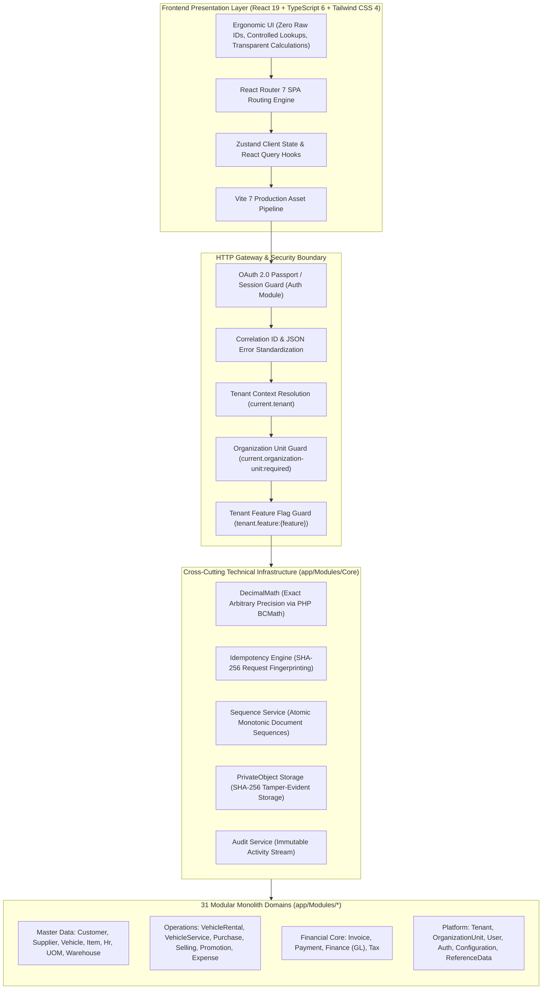
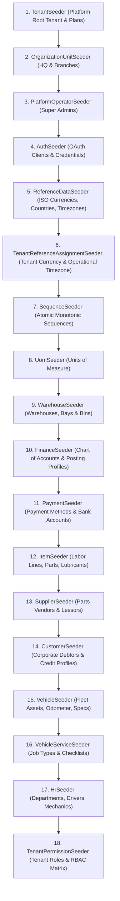
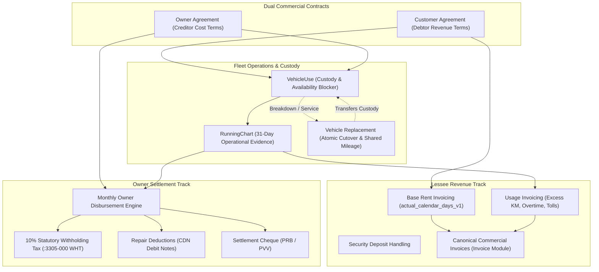
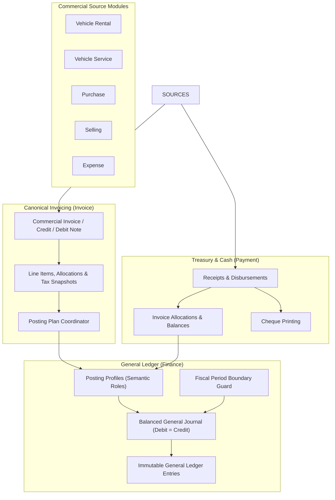

# AutoERP Project Knowledge Base & Canonical Technical Guide

**Document Status:** Single Authoritative System Specification, Enterprise Architecture Reference, and Developer Onboarding Guide for AutoERP.  
**System Architecture:** Modular Monolith (Laravel 12 Backend + React 19 / TypeScript 6 SPA Frontend)  
**Standard Civil Timezone:** Dynamically Configured Workspace Timezone (`localization.timezone` scoped by tenant/organization unit, with fallback to application `APP_TIMEZONE`)  
**Arithmetic Precision:** Exact Arbitrary-Precision String Arithmetic via `DecimalMath` (PHP BCMath)  
**Total Canonical Database Tables:** 267 Tables (262 Modular Migrations + 5 Infrastructure Migrations)  
**Business Modules:** 31 Domain Modules located in `app/Modules/*`  
**Shared Project Memory:** Append-Only Change Records in `docs/changes/`  
**Binding Core Axioms:** `AGENTS.md` and `RULES.md`  

---

## Author & Maintainer

- **Lead Architect & Developer:** Kasun Vimarshana
- **Email:** [kasunvmail@gmail.com](mailto:kasunvmail@gmail.com)
- **Phone:** [+94713525253](tel:+94713525253)
- **Repository:** [kasunvimarshana/AutoERP](https://github.com/kasunvimarshana/AutoERP)

---

## Table of Contents

1. [Executive System Overview & Enterprise Architecture](#1-executive-system-overview--enterprise-architecture)
   - [1.1 Architectural Blueprint & Modular Monolith Pattern](#11-architectural-blueprint--modular-monolith-pattern)
   - [1.2 High-Level Request Lifecycle & Boundary Pipeline](#12-high-level-request-lifecycle--boundary-pipeline)
   - [1.3 System Source Precedence Hierarchy](#13-system-source-precedence-hierarchy)
2. [The 12 Non-Negotiable Core Engineering Axioms](#2-the-12-non-negotiable-core-engineering-axioms)
3. [Developer Setup, Tooling & Onboarding Guide](#3-developer-setup-tooling--onboarding-guide)
   - [3.1 System Prerequisites](#31-system-prerequisites)
   - [3.2 Step-by-Step Installation & Bootstrapping](#32-step-by-step-installation--bootstrapping)
   - [3.3 Running the Local Development Environment (`composer dev`)](#33-running-the-local-development-environment-composer-dev)
   - [3.4 Essential Administrative & Health Artisan Commands](#34-essential-administrative--health-artisan-commands)
4. [Automated Testing, Static Analysis & Quality Verification](#4-automated-testing-static-analysis--quality-verification)
   - [4.1 Complete Quality Gate Matrix](#41-complete-quality-gate-matrix)
   - [4.2 Backend Testing with PHPUnit](#42-backend-testing-with-phpunit)
   - [4.3 Frontend Testing with Vitest](#43-frontend-testing-with-vitest)
   - [4.4 Static Analysis & Type Checking](#44-static-analysis--type-checking)
   - [4.5 Architectural Migration Baseline Verification](#45-architectural-migration-baseline-verification)
5. [Database Architecture & Schema Standards](#5-database-architecture--schema-standards)
   - [5.1 The 267 Canonical Tables Overview](#51-the-267-canonical-tables-overview)
   - [5.2 The Single-Table Baseline Migration Principle](#52-the-single-table-baseline-migration-principle)
   - [5.3 Explicit Column & Index Design (KISS + Explicit over DRY)](#53-explicit-column--index-design-kiss--explicit-over-dry)
   - [5.4 Foreign Key Constraint Policy & Audit Retention (`restrictOnDelete`)](#54-foreign-key-constraint-policy--audit-retention-restrictondelete)
   - [5.5 Optimistic Concurrency Control (`row_version` & `expected_version`)](#55-optimistic-concurrency-control-row_version--expected_version)
   - [5.6 Deterministic Seeder Execution Hierarchy](#56-deterministic-seeder-execution-hierarchy)
6. [Security, Dual-Plane Multi-Tenancy & Authorization Model](#6-security-dual-plane-multi-tenancy--authorization-model)
   - [6.1 Dual-Plane Tenancy Architecture](#61-dual-plane-tenancy-architecture)
   - [6.2 Global Query Scoping (`TenantOwnedModel`)](#62-global-query-scoping-tenantownedmodel)
   - [6.3 OAuth 2.0 Authentication & Secure Refresh Token Rotation](#63-oauth-20-authentication--secure-refresh-token-rotation)
   - [6.4 Role-Based Access Control (RBAC) & Route Entitlements](#64-role-based-access-control-rbac--route-entitlements)
   - [6.5 Idempotency Engine & Request Fingerprinting](#65-idempotency-engine--request-fingerprinting)
   - [6.6 Monotonic Document Sequences (`Sequence`)](#66-monotonic-document-sequences-sequence)
   - [6.7 Tamper-Evident Private Object Storage (`PrivateObject`)](#67-tamper-evident-private-object-storage-privateobject)
7. [Comprehensive 31-Module Catalog & Domain Matrix](#7-comprehensive-31-module-catalog--domain-matrix)
   - [7.1 Cross-Cutting Infrastructure Modules](#71-cross-cutting-infrastructure-modules)
   - [7.2 Platform & Identity Modules](#72-platform--identity-modules)
   - [7.3 Master Data Governance Modules](#73-master-data-governance-modules)
   - [7.4 Operational Domain Modules](#74-operational-domain-modules)
   - [7.5 Financial Core, Invoicing & Treasury Modules](#75-financial-core-invoicing--treasury-modules)
8. [Deep Dive: Commercial Vehicle Rental Operating Engine](#8-deep-dive-commercial-vehicle-rental-operating-engine)
   - [8.1 Dual Commercial Contracts (Customer vs. Owner Agreements)](#81-dual-commercial-contracts-customer-vs-owner-agreements)
   - [8.2 Agreement Lifecycle & Successor Lineage](#82-agreement-lifecycle--successor-lineage)
   - [8.3 Vehicle Custody State Machine & Availability Blocker](#83-vehicle-custody-state-machine--availability-blocker)
   - [8.4 Atomic Vehicle Replacement Workflow](#84-atomic-vehicle-replacement-workflow)
   - [8.5 Daily Running Chart Operational Log (31-Day Matrix)](#85-daily-running-chart-operational-log-31-day-matrix)
   - [8.6 Lessee Revenue Billing Calculations (`actual_calendar_days_v1`)](#86-lessee-revenue-billing-calculations-actual_calendar_days_v1)
   - [8.7 Owner Settlement Engine, Statements of Accounts & 10% WHT Ledger](#87-owner-settlement-engine-statements-of-accounts--10-wht-ledger)
   - [8.8 Fleet Expenses & 4-Way Destination Allocation Matrix](#88-fleet-expenses--4-way-destination-allocation-matrix)
   - [8.9 Vehicle Finance & Amortization Schedules](#89-vehicle-finance--amortization-schedules)
   - [8.10 Incident Management & Locked Evidence Attachments](#810-incident-management--locked-evidence-attachments)
9. [Deep Dive: Automotive Workshop Service & Maintenance Engine](#9-deep-dive-automotive-workshop-service--maintenance-engine)
   - [9.1 Workshop Service Job Card Lifecycle (`VehicleServiceJob`)](#91-workshop-service-job-card-lifecycle-vehicleservicejob)
   - [9.2 Inspection Checklists, Labor Lines & Commission Splits](#92-inspection-checklists-labor-lines--commission-splits)
   - [9.3 Spare Parts Requisition & Inventory Cost of Goods Sold (COGS)](#93-spare-parts-requisition--inventory-cost-of-goods-sold-cogs)
   - [9.4 Mechanical Custody Blocker on Rental Operations](#94-mechanical-custody-blocker-on-rental-operations)
   - [9.5 Customer Reviews, Star Ratings & Internal Workshop Notes CRUD](#95-customer-reviews-star-ratings--internal-workshop-notes-crud)
10. [Deep Dive: Supply Chain, Procurement & Inventory Lifecycle](#10-deep-dive-supply-chain-procurement--inventory-lifecycle)
    - [10.1 Standard Procurement vs. Fast Purchase Orchestration](#101-standard-procurement-vs-fast-purchase-orchestration)
    - [10.2 4-Dimensional Real-Time Inventory Balances](#102-4-dimensional-real-time-inventory-balances)
    - [10.3 Inventory Valuation Layers (FIFO & Weighted Average Costing)](#103-inventory-valuation-layers-fifo--weighted-average-costing)
    - [10.4 Immutable Inventory Movement Ledger](#104-immutable-inventory-movement-ledger)
11. [Deep Dive: Financial Core, Invoicing, Treasury & Statutory Tax](#11-deep-dive-financial-core-invoicing-treasury--statutory-tax)
    - [11.1 Double-Entry General Ledger & Chart of Accounts](#111-double-entry-general-ledger--chart-of-accounts)
    - [11.2 Semantic Posting Profiles (Decoupling Source Modules from GL)](#112-semantic-posting-profiles-decoupling-source-modules-from-gl)
    - [11.3 Canonical Commercial Invoicing Engine (`Invoice`)](#113-canonical-commercial-invoicing-engine-invoice)
    - [11.4 Flexible Multi-Format Invoice Layout Management System](#114-flexible-multi-format-invoice-layout-management-system)
    - [11.5 Treasury Management, Cash Receipts & Payment Vouchers (`Payment`)](#115-treasury-management-cash-receipts--payment-vouchers-payment)
    - [11.6 Statutory Taxation Engine (`Tax`) & Line-Level Snapshots](#116-statutory-taxation-engine-tax--line-level-snapshots)
12. [Comprehensive Enterprise Reporting Suite](#12-comprehensive-enterprise-reporting-suite)
    - [12.1 Daily Cashier Reconciliation & Shift Handover Report](#121-daily-cashier-reconciliation--shift-handover-report)
    - [12.2 Commercial Vehicle Rental Operational & Settlement Reports](#122-commercial-vehicle-rental-operational--settlement-reports)
    - [12.3 General Ledger & Executive Financial Statements](#123-general-ledger--executive-financial-statements)
    - [12.4 Inventory Stock Valuation & Reorder Health Reports](#124-inventory-stock-valuation--reorder-health-reports)
13. [Operational Maintenance, CLI Commands & Troubleshooting](#13-operational-maintenance-cli-commands--troubleshooting)
    - [13.1 Fresh Database Baseline Reset & Re-seeding](#131-fresh-database-baseline-reset--re-seeding)
    - [13.2 Application Cache Management & Production Deployment](#132-application-cache-management--production-deployment)
    - [13.3 Common Developer & Production Troubleshooting Scenarios](#133-common-developer--production-troubleshooting-scenarios)
14. [Prohibited Architectural Anti-Patterns](#14-prohibited-architectural-anti-patterns)
15. [AI-Agent & Developer Governance Protocol](#15-ai-agent--developer-governance-protocol)

---

## 1. Executive System Overview & Enterprise Architecture

AutoERP is an enterprise-grade ERP platform engineered as a clean **Modular Monolith**. It unifies multi-tenant platform administration, role-based security, master data governance, supply chain procurement, inventory warehousing and valuation, canonical commercial invoicing, cash treasury management, double-entry general ledger accounting, statutory taxation, automotive workshop repair operations, customer loyalty promotions, and a specialized commercial vehicle rental operating engine.

### 1.1 Architectural Blueprint & Modular Monolith Pattern

AutoERP rejects two common architectural extremes:
1. **The Unstructured Monolith:** Where disparate business domains directly manipulate each other's database tables, creating tangled dependencies, fragile upgrades, and unpredictable side effects.
2. **Premature Microservices:** Where distributed transactions, network serialization, eventual consistency, and network latency introduce immense cognitive and infrastructure overhead before organization scale warrants it.

Instead, AutoERP adopts the **Modular Monolith pattern**:
- **Independent Domain Modules:** The platform is partitioned into **31 decoupled domain modules** located under `app/Modules/<ModuleName>/`.
- **Vertical Feature Cohesion:** Each module strictly encapsulates its own Eloquent models, controllers, services, database migrations, seeders, form requests, events, listeners, policies, enums, and automated test suites.
- **Strict Single-Directional Boundaries:** Cross-module communication occurs exclusively through well-defined service interfaces or event-driven listeners. A module never executes direct SQL writes or updates on another module's database tables.
- **Unified Single-Process Deployment:** The entire system runs within a single Laravel application context, sharing transactions, database connections, and cache infrastructure while maintaining total logical separation.

### 1.2 High-Level Request Lifecycle & Boundary Pipeline



### 1.3 System Source Precedence Hierarchy

When evaluating business requirements, technical specifications, or edge cases, all developers and AI agents must adhere to this strict hierarchy:
1. **Proven Production Business Evidence:** Operational commercial documents, actual tenant ledger records, and verified real-world operational workflows take precedence over theoretical models.
2. **Root Architectural Axioms (`AGENTS.md` / `RULES.md`):** The 12 core engineering rules are non-negotiable.
3. **Narrowest Integrity Rule:** Always apply the smallest, most conservative constraint necessary to preserve physical, commercial, and financial truth safely.
4. **Explicit AutoERP Production Policies:** The formal rules, calculations, and boundaries documented in this specification.
5. **Absence of Automatic Financial Effect:** Physical events (vehicle trips, mechanic labor, damaged parts) are operational facts. **No financial document, debit note, or ledger entry may ever be created automatically without an explicit business rule and authorized commercial entitlement.**

---

## 2. The 12 Non-Negotiable Core Engineering Axioms

The 12 Core Axioms defined in `AGENTS.md` and `RULES.md` govern every line of code written for AutoERP:

### Axiom 1: Prime Directive — Understand First, Verify Second, Change Third
- Never act on assumptions or guess. Fully understand requirements, system context, module ownership, and data consequences before modifying code.
- If requirements are unclear or information is missing, ask for clarification instead of guessing (evidence over guessing).
- Fix only the requested issue using the smallest safe change. Do not introduce regressions, side effects, or modify unrelated code.
- Verify before completion: ensure the solution satisfies all requirements, preserves data integrity, and passes relevant test suites before marking a task complete.

### Axiom 2: Root Cause Design over Compatibility Workarounds
- Prioritize correctness, readability, and long-term maintainability over backward compatibility.
- Do not carry forward legacy design flaws or preserve historical mistakes through compatibility patches or workarounds unless backward compatibility is a strict, documented requirement.
- Fix underlying designs and build a solid, maintainable foundation now.

### Axiom 3: Simplicity, Pragmatism & No Overengineering
- Prefer the simplest clean design that correctly solves the problem.
- Avoid premature optimization, unnecessary abstractions, speculative features, or generic frameworks.
- No dead code: do not introduce unused code, unnecessary helper abstractions, or speculative placeholders for hypothetical future requirements.
- *"Wise developers know when to follow the framework and when to break away. Be wise."*

### Axiom 4: Module Ownership & Clear Boundaries
- Each of the 31 modules owns only the logic, data models, and business responsibilities assigned to it.
- Fix problems at their source: any bug, missing functionality, or incomplete implementation must be addressed directly within the responsible module.
- Never compensate for bugs or deficiencies in one module by adding workarounds, shadow tables, or misplaced logic in another module.
- If business rules or logic are found in the wrong module, relocate them to the owning module rather than expanding the improper module's scope.

### Axiom 5: Backend Authority & Single Source of Truth
- Always resolve issues in the layer where the root cause exists.
- The backend is the single authoritative source of truth: core business logic, validations, state transitions, calculations, permissions, and data integrity enforcement must be strictly implemented and enforced on the backend.
- The frontend focuses on presentation, user interaction, and user experience. Frontend validations provide immediate user feedback only and never substitute for backend enforcement.
- Avoid duplicated business logic, duplicated configurations, or conflicting rules.

### Axiom 6: Concurrency, Atomicity & Transaction Immutability
- Concurrency axiom: Multiple actors operate on shared resources simultaneously at overlapping times; never assume exclusive access or sequential execution order.
- Every write mutation must be atomic, conflict-aware, and version-checked (`expected_version` / `row_version`).
- Store every transaction with its original values and never modify historical financial or operational ledger records in place.
- All adjustments, corrections, or reversals must be recorded as separate, linked audit records to preserve complete audit trails and accurate historical reporting.

### Axiom 7: Database Architecture & Explicit Migrations
- Use portable Laravel migration APIs.
- One table per migration file.
- Split migrations that create or modify multiple unrelated tables.
- Merge later `Schema::table()` patch migrations into the original table-creation migration where safe.
- In migrations, always prefer **KISS + Explicit over DRY**:
  - Migrations represent immutable database schema history, not application code.
  - Write every column, foreign key, constraint, and index explicitly line-by-line.
  - Never use dynamic loops, runtime conditionals, or programmatic column/foreign-key naming.
- Database relationship hygiene: identify and fix unnecessary, redundant, circular, bidirectional, or messy relationships with clear architectural justification and data integrity preservation.

### Axiom 8: Code Modularity & File Size Management
- Organize code into cohesive, modular units.
- Split large files when they violate clarity, separation of concerns, reduce readability, or increase cognitive complexity.
- Every file split must have a clear architectural reason (e.g., feature boundary, sub-responsibility, reuse). Avoid arbitrary or excessive fragmentation.

### Axiom 9: Zero Magic Values
- Never use hardcoded magic values, literals, or strings in application logic.
- Use PHP Backed Enums (`string`) and TypeScript enums for predefined option sets.
- Use clearly named constants for shared fixed values.
- Use configuration files or environment variables for environment-specific or configurable parameters.

### Axiom 10: UI/UX Clarity & Cognitive Efficiency
- Design for speed, task completion efficiency, and clarity over information overload.
- Primary workflows (forms, creation dialogs, key actions) must display only essential fields and immediate context.
- Move auxiliary information (history, audit trails, reports, logs, analytics, advanced options) to separate views, tabs, or expandable progressive disclosure sections.
- **Never expose raw database IDs or internal primary keys to users**:
  - Present relational data in human-readable formats (codes, names, labels, badge status).
  - All relationship inputs must use controlled selection components (`LookupSelect`, dropdowns, autocomplete, visual selectors).
  - APIs must return structured related objects, not isolated foreign keys.
  - Prevent blind data entry with clear field descriptions, validation previews, and contextual guidance.

### Axiom 11: Security & Predictable Error Handling
- Security first: Never introduce security vulnerabilities, expose secrets, bypass authorization/authentication, or weaken input validation.
- Explicit error handling: Handle errors explicitly, consistently, and predictably. Never silently swallow failures.

### Axiom 12: Shared Project Memory via `/docs/changes`
- The project uses `/docs/changes` as its shared append-only memory.
- **Before starting any task**: Read recent records in `/docs/changes` to understand context and avoid repeating or conflicting work.
- **During the task**: Modify only the files necessary for the requested feature or fix; avoid touching unrelated files.
- **After completing the task**: Create a new record in `/docs/changes` detailing what was changed, why, and the verification results. Never edit or delete existing change records.

---

## 3. Developer Setup, Tooling & Onboarding Guide

AutoERP provides an automated, reproducible developer onboarding experience across macOS, Linux, and Windows (PowerShell / WSL).

### 3.1 System Prerequisites

Ensure the following runtimes, packages, and tools are installed on your workstation:
- **PHP 8.2 or Higher** (PHP 8.3+ supported).
- **Mandatory PHP Extensions:**
  - `bcmath` (Mandatory: powers exact string arithmetic in `DecimalMath`)
  - `pdo`, `pdo_mysql` (Production & local MySQL connections)
  - `pdo_sqlite` (Fast in-memory automated test execution)
  - `openssl`, `mbstring`, `tokenizer`, `xml`, `ctype`, `json`, `curl`, `fileinfo`
- **Composer 2.2 or Higher**
- **Node.js 20.x or Higher** (LTS recommended)
- **NPM 10.x or Higher**
- **MySQL 8.0+ or MariaDB 10.6+** (Required for local development and production database services)

### 3.2 Step-by-Step Installation & Bootstrapping

Execute the following setup commands from the repository root:

```bash
# 1. Clone the project repository
git clone https://github.com/kasunvimarshana/AutoERP.git
cd AutoERP

# 2. Copy the environment template
cp .env.example .env

# 3. Configure your local MySQL credentials in .env:
# DB_CONNECTION=mysql
# DB_HOST=127.0.0.1
# DB_PORT=3306
# DB_DATABASE=autoerp
# DB_USERNAME=root
# DB_PASSWORD=your_secure_password

# 4. Install PHP backend dependencies via Composer
composer install

# 5. Non-interactively verify and generate the application encryption key
php artisan app:key:ensure

# 6. Execute all 267 canonical baseline database migrations
php artisan migrate

# 7. Synchronize platform security catalogs and system permissions
php artisan platform:permissions:sync

# 8. Verify OAuth Passport readiness (encryption keys and client records)
php artisan auth:readiness

# 9. Seed the canonical master baseline (Platform Tenant, Master CoA, Settings)
php artisan db:seed

# 10. Install Node.js frontend dependencies via NPM
npm install

# 11. Compile production frontend assets
npm run build
```

Alternatively, the project provides a unified setup script:
```bash
composer setup
```

### 3.3 Running the Local Development Environment (`composer dev`)

AutoERP uses `concurrently` to orchestrate all development daemons simultaneously through a single terminal command:

```bash
composer dev
```

This starts four synchronized processes:
1. **`server`:** Laravel development server on `http://127.0.0.1:8000` (`php artisan serve`).
2. **`queue`:** Background queue worker daemon (`php artisan queue:listen --tries=1 --timeout=0`).
3. **`logs`:** Real-time log streaming daemon (`php artisan pail --timeout=0`).
4. **`vite`:** Vite frontend development server with Hot Module Replacement (HMR) on `http://127.0.0.1:5173`.

Navigate to `http://127.0.0.1:8000` in your web browser to access the application.

### 3.4 Essential Administrative & Health Artisan Commands

AutoERP provides specialized CLI commands to assist administrators and developers:

| Artisan Command | Target Module | Operational Purpose |
|---|---|---|
| `php artisan app:key:ensure` | `Core` | Checks for an active `APP_KEY` in `.env` and generates one safely without prompt if missing. |
| `php artisan platform:health` | `Core` | Diagnostics across database connectivity, cache drivers, queue listeners, and private storage. |
| `php artisan platform:permissions:sync` | `Auth` / `User` | Scans all 31 modules and synchronizes permissions into the platform database catalog. |
| `php artisan auth:readiness` | `Auth` | Asserts Passport RSA encryption keys, OAuth token tables, and auth guard readiness. |
| `php artisan auth:client:create` | `Auth` | Provisions a new OAuth client for external API integrations. |
| `php artisan tenant:create` | `Tenant` | Provisions a new tenant workspace, assigning its initial domain, slug, and subscription plan. |
| `php artisan tenant:activate` | `Tenant` | Activates an onboarded tenant workspace. |
| `php artisan tenant:domain:revalidate` | `Tenant` | Verifies DNS and SSL records for custom tenant vanity domains. |
| `php artisan tenant:storage:cleanup` | `PrivateObject` | Scans private disks, pruning orphaned files and temporary attachment uploads. |
| `php artisan vehicle:ownership:versioned`| `Vehicle` | Audits and reconciles vehicle asset ownership timelines and active roles. |
| `php artisan vehicle-service:legacy-import`| `VehicleService` | Safely validates and migrates legacy FoxPro workshop repair history logs. |

---

## 4. Automated Testing, Static Analysis & Quality Verification

AutoERP enforces a **zero-tolerance policy** for broken tests, type errors, or styling violations. Every change must pass 100% of the verification gates before being merged.

### 4.1 Complete Quality Gate Matrix

| Quality Gate | Tooling / Framework | Target Baseline & Coverage | Execution Command |
|---|---|---|---|
| **Backend Feature & Unit Tests** | PHPUnit 11 | **1,370 Passed / 1,370 Tests (14,235 assertions)** | `php artisan test` |
| **Frontend Unit & Component Tests** | Vitest 3 + React Testing Library | **176 Passed / 176 Suites (736 tests passed)** | `npm test` |
| **Static TypeScript Verification** | TypeScript Compiler (`tsc`) | **0 Errors across 922 TS/TSX files** (Strict Mode) | `npm run typecheck` |
| **Frontend Linting & Code Style** | ESLint 9 | **0 Errors** (`resources/js/*`) | `npm run lint` |
| **Backend Code Style Formatting** | Laravel Pint (PSR-12) | **0 Violations** | `php vendor/bin/pint --test` |
| **Single-Table Baseline Integrity**| PHPUnit Architecture Test | **100% Compliance (262 modular migrations, 0 `Schema::table`)** | `php artisan test --filter ModuleMigrationBaselineTest` |
| **Audit Retention FK Integrity** | PHPUnit Architecture Test | **100% Compliance (`restrictOnDelete` on status histories)** | `php artisan test --filter HistoricalRetentionMigrationTest` |
| **Live MySQL Integration Suite** | PHPUnit + MySQL 8 Container | Live database transactions and locking verification | `composer test:mysql` |

### 4.2 Backend Testing with PHPUnit

Backend tests are executed against SQLite in-memory databases for lightning-fast execution while maintaining full relational integrity:

```bash
# Run the complete backend test suite across all 31 modules
php artisan test

# Run tests for a specific module
php artisan test app/Modules/VehicleRental/Tests/
php artisan test app/Modules/Invoice/Tests/
php artisan test app/Modules/Auth/Tests/

# Filter by a specific test class or method
php artisan test --filter InvoiceLayoutManagementTest
php artisan test --filter RefreshTokenRotationConcurrencyTest
```

### 4.3 Frontend Testing with Vitest

Frontend unit, integration, and UI component tests run in JSDOM mode with Vitest:

```bash
# Run the entire Vitest suite silently with dot reporter
npm test

# Run tests in interactive watch mode during development
npx vitest

# Run a specific frontend test suite
npx vitest run resources/js/modules/invoice/InvoiceLayoutEditorDrawer.test.tsx
npx vitest run resources/js/app/access/routeEntitlements.test.ts
```

### 4.4 Static Analysis & Type Checking

To guarantee runtime type safety and catch defects before execution:

```bash
# Verify TypeScript strict type-checking across the entire frontend
npm run typecheck

# Verify ESLint code standards across React components and hooks
npm run lint

# Check PHP PSR-12 code style formatting without modifying files
php vendor/bin/pint --test
```

### 4.5 Architectural Migration Baseline Verification

AutoERP employs specialized architectural unit tests to enforce database design hygiene automatically:

1. **`ModuleMigrationBaselineTest`:** Inspects every migration file across all 31 modules, asserting:
   - Exactly one table is created per migration file.
   - Timestamps are monotonically ordered.
   - Zero `Schema::table()` alteration patches exist in the repository.
2. **`HistoricalRetentionMigrationTest`:** Asserts that every state-history table (`*_status_histories`) specifies `restrictOnDelete()` on foreign keys, preventing cascading deletions from destroying operational audit trails.

```bash
php artisan test --filter ModuleMigrationBaselineTest
php artisan test --filter HistoricalRetentionMigrationTest
```

---

## 5. Database Architecture & Schema Standards

AutoERP's relational database architecture prioritizes **immutability, explicit structural definitions, audit preservation, and optimistic concurrency**.

### 5.1 The 267 Canonical Tables Overview

The canonical AutoERP schema consists of **267 tables** across 28 functional areas:

- **Infrastructure Framework Tables (5 Tables):** Located in `database/migrations/`:
  - `cache`, `cache_locks`: Application cache and distributed atomic mutex locking.
  - `jobs`, `job_batches`, `failed_jobs`: Asynchronous queue execution and batch tracking.
- **27 Database-Owning Application Modules (262 Tables):** Located in `app/Modules/<ModuleName>/Database/Migrations/`:
  - `Tenant` (14 tables): Multi-tenant subscriptions, domain mapping, tenant states.
  - `OrganizationUnit` (4 tables): Depots, branches, legal entities, unit hierarchies.
  - `User` (13 tables): Users, roles, permissions, quick-access settings.
  - `Auth` (17 tables): OAuth tokens, platform auth credentials, session lifecycles.
  - `Configuration` (6 tables): Tenant and global settings with immutable revision histories.
  - `ReferenceData` (11 tables): ISO currencies, countries, languages, civil timezones.
  - `Idempotency` (1 table): Request payload fingerprints and execution locks.
  - `Sequence` (1 table): Monotonic document sequence numbers.
  - `Audit` (2 tables): Enterprise immutable activity stream and change diffs.
  - `Customer` (10 tables): Corporate debtors, contacts, credit profiles, WhatsApp verification.
  - `Supplier` (11 tables): Creditors, spare parts vendors, vehicle lessors, bank accounts.
  - `Vehicle` (15 tables): Fleet asset registry, odometers, VIN, revenue licenses, makes/models.
  - `Hr` (15 tables): Employee directory, departments, designations, driver/mechanic rates.
  - `Item` (12 tables): Master product catalog, repair labor lines, spare parts, pricing.
  - `UOM` (4 tables): Units of measure, conversion tables, measurement dimensions.
  - `Warehouse` (6 tables): Warehouses, workshop bays, aisle/rack/bin storage locations.
  - `Inventory` (14 tables): Real-time balances, valuation layers, stock movement ledger.
  - `Purchase` (22 tables): POs, GRN receipts, supplier invoices, returns, debit notes.
  - `Selling` (4 tables): Sales orders, quotations, customer delivery lines, sales returns.
  - `Expense` (6 tables): Corporate overhead expenses, approvals, expense types.
  - `Promotion` (10 tables): Loyalty cards, promotion templates, redemption audit logs.
  - `VehicleService` (16 tables): Workshop job cards, labor lines, commission splits, customer feedback/reviews.
  - `Invoice` (11 tables): Canonical commercial invoices, lines, posting plans, layouts.
  - `Payment` (10 tables): Cash treasury, customer receipts, payouts, cheques.
  - `Finance` (13 tables): Double-entry GL, Chart of Accounts, fiscal periods, posting profiles.
  - `Tax` (6 tables): Statutory tax profiles, VAT/NBT/WHT rates, tax snapshots.
  - `VehicleRental` (28 tables): Customer/owner agreements, running charts, billing cycles, incidents.
- **Architectural Modules with Zero Tables (4 Modules):**
  - `Core`: Technical base classes, `TenantOwnedModel`, BCMath `DecimalMath`.
  - `PrivateObject`: Disk-backed SHA-256 tamper-evident storage service.
  - `Reporting`: Document streaming engine (HTML, Spatie Laravel PDF, CSV).
  - `Voucher`: Unified composite presentation views over financial transactions.

### 5.2 The Single-Table Baseline Migration Principle

In AutoERP, migrations represent **immutable database schema specifications**, not application code:
- **One Table Per Migration File:** Every database table is created by exactly one migration file.
- **Elimination of Patch Migrations:** Historical `Schema::table()` alteration migrations and `UpgradeMigrations` are strictly forbidden. All column additions, index alterations, and constraint updates are merged directly into the original creation migration.
- **Clean Baseline History:** When migrating fresh (`php artisan migrate:fresh`), all 267 tables are constructed in a single deterministic pass.

### 5.3 Explicit Column & Index Design (KISS + Explicit over DRY)

- **Line-by-Line Column Declarations:** Define every column, type, nullability, default value, and index explicitly line-by-line. Never use dynamic loops (`foreach ($cols as $col)`), programmatic naming, or runtime conditionals in migrations.
- **Canonical Naming Conventions:**
  - Foreign keys: `<table_abbrev>_<column>_fk` (e.g. `vrca_customer_id_fk`)
  - Unique indexes: `<table_abbrev>_<columns>_uk` (e.g. `vrca_agreement_number_uk`)
  - Lookup indexes: `<table_abbrev>_<columns>_ix` (e.g. `vrca_tenant_status_ix`)
- **Portable Column Types:**
  - Database native `enum` types (`$table->enum(...)`) are prohibited. Use bounded string columns (`$table->string('status', 32)`) validated via PHP Backed Enums at the application layer.
  - Monetary amounts and exchange rates use `$table->decimal('amount', 20, 6);`.

### 5.4 Foreign Key Constraint Policy & Audit Retention (`restrictOnDelete`)

- **Prohibition of Cascading Deletions:** Cascading deletes (`onDelete('cascade')` or `cascadeOnDelete()`) on historical operational, financial, or state-history tables are strictly prohibited.
- **Explicit Restrict:** State history tables (`*_status_histories`) enforce `$table->foreignId('...')->constrained()->restrictOnDelete();`. This guarantees that parent master entities cannot be deleted while operational audit records reference them.

### 5.5 Optimistic Concurrency Control (`row_version` & `expected_version`)

Every mutable operational and master data entity carries an unsigned integer `row_version` (default 1):
- Update API endpoints mandate `expected_version` in the request payload.
- Update mutations execute an atomic version-checked SQL statement:
  ```php
  $updated = $model->newQuery()
      ->where('id', $model->id)
      ->where('row_version', $expectedVersion)
      ->update(array_merge($attributes, [
          'row_version' => $expectedVersion + 1,
      ]));

  if ($updated === 0) {
      throw new ConflictHttpException('The record was modified by another user.');
  }
  ```
- This prevents silent last-write-wins overwrites when multiple dispatchers or cashiers operate simultaneously.

### 5.6 Deterministic Seeder Execution Hierarchy

The root [`DatabaseSeeder`](file:///d:/project-new/AutoERP/database/seeders/DatabaseSeeder.php) coordinates baseline seeding inside a platform control-plane context in this strict topological order:



---

## 6. Security, Dual-Plane Multi-Tenancy & Authorization Model

### 6.1 Dual-Plane Tenancy Architecture

AutoERP establishes two cleanly separated operational planes:
1. **Platform Control Plane:** Platform super-administrators govern tenant onboarding, subscription plans, custom domain DNS mapping, global configurations, and infrastructure health.
2. **Tenant Business Plane:** Tenant users operate within an explicitly resolved tenant workspace (`current.tenant`) and active organization unit (`current.organization-unit:required`).
3. **System Tenant Boundary:** The root system tenant (`00000000-0000-0000-0000-000000000000`) is reserved exclusively for platform governance and is inaccessible to commercial tenant users.

### 6.2 Global Query Scoping (`TenantOwnedModel`)

All tenant-scoped models extend [`TenantOwnedModel`](file:///d:/project-new/AutoERP/app/Modules/Core/Models/TenantOwnedModel.php).
- The model automatically registers an Eloquent global query scope (`TenantScope`).
- Every query (`SELECT`, `UPDATE`, `DELETE`) automatically appends `WHERE tenant_id = ?`.
- Attempting to query records across tenant boundaries throws an unauthorized exception.
- When saving new records, the framework automatically populates `tenant_id` from the active context.

### 6.3 OAuth 2.0 Authentication & Secure Refresh Token Rotation

- **Authentication Protocol:** OAuth 2.0 powered by Laravel Passport.
- **Token Security:** Access tokens carry claims scoped to the tenant, organization unit, and user permissions.
- **Secure Refresh Token Rotation:** Refresh tokens are dispatched in secure, HTTP-only, SameSite cookies. Refreshing an access token atomically invalidates the predecessor refresh token and issues a new pair, mitigating replay attacks and preventing credential theft via XSS.
- **Concurrency Guard:** Version-checked token refresh and session concurrency guards prevent race conditions when multiple tabs or background workers refresh tokens simultaneously.

### 6.4 Role-Based Access Control (RBAC) & Route Entitlements

- **Granular Permissions:** Over 150 discrete permissions are registered across the 31 modules (e.g. `vehicle.rental.agreement.create`, `invoice.post`, `vehicle.odometer.override`).
- **Route Protection Middleware:**
  - `tenant.permission:{permission}`: Verifies the authenticated user holds the required permission.
  - `tenant.feature:{feature}`: Asserts that the tenant's active subscription tier entitles access to the requested module or feature.
- **Frontend Route Entitlements:** The React SPA mirrors backend entitlements via `resources/js/app/access/routeEntitlements.ts`. If an employee lacks the necessary permission, UI navigation items are hidden and route transitions are blocked with friendly authorization explanations.

### 6.5 Idempotency Engine & Request Fingerprinting

Mutating API operations (such as finalizing an agreement, cutting over a replacement vehicle, posting an invoice, or issuing a payment voucher) mandate an `Idempotency-Key` HTTP header:
- The `Idempotency` module computes a SHA-256 fingerprint of the request URI, payload, and user session.
- An atomic execution lock prevents concurrent executions of the same operation.
- If a network retry occurs with an identical key, the engine safely returns the cached original HTTP response without re-executing business logic or creating duplicate transactions.

### 6.6 Monotonic Document Sequences (`Sequence`)

AutoERP avoids exposing raw database IDs on commercial documents. The `Sequence` module provides monotonic, zero-collision document numbers:
- `INV-2026-0001` (Invoices)
- `RC-2026-09-0012` (Running Charts)
- `PRB-2026-0045` (Payment Receipts / Vouchers)
- `CDN-2026-0018` (Repair Deduction Notes)
- `EXP-2026-0033` (Overhead Expenses)

Generators use atomic table locking to guarantee gap-free numbering even under heavy concurrent load.

### 6.7 Tamper-Evident Private Object Storage (`PrivateObject`)

Sensitive attachments (police accident reports, signed contracts, driver licenses, vehicle inspection photos) are governed by `PrivateObject`:
- Files are saved outside the public web root in private tenant disks.
- Each file is hashed with SHA-256 upon upload. The hash is verified on read to guarantee tamper-evidence.
- Downloads are served exclusively through authenticated, signed, streaming endpoints. Once an incident or contract is formally reviewed, attachments are permanently locked against replacement or deletion.

---

## 7. Comprehensive 31-Module Catalog & Domain Matrix

AutoERP organizes its business capabilities into **31 decoupled modules** in `app/Modules/*`:

### 7.1 Cross-Cutting Infrastructure Modules

| Module | Architectural Role | Key Eloquent Models | Public Domain Responsibilities |
|---|---|---|---|
| **`Core`** | Base Infrastructure Primitives | *None (Technical primitives)* | `TenantOwnedModel`, `DecimalMath` exact string arithmetic, base API responses, error formatting. |
| **`Idempotency`** | Mutation Request Safety | `IdempotencyRecord` | Request payload fingerprinting, execution locks, duplicate prevention on financial writes. |
| **`Sequence`** | Document Number Generation | `Sequence` | Atomic monotonic document sequence number generation (`INV-`, `RC-`, `PRB-`, `CDN-`). |
| **`Audit`** | Enterprise Activity Logging | `AuditLog` | Append-only audit stream capturing user, timestamp, action, IP, and JSON change diffs. |
| **`PrivateObject`**| Tamper-Evident Storage | *None (Disk-backed service)* | SHA-256 tamper-evident private file storage, signed streaming downloads, immutable proof locks. |
| **`Configuration`**| Configuration Management | `TenantConfigurationValue`, `GlobalConfigurationValue` | Key-value settings with immutable revision lineage and instant rollback capabilities. |
| **`ReferenceData`**| ISO System Catalogs | `Country`, `Currency`, `Language`, `Timezone` | Standard ISO catalogs, tenant currency directories, civil timezone lookups. |

### 7.2 Platform & Identity Modules

| Module | Architectural Role | Key Eloquent Models | Public Domain Responsibilities |
|---|---|---|---|
| **`Tenant`** | Multi-Tenancy Governance | `Tenant`, `TenantPlan`, `TenantDomain` | Tenant provisioning, subscription plan lifecycles (`active`, `suspended`), custom domain verification. |
| **`OrganizationUnit`**| Branch & Depot Scoping | `OrganizationUnit`, `OrganizationUnitType` | Physical branch hierarchy, workshop bays, legal business entities, user-depot assignments. |
| **`User`** | Identity & Access Governance | `User`, `Role`, `Permission` | Tenant user accounts, role definitions, permission catalog synchronization. |
| **`Auth`** | Authentication & OAuth | `AuthIdentity`, `AuthSession`, `AuthClient` | Passport OAuth tokens, session management, password hashing, credential rotation. |

### 7.3 Master Data Governance Modules

| Module | Architectural Role | Key Eloquent Models | Public Domain Responsibilities |
|---|---|---|---|
| **`Customer`** | Customer Master Data | `Customer`, `CustomerContact`, `CustomerCreditProfile` | Corporate debtors, billing addresses, credit limit enforcement, WhatsApp verification. |
| **`Supplier`** | Supplier Master Data | `Supplier`, `SupplierContact`, `SupplierBankAccount` | Creditors, spare parts vendors, vehicle lessors, bank settlement profiles. |
| **`Vehicle`** | Fleet Asset Registry | `Vehicle`, `VehicleMake`, `VehicleModel`, `VehicleOwnership` | Physical fleet assets, odometers, VIN, revenue license tracking, fleet availability. |
| **`Hr`** | Workforce Management | `Employee`, `Department`, `Designation`, `EmployeeRate` | Driver and technician master directory, license tracking, commission rate rules. |
| **`Item`** | Master Product Catalog | `Item`, `ItemCategory`, `ItemBrand`, `ItemPrice` | Products, stock parts, repair labor lines, services, UOM assignments, base prices. |
| **`UOM`** | Units of Measure | `Uom`, `UomConversion` | Measurement units (km, hours, days, pieces, liters), conversion factors, validation. |
| **`Warehouse`** | Storage Facilities | `Warehouse`, `WarehouseLocation` | Physical parts warehouses, workshop bays, aisle/rack/bin storage hierarchies. |

### 7.4 Operational Domain Modules

| Module | Architectural Role | Key Eloquent Models | Public Domain Responsibilities |
|---|---|---|---|
| **`VehicleRental`** | Commercial Fleet Rental | `CustomerAgreement`, `OwnerAgreement`, `RunningChart` | Dual-sided commercial contracts, custody tracking, running charts, billing & settlements. |
| **`VehicleService`**| Workshop Operations | `VehicleServiceJob`, `VehicleServiceJobLine`, `JobType` | Mechanical repair job cards, inspection checklists, technician commissions, customer feedback/reviews. |
| **`Purchase`** | Procurement Workflow | `PurchaseOrder`, `GoodsReceiptNote`, `PurchaseInvoice` | Purchase orders, GRN receipts, supplier invoices, returns, debit notes, Fast Purchase. |
| **`Selling`** | Customer Sales | `Sale`, `SaleLine`, `SaleReturn`, `SaleReturnLine` | Commercial sales orders, quotations, customer deliveries, returns, line discounts. |
| **`Expense`** | Corporate Overhead | `Expense`, `ExpenseType`, `ExpenseHistory` | Overhead expense claims, approvals, sequential numbering, GL posting. |
| **`Promotion`** | Loyalty & Promotions | `PromotionOffer`, `PromotionCard`, `PromotionBenefit` | Loyalty cards, promo templates, fixed/percentage discounts, redemption audit streams. |

### 7.5 Financial Core, Invoicing & Treasury Modules

| Module | Architectural Role | Key Eloquent Models | Public Domain Responsibilities |
|---|---|---|---|
| **`Invoice`** | Canonical Invoicing Engine | `Invoice`, `InvoiceLine`, `InvoicePostingPlan`, `InvoiceLayout` | Canonical single source of truth for all commercial invoices, debit/credit notes, layout engine. |
| **`Payment`** | Cash & Treasury Engine | `Payment`, `PaymentAllocation`, `ChequeTemplate` | Customer receipts, supplier payouts, invoice allocations, cheque generation. |
| **`Finance`** | General Ledger Accounting | `FinanceAccount`, `FinanceJournalEntry`, `FinancePostingProfile` | Double-entry GL, Chart of Accounts, fiscal accounting periods, semantic posting rules. |
| **`Tax`** | Statutory Taxation Engine | `TaxProfile`, `TaxCategory`, `TaxRate` | VAT/NBT/WHT tax calculation profiles and line-level tax snapshots. |
| **`Voucher`** | Unified Voucher Views | *None (Presentation composite)* | Read-only unified views over transactions, receipts, and disbursement vouchers. |
| **`Reporting`** | Business Intelligence | *None (Document engine)* | Printable HTML layouts, Spatie Laravel PDF exports, CSV/Excel data streams. |

---

## 8. Deep Dive: Commercial Vehicle Rental Operating Engine

The `VehicleRental` module is AutoERP's most sophisticated domain engine. It coordinates physical vehicle custody, daily operational evidence, customer revenue billing, and vehicle owner settlements.



### 8.1 Dual Commercial Contracts (Customer vs. Owner Agreements)

AutoERP enforces complete independence between customer pricing and owner costs:
1. **Customer Agreement (`CustomerAgreement`):** Governs revenue owed by the corporate lessee. Specifies rental basis (`daily` vs. `monthly`), billing cycle, free kilometer allowance, excess distance rate, overtime hourly rates (Normal, Double, Triple), night out rates, AC mode premiums, and security deposit requirements.
2. **Owner Agreement (`OwnerAgreement`):** Governs liabilities owed to third-party fleet suppliers (vehicle owners/lessors). Specifies the agreed base monthly hire, excess KM reimbursement rate, and overtime pass-through rates. Company-owned vehicles do not have Owner Agreements, preventing artificial owner liabilities.

### 8.2 Agreement Lifecycle & Successor Lineage

To maintain legal auditability, an `Active` agreement is **immutable**. Commercial revisions use successor lineage (`supersedes_agreement_id`):
1. An operator creates a draft successor agreement while the current agreement remains active.
2. All operational terms copy forward to the draft **except security deposits** (security deposits belong to the original source payment and are preserved).
3. Activating the successor atomically closes the predecessor at the cutover timestamp, updates lineage links, and applies new commercial terms without interrupting vehicle custody.

### 8.3 Vehicle Custody State Machine & Availability Blocker

- **Custody State Machine (`VehicleUse`):** `planned` &rarr; `in_custody` &rarr; `returned` (or `cancelled`).
- **Half-Open Availability Intervals:** `VehicleUseAvailabilityBlocker` prevents overlapping assignments (`starts_at <= existing_end AND ends_at >= existing_start`). Exact boundary handovers (e.g. 10:00:00 return, 10:00:00 handover) are fully supported.
- **Odometer Continuity:** Starting odometer must match or exceed the vehicle's last recorded reading; return odometer cannot be lower than handover reading.

### 8.4 Atomic Vehicle Replacement Workflow

When an assigned vehicle breaks down or requires servicing:
1. Operator records the return odometer and timestamp of the existing vehicle.
2. Operator selects the replacement vehicle, handover reading, and supply source.
3. The return of the disabled vehicle and the handover of the replacement vehicle execute atomically in a single database transaction via `VehicleUseService::replace()`.
4. **Shared Allowance:** Both vehicles share the single contract's monthly mileage allowance.
5. **Visual Audit Badge:** The replacement vehicle's trips on the 31-day running chart matrix are highlighted in amber and annotated `For Repl. <vehicle_no>`.

### 8.5 Daily Running Chart Operational Log (31-Day Matrix)

The Running Chart is the **single physical operational log** of vehicle usage:
- Records daily operational facts:
  - Duty ON time (e.g. `06:30 AM`) and Duty OFF time (e.g. `08:00 PM`) in civil business timezone.
  - Start and finish odometers, comparative daily distance, and cumulative monthly mileage.
  - Overtime minutes categorized as Normal (`N`), Sunday/Double (`D`), or Holiday/Triple (`T`).
  - Out-of-pocket expressway tolls, driver night-out allowances, and AC mode usage.
  - Driver identity: Employee driver from `Hr` or external contractor snapshots.
- **Finalization Rules:** A trip can only be finalized after duty OFF has passed. Future or ongoing trips cannot be finalized. Once finalized, operational facts are frozen against casual editing. Reversals require an auditable reason.

### 8.6 Lessee Revenue Billing Calculations (`actual_calendar_days_v1`)

- **Base Rent Invoicing (`actual_calendar_days_v1`):** Monthly agreements bill on the agreement anniversary date. Proration for partial months calculates using actual civil calendar days:
  $$	ext{Base Charge} = rac{	ext{Actual Days in Period}}{	ext{Days in Month}} 	imes 	ext{Monthly Rate}$$
- **Commercial Mileage Assessment:** Finalized commercial kilometers are pooled against the monthly allowance. Kilometers exceeding the allowance are billed at `excess_km_rate`.
- **Usage Invoicing:** Overtime hours ($	ext{minutes} / 60$), night-out allowances, and expressway pass outlays convert into canonical invoices via `Invoice`.
- **Security Deposits:** Processed via `Payment`. Rental tracks remaining collection capacity ($	ext{Agreed Deposit} - 	ext{Net Receipts}$) and applies unallocated balances to final invoices.

### 8.7 Owner Settlement Engine, Statements of Accounts & 10% WHT Ledger

The owner settlement engine calculates monthly disbursements to vehicle lessors:

$$egin{aligned}
	ext{Gross Earnings} &= 	ext{Balance B/F} + 	ext{Base Monthly Hire} + 	ext{Driver Overtime Normal} + 	ext{Pass Outlays} \
	ext{Net Settlement} &= 	ext{Gross Earnings} - 	ext{Repair Deductions (CDN)} - 	ext{10\% Withholding Tax} - 	ext{Settlement Cheques}
\end{aligned}$$

1. **Statement of Accounts (Detail I) [A4 Portrait]:** Vertical statement showing Balance B/F, Base Hire period, Driver Overtime Normal, Other Charges, settlement cheques/vouchers (`PRB`/`PVV`), repair deduction debit notes (`CDN`), and final closing balance (`Balance Over Paid` or `Balance Payable`).
2. **Statement of Accounts (Detail II) [A4 Landscape]:** 18-column operational matrix detailing hire start/finish dates, unit, agreed total KM, non-A/C KM rate, hire amount, normal/double/triple overtime hours, driver salary/bata, other charges, VAT, net settlements, and closing balance.
3. **Statutory Withholding Tax Ledger (`:3305-000 WHT`):** Automatically computes and audits 10% WHT deductions from gross lessor earnings, tracking credit note entries with credit amounts and running balances.

### 8.8 Fleet Expenses & 4-Way Destination Allocation Matrix

Fleet expenses (fuel, tolls, repairs, fines, maintenance) are recorded in `RentalExpense` and allocated across four destinations:
1. `Company Cost`: Absorbed directly as fleet operational overhead.
2. `Customer Recovery`: Billed to customer on next rental invoice.
3. `Owner Deduction`: Deducted from lessor's disbursement statement (`CDN` note).
4. `Employee Reimbursement`: Reimbursed to driver through HR/Payroll.

### 8.9 Vehicle Finance & Amortization Schedules

- Manages hire-purchase and bank leasing contracts (`VehicleFinanceAgreement`).
- Automatically computes amortization schedules (flat or reducing balance interest).
- `refreshDueStatuses()` scans installment due dates against current business dates, advancing statuses from `scheduled` &rarr; `due` &rarr; `overdue`.
- Maturing installments convert directly into inbound supplier invoices (`Invoice`), establishing accounts payable liabilities.

### 8.10 Incident Management & Locked Evidence Attachments

- Captures accidents, damage, police fines, and toll violations.
- **Semantic Boundary:** Recording an incident verifies physical evidence; it never automatically generates a financial charge without an authorized commercial decision.
- **Private Tamper-Evident Proofs:** Photographs and police reports (PDF, JPEG, PNG up to 10 MB) are stored in private tenant storage with SHA-256 checksums and served via streaming downloads. Reviewing an incident permanently locks attachments.

---

## 9. Deep Dive: Automotive Workshop Service & Maintenance Engine

The `VehicleService` module governs automotive repair operations, technical labor, and customer feedback.

### 9.1 Workshop Service Job Card Lifecycle (`VehicleServiceJob`)

Repairs follow an auditable lifecycle:
$$	ext{draft} \longrightarrow 	ext{scheduled} \longrightarrow 	ext{in\_progress} \longrightarrow 	ext{completed} \longrightarrow 	ext{invoiced} \longrightarrow 	ext{closed}$$

- **Check-In & Inspection:** Records incoming odometer, fuel level, initial customer complaint, and pre-repair physical condition.
- **Service Job Types:** Scheduled preventative maintenance, mechanical repairs, electrical diagnostics, bodywork, or quick inspections.

### 9.2 Inspection Checklists, Labor Lines & Commission Splits

- **Service Checklist Items:** Multi-point safety inspections (fluids, brakes, tire wear, suspension).
- **Labor Lines & Operations:** Mechanical operations linked to master labor catalog items (`Item` module).
- **Technician Workforce Assignment & Commission Splits:** Allows workshop supervisors to assign one or more mechanics to specific job lines. Automatically calculates technician labor commissions based on configured hourly rates or percentage splits in `Hr`.

### 9.3 Spare Parts Requisition & Inventory Cost of Goods Sold (COGS)

- Requisitioning parts from inventory creates an allocation request in `Inventory`.
- Approving parts consumption immediately relieves warehouse on-hand stock and consumes explicit FIFO/WAC valuation layers.
- The system automatically triggers general ledger journal postings: debiting Cost of Goods Sold (COGS) and crediting the Spare Parts Inventory Asset account via `Finance` posting profiles.

### 9.4 Mechanical Custody Blocker on Rental Operations

Admitting a fleet rental vehicle into the workshop for repairs sets its mechanical status to off-road. This immediately engages the `VehicleUseAvailabilityBlocker` in `VehicleRental`, preventing the fleet dispatch team from creating new rental agreements or dispatching the vehicle until the workshop job card is formally completed and signed off.

### 9.5 Customer Reviews, Star Ratings & Internal Workshop Notes CRUD

Governed by `VehicleServiceJobFeedback` and the `vehicle_service_job_feedbacks` table:
- **Flexible Feedback Types:** Supports customer reviews (`review`), operational feedback (`feedback`), and internal technician notes (`note`).
- **Customer Ratings:** Star ratings from 1 to 5.
- **Non-Essential Fields Are Optional:** Comments, reviewer names, reviewer emails, and ratings are completely optional, ensuring fast check-out workflows without unnecessary form blockers.
- **Audit & Concurrency:** Tracks submitter user ID, created timestamps, and optimistic concurrency versioning (`row_version`).
- **Interactive Rating Breakdown:** Real-time rating summaries and search filters by reviewer name or submitter.

---

## 10. Deep Dive: Supply Chain, Procurement & Inventory Lifecycle

### 10.1 Standard Procurement vs. Fast Purchase Orchestration

AutoERP supports two procurement operational workflows:
1. **Standard Procurement Track:**
   $$	ext{Purchase Order (PO)} \longrightarrow 	ext{Goods Receipt Note (GRN)} \longrightarrow 	ext{Supplier Invoice} \longrightarrow 	ext{Payment}$$
   - Ensures strict 3-way matching between ordered, received, and billed quantities.
   - Supplier invoices cannot be posted against a PO until physical goods are formally accepted at the warehouse.
2. **Fast Purchase Orchestration:**
   - Designed for counter purchases and urgent emergency parts procurement.
   - A single-screen workflow coordinates PO generation, goods receipt, and invoice creation in a single atomic database transaction.

### 10.2 4-Dimensional Real-Time Inventory Balances

Inventory levels are calculated across four real-time dimensions:

$$	ext{Available Stock} = 	ext{On-Hand} - 	ext{Reserved} - 	ext{Allocated}$$

- **On-Hand Quantity:** Physical stock present inside warehouse bins.
- **Reserved Quantity:** Stock earmarked for approved workshop job cards or open sales orders.
- **Allocated Quantity:** Stock currently staged for packing or transit.
- **Available Quantity:** Stock legally and physically free for new orders or customer sale.

### 10.3 Inventory Valuation Layers (FIFO & Weighted Average Costing)

AutoERP maintains an immutable audit trail of valuation layers:
- **FIFO (First-In, First-Out):** Stock issues consume the oldest available cost batches first.
- **Weighted Average Costing (WAC):** Recomputes unit average costs upon every new goods receipt.
- Consumed valuation layers are snapshot onto invoice lines and stock movement records, ensuring financial audits remain reproducible even years later.

### 10.4 Immutable Inventory Movement Ledger

Every physical movement (receipt, issue, transfer between bays, scrap, or return) writes an immutable record to `inventory_movements`. In-place updates to historical stock movements are prohibited; inventory adjustments require formal stock adjustment transactions.

---

## 11. Deep Dive: Financial Core, Invoicing, Treasury & Statutory Tax

AutoERP enforces clean architectural separation between commercial source modules and financial accounting ledgers.



### 11.1 Double-Entry General Ledger & Chart of Accounts

- `Finance` owns the canonical Chart of Accounts, fiscal calendars, and journal entries.
- **Balanced Journal Invariant:** Every journal entry must enforce:
  $$\sum 	ext{Debits} = \sum 	ext{Credits}$$
- **Transaction Immutability:** Posted general ledger records cannot be edited or deleted. Corrections are executed through governed reversal journals (`reversed_journal_entry_id`).
- **Fiscal Period Boundary Guard:** Rejects any posting or reversal into a locked or closed financial accounting period.

### 11.2 Semantic Posting Profiles (Decoupling Source Modules from GL)

Commercial modules (`VehicleRental`, `VehicleService`, `Purchase`, `Selling`) never hardcode GL account numbers. Instead:
1. Source modules emit transactions using semantic transaction roles (e.g. `rental_revenue`, `accounts_receivable`, `wht_payable`, `cogs_parts`, `inventory_asset`).
2. `FinancePostingProfile` dynamically resolves these semantic roles into explicit tenant GL account IDs based on active posting profile mappings.
3. This allows multi-company tenants to reconfigure account codes without touching operational business logic.

### 11.3 Canonical Commercial Invoicing Engine (`Invoice`)

- `Invoice` is the single source of truth for commercial billing across all operational modules.
- **Document Lifecycles:**
  $$	ext{draft} \longrightarrow 	ext{approved} \longrightarrow 	ext{posted} \longrightarrow 	ext{paid} \quad (	ext{or } 	ext{cancelled}, 	ext{voided}, 	ext{reversed})$$
- Line items snapshot exact quantities, unit prices, discounts, tax rates, and calculated line amounts.

### 11.4 Flexible Multi-Format Invoice Layout Management System

Supported by the `invoice_layouts` baseline table and direct `invoice_layout_id` assignment on `invoices`:
- **5 Modular Blade Template Layouts:**
  1. `standard`: A4 portrait corporate document with comprehensive itemization, company headers, and payment terms.
  2. `compact`: Space-saving A5 portrait format designed for retail counter sales and quick billing.
  3. `modern`: Clean contemporary aesthetic with visual brand accents and dynamic metadata blocks.
  4. `thermal`: 80mm continuous roll receipt layout optimized for POS thermal receipt printers.
  5. `continuous`: Dot-matrix tractor-feed stationery layout tailored for multipart carbon pre-printed forms.
- **Interactive Layout Customizer Drawer:** Built into the frontend (`InvoiceLayoutEditorDrawer.tsx`), allowing operators to toggle logos, company headers, tax IDs, banking instructions, and custom terms in real time.

### 11.5 Treasury Management, Cash Receipts & Payment Vouchers (`Payment`)

- Governs all cash, bank, cheque, and card movements: customer receipts, supplier disbursements, security deposits, and advances.
- **Allocation Engine:** Allocates payments against open invoice balances, tracking unallocated excess funds.
- **Cheque Printing Engine:** Configurable cheque templates with automated amount-to-words spelling.

### 11.6 Statutory Taxation Engine (`Tax`) & Line-Level Snapshots

- Governs tax profiles, tax categories, and statutory calculation rules (VAT, NBT, WHT).
- Tax amounts are calculated and frozen onto invoice lines at posting time. Statutory tax rate revisions never modify historical posted documents.

---

## 12. Comprehensive Enterprise Reporting Suite

AutoERP features an enterprise reporting engine supporting interactive HTML grids, printable layouts, and high-fidelity PDF exports:

### 12.1 Daily Cashier Reconciliation & Shift Handover Report

- **Template:** `cashier-report.blade.php` (Module: `Reporting`)
- **Format:** A4 Portrait / Landscape
- **Business Purpose:** Comprehensive end-of-day cashier settlement and shift handover verification.
- **Core Metrics:**
  - Drawer collections broken down by tender method (Cash, Card, Cheque, Bank Transfer).
  - Terminal opening float balances and system receipt totals.
  - Declared drawer cash counting vs. expected system cash.
  - Over/short cash variance tracking.
  - Dual-signature shift handover sign-offs (Cashier and Supervisor).

### 12.2 Commercial Vehicle Rental Operational & Settlement Reports

| Report Title | Format & Layout | Legacy Source Reference | Core Business Purpose |
|---|---|---|---|
| **Running Chart 31-Day Matrix Sheet** | A4 Landscape | `pmdeblogsheet2.frx` / `pmcre1logsheet2.frx` | Official monthly trip matrix. Daily odometers, comparative/cumulative KM, overtime tiers (N/D/T), night outs, tolls, and replacement vehicle badges in Lessee & Owner modes. |
| **Statement of Accounts (Detail I)** | A4 Portrait | `pmcre1vehstat_b.frx` | Single-vehicle vertical statement. Balance B/F, Base Hire period, Driver Overtime Normal, Other Charges, Cheque Settlements (`PRB`), Repair Deductions (`CDN`), and Closing Balance. |
| **Statement of Accounts (Detail II)**| A4 Landscape | `pmcre1vehstat_c.frx` | Single-vehicle 18-column operational matrix. Agreed KM, Non-A/C KM rate, Base Hire, Agreed OT Hours, OT Amount, Other Charges, Cheque Settlements, and Closing Balance. |
| **WHT Ledger Account** | A4 Landscape | `pmglled.frx` | Statutory Withholding Tax audit ledger under Account `:3305-000 WHT`, tracking 10% deductions across credit notes (`CDN7000248`–`CDN7000273`). |
| **Lessee Outstanding Age Analysis** | A4 Portrait | `pmdebinv5.frx` | Debtor receivable aging grouped by client, agreement, and vehicle across Current, 30, 60, 90, 120+ day buckets. |
| **Lessee All Invoice Listing** | A4 Portrait | `pmdebinv3.frx` | Chronological billing registry with invoice numbers, dates, customer names, periods, base hire, excess KM, and totals. |
| **Vehicle Revenue License Expire** | A4 Portrait | `pmcrelicence.frx` | Fleet regulatory compliance tracking registration numbers, owners, expiry dates, and alert countdowns. |
| **Fleet Utilization & Status Report** | A4 Landscape | Native AutoERP Engine | Asset availability, custody states (In Custody, Available, Planned), ownership type, period distance, and utilization rates %. |
| **Fleet Profitability & Unit Economics**| A4 Landscape | Native AutoERP Engine | Vehicle P&L: revenue minus direct costs (lessor payout, fuel, repairs, tolls), gross margins, and per-KM economics. |

### 12.3 General Ledger & Executive Financial Statements

- **Trial Balance:** Complete list of all active Chart of Accounts balances asserting that total debits equal total credits.
- **Profit & Loss Statement (Income Statement):** Operating revenue, cost of goods sold, gross profit, administrative expenses, and net profit.
- **Balance Sheet:** Assets, liabilities, and shareholder equity.
- **Cash Flow Statement:** Operating, investing, and financing cash flows.

### 12.4 Inventory Stock Valuation & Reorder Health Reports

- **Stock Availability & Reorder Health:** Multi-warehouse stock health: on-hand, reserved, available quantities, reorder thresholds, and bin locations.
- **Inventory Valuation Summary:** Real-time stock valuation by item category, brand, and warehouse location.

---

## 13. Operational Maintenance, CLI Commands & Troubleshooting

### 13.1 Fresh Database Baseline Reset & Re-seeding

To reset the database cleanly from scratch and verify full baseline integrity:

```bash
# Drops all tables, re-runs all 267 canonical migrations, and seeds master baseline
php artisan migrate:fresh --seed
```

### 13.2 Application Cache Management & Production Deployment

When deploying application updates or clearing stale caches:

```bash
# Clear compiled application configurations
php artisan config:clear

# Clear cached routing table
php artisan route:clear

# Clear cached Blade view templates
php artisan view:clear

# Clear application cache store
php artisan cache:clear

# In production environments, compile optimized caches:
php artisan config:cache
php artisan route:cache
php artisan view:cache
```

### 13.3 Common Developer & Production Troubleshooting Scenarios

1. **409 Conflict (Optimistic Concurrency Lock Error):**
   - *Root Cause:* The `expected_version` submitted in the payload does not match the database `row_version` (another user edited the record).
   - *Remedy:* Re-fetch the latest record state before applying changes. Never blindly force-increment the version.
2. **Idempotency Key Collisions:**
   - *Root Cause:* A request was resent with an existing `Idempotency-Key` but an altered JSON payload.
   - *Remedy:* Generate a fresh UUID v4 key for new operations. If retrying a failed network call, submit the identical payload.
3. **Date Shift on Daily Running Charts:**
   - *Root Cause:* Client-side code used `new Date().toISOString()`, shifting timestamps across midnight UTC.
   - *Remedy:* Always parse and format dates using `businessDate.ts` against the dynamically configured workspace civil timezone.
4. **Tenant Scope Access Denied:**
   - *Root Cause:* Query executed outside an authenticated tenant session or attempted to access records across tenant boundaries.
   - *Remedy:* Verify the user has an active membership in the target tenant and organization unit.

---

## 14. Prohibited Architectural Anti-Patterns

The following practices are **strictly prohibited** across the entire AutoERP codebase:

1. **Direct Vehicle-to-Agreement Foreign Keys:** Vehicles must never be bound directly to customer agreements. All vehicle assignments must pass through `VehicleUse` to preserve replacement lineage and prevent silent double-booking.
2. **Destructive In-Place Edits on Posted Transactions:** Posted invoices, payments, vouchers, or running charts must never be edited in-place or deleted. Corrections must follow governed reversal/credit/reissue workflows.
3. **Inter-Module Workarounds:** Never compensate for missing features in `Invoice`, `Payment`, `Inventory`, or `Finance` by building shadow tables in a business module. Fix issues in the module where they belong.
4. **Fictitious Owner Costs:** Never manufacture artificial Owner Agreements or payable vouchers for company-owned vehicles.
5. **Hardcoded Magic Account Numbers:** Never hardcode legacy account codes in business logic. All GL postings must resolve through `Finance` posting profiles.
6. **Exposing Raw Database IDs in the UI:** The interface must never display raw integer IDs. Use human-readable labels, registration numbers, codes, and search-driven components (`LookupSelect`).
7. **Client Timezone Drift & Hardcoded Timezones:** Never rely on browser UTC string slicing (`.toISOString()`) or hardcode a static timezone. All business dates and timestamps must be formatted using `businessDate.ts` against the tenant's dynamically configured business timezone (`localization.timezone` / application configuration).
8. **Dynamic Migration Code:** Never use dynamic loops, runtime conditionals, or raw SQL statements in migration files.

---

## 15. AI-Agent & Developer Governance Protocol

### 15.1 AI-Agent Decision Sequence

When modifying code or implementing new features:
1. **Identify Module Responsibility:** Determine which module owns the capability. If logic belongs elsewhere, implement it in the owning module.
2. **Check Single Source of Truth:** Ensure no business rule or calculation is duplicated.
3. **Verify Evidence & Policies:** Consult this knowledge base. If no commercial policy exists, physical facts may be recorded, but **no monetary transaction may be invented**.
4. **Enforce Optimistic Concurrency:** Require `expected_version` and increment `row_version` on every write.
5. **Preserve Immutable History:** Record complete transition snapshots in append-only history tables.
6. **Maintain UI Ergonomics:** Use `LookupSelect`, human-readable labels, progressive disclosure, and business date utilities.
7. **Append to Change Memory:** Document the completed task in `docs/changes/YYYY-MM-DD-*.md`. Never edit previous change records.

### 15.2 Definition of Done Quality Checklist

A task is complete only when:
- [x] Concurrency is atomic, version-checked, and conflict-aware (`expected_version`).
- [x] Tenant and organization unit boundaries are strictly enforced.
- [x] Relational inputs use controlled selection components; zero raw IDs are exposed in the UI.
- [x] Calculation transparency is maintained with clear formula hints and breakdowns.
- [x] All dates and times evaluate against the tenant's dynamically configured civil business timezone (zero hardcoded timezones).
- [x] All relevant backend PHPUnit test suites pass completely (`php artisan test`).
- [x] All relevant frontend Vitest test suites pass completely (`npm test`).
- [x] TypeScript compile checks (`npm run typecheck`) report zero errors.
- [x] ESLint (`npm run lint`) reports zero errors.
- [x] An append-only change record is added to `docs/changes/`.
