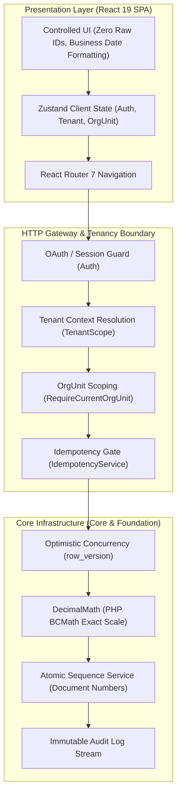
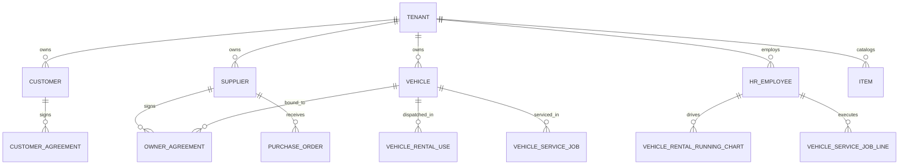
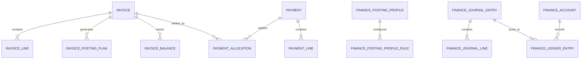
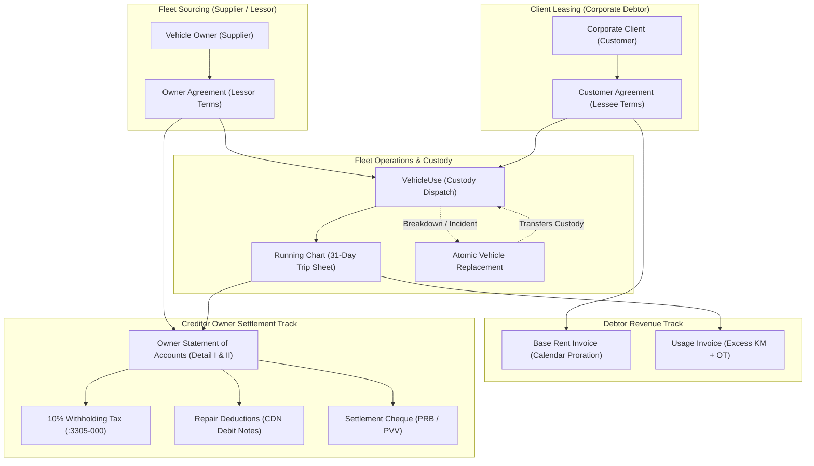
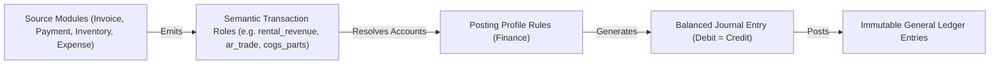

# AutoERP Enterprise Knowledge Base & Technical Developer Guide

**Document Status:** Authoritative Enterprise Architecture, Business Domain Specification, and Developer Reference for AutoERP.  
**System Architecture:** Modular Monolith (Laravel 12 + React 19 / TypeScript 6 / Vite 7 / Tailwind CSS 4)  
**Timezone Standard:** Dynamic Workspace Timezone (`ConfigurationKey::WORKSPACE_TIMEZONE` with fallback to `Asia/Colombo`)  
**Arithmetic Precision:** Exact Arbitrary-Precision Math (`DecimalMath` / PHP BCMath)  
**Database Schema:** 259 Canonical Domain Tables (1:1 Migration Mapping, zero `Schema::table()` patches) + 5 Framework Tables  
**Owning Modules:** `app/Modules/*` (31 Specialized Business & Infrastructure Domains)  
**Binding Architecture Policies:** Root `AGENTS.md` and `RULES.md`  
**Shared Memory & Change History:** `docs/changes/`  

---

## Table of Contents

1. [Executive System Overview](#1-executive-system-overview)
   - [1.1 What is AutoERP?](#11-what-is-autoerp)
   - [1.2 Core Architectural Axioms](#12-core-architectural-axioms)
   - [1.3 System Source Precedence Hierarchy](#13-system-source-precedence-hierarchy)
2. [Technology Stack & Prerequisites](#2-technology-stack--prerequisites)
   - [2.1 Backend Technology Stack](#21-backend-technology-stack)
   - [2.2 Frontend Technology Stack](#22-frontend-technology-stack)
   - [2.3 Development & Runtime Prerequisites](#23-development--runtime-prerequisites)
3. [Setup, Installation & Local Development](#3-setup-installation--local-development)
   - [3.1 Fresh Installation Step-by-Step](#31-fresh-installation-step-by-step)
   - [3.2 Environment Configuration (.env)](#32-environment-configuration-env)
   - [3.3 Running the Development Environment](#33-running-the-development-environment)
   - [3.4 Verification & Testing Commands](#34-verification--testing-commands)
4. [Platform Foundations & Architectural Patterns](#4-platform-foundations--architectural-patterns)
   - [4.1 Multi-Tenancy & Bounded Scoping](#41-multi-tenancy--bounded-scoping)
   - [4.2 Concurrency Control & Optimistic Locking](#42-concurrency-control--optimistic-locking)
   - [4.3 Operational Ledger Immutability & Reversals](#43-operational-ledger-immutability--reversals)
   - [4.4 Exact Decimal Arithmetic Standard](#44-exact-decimal-arithmetic-standard)
   - [4.5 Temporal Causality & Dynamic Timezone Handling](#45-temporal-causality--dynamic-timezone-handling)
   - [4.6 Zero Magic Values (PHP Backed Enums & Constants)](#46-zero-magic-values-php-backed-enums--constants)
   - [4.7 KISS + Explicit Database Migrations](#47-kiss--explicit-database-migrations)
   - [4.8 Idempotency Engine & Request Deduplication](#48-idempotency-engine--request-deduplication)
5. [Complete Module Catalog & Responsibilities (31 Modules)](#5-complete-module-catalog--responsibilities-31-modules)
   - [5.1 Core & Infrastructure Modules](#51-core--infrastructure-modules)
   - [5.2 Identity, Security & Administration Modules](#52-identity-security--administration-modules)
   - [5.3 Master Data Governance Modules](#53-master-data-governance-modules)
   - [5.4 Supply Chain, Inventory & Procurement Modules](#54-supply-chain-inventory--procurement-modules)
   - [5.5 Commercial Invoicing, Payments & Financial Accounting](#55-commercial-invoicing-payments--financial-accounting)
   - [5.6 Operational Engines (Vehicle Rental, Service & Promotion)](#56-operational-engines-vehicle-rental-service--promotion)
6. [Database Architecture & Core Schema Relationships](#6-database-architecture--core-schema-relationships)
   - [6.1 Database Architecture Overview](#61-database-architecture-overview)
   - [6.2 Multi-Tenant Foreign Key Conventions](#62-multi-tenant-foreign-key-conventions)
   - [6.3 Core Entity-Relationship Models](#63-core-entity-relationship-models)
7. [End-to-End Business Workflows](#7-end-to-end-business-workflows)
   - [7.1 Commercial Vehicle Rental Lifecycle](#71-commercial-vehicle-rental-lifecycle)
   - [7.2 Automotive Workshop Repair & Service Management](#72-automotive-workshop-repair--service-management)
   - [7.3 Procurement & Fast Purchase Flow](#73-procurement--fast-purchase-flow)
   - [7.4 Order to Cash & Commercial Selling](#74-order-to-cash--commercial-selling)
   - [7.5 Double-Entry General Ledger & Financial Posting Engine](#75-double-entry-general-ledger--financial-posting-engine)
8. [Frontend Architecture & UI/UX Standards](#8-frontend-architecture--uiux-standards)
   - [8.1 SPA Architecture & State Management](#81-spa-architecture--state-management)
   - [8.2 UI Design System & Component Library](#82-ui-design-system--component-library)
   - [8.3 Controlled Lookups & Zero Raw IDs Rule](#83-controlled-lookups--zero-raw-ids-rule)
   - [8.4 Speed & Clarity UX Philosophy](#84-speed--clarity-ux-philosophy)
9. [Development Practices, Conventions & Maintenance](#9-development-practices-conventions--maintenance)
   - [9.1 Backend & PHP Coding Standards](#91-backend--php-coding-standards)
   - [9.2 Frontend & TypeScript Standards](#92-frontend--typescript-standards)
   - [9.3 Migration Authoring Protocol](#93-migration-authoring-protocol)
   - [9.4 Shared Memory Protocol (/docs/changes)](#94-shared-memory-protocol-docschanges)
   - [9.5 Troubleshooting & Common Issues](#95-troubleshooting--common-issues)
10. [Practical Developer Tutorials & Code Examples](#10-practical-developer-tutorials--code-examples)
   - [10.1 Tutorial: Creating a Version-Checked Mutation API Endpoint](#101-tutorial-creating-a-version-checked-mutation-api-endpoint)
   - [10.2 Tutorial: Implementing a Semantic Financial Posting Event](#102-tutorial-implementing-a-semantic-financial-posting-event)
   - [10.3 Tutorial: Creating a Controlled Lookup Component in React](#103-tutorial-creating-a-controlled-lookup-component-in-react)
   - [10.4 Tutorial: Adding a New Database Table with Canonical Migration](#104-tutorial-adding-a-new-database-table-with-canonical-migration)

---

## 1. Executive System Overview

### 1.1 What is AutoERP?

AutoERP is an enterprise-grade, multi-tenant resource planning platform specifically engineered for automotive enterprises. Built as a high-performance **modular monolith**, it combines platform administration, master data governance, supply chain procurement, inventory warehousing and valuation, canonical commercial billing, cash and bank management, double-entry general ledger accounting, statutory taxation, automotive workshop operations, customer loyalty promotions, and a specialized commercial vehicle rental operating engine.

The system features two operating planes:
1. **Platform Control Plane:** Platform super-operators manage tenants, subscription plans, platform-wide configuration, infrastructure targeting, security sessions, audit logs, and system health.
2. **Tenant Business Plane:** Authenticated tenant users operate within an explicitly resolved tenant (`current.tenant`) and an active organization unit (`current.organization-unit:required`), which scopes branches, workshops, or physical depots.

AutoERP unifies high-volume operational workflows (vehicle dispatches, 31-day running charts, workshop job cards, spare parts issues) with rigorous financial truth.

---

### 1.2 Core Architectural Axioms

The following mandatory axioms govern every module, service, and database migration across the repository:

1. **Understand first, verify second, change third.**  
   Never guess, assume, or apply changes blindly. Fully understand requirements, module boundaries, and downstream data consequences before modifying code.
2. **Do not invent money.**  
   Physical events (odometer readings, trip logs, fuel receipts, vehicle dispatches, workshop labor hours, damaged parts) are operational evidence. **No financial document**—invoice, debit note, credit note, owner payable voucher, payment receipt, tax withholding, or GL journal—may ever be created without an explicit, approved business rule and verified commercial entitlement.
3. **Speed and clarity over information overload.**  
   Design systems for task completion efficiency and minimal cognitive load. Keep primary workflows focused on essential fields. Never expose raw database IDs to users; all relationships must use guided controls (`LookupSelect`, dropdowns, search) with human-readable labels and codes. Progressive disclosure (`<details>`, tabs, expandable sections) must be used for secondary or audit details.
4. **Fix issues at their root source.**  
   Never compensate for a bug, missing feature, or incomplete implementation in one module by adding workarounds or shadow tables in another. Keep module boundaries clean and maintainable.
5. **No compatibility patches for legacy design flaws.**  
   Prioritize correctness, readability, and long-term maintainability over backward compatibility. Fix root causes rather than carrying historical mistakes forward.
6. **Assume multiple actors interact simultaneously.**  
   Concurrency is assumed across all writes. Every mutation must be atomic, conflict-aware, and version-checked (`expected_version` / `row_version`).
7. **Store transactions with original values; preserve history permanently.**  
   Historical business records are immutable. Never modify or overwrite historical transactions in place. Any later adjustments, reversals, or corrections must be recorded as separate, auditable transactions linked through lineage.
8. **KISS + Explicit over DRY in migrations.**  
   Database migrations are immutable schema history, not dynamic application code. Every column, constraint, index, and foreign key must be defined explicitly line by line without dynamic loops or abstractions. Use one table per migration file.
9. **Never hardcode timezones or magic literals.**  
   All dates and times evaluate against the tenant's configured workspace timezone (`ConfigurationKey::WORKSPACE_TIMEZONE`). All statuses, categories, and fixed values use PHP 8.3 Backed Enums or named constants.

---

### 1.3 System Source Precedence Hierarchy

When evaluating domain behavior or resolving conflicting requirements, prioritize in this strict order:
1. **Proven production business evidence** from the historical enterprise corpus (TACGL Visual FoxPro ERP database, operational screen recordings, and real-world scanned commercial documents).
2. **Root architectural rules** (`AGENTS.md` / `RULES.md`): single source of truth, atomic concurrency, clean module boundaries, immutable history, portable schema.
3. **Narrowest integrity rule** necessary to preserve physical, commercial, and financial truth safely.
4. **Explicit AutoERP production policies** formally documented in this specification.
5. **Absence of automatic financial effect:** If an edge case lacks an approved commercial policy, physical facts are preserved but no automatic financial document is generated until explicitly authorized.

---

## 2. Technology Stack & Prerequisites

### 2.1 Backend Technology Stack

| Layer / Component | Technology | Version | Description |
|---|---|---|---|
| **Language** | PHP | 8.2+ / 8.3 | Strictly typed PHP with modern syntax (enums, readonly classes, constructor promotion). |
| **Framework** | Laravel | 12.x | Modular monolith structure with custom module service providers. |
| **Authentication** | Laravel Passport + Custom Guards | 13.7+ | Dual-guard authentication (platform operators vs. tenant users) with HMAC-SHA-256 tokens. |
| **Exact Arithmetic** | PHP BCMath (`DecimalMath`) | Core | Arbitrary-precision decimal arithmetic; floating-point math is strictly forbidden. |
| **Realtime Events** | Laravel Reverb | 1.10+ | Real-time WebSocket event broadcasting for operational updates. |
| **Document Generation** | Spatie Laravel PDF / DOMPDF | 2.12+ / 3.1+ | Server-side PDF generation for invoices, statements, vouchers, and contracts. |
| **API Documentation** | L5 Swagger (OpenAPI 3.0) | 11.x | Standardized OpenAPI specification generation for external/internal endpoints. |
| **Testing** | PHPUnit | 11.5+ | Full test coverage (1,259 passing tests, 13,000+ assertions). |
| **Code Style** | Laravel Pint | 1.24+ | Automated PSR-12 and Laravel code-style enforcement. |

---

### 2.2 Frontend Technology Stack

| Layer / Component | Technology | Version | Description |
|---|---|---|---|
| **Core Framework** | React | 19.2+ | Modern React utilizing functional components and hooks. |
| **Language** | TypeScript | 6.0+ | Strict type checking with `tsc --noEmit` validation. |
| **Build Tooling** | Vite + Laravel Vite Plugin | 7.x / 2.x | High-speed frontend development server and production bundler. |
| **Styling** | Tailwind CSS | 4.x | Utility-first responsive CSS styling with custom theme variables. |
| **Client Routing** | React Router DOM | 7.x | Client-side routing with guarded layout boundaries. |
| **State Management** | Zustand | 5.0+ | Lightweight, un-opinionated store for user session and active organization units. |
| **HTTP Transport** | Axios | 1.17+ | Interceptor-configured client handling CSRF, correlation IDs, and standard errors. |
| **Notifications** | React Toastify | 11.1+ | Toast notifications for user feedback and error alerts. |
| **Frontend Testing** | Vitest + Testing Library | 4.1+ | Component and unit test runner (169 test files, 692 passing tests). |
| **Linting** | ESLint + typescript-eslint | 10.x / 8.x | Strict linting rules with React Hooks validation. |

---

### 2.3 Development & Runtime Prerequisites

To run AutoERP locally or in production, ensure your environment meets the following minimum prerequisites:

- **PHP:** `^8.2` or `^8.3` with the following extensions enabled:
  - `bcmath` (mandatory for exact decimal calculations)
  - `pdo_mysql` or `pdo_sqlite`
  - `mbstring`, `openssl`, `tokenizer`, `xml`, `ctype`, `json`, `curl`
- **Composer:** `^2.7`
- **Node.js:** `^20.10` or `^22.x` (LTS recommended)
- **NPM:** `^10.x`
- **Database:** MySQL 8.0+ / MariaDB 10.6+ (or SQLite 3.35+ for unit testing)

---

## 3. Setup, Installation & Local Development

### 3.1 Fresh Installation Step-by-Step

AutoERP provides an automated single-command setup pipeline defined in `composer.json`. Run the following sequence from the repository root:

```bash
# 1. Clone the repository and navigate into the root directory
git clone https://github.com/organization/AutoERP.git
cd AutoERP

# 2. Run the automated setup routine
composer setup
```

The automated `composer setup` command executes the following operations:
1. Installs PHP dependencies (`composer install`).
2. Copies `.env.example` to `.env` if `.env` does not already exist.
3. Clears stale configuration caches (`php artisan config:clear`).
4. Generates or validates application keys (`php artisan app:key:ensure`).
5. Runs all database migrations (`php artisan migrate --force`).
6. Synchronizes platform and tenant permissions (`php artisan platform:permissions:sync`).
7. Validates authentication and encryption readiness (`php artisan auth:readiness`).
8. Installs frontend dependencies (`npm install`).
9. Builds production frontend assets (`npm run build`).

---

### 3.2 Environment Configuration (`.env`)

Key environment variables to configure in `.env`:

```ini
APP_NAME=AutoERP
APP_ENV=local
APP_KEY=base64:...
APP_DEBUG=true
APP_URL=http://localhost:8000

# Operational Business Timezone (System Default)
APP_TIMEZONE=Asia/Colombo

# Database Configuration
DB_CONNECTION=mysql
DB_HOST=127.0.0.1
DB_PORT=3306
DB_DATABASE=autoerp_dev
DB_USERNAME=root
DB_PASSWORD=secret

# Session & Cache Drivers
SESSION_DRIVER=file
CACHE_STORE=database
QUEUE_CONNECTION=database

# Realtime Reverb Configuration
REVERB_APP_ID=autoerp_reverb
REVERB_APP_KEY=autoerp_key
REVERB_APP_SECRET=autoerp_secret
REVERB_HOST=localhost
REVERB_PORT=8080
REVERB_SCHEME=http

# Security & Password Policies
AUTH_MIN_PASSWORD_LENGTH=12
AUTH_SESSION_LIFETIME_MINUTES=120
AUTH_REFRESH_TOKEN_DAYS=30
```

---

### 3.3 Running the Development Environment

AutoERP includes a unified multi-process runner using `concurrently`. To start all required services with a single command:

```bash
npm run dev
```

This concurrently launches:
1. **HTTP Server:** `php artisan serve` (Backend API on `http://localhost:8000`)
2. **Queue Worker:** `php artisan queue:listen --tries=1 --timeout=0` (Background jobs)
3. **Log Streamer:** `php artisan pail --timeout=0` (Interactive real-time log output)
4. **Vite Dev Server:** `npm run dev` (Frontend HMR on `http://localhost:5173`)

---

### 3.4 Verification & Testing Commands

Before committing any change or completing a task, execute the full verification suite:

```bash
# Backend Test Suite (PHPUnit - 1,259 tests)
php artisan test

# Verify Database Migration Baseline (Canonical 1-table-per-file compliance)
php artisan test --filter=ModuleMigrationBaselineTest

# Backend Code Formatting & Style (Laravel Pint)
vendor/bin/pint --test

# Frontend Static Typecheck (TypeScript compiler)
npm run typecheck

# Frontend Code Linting (ESLint)
npm run lint

# Frontend Test Suite (Vitest - 169 test files)
npm test

# Production Frontend Asset Build
npm run build
```

---

## 4. Platform Foundations & Architectural Patterns



### 4.1 Multi-Tenancy & Bounded Scoping

- **Shared-Schema Multi-Tenancy:** All tenant data lives within a unified database schema. Every tenant-owned table incorporates `tenant_id` (and `organization_unit_id` where operationally scoped).
- **`TenantOwnedModel` Base Class:** Every tenant-owned Eloquent model extends `Modules\Core\Models\TenantOwnedModel`. It enforces:
  1. A global query scope (`TenantScope`) that automatically injects `WHERE tenant_id = ?` into every `SELECT`, `UPDATE`, and `DELETE`.
  2. Fail-closed protection: Any query attempted without an active, resolved tenant context immediately throws a security exception.
  3. Immutability of tenancy: Once created, `tenant_id` can never be updated or reassigned.
- **Tenant-Scoped Requests:** `TenantScopedRequest` automatically overrides any client-supplied `tenant_id` or `organization_unit_id` with trusted session attributes, preventing parameter tampering.

---

### 4.2 Concurrency Control & Optimistic Locking

To guarantee correctness in a multi-user environment, AutoERP rejects last-write-wins:

- **Optimistic Concurrency Control (OCC):** Every mutable business record carries an unsigned big integer column: `row_version` (defaulting to 1).
- **Version Checking:** All mutation API endpoints (`PUT`, `PATCH`, state transitions) mandate the client supply `expected_version`.
- **Atomic Mutation Queries:** Updates execute with atomic version incrementation:
  ```sql
  UPDATE customer_agreements 
  SET status = 'active', row_version = row_version + 1 
  WHERE id = ? AND tenant_id = ? AND row_version = ?;
  ```
- **Conflict Handling:** If zero rows are updated, another user has modified the record. The service immediately throws a `ConcurrencyException`, returning HTTP `409 Conflict`.
- **Pessimistic Row-Level Locking:** High-stakes boundaries (issuing invoice numbers, consuming stock valuation layers, cutting over rental custody) combine OCC with `DB::transaction()` and `lockForUpdate()`.

---

### 4.3 Operational Ledger Immutability & Reversals

AutoERP strictly prohibits the destructive modification or deletion of historical transactions:

- **Immutable Ledgers:** Tables recording physical or financial truth (`finance_ledger_entries`, `inventory_movements`, `inventory_stock_state_changes`, `tax_transactions`, `vehicle_rental_running_charts`) are strictly append-only.
- **Model Event Locks:** Models register `booted()` listeners that intercept `updating` and `deleting` events and throw `\LogicException`, preventing direct Eloquent mutations.
- **No Soft Deletes on Ledgers:** Soft deletes are prohibited on transaction and movement tables.
- **Compensating Transactions:** Errors are corrected by posting linked compensating records (e.g. reversing journals, credit notes, return movements) with full audit lineage.

---

### 4.4 Exact Decimal Arithmetic Standard

Standard binary floating-point numbers (`float`, `double`) cause rounding inaccuracies and are strictly forbidden for quantities, monetary values, and rates:

- **`DecimalMath` Service:** All calculations use arbitrary-precision string arithmetic via [`DecimalMath`](file:///d:/project-new/AutoERP/app/Modules/Core/Services/DecimalMath.php) (wrapping PHP's `ext-bcmath`).
- **Standard Scale Configuration:**
  - Currency Amounts: 2 decimal places (`$scale = 2`).
  - Unit Prices, Tax Rates, Exchange Rates, and Quantities: 4 to 6 decimal places (`$scale = 6`).
- **Database Types:** Database schemas store numbers as `DECIMAL(20, 6)` or `DECIMAL(15, 2)` to eliminate precision loss.

---

### 4.5 Temporal Causality & Dynamic Timezone Handling

- **Workspace Timezone Resolution:** The application never hardcodes timezones. It dynamically resolves the active workspace timezone via:
  ```php
  $timezone = $this->configuration->value(ConfigurationKey::WORKSPACE_TIMEZONE, $tenantId, $organizationUnitId) 
      ?? config('app.timezone', 'Asia/Colombo');
  ```
- **Civil Business Calendar:** Operational logs (trip sheets, daily job cards) represent physical human calendar dates. When an operator records duty starting on `2026-11-21` at `06:30`, that civil date must remain unchanged regardless of the server's UTC offset.
- **Frontend Civil Date Handling:** Frontend formatting functions (`formatDate.ts`, `businessDate.ts`) format date strings directly using civil parts, preventing JavaScript's native `Date` object from shifting dates across midnight due to client browser UTC offsets.

---

### 4.6 Zero Magic Values (PHP Backed Enums & Constants)

- **Backed Enums:** Predefined statuses, categories, document types, and workflow states must use PHP 8.3 Backed Enums with string or integer backing.
  ```php
  namespace Modules\Customer\Enums;

  enum CustomerStatus: string {
      case Active = 'active';
      case Inactive = 'inactive';
      case Suspended = 'suspended';
  }
  ```
- **Descriptive Constants:** Shared keys and configuration identifiers use clearly named constants (e.g. `ConfigurationKey::WORKSPACE_TIMEZONE`).
- **Type Safety:** Comparisons in PHP code must compare enum instances directly (`$model->status === CustomerStatus::Active`) rather than raw string literals.

---

### 4.7 KISS + Explicit Database Migrations

AutoERP enforces a strict, deterministic database migration standard:

- **Canonical 1-Table-Per-File Mapping:** Exactly 259 domain tables are defined across 259 explicit migration files located in `app/Modules/*/Database/Migrations/`.
- **Zero Table Alterations (`Schema::table()`):** Incremental `Schema::table()` patches are strictly forbidden. When a schema change is required, the change is incorporated directly into the canonical table-creation migration file.
- **Brutally Explicit:** Loops, conditionals, dynamic column naming, and raw database statements (`DB::statement()`, `DB::raw()`) are forbidden in migration files. Every column, foreign key, index, and constraint is declared line by line.
- **Automated Verification:** The migration architecture is protected by `Tests\Unit\Database\ModuleMigrationBaselineTest`, which validates timestamp uniqueness, foreign key precedence, and single-table encapsulation.

---

### 4.8 Idempotency Engine & Request Deduplication

To prevent accidental double-billing, duplicate payments, or repeated dispatches during network latency:

- **Idempotency Keys:** Mutating API operations accept an `Idempotency-Key` HTTP header.
- **Request Fingerprinting:** `IdempotencyService` computes a SHA-256 hash of the request payload, method, and route.
- **Atomic Request Locking:** The key is locked in `idempotency_records`. If a duplicate request arrives while processing, it receives HTTP `409 Conflict`. Once complete, the cached HTTP response is stored and replayed on identical subsequent submissions.

---

## 5. Complete Module Catalog & Responsibilities (31 Modules)

AutoERP organizes its business capabilities into 31 focused modules under `app/Modules/`:

```
app/Modules/
├── Audit/               ├── Hr/                  ├── ReferenceData/       ├── User/
├── Auth/                ├── Idempotency/         ├── Reporting/           ├── Vehicle/
├── Configuration/       ├── Inventory/           ├── Selling/             ├── VehicleRental/
├── Core/                ├── Invoice/             ├── Sequence/            ├── VehicleService/
├── Customer/            ├── Item/                ├── Supplier/            ├── Voucher/
├── Expense/             ├── OrganizationUnit/    ├── Tax/                 └── Warehouse/
├── Finance/             ├── Payment/             ├── Tenant/
                         ├── PrivateObject/       ├── UOM/
                         └── Promotion/           ├── Purchase/
```

---

### 5.1 Core & Infrastructure Modules

#### 1. Core (`Modules\Core`)
- **Responsibility:** Foundational models, base abstractions, execution context, decimal mathematics (`DecimalMath`), standard error response factories, and cross-cutting contracts.
- **Database Tables (0):** Pure infrastructure layer; does not own dedicated database tables.
- **Key Classes:** `TenantOwnedModel`, `DecimalMath`, `ApiErrorResponseFactory`, `TenantScopedRequest`.

#### 2. Idempotency (`Modules\Idempotency`)
- **Responsibility:** Replay-sensitive request deduplication and distributed command locking.
- **Database Tables (1):** `idempotency_records`.
- **Key Classes:** `IdempotencyService`, `IdempotentRequestMiddleware`.

#### 3. Sequence (`Modules\Sequence`)
- **Responsibility:** Monotonic, collision-free sequential document number generation (`INV-`, `RC-`, `PRB-`, `EXP-`, `PO-`).
- **Database Tables (1):** `sequences`.
- **Key Classes:** `SequenceService`, `SequenceGeneratorInterface`.

#### 4. PrivateObject (`Modules\PrivateObject`)
- **Responsibility:** Secure, tenant-isolated binary file storage, SHA-256 tamper-evident checksum verification, and signed streaming file downloads.
- **Database Tables (0):** Interfaces with tenant disk storage directly.
- **Key Classes:** `PrivateObjectStorageService`, `StreamSignedFileResponse`.

#### 5. Configuration (`Modules\Configuration`)
- **Responsibility:** Multi-tiered configuration hierarchy (Global &rarr; Tenant &rarr; Organization Unit), immutable revision tracking, and point-in-time configuration rollback.
- **Database Tables (6):** `global_configuration_values`, `tenant_configuration_values`, `organization_unit_configuration_values`, `global_configuration_value_revisions`, `tenant_configuration_value_revisions`, `organization_unit_configuration_value_revisions`.
- **Key Classes:** `ConfigurationService`, `ConfigurationKey`, `ConfigurationRevisionService`.

#### 6. ReferenceData (`Modules\ReferenceData`)
- **Responsibility:** Standardized ISO countries, currencies, languages, and timezones.
- **Database Tables (4):** `countries`, `currencies`, `languages`, `timezones`.
- **Key Classes:** `CurrencyCatalogService`, `TimezoneCatalogService`.

#### 7. Audit (`Modules\Audit`)
- **Responsibility:** Sanitized tenant and platform audit event logging, credential redaction, and compliance tracking.
- **Database Tables (1):** `audit_logs`.
- **Key Classes:** `AuditService`, `AuditPayloadSanitizer`.

---

### 5.2 Identity, Security & Administration Modules

#### 8. Tenant (`Modules\Tenant`)
- **Responsibility:** Multi-tenant lifecycle management, subscription plans, domain mapping and verification, tenant onboarding, storage quota accounting, and outbox event publishing.
- **Database Tables (14):** `tenant_plans`, `tenant_plan_revisions`, `tenants`, `tenant_subscriptions`, `tenant_current_subscriptions`, `tenant_documents`, `tenant_domains`, `tenant_primary_domains`, `tenant_storage_cleanup_jobs`, `tenant_event_outbox`, `tenant_subscription_events`, `tenant_lifecycle_events`, `tenant_onboarding_states`, `tenant_onboarding_steps`.
- **Key Classes:** `TenantService`, `TenantProvisioningService`, `TenantDomainService`, `TenantEventOutboxService`.

#### 9. OrganizationUnit (`Modules\OrganizationUnit`)
- **Responsibility:** Branch, depot, and workshop hierarchical structure, legal profiles, and branch-level user access scoping.
- **Database Tables (4):** `organization_units`, `organization_unit_legal_profiles`, `organization_unit_user_access`, `organization_unit_status_histories`.
- **Key Classes:** `OrganizationUnitService`, `CurrentOrganizationUnitContext`.

#### 10. User (`Modules\User`)
- **Responsibility:** User identity records, RBAC roles, permission assignments, user device tracking, and platform operator profiles.
- **Database Tables (13):** `users`, `roles`, `permissions`, `role_permissions`, `user_roles`, `user_permissions`, `user_organization_units`, `user_documents`, `user_devices`, `platform_operators`, `platform_permissions`, `platform_operator_permissions`, `user_quick_access_settings`.
- **Key Classes:** `UserService`, `RoleService`, `PermissionRegistry`, `RequireTenantPermissionMiddleware`.

#### 11. Auth (`Modules\Auth`)
- **Responsibility:** Dual-plane authentication (Platform Operator vs. Tenant User), session management, token issuance, refresh token rotation, and password security.
- **Database Tables (17):** `auth_providers`, `auth_clients`, `auth_identities`, `auth_sessions`, `auth_access_tokens`, `auth_refresh_tokens`, `auth_authorization_codes`, `auth_login_attempts`, `auth_platform_login_attempts`, `auth_registration_invitations`, `auth_processed_integration_events`, `auth_registration_invitation_deliveries`, `auth_platform_sessions`, `auth_platform_access_tokens`, `auth_platform_refresh_tokens`, `auth_user_password_credentials`, `auth_platform_operator_password_credentials`.
- **Key Classes:** `TenantAuthenticationService`, `PlatformAuthenticationService`, `PasswordHasher`, `TokenRotationService`.

---

### 5.3 Master Data Governance Modules

#### 12. Customer (`Modules\Customer`)
- **Responsibility:** Commercial debtor master records, credit limits, contacts, addresses, bank accounts, categories, and WhatsApp number verification.
- **Database Tables (10):** `customers`, `customer_contacts`, `customer_addresses`, `customer_bank_accounts`, `customer_categories`, `customer_category_assignments`, `customer_documents`, `customer_credit_profiles`, `customer_status_histories`, `customer_whatsapp_verifications`.
- **Key Classes:** `CustomerService`, `CustomerCategoryService`, `CustomerCreditLimitPolicy`.

#### 13. Supplier (`Modules\Supplier`)
- **Responsibility:** Vendor and vehicle owner creditor profiles, bank settlement accounts, item mappings, and credit terms.
- **Database Tables (11):** `suppliers`, `supplier_contacts`, `supplier_addresses`, `supplier_bank_accounts`, `supplier_categories`, `supplier_category_assignments`, `supplier_documents`, `supplier_item_mappings`, `supplier_credit_profiles`, `supplier_status_histories`, `supplier_whatsapp_verifications`.
- **Key Classes:** `SupplierService`, `SupplierCategoryService`, `SupplierItemMappingService`.

#### 14. Vehicle (`Modules\Vehicle`)
- **Responsibility:** Physical fleet asset registry, makes, models, engine/chassis numbers, odometer telemetry, ownership classification (`company_owned` vs. `leased`), and revenue licence expiration tracking.
- **Database Tables (9):** `vehicle_makes`, `vehicle_types`, `vehicle_categories`, `vehicle_models`, `vehicles`, `vehicle_documents`, `vehicle_ownerships`, `vehicle_attributes`, `vehicle_status_histories`.
- **Key Classes:** `VehicleService`, `VehicleOdometerPolicy`, `VehicleAvailabilityService`.

#### 15. Hr (`Modules\Hr`)
- **Responsibility:** Workforce management, employee profiles, driver and technician directories, skills, certifications, licences, and commission policies.
- **Database Tables (16):** `hr_departments`, `hr_designations`, `hr_employment_types`, `hr_skills`, `hr_certifications`, `hr_licenses`, `hr_employees`, `hr_employee_contacts`, `hr_employee_addresses`, `hr_employee_documents`, `hr_employee_skill_assignments`, `hr_employee_certification_assignments`, `hr_employee_license_assignments`, `hr_employee_rates`, `hr_employee_availabilities`, `hr_employee_status_histories`.
- **Key Classes:** `EmployeeService`, `EmployeeLicensePolicy`, `DriverDirectoryService`.

#### 16. Item (`Modules\Item`)
- **Responsibility:** Product and service catalog, stock/consumable/service/labor types, categories, brands, variants, bundles, and temporal price lists.
- **Database Tables (10):** `item_categories`, `item_brands`, `items`, `item_units`, `item_variants`, `item_bundles`, `item_bundle_lines`, `item_usage_rules`, `item_prices`, `item_status_histories`.
- **Key Classes:** `ItemService`, `ItemPriceService`, `ItemBundleService`.

#### 17. UOM (`Modules\UOM`)
- **Responsibility:** Units of Measure and dimensional conversions (e.g. liters to milliliters, kilometers to miles).
- **Database Tables (2):** `unit_of_measures`, `uom_conversions`.
- **Key Classes:** `UomConversionService`, `UomValidationPolicy`.

#### 18. Warehouse (`Modules\Warehouse`)
- **Responsibility:** Physical storage facilities, locations, and aisle/bin coordinates.
- **Database Tables (2):** `warehouses`, `warehouse_locations`.
- **Key Classes:** `WarehouseService`, `WarehouseLocationService`.

---

### 5.4 Supply Chain, Inventory & Procurement Modules

#### 19. Inventory (`Modules\Inventory`)
- **Responsibility:** Real-time stock balances across four dimensions ($\text{Available} = \text{On-Hand} - \text{Reserved} - \text{Allocated}$), FIFO/WAC valuation layers, stock state changes, batch/serial tracking, transfers, adjustments, and physical counts.
- **Database Tables (21):** `inventory_batches`, `inventory_serial_numbers`, `inventory_stock_balances`, `inventory_movements`, `inventory_reservations`, `inventory_allocations`, `inventory_adjustments`, `inventory_adjustment_lines`, `inventory_transfers`, `inventory_transfer_lines`, `inventory_valuation_layers`, `inventory_allocation_lines`, `inventory_allocation_issues`, `inventory_valuation_consumptions`, `inventory_stock_state_changes`, `inventory_cost_adjustments`, `inventory_cost_adjustment_lines`, `inventory_stock_counts`, `inventory_stock_count_lines`, `inventory_number_sequences`, `inventory_batch_price_revisions`.
- **Key Classes:** `InventoryStockService`, `StockCardService`, `InventoryValuationService`, `FifoAllocationStrategy`.

#### 20. Purchase (`Modules\Purchase`)
- **Responsibility:** Procurement lifecycles, Purchase Orders (PO), Goods Receipt Notes (GRN), supplier invoice linkage, purchase returns, and supplier debit notes. Includes Fast Purchase orchestration.
- **Database Tables (12):** `purchase_orders`, `purchase_order_lines`, `goods_receipt_notes`, `goods_receipt_note_lines`, `purchase_invoice_links`, `purchase_payments`, `purchase_returns`, `purchase_return_lines`, `purchase_debit_notes`, `purchase_document_capabilities`, `purchase_order_approval_histories`, `goods_receipt_note_line_batch_allocations`.
- **Key Classes:** `PurchaseOrderService`, `GoodsReceiptService`, `PurchaseReturnService`, `FastPurchaseService`.

#### 21. Selling (`Modules\Selling`)
- **Responsibility:** Commercial sales orders, item delivery dispatches, sales returns, and line/bill discount allocations.
- **Database Tables (4):** `sales`, `sale_lines`, `sale_returns`, `sale_return_lines`.
- **Key Classes:** `SaleService`, `SaleDeliveryService`, `SaleDiscountAllocationPolicy`.

---

### 5.5 Commercial Invoicing, Payments & Financial Accounting

#### 22. Invoice (`Modules\Invoice`)
- **Responsibility:** Single authoritative source of truth for commercial billing across sales, services, vehicle rentals, and supplier purchases. Manages immutable document snapshots, posting plans, line items, and balances.
- **Database Tables (10):** `invoices`, `invoice_lines`, `invoice_sources`, `invoice_source_lines`, `invoice_adjustments`, `invoice_adjustment_allocations`, `invoice_balances`, `invoice_credit_allocations`, `invoice_posting_plans`, `invoice_document_snapshots`.
- **Key Classes:** `InvoiceService`, `InvoicePostingService`, `InvoiceBalanceService`, `InvoicePrintSnapshotService`.

#### 23. Payment (`Modules\Payment`)
- **Responsibility:** Cash movements, customer receipts, vendor disbursements, deposits, payment allocations against open invoices, cheque leaf tracking, and cheque printing templates.
- **Database Tables (10):** `payment_methods`, `payments`, `payment_lines`, `payment_allocations`, `payment_unapplied_balances`, `payment_events`, `cheque_templates`, `cheque_books`, `cheque_leaves`, `payment_status_histories`.
- **Key Classes:** `PaymentService`, `PaymentAllocationService`, `ChequePrintingService`, `PaymentCashReceiptDatePolicy`.

#### 24. Finance (`Modules\Finance`)
- **Responsibility:** Authoritative double-entry General Ledger (GL), Chart of Accounts, fiscal calendar periods, posting profile rules, balanced journal entries, and financial statements (Balance Sheet, P&L, Trial Balance).
- **Database Tables (18):** `finance_account_types`, `finance_account_categories`, `finance_accounts`, `finance_dimensions`, `finance_posting_profiles`, `finance_journal_entries`, `finance_journal_lines`, `finance_ledger_entries`, `finance_account_balances`, `finance_bank_reconciliations`, `finance_bank_statement_lines`, `finance_budgets`, `finance_budget_lines`, `finance_account_roles`, `finance_account_assignments`, `finance_posting_profile_rules`, `finance_accounting_periods`, `finance_accounting_period_events`.
- **Key Classes:** `JournalPostingService`, `FinancePostingService`, `AccountingPeriodService`, `TrialBalanceReportService`.

#### 25. Tax (`Modules\Tax`)
- **Responsibility:** Statutory tax determination, tax profiles, VAT/NBT rates, legal calculation profiles, immutable tax snapshots on transactions, and tax returns.
- **Database Tables (9):** `taxes`, `tax_rates`, `tax_groups`, `tax_group_lines`, `tax_posting_profiles`, `tax_document_snapshots`, `tax_transactions`, `customer_tax_profiles`, `supplier_tax_profiles`.
- **Key Classes:** `TaxCalculationService`, `TaxSnapshotService`, `TaxTransactionService`.

#### 26. Expense (`Modules\Expense`)
- **Responsibility:** General corporate operating expenses (utilities, office supplies, travel claims), multi-stage approval workflows, and automated double-entry GL posting via `Finance`.
- **Database Tables (2):** `expense_types`, `expenses`.
- **Key Classes:** `ExpenseService`, `ExpensePostingService`.

#### 27. Voucher (`Modules\Voucher`)
- **Responsibility:** Read-only presentation layer that unifies transaction sources (receipts, disbursements, journals) into standardized commercial vouchers without duplicating data ownership.
- **Database Tables (0):** Presentation layer over `Payment`, `Invoice`, and `Finance`.
- **Key Classes:** `VoucherService`, `VoucherPresentationFactory`.

#### 28. Reporting (`Modules\Reporting`)
- **Responsibility:** Business intelligence summaries, financial statement generation, operational matrix exports, and PDF rendering.
- **Database Tables (0):** Aggregates data from authoritative domain modules.
- **Key Classes:** `DashboardSummaryService`, `ReportCatalog`, `ReportExportService`.

---

### 5.6 Operational Engines (Vehicle Rental, Service & Promotion)

#### 29. VehicleRental (`Modules\VehicleRental`)
- **Responsibility:** Commercial vehicle rental operating engine. Governs dual-sided agreements (Customer Agreement vs. Owner Agreement), vehicle assignments, custody tracking, atomic vehicle replacement, 31-day Running Chart matrix sheets, debtor billing (calendar proration, excess distance), creditor lessor settlement (Statements Detail I & II, 10% WHT ledger `:3305-000`, repair deductions via CDN), fleet expenses (4-way destination matrix), bank lease amortization, and incident evidence.
- **Database Tables (28):** `vehicle_rental_customer_agreements`, `vehicle_rental_customer_agreements_history`, `vehicle_rental_owner_agreements`, `vehicle_rental_owner_agreements_history`, `vehicle_rental_uses`, `vehicle_rental_use_history`, `vehicle_rental_running_charts`, `vehicle_rental_running_chart_history`, `vehicle_rental_customer_base_charges`, `vehicle_rental_owner_base_charges`, `vehicle_rental_customer_usage_charges`, `vehicle_rental_owner_usage_charges`, `vehicle_rental_incidents`, `vehicle_rental_incident_events`, `vehicle_rental_incident_attachments`, `vehicle_rental_reservations`, `vehicle_rental_reservation_histories`, `vehicle_rental_finance_agreements`, `vehicle_rental_finance_installments`, `vehicle_rental_finance_status_histories`, `vehicle_rental_expenses`, `vehicle_rental_expense_allocations`, `vehicle_rental_agreement_adjustments`, `vehicle_rental_agreement_adjustments_history`, `vehicle_rental_billing_cycles`, `vehicle_rental_billing_cycle_charts`, `vehicle_rental_billing_cycle_items`, `vehicle_rental_reassignments`.
- **Key Classes:** `CustomerAgreementService`, `OwnerAgreementService`, `VehicleUseService`, `RunningChartService`, `RentalBillingService`, `OwnerSettlementService`, `RentalExpenseService`.

#### 30. VehicleService (`Modules\VehicleService`)
- **Responsibility:** Automotive repair workshop operations. Governs job cards, inspection checklists, labor operation lines, technician assignments, commission policies, and spare parts issue requests. Integrates automatically with `Inventory` (reserving and consuming stock) and `Invoice` (service billing).
- **Database Tables (14):** `vehicle_service_jobs`, `vehicle_service_inspections`, `vehicle_service_job_lines`, `vehicle_service_line_employees`, `vehicle_service_documents`, `vehicle_service_invoice_links`, `vehicle_service_payment_links`, `vehicle_service_status_histories`, `vehicle_service_supervisor_commission_policies`, `vehicle_service_labor_item_commission_rules`, `vehicle_service_job_discounts`, `vehicle_service_legacy_import_batches`, `vehicle_service_legacy_histories`, `vehicle_service_legacy_history_items`.
- **Key Classes:** `VehicleServiceJobService`, `JobLineService`, `ServiceStockAllocationService`, `TechnicianCommissionService`.

#### 31. Promotion (`Modules\Promotion`)
- **Responsibility:** Marketing promotions, customer loyalty cards (`PromotionCard`), promotional templates, benefit rules (percentage or fixed discount), job-line choices, and immutable redemption tracking.
- **Database Tables (10):** `promotion_card_templates`, `promotions`, `promotion_job_choices`, `promotion_cards`, `promotion_card_status_histories`, `promotion_redemptions`, `promotion_redemption_lines`, `promotion_benefit_rules`, `promotion_benefit_rule_service_items`, `promotion_line_templates`.
- **Key Classes:** `PromotionCardService`, `PromotionRedemptionService`, `PromotionBenefitCalculator`.

---

## 6. Database Architecture & Core Schema Relationships

### 6.1 Database Architecture Overview

The AutoERP database consists of **264 total tables**:
- **5 Framework System Tables** (defined in `database/migrations`): `cache`, `cache_locks`, `jobs`, `job_batches`, `failed_jobs`.
- **259 Domain Tables** (defined in `app/Modules/*/Database/Migrations`): Exactly one canonical migration file per table. Zero table alteration patches exist in the codebase.

---

### 6.2 Multi-Tenant Foreign Key Conventions

To preserve tenant isolation and database integrity, AutoERP adheres to a strict composite foreign key convention:

```sql
-- Pattern for multi-tenant child foreign keys:
CONSTRAINT child_parent_tenant_fk 
FOREIGN KEY (parent_id, tenant_id) 
REFERENCES parent_table (id, tenant_id) 
ON DELETE RESTRICT;
```

1. **Composite References:** Foreign keys reference both `id` and `tenant_id` on the parent table. This prevents cross-tenant record linking even if an erroneous query attempts it.
2. **Restricted Deletes:** Relational master records mandate `ON DELETE RESTRICT` to ensure data history cannot be orphaned. Cascading deletes (`ON DELETE CASCADE`) are permitted strictly for owned child collections (e.g. `invoice_lines` owned by `invoices`).
3. **Covering Indexes:** Because `TenantScope` prepends `tenant_id = ?`, composite indexes are declared on `['tenant_id', 'parent_id']`, enabling index seek optimizations.

---

### 6.3 Core Entity-Relationship Models

#### Master Data & Counterparties



#### Commercial Invoicing & Double-Entry Accounting



---

## 7. End-to-End Business Workflows

### 7.1 Commercial Vehicle Rental Lifecycle



#### 1. Dual-Sided Agreements
- **Customer Agreement (`CustomerAgreement`):** Governs commercial receivables from corporate lessees. Defines cycle base rates, free kilometer allowances, excess distance rates, overtime tiers (Normal, Double, Triple), night out rates, and security deposits.
- **Owner Agreement (`OwnerAgreement`):** Governs liabilities owed to third-party lessors supplying vehicles to the fleet. Bounds the physical vehicle (`vehicle_id`) and sets lessor payout rates, excess distance reimbursement, and driver OT pass-through.

#### 2. Agreement Lifecycle & Successors
- Mutating rates or terms on an active agreement is prohibited.
- Revisions use **Successor Agreement Mechanics** (`supersedes_agreement_id`): A new draft agreement is prepared while the current agreement remains active. Activating the successor atomically closes the predecessor and carries forward ongoing custody without disruption. Security deposits are linked to the original payment source and are not duplicated.

#### 3. Custody & Atomic Vehicle Replacement
- **Half-Open Interval Collision Blocker:** `VehicleUseAvailabilityBlocker` checks that no active custody assignment overlaps (`starts_at <= existing_end AND ends_at >= existing_start`). Exact-boundary turnovers (e.g. 10:00:00 return, 10:00:00 handover) are permitted.
- **Atomic Vehicle Replacement (`VehicleUseService::replace()`):** If a vehicle breaks down, recording the return of the disabled vehicle and the dispatch of the substitute vehicle executes in a single database transaction. Both vehicles share the contract's cumulative mileage allowance for the month.

#### 4. Daily Running Chart Matrix
- The Running Chart is the **single physical operational log** of vehicle usage.
- Tracks daily trip start/finish times, duty hours, odometers, comparative/cumulative kilometers, overtime tiers (Normal, Double, Triple), night outs, and expressway toll receipts.
- Trips can only be finalized after they conclude; future trips cannot be finalized. Once finalized, operational evidence is locked.

#### 5. Debtor Billing & Creditor Settlement
- **Debtor Billing:** Billed via `Invoice`. Base rent uses actual calendar days proration:
  $$\text{Base Charge} = \frac{\text{Actual Days in Month}}{\text{Total Days in Month}} \times \text{Monthly Agreed Rate}$$
  Commercial kilometers are pooled; excess distance is billed at the agreed excess rate.
- **Owner Settlement Statement (Detail I & II):** Computes gross earnings (base hire + driver overtime + toll outlays), deducts maintenance debit notes (`CDN`), deducts statutory 10% Withholding Tax (`:3305-000 WHT`), and issues outbound settlement cheques (`PRB`/`PVV`).

#### 6. Fleet Expense 4-Way Allocation Matrix
Fleet expenses (fuel, tolls, repairs, fines) are recorded in `RentalExpense` and allocated across four destinations:
1. `Company Cost`: Fleet overhead.
2. `Customer Recovery`: Billed on customer invoice.
3. `Owner Deduction`: Deducted from lessor settlement via `CDN` debit note.
4. `Employee Reimbursement`: Reimbursed to driver via HR/Payroll.

---

### 7.2 Automotive Workshop Repair & Service Management

```text
1. Customer / Fleet Vehicle Intake & Inspection Checklist
   → Create VehicleServiceJob (draft)
2. Add Labor & Spare Parts Lines
   → Company Stock Line: Automatically reserves stock in Inventory
3. Job Start (In Progress)
   → Atomically releases reservation, posts inventory stock issue,
     and records COGS valuation layer consumption
4. Work Completion & Sign-off
   → Calculates technician commissions based on labor item policies
5. Issue Commercial Service Invoice
   → Generates canonical invoice via Invoice module
6. Customer Payment & Job Card Closure
```

- **Stock Integration:** Adding parts to a job card immediately creates a reservation in `Inventory`. Starting the job atomically consumes stock at the active FIFO/WAC valuation layer, debiting Cost of Goods Sold and crediting Inventory Asset via `Finance`.
- **Custody Lock:** While a fleet vehicle is admitted in the workshop, its mechanical availability is flagged as off-road, blocking commercial rental dispatch until the job is signed off.

---

### 7.3 Procurement & Fast Purchase Flow

```text
Purchase Order (PO) 
  → Approval
  → Goods Receipt Note (GRN)
  → Physical Stock Received (Inventory) + Valuation Layer Created
  → Goods Received Not Invoiced (GRNI) Ledger Accrual
  → Supplier Invoice Linkage (gated on received quantity)
  → GRNI Cleared + Accounts Payable Liability Established
  → Supplier Disbursement Voucher (Payment)
```

- **Receipt Gating:** Supplier invoices cannot be created against a PO until physical goods have been formally received through a GRN.
- **Fast Purchase:** Counter parts purchases coordinate PO creation, receipt, stock valuation, and supplier billing in a single atomic transaction.

---

### 7.4 Order to Cash & Commercial Selling

```text
Sales Quotation / Order
  → Stock Allocation
  → Delivery Dispatch (SaleDelivery)
  → Stock Issue (Inventory Movement & COGS)
  → Commercial Sales Invoice (Invoice)
  → Customer Payment Receipt & Allocation (Payment)
```

- Sales orders support line-level item discounts as well as overall bill-level discounts allocated proportionally across lines.
- Generates accounts receivable entries and sales revenue in `Finance`.

---

### 7.5 Double-Entry General Ledger & Financial Posting Engine

AutoERP enforces a strict separation between source business modules and the General Ledger:



1. **Semantic Account Roles:** Source modules never hardcode GL account numbers. Instead, they emit semantic roles (e.g. `accounts_receivable`, `rental_revenue`, `inventory_asset`, `cogs`, `wht_payable`).
2. **Posting Profiles:** `Finance` resolves semantic roles into concrete GL accounts based on the tenant's active posting profile.
3. **Balanced Journal Rule:** A journal entry cannot be posted unless total debits equal total credits exactly:
   $$\sum \text{Debits} = \sum \text{Credits}$$
4. **Fiscal Period Guard:** Posting or reversing journals into closed accounting periods is rejected with HTTP `422`.

---

## 8. Frontend Architecture & UI/UX Standards

### 8.1 SPA Architecture & State Management

The frontend is a single-page application built with React 19, TypeScript 6, Vite 7, and React Router 7.
- **Root Entry Point:** `resources/js/app.tsx` mounts the application and provides routing context.
- **Routing Composition:** `resources/js/app/router.tsx` defines guarded layout routes:
  - `PublicRoute`: Authentication login, password reset, and registration.
  - `PlatformOperatorRoute`: Platform control plane administration.
  - `TenantRoute`: Tenant-scoped workspace layouts.
  - `TenantEntitlementRoute`: Feature-flag protected workspaces.
- **Zustand State Stores:** Lightweight stores (`useAuthStore`, `useTenantStore`, `useOrgUnitStore`) manage active authentication tokens and active organization unit context.

---

### 8.2 UI Design System & Component Library

All interface components are standardized under `resources/js/shared/components/`:
- **Modals & Dialogs (`Modal.tsx`, `ConfirmDialog.tsx`):** Accessible, keyboard-navigable (`Escape` to close), focus-trapped dialogs with standardized header, body, and action button layouts.
- **Tab Controls (`Tabs.tsx`):** Consistent tabbed navigation for complex forms and multi-section detail views.
- **Alert Banners (`Alert.tsx`):** Semantic status banners (Success, Warning, Error, Info) for user feedback.
- **Badge Indicators (`Badge.tsx`):** Standardized status badges mapping backed enums to uniform color tokens.

---

### 8.3 Controlled Lookups & Zero Raw IDs Rule

**Rule:** *Never expose raw database IDs to users; all relationship inputs must use guided controls.*
- **`LookupSelect` Component:** All foreign key relationships (selecting a customer, vehicle, driver, supplier, or item) must use search-driven, autocomplete selection components.
- **Human-Readable Presentation:** Options display business codes, registration numbers, and descriptive names (e.g. `[WP-CAB-1234] Toyota Corolla 2022`).
- **Structured API Responses:** API responses serialize related entities as structured objects (`{ id: 1, name: "Acme Corp", code: "CUST-001" }`) rather than isolated integer foreign keys.

---

### 8.4 Speed & Clarity UX Philosophy

Interfaces are engineered for high-throughput task completion and minimal cognitive overload:
1. **Focused Primary Actions:** Forms present only essential operational fields necessary to complete the action.
2. **Progressive Disclosure:** Secondary metadata, audit history, and advanced configuration options are moved into expandable sections (`<details>`) or secondary tabs.
3. **Optimistic Conflict Feedback:** When an OCC conflict occurs (HTTP 409), the UI presents a clear warning that data was modified by another user, offering a non-destructive refresh action.
4. **Civil Date Formatting:** Dates are formatted with `formatDate()` to prevent UTC timezone drift across client browsers.

---

## 9. Development Practices, Conventions & Maintenance

### 9.1 Backend & PHP Coding Standards

- **Strict Types:** Every PHP file must declare `declare(strict_types=1);` at line 3.
- **Constructor Property Promotion:** Use constructor promotion and `readonly` properties for services and DTOs.
- **Laravel Pint Compliance:** Code must comply 100% with Laravel Pint rules. Run `vendor/bin/pint --test` before committing.
- **Layered Flow:** Request flow follows: `Route` &rarr; `FormRequest` &rarr; `Controller` &rarr; `Service` &rarr; `Model/Contract` &rarr; `Resource`.
  - Controllers must remain thin (orchestration only).
  - Business logic, calculations, and transaction wrapping belong in dedicated `Services`.

---

### 9.2 Frontend & TypeScript Standards

- **Strict Type Checking:** Zero `any` types. All props, API contracts, and form states must have explicit TypeScript interfaces. Verify with `npm run typecheck`.
- **ESLint Compliance:** Code must pass `npm run lint` with zero errors.
- **Component Modularity:** Large components exceeding 300 lines must be decomposed into focused subcomponents with clear single responsibilities.

---

### 9.3 Migration Authoring Protocol

When introducing database schema modifications, adhere to these non-negotiable rules:
1. **Never write `Schema::table()`:** Do not create alteration migrations.
2. **Single Table Per File:** Every migration file must create exactly one table and drop that exact table.
3. **Explicit Line-by-Line:** Write every column, index, and foreign key explicitly. Never use dynamic loops or conditionals.
4. **Baseline Compliance:** Run `php artisan test --filter=ModuleMigrationBaselineTest` to ensure your migration satisfies the project baseline rules.

---

### 9.4 Shared Memory Protocol (`/docs/changes`)

This project uses `docs/changes/` as its shared, append-only memory:
1. **Read recent records:** Before beginning any task, read the latest change records to understand recent architectural decisions.
2. **Make minimal changes:** Modify only the files strictly necessary for your task.
3. **Append a new change record:** Upon task completion, create a new record in `docs/changes/YYYY-MM-DD-<task-name>.md` detailing what was changed and why.
4. **Never modify or delete past change records:** They represent immutable project history.

---

### 9.5 Troubleshooting & Common Issues

| Issue | Root Cause | Solution |
|---|---|---|
| **HTTP 409 Conflict** | Optimistic concurrency conflict (`row_version` mismatch). | Refresh entity state to obtain the latest `row_version` before retrying mutation. |
| **HTTP 403 Forbidden** | User lacks required permission or tenant feature flag is disabled. | Check role permissions in `User` module or enable plan feature in `Tenant` module. |
| **Fail-Closed Tenancy Error** | Query executed on `TenantOwnedModel` without active tenant context. | Wrap task in `TenantContext::runAs($tenant, ...)` or ensure tenant middleware runs. |
| **SQLite Migration Rollback Failure** | Unconditional `DB::disconnect()` in test `tearDown()` drops SQLite in-memory DB. | Guard `DB::disconnect()` to run only when database driver is not `sqlite`. |
| **Vite / TypeScript Compile Error** | Unresolved import or strict type mismatch. | Run `npm run typecheck` to locate exact line and file type errors. |

---

## 10. Practical Developer Tutorials & Code Examples

### 10.1 Tutorial: Creating a Version-Checked Mutation API Endpoint

Here is the canonical pattern for creating an optimistic-concurrency mutation endpoint:

#### Step 1: Form Request with `expected_version` Validation
```php
<?php

declare(strict_types=1);

namespace Modules\Customer\Http\Requests;

use Modules\Core\Http\Requests\TenantScopedRequest;

final class UpdateCustomerCreditLimitRequest extends TenantScopedRequest
{
    public function rules(): array
    {
        return [
            'credit_limit' => ['required', 'numeric', 'min:0'],
            'expected_version' => ['required', 'integer', 'min:1'],
        ];
    }
}
```

#### Step 2: Service with Atomic OCC Update
```php
<?php

declare(strict_types=1);

namespace Modules\Customer\Services;

use Modules\Core\Exceptions\ConcurrencyException;
use Modules\Customer\Models\Customer;

final class CustomerService
{
    public function updateCreditLimit(Customer $customer, string $creditLimit, int $expectedVersion): Customer
    {
        $updatedRows = Customer::query()
            ->where('id', $customer->id)
            ->where('row_version', $expectedVersion)
            ->update([
                'credit_limit' => $creditLimit,
                'row_version' => $expectedVersion + 1,
            ]);

        if ($updatedRows === 0) {
            throw new ConcurrencyException('The customer record was modified by another user. Please refresh and try again.');
        }

        return $customer->refresh();
    }
}
```

---

### 10.2 Tutorial: Implementing a Semantic Financial Posting Event

When posting a business transaction to the General Ledger, emit semantic roles rather than hardcoded account numbers:

```php
<?php

declare(strict_types=1);

namespace Modules\VehicleRental\Services;

use Illuminate\Support\Facades\DB;
use Modules\Finance\Contracts\FinancePostingInterface;
use Modules\Finance\DTOs\PostingLineDTO;
use Modules\VehicleRental\Models\RentalCustomerUsageCharge;

final class RentalBillingPostingService
{
    public function __construct(
        private readonly FinancePostingInterface $financePosting,
    ) {}

    public function postUsageCharge(RentalCustomerUsageCharge $charge): void
    {
        DB::transaction(function () use ($charge) {
            $this->financePosting->postJournal([
                'tenant_id' => $charge->tenant_id,
                'organization_unit_id' => $charge->organization_unit_id,
                'source_type' => 'rental_usage_charge',
                'source_id' => $charge->id,
                'transaction_date' => $charge->period_to,
                'lines' => [
                    // Debit Accounts Receivable
                    new PostingLineDTO(
                        role: 'accounts_receivable',
                        debit: $charge->total_amount,
                        credit: '0.00',
                        description: "Excess mileage for agreement {$charge->agreement_id}"
                    ),
                    // Credit Rental Revenue
                    new PostingLineDTO(
                        role: 'rental_revenue',
                        debit: '0.00',
                        credit: $charge->total_amount,
                        description: "Excess mileage revenue for agreement {$charge->agreement_id}"
                    ),
                ],
            ]);
        });
    }
}
```

---

### 10.3 Tutorial: Creating a Controlled Lookup Component in React

To ensure zero raw IDs are displayed and prevent invalid relational input:

```tsx
import React, { useState, useEffect } from 'react';
import axios from 'axios';
import { LookupSelect, LookupOption } from '@/shared/components/LookupSelect';

interface CustomerOption extends LookupOption {
    creditLimit: string;
}

export const CustomerSelector: React.FC<{
    value?: number | null;
    onChange: (customerId: number, option: CustomerOption) => void;
}> = ({ value, onChange }) => {
    const [options, setOptions] = useState<CustomerOption[]>([]);
    const [isLoading, setIsLoading] = useState(false);

    useEffect(() => {
        setIsLoading(true);
        axios.get('/api/v1/customers/lookup/active')
            .then(res => {
                const formatted = res.data.data.map((c: any) => ({
                    value: c.id,
                    label: `[${c.code}] ${c.name}`,
                    creditLimit: c.credit_limit,
                }));
                setOptions(formatted);
            })
            .finally(() => setIsLoading(false));
    }, []);

    return (
        <div className="space-y-1">
            <label className="block text-sm font-medium text-slate-700 dark:text-slate-200">
                Customer Account <span className="text-rose-500">*</span>
            </label>
            <LookupSelect
                placeholder="Search by customer name or code..."
                options={options}
                value={value}
                isLoading={isLoading}
                onChange={(selectedId, opt) => onChange(Number(selectedId), opt as CustomerOption)}
            />
            <p className="text-xs text-slate-500">
                Select an approved commercial customer to bind this agreement.
            </p>
        </div>
    );
};
```

---

### 10.4 Tutorial: Adding a New Database Table with Canonical Migration

When creating a new database table, follow the canonical 1-table-per-file standard:

```php
<?php

declare(strict_types=1);

use Illuminate\Database\Migrations\Migration;
use Illuminate\Database\Schema\Blueprint;
use Illuminate\Support\Facades\Schema;

return new class extends Migration
{
    public function up(): void
    {
        Schema::create('custom_feature_records', function (Blueprint $table) {
            $table->id();
            $table->unsignedBigInteger('tenant_id');
            $table->unsignedBigInteger('organization_unit_id')->nullable();
            
            $table->string('code', 50);
            $table->string('name', 255);
            $table->string('status', 30)->default('draft');
            $table->decimal('amount', 20, 6)->default('0.000000');
            
            // Optimistic Concurrency Control
            $table->unsignedBigInteger('row_version')->default(1);
            
            $table->timestamps();

            // Multi-Tenant Covering Indexes
            $table->index(['tenant_id', 'status'], 'cfr_tenant_status_ix');
            $table->unique(['tenant_id', 'code'], 'cfr_tenant_code_uk');

            // Foreign Key Constraints
            $table->foreign('tenant_id', 'cfr_tenant_fk')
                ->references('id')
                ->on('tenants')
                ->onDelete('restrict');

            $table->foreign(['organization_unit_id', 'tenant_id'], 'cfr_org_unit_tenant_fk')
                ->references(['id', 'tenant_id'])
                ->on('organization_units')
                ->onDelete('restrict');
        });
    }

    public function down(): void
    {
        Schema::dropIfExists('custom_feature_records');
    }
};
```

---

*This document serves as the central, authoritative technical guide for AutoERP. For historical change records and recent engineering decisions, consult [`docs/changes/`](changes/).*
