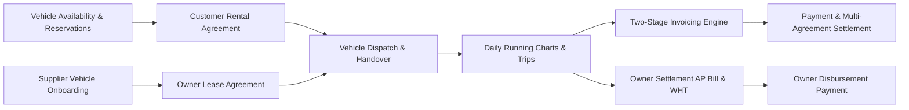
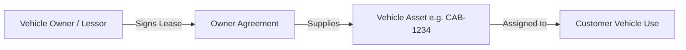
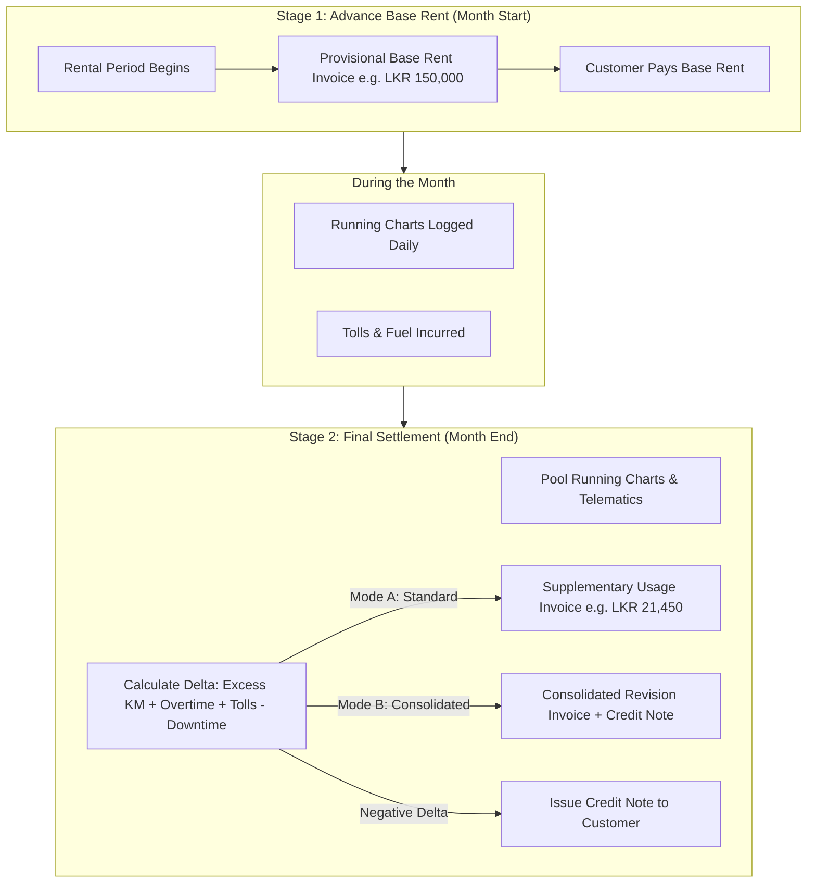

# AutoERP Vehicle Rental: End-User Guide & Operator Handbook

> [!NOTE]
> **Audience:** This handbook is designed for daily business operators—including **Fleet Officers, Dispatchers, Billing Clerks, Cashiers, AP Clerks, and Operations Managers**. For architectural specifications, database schemas, and developer onboarding, refer to the canonical [Vehicle Rental Complete Guide](file:///d:/project-new/AutoERP/docs/modules/vehicle_rental_complete_guide.md).

---

## Table of Contents

1. [Welcome & Navigation Overview](#1-welcome--navigation-overview)
   - 1.1 [User Roles & Responsibilities](#11-user-roles--responsibilities)
   - 1.2 [Main Navigation & Sidebar Structure](#12-main-navigation--sidebar-structure)
   - 1.3 [Operations Dashboard & Live Fleet KPIs](#13-operations-dashboard--live-fleet-kpis)
   - 1.4 [Core Operating Principles for Users](#14-core-operating-principles-for-users)
2. [Customer Rental Agreements](#2-customer-rental-agreements)
   - 2.1 [Creating a New Customer Agreement](#21-creating-a-new-customer-agreement)
   - 2.2 [Configuring Agreed Rates & Allowances](#22-configuring-agreed-rates--allowances)
   - 2.3 [Reviewing, Activating, and Freezing Terms](#23-reviewing-activating-and-freezing-terms)
   - 2.4 [Security Deposit Management & Inline Receipts](#24-security-deposit-management--inline-receipts)
   - 2.5 [Financial Position, Ad-Hoc Adjustments & Deposit Allocations](#25-financial-position-ad-hoc-adjustments--deposit-allocations)
   - 2.6 [Successor Agreements (Contract Extensions)](#26-successor-agreements-contract-extensions)
   - 2.7 [Closing & Terminating Agreements](#27-closing--terminating-agreements)
3. [Vehicle Owner Lease Agreements](#3-vehicle-owner-lease-agreements)
   - 3.1 [Fleet Sourcing & Supplier Vehicle Onboarding](#31-fleet-sourcing--supplier-vehicle-onboarding)
   - 3.2 [Setting Up Owner Lease Rates & Reimbursements](#32-setting-up-owner-lease-rates--reimbursements)
   - 3.3 [Activating & Managing Owner Contracts](#33-activating--managing-owner-contracts)
   - 3.4 [Vehicle Hire-Purchase & Loan Financing](#34-vehicle-hire-purchase--loan-financing)
4. [Vehicle Dispatch & Custody Management](#4-vehicle-dispatch--custody-management)
   - 4.1 [Fleet Availability Inquiries (Direct Reserve & Dispatch)](#41-fleet-availability-inquiries-direct-reserve--dispatch)
   - 4.2 [Customer Advance Reservations & Agreement Conversion](#42-customer-advance-reservations--agreement-conversion)
   - 4.3 [Vehicle Assignment & Planning](#43-vehicle-assignment--planning)
   - 4.4 [Physical Vehicle Handover (Start Mileage & Inspection)](#44-physical-vehicle-handover-start-mileage--inspection)
   - 4.5 [Mid-Lease Atomic Vehicle Swaps / Replacements](#45-mid-lease-atomic-vehicle-swaps--replacements)
   - 4.6 [Physical Vehicle Return (End Mileage & Close Custody)](#46-physical-vehicle-return-end-mileage--close-custody)
   - 4.7 [Driver Assignments & Mid-Lease Reassignments](#47-driver-assignments--mid-lease-reassignments)
5. [Daily Running Charts & Telematics Log](#5-daily-running-charts--telematics-log)
   - 5.1 [Creating a Daily Trip Sheet](#51-creating-a-daily-trip-sheet)
   - 5.2 [Commercial vs Private (Garage) Distance](#52-commercial-vs-private-garage-distance)
   - 5.3 [Multi-Tier Driver Overtime (Normal, Double, Triple)](#53-multi-tier-driver-overtime-normal-double-triple)
   - 5.4 [Air Conditioning & Driver Identity Logging](#54-air-conditioning--driver-identity-logging)
   - 5.5 [Draft Status Badges & Chronological Rules](#55-draft-status-badges--chronological-rules)
   - 5.6 [Supervisor Review, Finalization & Guard Errors](#56-supervisor-review-finalization--guard-errors)
   - 5.7 [Reversals, Corrections & Direct Sheet Printing](#57-reversals-corrections--direct-sheet-printing)
6. [Customer Invoicing & Telematics Statements](#6-customer-invoicing--telematics-statements)
   - 6.1 [Understanding the Two-Stage Invoicing Engine](#61-understanding-the-two-stage-invoicing-engine)
   - 6.2 [Direct Advance Base Rent Invoicing](#62-direct-advance-base-rent-invoicing)
   - 6.3 [Billing Cycle Wizard: Initializing Stage 1](#63-billing-cycle-wizard-initializing-stage-1)
   - 6.4 [Billing Cycle Wizard: Attaching Telematics Charts](#64-billing-cycle-wizard-attaching-telematics-charts)
   - 6.5 [Billing Cycle Wizard: Recording Additions & Deductions](#65-billing-cycle-wizard-recording-additions--deductions)
   - 6.6 [Billing Cycle Wizard: Finalizing Invoices (Mode A vs Mode B)](#66-billing-cycle-wizard-finalizing-invoices-mode-a-vs-mode-b)
   - 6.7 [Printing Official Telematics Statements of Accounts](#67-printing-official-telematics-statements-of-accounts)
7. [Dedicated Invoices & Owner Bills Register](#7-dedicated-invoices--owner-bills-register)
   - 7.1 [The Central Billing Cockpit (AR vs AP Dual Workspace)](#71-the-central-billing-cockpit-ar-vs-ap-dual-workspace)
   - 7.2 [Reading Real-Time Financial Metric Cards](#72-reading-real-time-financial-metric-cards)
   - 7.3 [Searching, Filtering & Document Inspector](#73-searching-filtering--document-inspector)
   - 7.4 [Reviewing Itemized Lines, Telematics & Adjustments](#74-reviewing-itemized-lines-telematics--adjustments)
   - 7.5 [Editing Draft Documents & Cancelling Unposted Records](#75-editing-draft-documents--cancelling-unposted-records)
   - 7.6 [Tendering Agreement Payments Directly from Invoices](#76-tendering-agreement-payments-directly-from-invoices)
8. [Vehicle Owner Settlements & AP Bills](#8-vehicle-owner-settlements--ap-bills)
   - 8.1 [The Fleet Sourcing Settlement Cycle](#81-the-fleet-sourcing-settlement-cycle)
   - 8.2 [Generating an Inbound AP Supplier Bill](#82-generating-an-inbound-ap-supplier-bill)
   - 8.3 [Statutory 10% Withholding Tax (WHT) Calculation](#83-statutory-10-withholding-tax-wht-calculation)
   - 8.4 [Maintenance Expense Deductions & Chargebacks](#84-maintenance-expense-deductions--chargebacks)
   - 8.5 [Settlement Cancellation & Chargeback Restoration](#85-settlement-cancellation--chargeback-restoration)
9. [Payment Processing & Multi-Agreement Settlements](#9-payment-processing--multi-agreement-settlements)
   - 9.1 [Single Payment for Multiple Agreements](#91-single-payment-for-multiple-agreements)
   - 9.2 [Using the Interactive Agreement Allocation Grid](#92-using-the-interactive-agreement-allocation-grid)
   - 9.3 [One-Click Auto "Pay Full" & Clear Allocations](#93-one-click-auto-pay-full--clear-allocations)
   - 9.4 [Reading the 4 Financial Metric Cards & Balance After Payment](#94-reading-the-4-financial-metric-cards--balance-after-payment)
   - 9.5 [Managing Unapplied Advances & Surplus Balances](#95-managing-unapplied-advances--surplus-balances)
   - 9.6 [Printing Branded Receipts & Canvas Bank Cheques](#96-printing-branded-receipts--canvas-bank-cheques)
   - 9.7 [Payment Reversals, Allocation Adjustments & Cash Refunds](#97-payment-reversals-allocation-adjustments--cash-refunds)
10. [Fleet Operating Expenses & Damage Incidents](#10-fleet-operating-expenses--damage-incidents)
    - 10.1 [Recording Fleet Operating Expenses](#101-recording-fleet-operating-expenses)
    - 10.2 [The 4-Way Expense Allocation Matrix](#102-the-4-way-expense-allocation-matrix)
    - 10.3 [Charging Expenses Back to Customers (Debit Notes / Invoices)](#103-charging-expenses-back-to-customers-debit-notes--invoices)
    - 10.4 [Offsetting Expenses Against Owner Disbursements](#104-offsetting-expenses-against-owner-disbursements)
    - 10.5 [Logging Damage Incidents & Private Proofs](#105-logging-damage-incidents--private-proofs)
    - 10.6 [Reviewing Incident Evidence & Factual Confirmation](#106-reviewing-incident-evidence--factual-confirmation)
11. [Fleet Reports & Matrix Sheets](#11-fleet-reports--matrix-sheets)
    - 11.1 [Fleet Operations & Compliance Reports](#111-fleet-operations--compliance-reports)
    - 11.2 [Commercial Revenue & Receivables Aging](#112-commercial-revenue--receivables-aging)
    - 11.3 [Supplier Payables & Vehicle Unit Economics](#113-supplier-payables--vehicle-unit-economics)
    - 11.4 [Exporting the 31-Day Running Chart Matrix Sheet](#114-exporting-the-31-day-running-chart-matrix-sheet)
12. [End-User Troubleshooting & FAQs](#12-end-user-troubleshooting--faqs)

---

## 1. Welcome & Navigation Overview

Welcome to the **AutoERP Vehicle Rental Management System**. AutoERP provides an end-to-end operational and financial environment for commercial fleet leasing, corporate chauffeur transportation, retail self-drive hire, and supplier vehicle management.



### 1.1 User Roles & Responsibilities

| Role | Primary System Modules | Core Daily Actions |
| :--- | :--- | :--- |
| **Fleet Officer / Dispatcher** | Vehicle Availability, Reservations, Vehicle Uses | Checks vehicle availability, conducts physical handovers/returns, records odometers/fuel, executes mid-lease atomic vehicle swaps, reassigns drivers. |
| **Driver / Field Clerk** | Running Chart Register | Logs daily trips, commercial vs private km, normal/double/triple overtime hours, night-outs, and expressway tolls. |
| **Billing Clerk** | Customer Agreements, Invoices & Owner Bills | Creates agreements, generates Stage 1 provisional invoices, attaches telematics trip charts, applies breakdown rebates, issues Stage 2 supplementary invoices or Mode B consolidated revisions. |
| **AP / Procurement Officer** | Owner Agreements, Invoices & Owner Bills (AP) | Manages supplier lease agreements, calculates monthly owner earnings, deducts 10% statutory WHT and maintenance chargebacks, generates AP bills. |
| **Cashier / Finance Officer** | Payments (`/payments`), Bank & Cash Receipts | Tenders single payments against multiple customer agreements, prints multi-agreement receipts, issues payment refunds, prints bank cheques. |
| **Fleet Manager / Executive** | Operations Dashboard, Reports & Matrix Sheet | Reviews fleet utilization, monitors overdue customer receivables, inspects vehicle profitability, oversees damage incident proofs. |

### 1.2 Main Navigation & Sidebar Structure

All Vehicle Rental functionalities are accessible via the main left-hand sidebar under **Vehicle Rental** and **Payments**:

```
AutoERP Navigation Menu
├── 🚗 Vehicle Rental
│   ├── Operations Dashboard          -> /vehicle-rental/dashboard
│   ├── Reservations                  -> /vehicle-rental/reservations
│   ├── Customer Agreements           -> /vehicle-rental/customer/agreements
│   ├── Owner Agreements              -> /vehicle-rental/owner/agreements
│   ├── Invoices & Owner Bills        -> /vehicle-rental/billing
│   ├── Vehicle Use Register          -> /vehicle-rental/vehicle-uses
│   ├── Running Chart Register        -> /vehicle-rental/running-charts
│   ├── Fleet Expenses                -> /vehicle-rental/expenses
│   ├── Vehicle Finance               -> /vehicle-rental/finance
│   ├── Incident Evidence             -> /vehicle-rental/incidents
│   ├── Vehicle Availability          -> /vehicle-rental/vehicles/available
│   └── Reports & Matrix Sheet        -> /vehicle-rental/reports
│
└── 💳 Payments
    ├── All Payments                  -> /payments
    ├── Record Payment                -> /payments/create
    ├── Payment Methods               -> /payments/methods
    └── Cheque Templates              -> /payments/cheque-templates
```

### 1.3 Operations Dashboard & Live Fleet KPIs

The **Operations Dashboard** (`/vehicle-rental/dashboard`) provides management and dispatchers with an immediate live pulse of fleet operations:

```
+-------------------------------------------------------------------------------------------------------------+
| Vehicle Rental Operations Dashboard                                                                         |
+-------------------------------------------------------------------------------------------------------------+
| Active Customer Rentals   Owner Supply Agreements   Vehicles In Custody       Planned Deployments           |
| 42 Agreements             18 Agreements             38 Vehicles               5 Scheduled                   |
| [ View -> ]               [ View -> ]               [ Register -> ]           [ View -> ]                   |
+-------------------------------------------------------------------------------------------------------------+
| Pending Reservations      Draft Running Charts      Unresolved Incidents      Upcoming Lease Due            |
| 3 Advance Holds           12 To Finalize            2 Under Review            4 Payments Pending            |
| [ Review -> ]             [ Inspect -> ]            [ Evidence -> ]           [ Finance -> ]                |
+-------------------------------------------------------------------------------------------------------------+
```

- **Active Customer Rentals:** Total active revenue leases currently running.
- **Vehicles In Custody:** Physical vehicles handed over and operating with customers.
- **Planned Deployments:** Future bookings requiring dispatch preparation.
- **Draft Running Charts:** Trips logged by drivers awaiting supervisor verification and freezing.
- **Unresolved Incidents:** Recorded collisions, repairs, or breakdowns pending manager review.

### 1.4 Core Operating Principles for Users

1. **Do Not Invent Money**: Physical trip evidence (mileage, overtime hours, night-outs, accident repairs) is recorded as operational truth. **No financial document** (invoice, debit note, credit note, or GL journal) is ever created automatically without explicit, authorized user approval.
2. **Never Type Raw IDs**: AutoERP uses human-readable autocomplete search boxes (`LookupSelect`). You always select customers by company name, vehicles by registration number (e.g. `CAB-1234`), and drivers by employee name.
3. **Auditable & Non-Destructive**: Nothing is quietly deleted. If a contract, running chart, or invoice was created in error, it must be formally cancelled or reversed with a mandatory explanation note.
4. **Civil Time Standard**: All dates and timestamps are evaluated in the tenant's dynamically configured operational business timezone (`localization.timezone` / application configuration).

---

## 2. Customer Rental Agreements

A **Customer Rental Agreement** defines the commercial contract between your company and a corporate lessee or retail customer. It governs rental rates, free kilometer allowances, excess distance rates, overtime multipliers, and security deposit requirements.

```
+---------------------------------------------------------------------------------------+
| Customer Agreement Lifecycle:                                                         |
|                                                                                       |
|   [ Draft ]  ──────( Activate )──────>  [ Active ]  ──────( Close )──────> [ Closed ]  |
|       │                                     │                                         |
|       └──────( Close Draft )───────────────>┴───( Create Successor )──> [ Draft (New)]|
+---------------------------------------------------------------------------------------+
```

### 2.1 Creating a New Customer Agreement

#### Step 1: Navigate to the Agreements Register
Click **Vehicle Rental** > **Customer Agreements** in the left sidebar.

#### Step 2: Open the Creation Form
Click the blue **+ New agreement** button in the top right corner.

```
+----------------------------------------------------------------------------------+
| New agreement                                                                    |
+----------------------------------------------------------------------------------+
| Agreement reference: [ CR-2026-0042                                            ] |
| Customer:            [ ABC Holdings PLC                     ▼ ] (Search name)    |
| Currency:            [ LKR - Sri Lankan Rupee               ▼ ]                  |
| Agreement date:      [ 2026-11-01 ]   Agreement executing:   [ 2026-11-01 ]      |
| Start date:          [ 2026-11-01 ]   End date:              [ 2026-11-30 ]      |
| Rental basis:        [ Monthly                             ▼ ]                   |
| Driver arrangement:  [ With driver                         ▼ ]                   |
+----------------------------------------------------------------------------------+
| ▸ Agreed rates and allowances (Click to expand)                                  |
+----------------------------------------------------------------------------------+
| Notes:               [ Monthly executive vehicle hire for CEO                  ] |
|                                                                                  |
| [ Save draft ]   [ Cancel ]                                                      |
+----------------------------------------------------------------------------------+
```

#### Step 3: Complete Primary Contract Details
1. **Agreement reference**: Enter your internal reference or purchase order number.
   > [!TIP]
   > You can leave the **Agreement reference** field blank; AutoERP will automatically generate a clean sequential reference (e.g., `CR-2026-0001`).
2. **Customer**: Type the customer's name in the autocomplete field and select the account.
3. **Currency**: Select the billing currency (e.g., `LKR`, `USD`).
4. **Agreement date**: Date the terms were agreed upon (defaults to today).
5. **Agreement executing date**: Optional legal execution date stated in the contract.
6. **Start date & End date**: Contract duration. For ongoing long-term rentals without an expiration date, leave **End date** blank.
7. **Rental basis**: Select **Monthly** (for calendar billing) or **Daily** (for short-term hire).
8. **Driver arrangement**: Select **Self-drive** (customer drives) or **With driver** (company chauffeur provided).

### 2.2 Configuring Agreed Rates & Allowances

Click the **▸ Agreed rates and allowances** section to expand the rate grid:

```
+----------------------------------------------------------------------------------+
| Agreed rates and allowances                                                      |
+----------------------------------------------------------------------------------+
| Base rental rate:             [ 150000.00 ]  Included distance (km):    [ 2500 ] |
| Excess distance rate per km:  [     65.00 ]  Agreed driver amount:      [    0 ] |
| Non-AC rate:                  [         0 ]  Front AC rate:             [    0 ] |
| Dual AC rate:                 [         0 ]  Agreed security deposit:   [ 50000] |
| Normal overtime hourly rate:  [    450.00 ]  Double overtime hourly:    [ 650.0] |
| Triple overtime hourly rate:  [    850.00 ]  Night-out rate:            [ 2000 ] |
+----------------------------------------------------------------------------------+
```

- **Base rental rate**: The fixed periodic charge (e.g., 150,000 LKR / month).
- **Included distance (km)**: Free mileage allowance for the period (e.g., 2,500 km).
- **Excess distance rate per km**: Surcharge applied to every km consumed above the allowance (e.g., 65.00 LKR/km).
- **Normal overtime hourly rate**: Chauffeur overtime rate for standard working days (1.5x hourly rate).
- **Double overtime hourly rate**: Chauffeur rate for Sundays or rest days (2.0x hourly rate).
- **Triple overtime hourly rate**: Chauffeur rate for statutory/mercantile poya holidays (3.0x hourly rate).
- **Night-out rate**: Fixed allowance when the driver remains outstation overnight (e.g., 2,000 LKR/night).
- **Agreed security deposit**: Required refundable security deposit (e.g., 50,000 LKR).

#### Step 4: Save the Draft
Click **Save draft**. The agreement is saved with a grey **Draft** status badge.

### 2.3 Reviewing, Activating, and Freezing Terms

To inspect an agreement, locate it in the table and click **Review [Reference]**.

The agreement review workspace features dedicated operational tabs:
- **Billing & Rate Estimates**: Live financial breakdown preview of base rent calculations.
- **Assigned Vehicles & Handover**: Vehicle dispatch, physical custody handover, returns, swaps, and driver assignments.
- **Security Deposits**: View deposit summary and issue inline deposit receipts.
- **Financial Position & Notes**: Real-time billing cycles, ad-hoc financial adjustments (credit/debit notes), deposit allocations to invoices, payment entry, and refunds.
- **Audit History**: Complete immutable chronological log of every change, actor, and status transition.

```
+------------------------------------------------------------------------------------+
| CR-2026-0042 · ABC Holdings PLC                                 [ Active ]         |
+------------------------------------------------------------------------------------+
| LKR · With driver · Agreement date: Nov 1, 2026 · Executing date: Nov 1, 2026      |
| Base: LKR 150,000.00 | Inc KM: 2,500 | Excess: LKR 65.00 | OT: LKR 450.00 / 650.00 |
+------------------------------------------------------------------------------------+
| [ Billing & Rate Estimates ] [ Assigned Vehicles ] [ Security Deposits ]           |
| [ Financial Position & Notes ] [ Audit History ]                                   |
+------------------------------------------------------------------------------------+
```

#### How to Activate a Draft Agreement:
1. Review the recorded rates in the summary card.
2. Click the blue **Activate** button in the top right corner.
3. An amber confirmation alert appears:
   > *"Activation freezes these terms. Confirm that the recorded details match the agreement. This does not reserve the vehicle or create a financial document."*
4. Click **Confirm activation**. The status changes to green **Active**.

> [!WARNING]
> Once activated, rates and contract terms are frozen. If the customer renegotiates rates later, you must create a **Successor Agreement** to preserve the audit trail.

### 2.4 Security Deposit Management & Inline Receipts

For customer agreements requiring a refundable deposit:
1. In the agreement review panel, click the **Security Deposits** tab.
2. The panel displays real-time summary indicators:
   - **Agreed**: Contracted deposit requirement (e.g., LKR 50,000.00).
   - **Net receipts including drafts**: Total deposit receipts recorded to date.
   - **Remaining collection capacity**: Uncollected deposit balance.
3. If capacity remains, the **inline creation form** is active:
   - **Deposit receipt date**: Defaults to today.
   - **Deposit exchange rate**: Currency conversion rate (defaults to `1.00`).
   - **Reference / Cheque #**: Cheque leaf number or bank wire transaction ID.
   - **Receipt notes / reason**: Contextual notes (required when posting backdated receipts).
   - **Payment Lines Table**: Select payment method (e.g. Cash, Bank Transfer, Card), amount, and card/bank metadata.
4. Click **Create deposit receipt**.
   - AutoERP generates an official payment document (e.g. `PAY-2026-0045`) linked directly to this agreement.
   - Click the payment number link to inspect posting status or print an official receipt.

### 2.5 Financial Position, Ad-Hoc Adjustments & Deposit Allocations

Under the **Financial Position & Notes** tab (`AgreementFinancialSummaryPanel`), operators have a full suite of financial controls:

#### 1. Issuing Agreement Financial Adjustments (Credit / Debit Notes):
If an unexpected credit or surcharge arises outside of standard running charts:
1. Click **+ Issue Adjustment**.
2. Select **Adjustment Type**: `Credit Note` (credit customer) or `Debit Note` (charge customer).
3. Select optional **Target Invoice** to offset a specific invoice.
4. Enter **Amount**, **Invoice Date**, **Due Date**, and mandatory **Reason / Justification**.
5. Click **Issue Adjustment**. The note is immediately created and posted.

#### 2. Allocating Security Deposits Against Open Invoices:
When an active rental invoice is unpaid, held deposit funds can be applied to clear the balance:
1. In the **Security Deposits Summary** strip, click **Allocate Deposit to Invoice**.
2. Select the source unapplied deposit receipt.
3. Select the target open customer invoice.
4. Enter the **Allocation Amount** (up to invoice balance or available deposit).
5. Click **Confirm Deposit Allocation**. The invoice balance is reduced immediately without requiring new cash inflow.

#### 3. Tendering Agreement Payments Directly:
Click **Record Agreement Payment** to open the `AgreementPaymentModal`, tender cash/bank funds, and allocate across this agreement's invoices or enable the cross-agreement toggle.

#### 4. Processing Payment Refunds:
If a customer has an unapplied deposit or overpayment surplus, click **Refund** on the payment row, select disbursement method, enter reason, and click **Process Refund**.

### 2.6 Successor Agreements (Contract Extensions)

When a customer agreement reaches its end date, or when commercial rates are updated mid-lease:
1. Open the active agreement review panel.
2. Click the **Create successor** button.
3. A successor form opens:
   - Inherits the customer counterparty automatically.
   - Enter the new **Agreed on**, **Start date**, and **End date**.
   - Enter a **Reason for revision / extension** (e.g. *"Contract renewal for 2027 with updated fuel surcharge"*).
4. Click **Create successor draft**.
5. The original agreement displays an amber badge: `Successor in progress (draft): CR-2027-0001`.
6. Once you activate the successor agreement, the predecessor agreement automatically closes with full historical continuity.

### 2.7 Closing & Terminating Agreements

When a customer completes their rental without renewal:
1. Open the active agreement review panel.
2. Click the red **Close agreement** button.
3. Enter a mandatory **Closure reason** (e.g., *"Customer project completed; vehicle returned in good order"*).
4. Click **Confirm closure**. The agreement is now **Closed**.

---

## 3. Vehicle Owner Lease Agreements

AutoERP uses a **Dual-Sided Commercial Architecture**. When your company leases third-party vehicles from private owners or fleet investors to fulfill customer rentals, those supplier contracts are managed under **Owner Agreements**.

> [!IMPORTANT]
> **No Fictitious Owner Costs for Company-Owned Vehicles:** If a vehicle is owned directly by your company, do NOT create an owner agreement. The vehicle is simply marked as company-owned during assignment.

### 3.1 Fleet Sourcing & Supplier Vehicle Onboarding



#### Step 1: Open Owner Agreements
Navigate to **Vehicle Rental** > **Owner Agreements** and click **+ New agreement**.

#### Step 2: Enter Owner Information
1. **Agreement reference**: Leave blank for auto-generation or enter the supplier's contract reference.
2. **Owner / supplier**: Select the vehicle lessor from your supplier database.
3. **Vehicle**: Select the specific physical vehicle supplied by this lessor.
4. **Currency**: Lease payout currency (e.g., `LKR`).
5. **Start date & End date**: Duration of the vehicle lease.
6. **Rental basis**: Typically **Monthly** for lease-in fleet.

### 3.2 Setting Up Owner Lease Rates & Reimbursements

Under **Agreed rates and allowances**, enter what your company has agreed to pay the vehicle owner:
- **Owner base rental payable**: Monthly lease payout due to the owner (e.g., LKR 120,000.00).
- **Owner included distance (km)**: Distance quota before excess km reimbursements apply.
- **Owner excess distance payable per km**: Rate paid to owner for wear-and-tear per excess km.
- **Owner driver reimbursement amount**: Amount paid if the owner supplies their own driver.
- **Owner overtime reimbursement rates**: Normal (1.5x), Double (2.0x), and Triple (3.0x) reimbursement rates.
- **Owner night-out reimbursement rate**: Reimbursement for outstation driver nights.

### 3.3 Activating & Managing Owner Contracts

Click **Save draft**, verify the terms, and click **Activate**. The supplier vehicle is now officially active in your fleet pool and ready for dispatch.

### 3.4 Vehicle Hire-Purchase & Loan Financing

For vehicles financed through commercial banks, leasing companies, or finance houses:
1. Navigate to **Vehicle Rental** > **Vehicle Finance** (`/vehicle-rental/finance`).
2. Click **+ Record finance agreement**.
3. Fill in:
   - **Finance Supplier**: Bank or leasing company.
   - **Vehicle**: Target asset.
   - **Principal Amount**, **Deposit Amount**, and **Annual Interest Rate (%)**.
   - **Repayment Frequency**: Monthly, Quarterly.
   - **Installment Count**: E.g. `36` months.
4. AutoERP creates the amortization schedule and allows finance officers to generate Accounts Payable installments on each monthly maturity date.

---

## 4. Vehicle Dispatch & Custody Management

Vehicle dispatch bridges commercial contracts and physical fleet operations. The **Vehicle Use Register** tracks which physical car is in the hands of which customer, with precise timestamps and odometer readings.

```
+-----------------------------------------------------------------------------------+
| Vehicle Custody Lifecycle:                                                        |
|                                                                                   |
|  [ Planned ]  ───( Hand over )───>  [ In Custody ]  ───( Record return )───> [ Returned ]
|      │                                     │                                      |
|      └────────( Cancel plan )              └───( Replace vehicle )──> [ Replaced ]|
+-----------------------------------------------------------------------------------+
```

### 4.1 Fleet Availability Inquiries (Direct Reserve & Dispatch)

Before committing to a booking, check fleet availability:
1. Navigate to **Vehicle Rental** > **Vehicle Availability** (`/vehicle-rental/vehicles/available`).
2. Enter **Required start date & time** and **Expected end date & time**.
3. Click **Check availability**.
4. The system lists all unallocated vehicles matching your schedule:
   - Registration number, Make & Model, Vehicle Category, Current Dashboard Odometer.
5. On any available vehicle row, take immediate action:
   - Click **Reserve**: Directly navigates to the Reservation creation form with the vehicle pre-selected!
   - Click **Dispatch**: Directly opens the Customer Agreement assignment panel with the vehicle pre-selected!

### 4.2 Customer Advance Reservations & Agreement Conversion

To log advance customer requests before finalizing formal rental contracts:
1. Navigate to **Vehicle Rental** > **Reservations** (`/vehicle-rental/reservations`).
2. Click **+ New reservation**.
3. Fill in **Customer**, **Requested Vehicle** (or vehicle category), **Rental Mode** (Self-drive vs With driver), **Billing Cycle**, **Requested Start & End Dates**, and estimated amounts.
4. Click **Save draft reservation**.
5. Once confirmed by the client, transition status to **Confirmed**.
6. When the customer arrives to sign the contract, click **Convert to Agreement**. AutoERP instantly creates an active **Customer Rental Agreement** with zero re-typing!

### 4.3 Vehicle Assignment & Planning

To allocate a vehicle to an active customer agreement:
1. Open the customer agreement and click the **Assigned Vehicles & Handover** tab.
2. Click **Assign vehicle** to open the assignment form.
3. Configure:
   - **Vehicle**: Select the car to deploy (e.g. `CAB-1234 - Toyota Prius`).
   - **Ownership / Source**:
     - Check **Company-owned vehicle** if owned by your depot.
     - Otherwise, select the covering **Owner agreement** (or click **Auto-select owner agreement** if only one supplier contract covers this vehicle).
   - **Planned handover**: Scheduled departure date and time.
   - **Planned return (optional)**: Expected return date and time (leave blank for open-ended rentals).
   - **Assignment notes**: Special customer instructions.
4. Click **Save assignment**. The vehicle appears with a grey **Planned** status badge.

### 4.4 Physical Vehicle Handover (Start Mileage & Inspection)

When the driver or customer arrives to collect the vehicle:
1. In the **Assigned Vehicles & Handover** tab, locate the planned vehicle row.
2. Click the blue **Hand over vehicle** button.
3. Complete the handover form:
   - **Actual event time**: Physical departure timestamp. Use the helper buttons **Use planned handover time** or **Use current time**.
     > [!WARNING]
     > Handover time **cannot be in the future**. Ensure your computer clock matches operational civil time (the workspace's configured timezone).
   - **Odometer (optional)**: Current physical odometer reading on the dashboard (e.g., `45,200`).
   - **Action reason**: Mandatory operational handover remarks (e.g. *"Handed over with 100% fuel tank, spare wheel OK"*).
4. Click **Confirm handover**. The status updates to green **In Custody**.

### 4.5 Mid-Lease Atomic Vehicle Swaps / Replacements

Breakdowns, scheduled servicing, or customer upgrade requests happen during ongoing rentals. AutoERP handles mid-lease swaps **atomically** without disrupting contract allowances.

```mermaid
sequenceDiagram
    participant Dispatcher
    participant OldCar as Old Vehicle (CAB-1234)
    participant NewCar as New Vehicle (CAB-5678)
    participant Billing as Shared Allowance Pool

    Dispatcher->>OldCar: 1. Record Final Return Odometer (46,100 km)
    Dispatcher->>NewCar: 2. Record Start Odometer (12,400 km)
    Dispatcher->>Billing: 3. Atomic Swap Execution
    Note over OldCar,NewCar: Old custody closed; New custody opened simultaneously.
    Note over Billing: Both vehicles share the single 2,500 km contract quota!
```

#### Step-by-Step Replacement Workflow:
1. Under **Assigned Vehicles & Handover**, find the active vehicle in custody.
2. Click **Replace vehicle**.
3. Complete the replacement dialog:
   - **Vehicle**: Select the substitute car from available fleet (e.g. `CAB-5678`).
   - **Replacement time**: The exact timestamp when physical custody shifted (click **Use current time**).
   - **Vehicle ownership**: Select company-owned or link covering owner agreement.
   - **Old vehicle return odometer (optional)**: Final dashboard meter reading of the replaced car.
   - **Replacement handover odometer (optional)**: Starting dashboard meter reading of the substitute car.
   - **Replacement reason**: Mandatory explanation (e.g. *"AC compressor breakdown; deployed replacement car"*).
4. Click **Confirm replacement**.

> [!NOTE]
> **Why is this called "Atomic"?**
> The old custody is closed and new custody is opened in a single database transaction. Kilometers traveled by **both** vehicles will automatically pool together against the customer's contract allowance in billing cycles!

### 4.6 Physical Vehicle Return (End Mileage & Close Custody)

When the customer brings the vehicle back at the end of the rental:
1. Locate the vehicle row and click **Record return**.
2. Complete:
   - **Actual event time**: Arrival timestamp (click **Use current time**).
   - **Odometer (optional)**: Final dashboard reading.
     > [!WARNING]
     > Return odometer **cannot be lower** than the handover odometer.
   - **Action reason**: Return condition notes (fuel level, damage inspection).
3. Click **Confirm return**. The vehicle is marked **Returned** and returned to the available fleet pool.

### 4.7 Driver Assignments & Mid-Lease Reassignments

Chauffeurs may change due to shifts, leave, or customer preference:
1. On the vehicle custody row, click **Reassign driver**.
2. The modal displays the **Current Driver**.
3. Enter **Effective Cutover Date & Time**.
4. In **New Driver Employee**, type the name or employee number to search the staff directory.
5. Enter **Reassignment Reason / Justification**.
6. Click **Confirm Driver Reassignment**.
   > [!TIP]
   > You can also reassign a driver for an individual **Running Chart** trip sheet by clicking **Reassign driver** directly on that chart row!

---

## 5. Daily Running Charts & Telematics Log

The **Running Chart** is the operational heartbeat of AutoERP. It represents daily trip sheets, recording odometer readings, driver overtime, night-outs, and expressway tolls.

```
+----------------------------------------------------------------------------------+
| Running Chart Lifecycle:                                                         |
|                                                                                  |
|   [ Draft ]  ──────( Finalize usage )──────>  [ Finalized ] (Frozen)             |
|       │                                             │                            |
|       │                                             └────( Reverse usage )       |
|       │                                                        │                 |
|       │                                                        v                 |
|       └────────( Edit draft )                      [ Reversed ] ──( Create Corr )|
+----------------------------------------------------------------------------------+
```

### 5.1 Creating a Daily Trip Sheet

#### Step 1: Open the Running Chart Form
Navigate to **Vehicle Rental** > **Running Chart Register** (or click **Running charts** inside an agreement's vehicle row) and click **Record usage**.

#### Step 2: Trip Timestamps & Custody Boundaries
- **Chart reference**: Leave blank for auto-generation (e.g. `RC-2026-00120`) or enter physical trip ticket reference.
- **Usage start**: Departure date & time. Use the quick buttons **Use custody start time** or **Use current time**.
- **Usage end**: Trip conclusion date & time. Use **Use custody return time** or **Use current time**.
  > [!WARNING]
  > Trip timestamps **must fall strictly within vehicle custody dates**. You cannot record a trip after a vehicle was returned!

#### Step 3: Odometer Dashboard Readings
- **Start odometer (km)**: Dashboard reading at start of trip.
- **End odometer (km)**: Dashboard reading at end of trip.

### 5.2 Commercial vs Private (Garage) Distance

Click **▸ Additional usage observations** to expand:
- **Commercial distance (km)**: Kilometers traveled for client business (billable).
- **Garage distance (km)**: Kilometers traveled for deadhead depot transit (non-billable overhead).

```
Total Distance Traveled (End Odometer - Start Odometer = 120 km)
├── Commercial Distance: 105 km (Billed to Customer / Reimbursed to Owner)
└── Garage Distance:      15 km (Depot deadhead / Private transit, non-billable)
```

### 5.3 Multi-Tier Driver Overtime (Normal, Double, Triple)

Overtime hours are entered in exact **minutes** to preserve mathematical precision:
- **Normal overtime (minutes)**: Regular working day overtime (1.5x rate). E.g., 2 hrs = `120`.
- **Double overtime (minutes)**: Sunday or statutory rest day overtime (2.0x rate). E.g., 3 hrs = `180`.
- **Triple overtime (minutes)**: Mercantile or festival poya holiday overtime (3.0x rate). E.g., 1 hr = `60`.
- **Night-outs**: Integer count of overnight stays outside base station (e.g. `1`).

### 5.4 Air Conditioning & Driver Identity Logging

- **Air conditioning**: Select **Not recorded**, **Non-AC**, **Front AC**, or **Dual AC**.
- **Driver identity**:
  - **Employee driver**: Opens employee autocomplete directory.
  - **External driver**: Enter **External driver name** and **External driver reference** (phone/NIC).
- **Driver observation (optional)**: Chauffeur road notes or route remarks.
- **Notes**: Operational trip remarks.

Click **Save draft**.

### 5.5 Draft Status Badges & Chronological Rules

Draft charts render intelligent real-time visual indicators:
- `Upcoming trip` (sky blue): Scheduled in the future; cannot be finalized yet.
- `Trip in progress` (amber): Currently ongoing; finalize once duty concludes.
- `Ready to finalize` (emerald green): Completed trip ready for supervisor sign-off.
- `Exceeds return custody` (rose red): Trip end extends past vehicle return time. Must be corrected before finalizing.

### 5.6 Supervisor Review, Finalization & Guard Errors

When reviewing trip sheets against GPS or paper logbooks:
1. Click **Finalize usage** on any completed draft row.
2. Confirm the prompt: *"Finalize physical evidence. This does not create charges."*
3. The chart becomes green **Finalized** and frozen.

#### Real-World Guard Validation Messages:
If you attempt to finalize improperly, AutoERP enforces chronological integrity:
- *"Usage has not started yet. Running charts can only be finalized as physical evidence after the trip has concluded."*
- *"Usage is currently ongoing. Running charts can only be finalized as physical evidence after the trip has concluded."*
- *"Usage ends after vehicle was returned. Edit the draft chart to match custody dates."*

### 5.7 Reversals, Corrections & Direct Sheet Printing

- **Reverse Usage**: If an odometer typo is identified on a finalized chart, click **Reverse usage**, provide a mandatory explanation note, and confirm. Status becomes red **Reversed**.
- **Create Correction**: On a reversed chart, click **Create correction**. Opens the editor pre-filled with previous data and links the revision lineage (`Corrects RC-XXXX`).
- **Direct Sheet Printing**: Click **Print Sheet** (client copy) or **Print Owner Sheet** (supplier copy) at the top of the panel to print the official running chart ledger.

---

## 6. Customer Invoicing & Telematics Statements

AutoERP features an advanced **Two-Stage Invoicing Engine** designed specifically for vehicle rental operations.

### 6.1 Understanding the Two-Stage Invoicing Engine



### 6.2 Direct Advance Base Rent Invoicing

If you simply need to bill advance monthly base rent without initializing a full telematics cycle:
1. Navigate to **Vehicle Rental** > **Invoices & Owner Bills** (`/vehicle-rental/billing`).
2. Click **+ Advance Base Rent**.
3. Select the **Customer Agreement**, **Billing Period Start & End**, and **Invoice Date**.
4. Click **Generate Base Rent Invoice**. AutoERP issues the standalone base rent sales invoice immediately.

### 6.3 Billing Cycle Wizard: Initializing Stage 1

For comprehensive enterprise billing cycles:
1. In **Invoices & Owner Bills**, click **+ Billing Cycle Invoice**.
2. Select:
   - **Customer Agreement**: Target corporate account.
   - **Billing Period Start & End**: E.g., `2026-11-01` to `2026-11-30`.
   - **Billing Mode**: Select **Provisional Base Rent Invoicing (Without Running Charts)**.
   - **Finalization Mode Strategy**: Select **Mode A: Supplementary Usage Invoice** or **Mode B: Consolidated Revision & Credit Note**.
   - Check **Issue Initial Base Rent Invoice (Stage 1) Immediately**.
3. Click **Initialize Billing Cycle**. Stage 1 invoice is posted to Accounts Receivable for collection.

### 6.4 Billing Cycle Wizard: Attaching Telematics Charts

At month end, when trip sheets are finalized:
1. Open the Billing Cycle wizard and switch to the **Charts** sub-tab.
2. Click **Select All Available** to check all eligible running charts.
3. Click **Confirm Attached Charts**.
4. AutoERP pools kilometers across all assigned and replacement vehicles, calculating excess distance above the contract allowance and total overtime minutes.

### 6.5 Billing Cycle Wizard: Recording Additions & Deductions

If there are toll outlays, fuel surcharges, or breakdown downtime rebates:
1. Switch to the **Additions & Deductions** sub-tab.
2. Select **Item Type**: `+ Addition` or `- Deduction`.
3. Select **Category**: `Breakdown Rebate / Downtime`, `Fuel Surcharge`, `Highway Toll Reimbursement`, `Driver Salary`.
4. Enter **Description**, **Quantity**, and **Unit Rate**.
5. Click **Add Item**.

### 6.6 Billing Cycle Wizard: Finalizing Invoices (Mode A vs Mode B)

Switch to the **Finalize** sub-tab. Review the **Final Financial Breakdown Preview**:

```
+----------------------------------------------------------------------------------+
| Final Financial Breakdown Preview                                                |
+----------------------------------------------------------------------------------+
| Base Rent:         LKR 150,000.00 | Excess KM & OT:       LKR  23,450.00         |
| Additions (Tolls): LKR   3,000.00 | Deductions (Rebate): -LKR   5,000.00         |
| -------------------------------------------------------------------------------- |
| Consolidated Net Total:   LKR 171,450.00                                         |
| Stage 1 Already Invoiced: LKR 150,000.00                                         |
| Net Delta to Settle:      LKR  21,450.00                                         |
+----------------------------------------------------------------------------------+
```

Choose your finalization mode:
- **Mode A: Supplementary Usage Invoice (Recommended for Corporates):** Leaves Stage 1 intact. Issues a supplementary invoice strictly for the net delta (`LKR 21,450.00`).
- **Mode B: Consolidated Revision:** Issues a single invoice for `LKR 171,450.00`, creates an internal Credit Note for `LKR 150,000.00` to cancel Stage 1, and automatically transfers prior payments!
- **Negative Delta:** If downtime rebates exceed usage, AutoERP automatically issues an official **Credit Note**.

Enter **Invoice Date** and click **Finalize Cycle & Issue Invoices**.

### 6.7 Printing Official Telematics Statements of Accounts

In the Billing Cycle window, click **Statement (PDF)** or **Print**. AutoERP produces a signed **Telematics Statement of Accounts** formatted with:
- Agreement rate specifications and vehicle details.
- Daily trip breakdown with odometer readings, commercial distance, and driver duty hours.
- Itemized additions/deductions summary.
- Net payable financial reconciliation.

---

## 7. Dedicated Invoices & Owner Bills Register

Navigate to **Vehicle Rental** > **Invoices & Owner Bills** (`/vehicle-rental/billing`) to access the centralized dual-tab billing workspace.

```
+-------------------------------------------------------------------------------------------------------------+
| Invoices & Vehicle Owner Bills Workspace                                                                    |
+-------------------------------------------------------------------------------------------------------------+
| [ Customer Invoices (AR) (2 Overdue) ]    [ Vehicle Owner Bills (AP) ]                                      |
+-------------------------------------------------------------------------------------------------------------+
| Total Invoiced (AR)    Total Collected         Outstanding AR          Overdue AR                           |
| LKR 1,850,000.00       LKR 1,200,000.00        LKR 650,000.00          LKR 125,000.00 (2 Overdue)           |
+-------------------------------------------------------------------------------------------------------------+
| Search: [ ABC Holdings           ]  Status: [ All         ▼ ]  Balance: [ Unpaid   ▼ ]  From/To Dates...    |
+-------------------------------------------------------------------------------------------------------------+
| Doc #        Date        Customer           Agreement     Vehicle    Grand Total   Balance Due  Status      |
| ----------------------------------------------------------------------------------------------------------- |
| INV-2026-101 2026-11-01  ABC Holdings PLC   CR-2026-0042  CAB-1234   LKR 150,000   LKR       0  Paid        |
| INV-2026-148 2026-11-30  ABC Holdings PLC   CR-2026-0042  CAB-1234   LKR  21,450   LKR  21,450  Posted      |
+-------------------------------------------------------------------------------------------------------------+
```

### 7.1 The Central Billing Cockpit (AR vs AP Dual Workspace)
- **Customer Invoices (AR)**: Sales invoices, base rent bills, usage supplementary invoices, and debit notes.
- **Vehicle Owner Bills (AP)**: Supplier purchase invoices representing net lease payouts due to vehicle owners.

### 7.2 Reading Real-Time Financial Metric Cards
The top metric cards update dynamically:
- **Total Invoiced**: Cumulative receivables billed.
- **Total Collected**: Actual cash/bank payments received and applied.
- **Outstanding Receivables**: Unpaid balance across active invoices.
- **Overdue Receivables**: Receivables past their agreed payment due date (highlighted in rose red).

### 7.3 Searching, Filtering & Document Inspector
Filter by customer name, reference string, document status (`Draft`, `Approved`, `Posted`, `Paid`, `Cancelled`), balance status (`Unpaid`, `Overdue`), or date range. Click any row to open the **Document Detail Modal**.

### 7.4 Reviewing Itemized Lines, Telematics & Adjustments
The document modal displays:
- **Header**: Document number, invoice date, due date, status badges.
- **Party & Vehicle Context**: Customer code, vehicle registration, assigned driver.
- **Telematics Summary Strip**: Commercial km traveled, normal/double overtime hours, night-outs.
- **Itemized Charges**: Base rent, excess km, overtime services, toll outlays.
- **Payment Allocation History**: All payments and receipts tied to this invoice.

### 7.5 Editing Draft Documents & Cancelling Unposted Records
- **Edit Draft**: Update due date or internal invoice notes.
- **Cancel / Void Document**: Click **Cancel / Void**. Enter a mandatory **Reason for Cancellation** (minimum 5 characters) and click **Confirm Cancellation**. Attached running charts are automatically unlinked and restored to billable status.

### 7.6 Tendering Agreement Payments Directly from Invoices
Inside the document detail modal, click **Record Payment**. AutoERP loads the linked agreement and launches the payment modal with the invoice pre-selected for instant settlement!

---

## 8. Vehicle Owner Settlements & AP Bills

When vehicles are leased from private owners, your company generates monthly **Owner Settlement Bills** to disburse net hire earnings while withholding statutory tax and recovering maintenance costs.

```
+----------------------------------------------------------------------------------+
| Owner Settlement Calculation:                                                    |
|                                                                                  |
|   Gross Base Lease Payable (e.g. LKR 120,000.00)                                 |
|   + Owner Excess Mileage & Overtime Reimbursements (e.g. LKR 15,000.00)          |
|   ----------------------------------------------------------------               |
|   Gross Lease Earnings:                             LKR 135,000.00               |
|                                                                                  |
|   - Statutory 10% Withholding Tax (WHT :3305-000): -LKR  13,500.00               |
|   - Fleet Maintenance Chargebacks (Tyres/Repairs): -LKR  12,000.00               |
|   ================================================================               |
|   Net Disbursement Payable to Owner:                LKR 109,500.00               |
+----------------------------------------------------------------------------------+
```

### 8.1 The Fleet Sourcing Settlement Cycle
Owner disbursements should be executed at the end of each calendar month after all trip sheets have been finalized.

### 8.2 Generating an Inbound AP Supplier Bill

1. Navigate to **Vehicle Rental** > **Invoices & Owner Bills**.
2. Click the **Vehicle Owner Bills (AP)** tab.
3. Click **+ Owner Settlement Bill**.
4. Configure:
   - **Vehicle Owner Agreement**: Select the active lessor contract.
   - **Settlement Period Start & End**: E.g. `2026-11-01` to `2026-11-30`.
   - **WHT Rate (%)**: Defaults to `10.00`% (statutory Sri Lankan withholding tax).
   - **Bill Invoice Date** and **Payment Due Date**.
5. Click **Generate Inbound AP Bill**.
   - AutoERP generates an official Inbound Purchase Invoice in Accounts Payable.
   - Net payable is posted to the lessor's supplier ledger.

### 8.3 Statutory 10% Withholding Tax (WHT) Calculation
AutoERP automatically calculates 10% WHT on gross earnings and credits account `:3305-000` (Statutory Tax Withheld). If an owner possesses an Inland Revenue tax exemption directive, set the WHT rate to `0`.

### 8.4 Maintenance Expense Deductions & Chargebacks
If your workshop replaced tires or serviced an owner vehicle and allocated the cost as an **Owner Deduction**, the settlement engine automatically subtracts that maintenance charge from the payout bill.

### 8.5 Settlement Cancellation & Chargeback Restoration
If an owner settlement bill is cancelled before payment:
- The supplier bill is voided in Accounts Payable.
- Any maintenance chargebacks deducted on the bill are automatically **unlinked and restored** to pending status, ensuring maintenance costs are never lost or forgotten!

---

## 9. Payment Processing & Multi-Agreement Settlements

AutoERP features a specialized **Multi-Agreement Settlement Engine** that allows a cashier to accept a single cheque, bank transfer, or cash bundle and allocate it across multiple customer contracts.

```
+------------------------------------------------------------------------------------+
| Single Payment of LKR 500,000.00 Tendered by ABC Holdings PLC                      |
+------------------------------------------------------------------------------------+
| Interactive Agreement Allocation Grid:                                             |
|                                                                                    |
| [ Agreement ]  [ Vehicle ]  [ Invoice # ]     [ Balance Due ]   [ Allocate Amount ]|
| CR-2026-0042   CAB-1234     INV-2026-101      LKR 150,000.00    LKR 150,000.00     |
| CR-2026-0042   CAB-1234     INV-2026-148      LKR  21,450.00    LKR  21,450.00     |
| CR-2026-0089   WP-CAD-8822  INV-2026-205      LKR 200,000.00    LKR 200,000.00     |
|                                                                                    |
| Total Tendered:    LKR 500,000.00 | Total Allocated:       LKR 371,450.00          |
| Surplus Advance:   LKR 128,550.00 | Balance After Payment: LKR            0        |
+------------------------------------------------------------------------------------+
```

### 9.1 Single Payment for Multiple Agreements
Corporate clients typically send a single lump-sum wire covering multiple leased vehicles. AutoERP does not require you to split the bank transaction into artificial separate receipts.

### 9.2 Using the Interactive Agreement Allocation Grid

#### Step 1: Open Payment Entry
Navigate to **Payments** > **Record Payment** (`/payments/create`).

#### Step 2: Set Settlement Header
1. **Payment type**: Select **Customer receipt** (for customer collections) or **Supplier payment** (for owner disbursements).
2. **Payment date**: Transaction date.
3. **Settlement party**: Select the customer (e.g., `ABC Holdings PLC`).

#### Step 3: Inspect Open Rental Documents
As soon as you select the party, the **Open documents & agreement allocations** panel appears.
- The table lists every open invoice for that customer across all their active agreements.
- Use the **Filter by agreement** dropdown if you only want to view invoices for a specific contract.

### 9.3 One-Click Auto "Pay Full" & Clear Allocations
- **Pay full balance on all**: Click the top button to automatically fill every open invoice with its full remaining balance.
- **Pay full on a single invoice**: Click the **Pay full** button on any individual row.
- **Partial allocation**: Type any specific amount into the `Allocate Amount` input.
- **Clear allocations**: Click to reset all allocations to zero.

### 9.4 Reading the 4 Financial Metric Cards & Balance After Payment
Below the allocation grid, 4 real-time metric cards reflect exact financial positions:
1. **Total Tendered**: Total cash/bank funds received.
2. **Total Allocated**: Sum of all invoice allocations.
3. **Unapplied Advance / Surplus**: Excess funds received above allocated invoices.
4. **Balance After Payment**: Remaining unpaid customer debt across all invoices after this settlement.

### 9.5 Managing Unapplied Advances & Surplus Balances
Any surplus balance is safely preserved as an **Unapplied Customer Advance**. It appears on customer statements and can be applied to future rental billing cycle invoices with a single click.

### 9.6 Printing Branded Receipts & Canvas Bank Cheques
- **Print Receipt**: Open `/payments/{id}` and click **Print receipt**. Formats an official receipt with customer details, itemized allocations by agreement and vehicle, and unapplied balance.
- **Print Cheque**: For supplier disbursements, click **Print cheque** to render the payment directly onto your bank's physical pre-printed cheque leaf using custom layout templates (`/payments/cheque-templates`).

### 9.7 Payment Reversals, Allocation Adjustments & Cash Refunds
- **Allocation Reversals**: Under the **Allocations** tab on the payment page, click **Reverse allocation** to reopen a specific invoice balance.
- **Payment Reversal (Bounced Cheque / Bank Error)**: Under the **Reversals** tab, enter a mandatory reason and click **Reverse** to void the GL posting and restore all invoice balances.
- **Customer Cash Refunds**: Under the **Refunds** tab, enter an amount up to the available unapplied advance, select disbursement method, and click **Process Refund**.

---

## 10. Fleet Operating Expenses & Damage Incidents

### 10.1 Recording Fleet Operating Expenses

To log fleet operating costs:
1. Navigate to **Vehicle Rental** > **Fleet Expenses** (`/vehicle-rental/expenses`) and click **+ Record fleet expense**.
2. Complete the expense record:
   - **Vehicle**: Select the car.
   - **Expense Type**: `Fuel`, `Highway Toll`, `Maintenance & Repairs`, `Traffic Fine`, or `Other Operational Cost`.
   - **Expense Date**, **Currency**, **Net Amount**, and **Tax Amount**.
   - Optional details: **Supplier**, **Vendor Invoice / Receipt #**, and **Description**.
3. Click **Record expense**.

### 10.2 The 4-Way Expense Allocation Matrix

Every fleet expense can be allocated across 4 financial destinations:

```
+-----------------------------------------------------------------------------------+
| Fleet Expense Allocation Matrix:                                                  |
|                                                                                   |
| 1. Company Cost       -> Absorbed by company fleet overhead (Operating Expense).  |
| 2. Customer Recovery  -> Billed back to customer via Debit Note or Invoice.       |
| 3. Owner Deduction    -> Offset against vehicle owner's monthly AP settlement.    |
| 4. Split Allocation   -> Divided proportionally between company, customer, owner. |
+-----------------------------------------------------------------------------------+
```

### 10.3 Charging Expenses Back to Customers (Debit Notes / Invoices)

If a customer incurs a traffic fine or damage repair during self-drive hire:
1. In **Fleet Expenses**, click **Review** on the expense row.
2. In the Allocations table, locate the `Customer Recovery` line and click **Bill Customer**.
3. In the billing form:
   - Enter **Invoice Date**, **Due Date**, and **Exchange Rate**.
   - Tick **Issue as Debit Note adjustment** (or leave unticked to issue a standard Sales Invoice).
4. Click **Generate & Issue Invoice**.
5. *If the generated invoice is ever cancelled, an **Unlink** button appears to restore the recovery item to unbilled status for re-invoicing.*

### 10.4 Offsetting Expenses Against Owner Disbursements

If your company replaces the tires or services a leased vehicle that is the owner's contractual responsibility:
1. In **Fleet Expenses**, allocate the cost as **Owner Deduction** and link the **Owner Agreement**.
2. When you run the owner's monthly settlement bill (Section 8), this chargeback is automatically deducted from the lessor's payout!

### 10.5 Logging Damage Incidents & Private Proofs

For accidents, collisions, or police reports:
1. Navigate to **Vehicle Rental** > **Incident Evidence** (`/vehicle-rental/incidents`).
2. Click **Record incident evidence**.
3. Select the active **Vehicle Use** assignment and the associated **Running Chart** (if occurred during a trip).
4. Enter **Incident Type** (`Accident / Collision`, `Mechanical Breakdown`, `Theft / Loss`, `Traffic Violation`).
5. Enter **Occurred On** date, **Evidence Reference** (e.g. Police entry `POL-COL-88412`), and **Description**.
6. Click **Record incident evidence**.
7. In the **File proofs** panel, upload accident photos, police abstracts, or repair quotes (PDF, JPEG, PNG, up to 10 MB).
   > [!NOTE]
   > Saved evidence files cannot be replaced or deleted. Reviewed incidents cannot accept new files.

### 10.6 Reviewing Incident Evidence & Factual Confirmation

1. Fleet managers review recorded evidence by clicking **Review evidence**.
2. Enter a mandatory **Review reason (required)**.
3. Click **Confirm evidence** (factual truth accepted) or **Reject evidence**.
   > [!NOTE]
   > Confirming factual incident evidence documents operational truth. In accordance with the **Do Not Invent Money** rule, confirming evidence does NOT automatically debit customer accounts until formal repair invoices are approved.

---

## 11. Fleet Reports & Matrix Sheets

Navigate to **Vehicle Rental** > **Reports & Matrix Sheet** (`/vehicle-rental/reports`) to access business intelligence reports organized into three core operational areas:

### 11.1 Fleet Operations & Compliance Reports
- **Fleet Utilization & Status Report** (`/vehicle-rental/reports/fleet-utilization`): Live asset availability, current custody, period distance, and utilization rates across company vs leased fleet.
- **Vehicle Revenue Licence Expire Report** (`/vehicle-rental/reports/revenue-licenses`): Regulatory compliance countdown with expiry warnings for revenue licences, fitness certificates, and insurance policies.
- **Running Chart 31-Day Matrix Sheet** (`/vehicle-rental/running-chart/report`): Official daily trip sheet ledger.
- **Vehicle Availability Query** (`/vehicle-rental/vehicles/available`): High-speed availability query across planned dispatches.

### 11.2 Commercial Revenue & Receivables Aging
- **Rental Revenue & Commercial Billing Summary** (`/vehicle-rental/reports/rental-revenue`): Revenue totals segmented by base rent, excess km, overtime, and toll recoveries.
- **Lessee's Outstanding Age Analysis** (`/vehicle-rental/reports/lessee-outstanding`): Customer aging analysis grouped by client, contract, and vehicle with 30/60/90+ day aging buckets.

### 11.3 Supplier Payables & Vehicle Unit Economics
- **Vehicle Owner Disbursement & Payables Ledger** (`/vehicle-rental/reports/owner-disbursements`): Owner lease payouts, usage revenue share, maintenance deductions, and 10% statutory WHT deductions.
- **Fleet Vehicle Profitability & Unit Economics** (`/vehicle-rental/reports/vehicle-profitability`): Asset-level profit and loss statements comparing customer revenue against owner payouts, fuel, maintenance, and per-km profitability.
- **Incidents & Risk Register Summary** (`/vehicle-rental/reports/incidents-summary`): Risk analysis across accident frequencies and vehicle maintenance downtimes.

### 11.4 Exporting the 31-Day Running Chart Matrix Sheet
1. Open **Running Chart 31-Day Matrix Sheet**.
2. Select **Customer Agreement**, **Start Date**, **End Date**, and **Sheet Mode** (Lessee Sheet vs Owner Sheet).
3. Click **Generate Matrix Sheet**.
4. Click **Print** or **Export PDF / Excel** to produce the official corporate trip log with cumulative odometers and chauffeur sign-offs.

---

## 12. End-User Troubleshooting & FAQs

### Q1: Why do I get the error: *"Handover time cannot be in the future"*?
**Cause:** AutoERP operates strictly on the tenant's dynamically configured civil operational time. If your computer's local clock is set ahead of the server time, or if you selected a future timestamp, the system blocks the write to maintain chronologically valid odometers.  
**Solution:** Ensure your device clock is synchronized with network civil time, or click the **Use current time** button in the form.

---

### Q2: Why does the system say: *"Return odometer cannot be less than handover odometer"*?
**Cause:** A vehicle cannot travel negative kilometers. If the car was handed over at `45,200 km`, the return reading must be `45,200 km` or higher.  
**Solution:** Verify the physical meter photograph. If a typo occurred during handover, contact your supervisor to correct the handover record before closing custody.

---

### Q3: Why can't I cancel an invoice from the Invoices & Owner Bills register?
**Cause:** An invoice cannot be cancelled if:
1. It has already been **Posted** to the general ledger.
2. It has **Payments or Receipts allocated** to it.  
**Solution:** If payments have been allocated, reverse the payment allocations first under **Payments** (`/payments/{id}`). If the invoice is posted, issue a **Credit Note** via the Billing Cycle wizard (Mode B) or agreement adjustments rather than attempting a hard cancellation.

---

### Q4: We replaced a vehicle mid-lease. Will the customer be billed twice for their monthly 2,500 km allowance?
**Answer:** **No.** AutoERP's **Atomic Vehicle Swap** links both the original vehicle and the substitute vehicle under the same commercial agreement. When you attach running charts in the Billing Cycle wizard, the kilometers logged by both cars are pooled together against the single 2,500 km allowance.

---

### Q5: Why is the Owner Settlement Bill deducting 10% Withholding Tax?
**Answer:** Under Sri Lankan statutory inland revenue regulations, corporate lease payments to private vehicle lessors are subject to a mandatory 10% Withholding Tax (WHT). AutoERP credits this 10% to account `:3305-000` (Statutory Tax Withheld) and disburses the net 90% to the owner. If an owner is exempt by an official Inland Revenue directive, set the WHT rate to `0` in the settlement dialog.

---

### Q6: A customer paid 500,000 LKR, but their open invoices were only 371,450 LKR. Where did the remaining 128,550 LKR go?
**Answer:** The remaining 128,550 LKR is held safely as an **Unapplied Advance / Surplus Balance** on the customer's account. It appears in the payment summary cards and can be applied with one click to the customer's next monthly billing cycle invoice.

---

### Q7: Why do I get *"Usage has not started yet"* or *"Usage is currently ongoing"* when trying to finalize a Running Chart?
**Cause:** Running charts represent verified physical operational evidence. You cannot finalize a trip sheet that represents a trip in the future or a trip currently in progress.  
**Solution:** Wait until the trip concludes, or if the trip ended earlier than scheduled, click **Edit draft** to adjust the usage end time to the actual conclusion time before clicking **Finalize usage**.

---

### Q8: What is the difference between Mode A and Mode B in customer billing?
- **Mode A (Supplementary Invoice)**: Leaves the Stage 1 advance invoice untouched and creates a separate, smaller invoice for excess km and overtime.
- **Mode B (Consolidated Revision)**: Voids Stage 1 with an internal credit note and issues a single unified invoice for the total month's balance, automatically transferring previous payments.

---

*End of User Guide. For technical issues, database schemas, or system integration details, please refer to the [Vehicle Rental Developer Manual](file:///d:/project-new/AutoERP/docs/modules/vehicle_rental_complete_guide.md).*

---

## Author & Maintainer

- **Lead Architect & Developer:** Kasun Vimarshana
- **Email:** [kasunvmail@gmail.com](mailto:kasunvmail@gmail.com)
- **Phone:** [+94713525253](tel:+94713525253)

